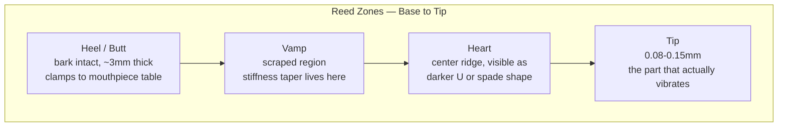
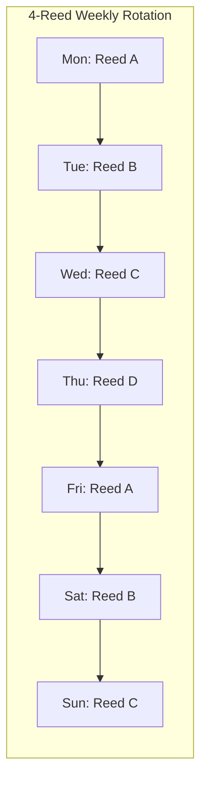
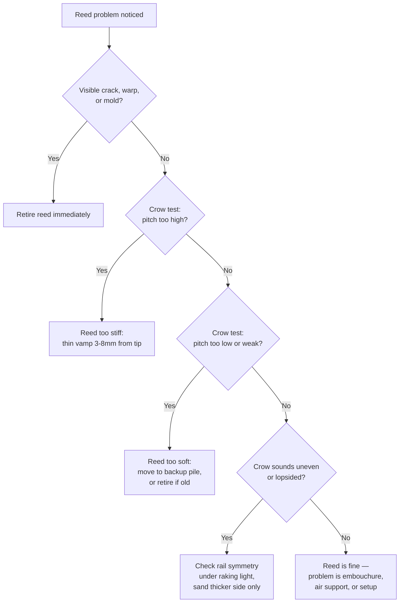

# Lesson 2: Reed Care, Adjustment, and Embouchure Integration

## 1. Why the Reed Is Your Real Instrument

Everything upstream of the reed — your air, your embouchure, your tongue — only matters because of what it does to that thin strip of cane. A clarinet or saxophone body is acoustically dumb without a reed that opens and closes correctly. Get the reed right and a mediocre horn plays well; get it wrong and a $10,000 horn plays like junk. This lesson treats the reed as a piece of gear you tune, not a consumable you complain about.

**The one-paragraph physics you need, no more:** A reed is a cantilever — clamped at the mouthpiece table, free at the tip. You blow air across the gap between reed and mouthpiece facing; fast-moving air drops in pressure (Bernoulli), which sucks the tip closed; once closed, airflow stops, pressure rebuilds behind the reed, and the cane's own springiness snaps it back open. Repeat a few hundred times a second and you have a tone. Thin cane flexes easily and opens/closes fast (bright, free-blowing, can be unstable). Thick cane resists flexing (dark, resistant, can be stuffy). Moisture content shifts cane between these states by softening the internal fiber matrix. That's 90% of what you need to diagnose and fix a reed — everything else in this lesson is applying that idea with a knife, sandpaper, and your ears.

## 2. Reed Anatomy You Can Actually Point To

Hold a reed up to the light, flat side toward you, tip up.

- **Heel** — never touch this. It's your anchor to the mouthpiece table. If it's uneven or warped, the reed leaks air at the sides no matter what you do to the tip.
- **Vamp** — the whole scraped taper. This is where 90% of adjustment work happens.
- **Heart** — the slightly raised, often visually darker spine in the middle of the vamp. It stiffens the reed longitudinally so it doesn't buckle; too much heart = stuffy and resistant, too little = unfocused and buzzy.
- **Rails** — the two long edges of the vamp running up either side of the heart to the tip. These must be symmetrical or the reed vibrates crookedly and squeaks.
- **Tip** — the last 3-4mm. Thinnest, most fragile, does the actual fast oscillating. Most cracks start here.

You don't need calipers to feel this. Hold the reed up to a window: light passing through unevenly (bright patches, dark patches) shows you thickness variation before you ever pick up a tool.

## 3. Breaking In a New Reed (Box of 10 Workflow)

Buy reeds in boxes of 10, never one at a time — strength numbers vary reed to reed even within a box, and you need volume to build a working rotation.

**Sorting a fresh box (do this before any playing):**
1. Hold each reed to light. Reject any with visible dark streaks, uneven grain, or pith showing through near the tip.
2. Wet each reed 60 seconds, then do a **crow test** (below) on the bare mouthpiece. Sort into three piles: too soft, about right, too stiff.
3. Label piles. "Too soft" reeds are for loud rehearsal/outdoor playing or sanding practice. "Too stiff" reeds are candidates for clipping (Section 7) or long-term break-in. "About right" become your primary rotation.

**Break-in schedule for the "about right" pile — do not skip this, it's the difference between a reed that lasts 60 hours and one that cracks in a week:**

| Day | Soak | Play Time | Dynamic / Register | Articulation |
|---|---|---|---|---|
| 1 | 2 min, room-temp water | 5 min | pp-mp, middle register only (written G3-C5 clarinet / low Bb-high F sax) | Long tones only, no tongue |
| 2 | 2 min | 7 min | mp-mf, add low register | Soft legato tonguing |
| 3 | 2 min | 10 min | mf, add upper clarion/altissimo approach | Normal articulation |
| 4-5 | 2 min | 15 min | Full dynamic range | Full articulation, scales |
| 6-7 | 2 min | 20+ min | Full range, test altissimo | Staccato, accents — stress test |
| 8+ | Normal | Normal | Enter full rotation | — |

**Why gradual:** cane is viscoelastic — it creeps (permanently deforms a little) under sustained stress, then partially recovers at rest. Hammering a brand-new reed at forte in the altissimo immediately overloads fibers before they've equilibrated to moisture, causing permanent fiber misalignment — the reed goes dead in a week instead of lasting two months. Patience here is the single highest-leverage habit in this entire lesson.

## 4. The Crow Test — Your 10-Second Diagnostic

This is the fastest, cheapest diagnostic tool you have, and most players never learn to use it properly.

**Procedure:**
1. Remove the mouthpiece/reed from the instrument body.
2. Take the mouthpiece fully into your mouth past the reed tip (further than normal playing) with a firm, even seal.
3. Blow a steady, moderate airstream — don't force it.
4. Listen to the raw, buzzy sound (the "crow").

**What you're listening for, by instrument:**

| Instrument | Healthy Crow Sound | Too Soft | Too Stiff |
|---|---|---|---|
| Bb Clarinet | Double "crow": a buzzy low note plus a clear high overtone a 12th-ish above, roughly concert C#-D | Flat, single low pitch, no overtone | High, thin squeal, hard to sustain, or no pitch at all |
| Alto Sax | Broad, airy "AH-EEE" with a clear overtone split | Weak, closes/chokes easily, low buzz only | Sharp, resists closing, mostly hiss |
| Oboe | Sharp double-reed crow, bright "ha-ha" bark on two close pitches | Collapses, muffled, closes under light pressure | Won't crow at all, just air noise |
| Bassoon | Low, dark "croak," two pitches roughly an octave-ish apart | Weak single tone, airy | Won't speak, pure hiss |

Test the crow **before and after every adjustment**. If an adjustment doesn't visibly change the crow, you didn't remove enough material to matter — or you adjusted the wrong zone.

## 5. Daily Maintenance Routine (Follow Every Session, No Exceptions)

**Before playing:**
1. Soak reed in a small cup of room-temp water, or in your mouth, 60-120 seconds. Don't over-soak — waterlogged cane (visibly swollen, spongy to a fingernail press) plays dull and unresponsive until it re-equilibrates, which can take 10+ minutes.
2. Press gently with a fingertip along the vamp — it should feel resilient, springy, not mushy.

**Immediately after playing:**
1. Wipe the flat side once, gently, with a lint-free cloth or your thumb, base to tip, in the direction of the fibers. Don't scrub side to side — that works against grain and roughs up the surface.
2. **Pull the reed off the mouthpiece.** Never leave a wet reed clamped on the mouthpiece in your case. It warps as it dries unevenly under the ligature, and it's the single most common cause of "my reed used to be great and now it's garbage."
3. Store flat-side down in a reed case with a flat glass or plastic surface — never in the reed's original paper sleeve long-term, which lets it dry unevenly and curl.

**Weekly (5 minutes, do it on the same day each week so it becomes automatic):**
1. Rinse each reed under plain running water — this clears dried saliva residue (sugars and proteins) that otherwise feeds bacteria and leaves a gummy film that damps vibration.
2. Lay each reed flat-side down on a flat glass or phone-screen surface. If any corner rocks or lifts, that reed is warping — flag it.
3. Check tips under a strong lamp for hairline cracks. A crack that's just reached the vamp is still salvageable by clipping (Section 7); a crack into the heart means retire it.

**Monthly:**
1. Soak reeds 30 seconds in a 70% isopropyl alcohol solution, then rinse thoroughly in water. This knocks back bacterial buildup without over-drying the cane the way bleach or hydrogen peroxide will (both attack lignin and leave the reed brittle — avoid them).
2. Re-run the crow test on your whole rotation and compare to notes from last month — this is how you catch slow degradation before it shows up as "I can't figure out why I sound bad today."

## 6. Reed Rotation — The Professional System

Never play on one reed every day. Cane needs recovery time between sessions (viscoelastic recovery — the fibers relax back toward their rest shape), and a single reed used daily degrades 3-4x faster than one rotated through a group.

**Minimum working rotation: 4 reeds, rotated daily**

Label reeds with a pencil dot code on the heel (not the vamp) so you can track which one is which across weeks. Keep a simple log: date first played, approximate cumulative hours, and a 1-10 playability rating after each session. A reed that's consistently rated 7+ for 15-20 sessions and then drops to 4-5 without any visible damage has reached end-of-life — retire it rather than trying to rescue it with more adjustment.

## 7. Adjustment Workshop — Diagnosing and Fixing Specific Problems

**Tools you need, nothing exotic:**
- A reed knife (sharp — a dull reed knife tears fibers instead of shaving them, which is worse than not adjusting at all) or a single-edge razor blade as a budget substitute
- 400-600 grit wet/dry sandpaper or a Dutch rush reed plant stem
- A flat glass tile for checking warp
- Strong, raking light (a desk lamp held at a low angle shows thickness variation as shadow far better than overhead light)

**Golden rules before touching any reed:**
- Always work with the reed **wet**. Dry cane chips and cracks under a blade; wet cane shaves cleanly.
- Remove material in passes you can barely see — think "polishing," not "carving." You can always take off more; you can never put cane back.
- Re-test (crow test + actual playing) after every single pass. Never make two changes before testing.
- Always sand/scrape **with the grain**, base toward tip, never side to side across the fibers.

**The diagnostic table — match your actual playing symptom to the fix:**

| Symptom | What's Actually Happening | Fix |
|---|---|---|
| Hard to get a sound, feels like blowing into a wall | Reed too stiff overall, usually tip/vamp too thick | Thin the vamp 3-8mm back from tip with sandpaper, long strokes with the grain. Re-crow after every 2-3 strokes. |
| Reed closes up / "chokes" at loud dynamics | Tip too thin/soft relative to the rest of the reed, or heart too weak to support the vibration | Don't remove more material — this reed may just be too soft for you; move to backup pile. If heart feels flat under a fingernail, this reed is past saving. |
| Bright, thin, harsh tone, no core | Insufficient heart/damping, tip region overly flexible relative to vamp | Lightly scrape 4-7mm back from the tip (just past the thinnest part) to thicken the transition zone slightly — counterintuitive but it restores support without killing response. |
| Dull, stuffy, muffled tone | Heart too prominent or vamp too thick in the 5-10mm zone | Thin the shoulders of the vamp just outside the heart ridge, leaving the heart itself alone. |
| Squeaks, especially in the upper register | Rails are asymmetric — one side thinner than the other, so the reed vibrates off-axis | Hold reed up to light: compare brightness left vs right rail. Lightly sand the thicker rail only, a few strokes, re-check under light after each pass. |
| Sluggish articulation, tongue feels like it's fighting the reed | Overall stiffness, or tip edge slightly too thick | Fine-sand the very tip edge (last 1-2mm) with 600 grit, 3-4 light strokes, re-test tonguing immediately. |
| Reed plays sharp compared to your other reeds | Reed is stiffer/shorter functionally — common right out of the box | Soft reeds run flatter, stiff reeds run sharp; this is normal reed-to-reed variance, not necessarily a defect — compensate with voicing/embouchure first before cutting material. |
| Reed plays flat, hard to bring pitch up | Reed too soft/open, or badly worn in from overuse | If new: likely just a soft reed, move to "loud rehearsal" pile. If old: approaching end of life, retire. |

**Clipping a reed (fastest fix for "too soft"):**
A reed that's too soft everywhere but otherwise healthy can be stiffened instantly by shortening it. Using a reed clipper (a dedicated, cheap tool — don't freehand this with scissors) or fine sandpaper on a flat block, remove 0.3-0.5mm from the very tip, square across, perpendicular to the centerline. This shortens the vibrating length, which raises stiffness and pitch center. Crow-test before and after — you'll hear the crow pitch rise immediately. Never clip more than 0.5mm at a time; over-clipping makes the reed stiff and unresponsive with no way to reverse it.

## 8. Troubleshooting Flowchart

If the reed passes every check above and the problem persists, stop blaming the reed. Check: mouthpiece table flatness (a warped table leaks air at the sides regardless of reed quality), ligature tension (too tight chokes the reed's free edges, too loose lets it buzz against the mouthpiece rails), and your own embouchure pressure and voicing — reed problems and embouchure problems produce nearly identical symptoms, and chasing the wrong one wastes reeds.

## 9. Storage and Environment

- **Humidity:** keep reed cases in 45-60% relative humidity. A cheap two-way humidity pack (the kind cigar and guitar players use) dropped into your reed case solves this for a few dollars. Below 40% RH, cane dries brittle and cracks easily; above 70%, mold risk climbs fast, especially in cases with poor airflow.
- **Never** store reeds in a sealed plastic bag or airtight container long-term — they need slow, even air exchange to dry without warping.
- **Temperature:** avoid leaving reed cases in a hot car or direct sun. Heat accelerates both drying and bacterial growth.
- Flat storage (reed case with a flat retaining surface) beats round tube cases for preventing warp — the flat surface keeps the reed's bottom from cupping as it dries.

## 10. End-of-Life Signs — When to Stop Fighting a Reed

**Retire immediately:**
- Any crack reaching from the tip into the vamp
- Visible dark mold spots (not to be confused with natural cane coloring/streaking, which is cosmetic)
- Warping severe enough that the reed rocks visibly on a flat glass surface
- Torn or frayed fibers at the tip edge that catch on your fingernail

**Retire soon, even without visible damage:**
- Requires noticeably more air pressure than it used to for the same dynamic
- Pitch has become harder to center, drifts under dynamic changes
- You've made 4-5 adjustment passes with no improvement — further cutting will only make it worse
- It's logged 25-40+ hours of playing time with a declining rating trend in your log

A reed is a consumable with a controllable lifespan, not a permanent tool. Fighting a dead reed with more scraping wastes your practice time; swapping it costs you fifty cents.

## 11. Practice Lab: 30-Minute Reed Rotation Audit

**Goal:** build the habit of systematic reed assessment so diagnosis becomes automatic instead of guesswork.

**Setup:** your current reed rotation (4-6 reeds), reed knife or sandpaper, flat glass tile, strong desk lamp, a notebook or spreadsheet.

**Steps:**
1. **(5 min) Visual pass** — hold each reed to the lamp. Note any uneven brightness (thickness variation), discoloration, or visible cracks. Lay each on glass, check for rocking.
2. **(5 min) Crow test pass** — soak each reed 60 seconds, crow test each on the bare mouthpiece. Write down: pitch (too high / good / too low), and clarity (clean double-crow vs. weak/airy).
3. **(10 min) Playing test pass** — on the full instrument, play a two-octave scale pp and then ff on each reed. Rate each 1-10 on response, pitch stability, and tone. Note the single biggest issue per reed.
4. **(10 min) One adjustment** — pick the reed with the clearest, most fixable issue (not the worst reed — the one whose problem matches a row in the Section 7 table cleanly). Make exactly one adjustment pass. Re-crow. Re-play the same scale. Log the before/after rating.

**Success check:** by the end of this lab you should have a written rating for every reed in your rotation and one completed, tested adjustment with a measured before/after change. Do this audit weekly for a month and you'll start predicting which reeds are about to go bad before they actually fail mid-rehearsal.
