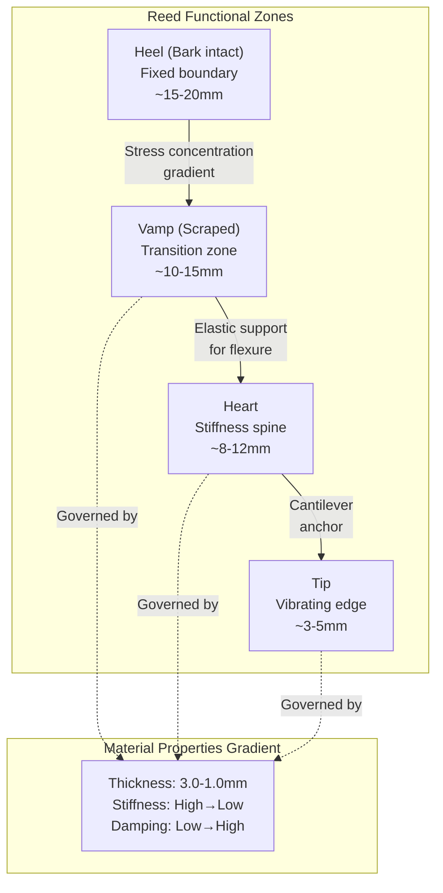
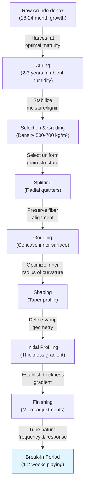
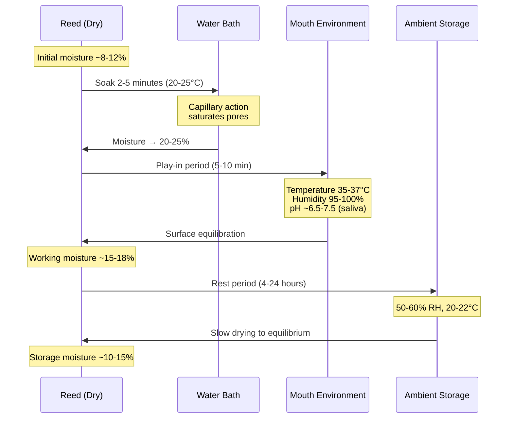

# Lesson 2: Reed Care and Maintenance

## 1. First-Principles Intuition & Invariants

The reed functions as a pressure-controlled flow modulator in woodwind acoustics, converting steady airflow into periodic oscillations that excite the instrument's air column. Understanding reed behavior requires examining the coupled fluid-structure interaction between the player's breath and the reed's mechanical response, a system governed by the Bernoulli effect, elastic beam theory, and nonlinear dynamical systems.

### The Physics of Reed Oscillation

A reed vibrates as a cantilevered beam with one end fixed to the mouthpiece and the free end oscillating in response to airflow. The oscillation mechanism follows a self-sustaining feedback loop: when the player blows, air velocity increases at the constriction between reed and mouthpiece, creating a pressure drop (Bernoulli principle) that pulls the reed toward the mouthpiece. As the reed closes, airflow decreases, pressure recovers, and elastic restoring forces snap the reed back open. This cycle repeats at the reed's natural frequency, which is determined by:

$$f_0 = \frac{1}{2\pi} \sqrt{\frac{k}{m_{eff}}}$$

where $k$ is the effective stiffness (determined by Young's modulus, geometry, and boundary conditions) and $m_{eff}$ is the effective mass of the vibrating portion. For a uniform cantilever beam:

$$f_0 \approx \frac{1.875^2}{2\pi L^2} \sqrt{\frac{EI}{\rho A}}$$

where $L$ is the vibrating length, $E$ is Young's modulus (~10 GPa for Arundo donax), $I$ is the second moment of area (proportional to thickness cubed for rectangular cross-sections), $\rho$ is density (~500-700 kg/m³ for cane), and $A$ is cross-sectional area.

This reveals several critical invariants:

1. **Frequency scales inversely with length squared**: Doubling the vibrating length reduces natural frequency by a factor of four
2. **Stiffness dominates through cubic thickness dependence**: A 10% thickness reduction decreases stiffness by approximately 27%
3. **Material anisotropy matters**: Cane exhibits different elastic properties along the fiber direction versus perpendicular to it

### Material Science of Cane

Arundo donax cane is a natural composite with hierarchical structure. At the macroscopic level, vascular bundles (consisting of xylem and phloem vessels surrounded by sclerenchyma fiber sheaths) are embedded in a parenchyma matrix. The fiber bundles provide tensile strength and stiffness along the cane's longitudinal axis, while the lignin-rich matrix provides shear resistance and transverse stiffness.

The mechanical properties exhibit both elastic and viscoelastic behavior. Under short-duration stress, cane behaves elastically with Young's modulus around 10-15 GPa (comparable to some engineering plastics). Under sustained load or cyclic stress, viscoelastic creep occurs: the reed gradually softens and loses responsiveness. This time-dependent behavior is governed by the Kelvin-Voigt model:

$$\sigma(t) = E\epsilon(t) + \eta\frac{d\epsilon}{dt}$$

where $\eta$ is the viscosity coefficient. The relaxation time $\tau = \eta/E$ for cane is on the order of minutes to hours, explaining why reeds "play in" during a session and why they require rest periods between uses.

Moisture content profoundly affects these properties. Dry cane ($<$8% moisture) becomes brittle with increased stiffness but reduced damping, producing a bright but harsh tone. Over-saturated cane ($>$25% moisture) softens excessively, losing definition and producing a dull, unresponsive sound. The optimal moisture range (12-18%) balances stiffness, damping, and dimensional stability. Water molecules plasticize the hemicellulose matrix, reducing intermolecular bonding and allowing greater molecular mobility—this reduces elastic modulus while increasing damping coefficient.

### Vibrational Modes and Timbre

A reed's sound quality depends not only on its fundamental frequency but also on its spectrum of higher-order vibrational modes. An ideal reed supports integer multiples of the fundamental (harmonic series), but real reeds exhibit inharmonicity due to stiffness and nonlinear geometric effects. The mode shapes follow Euler-Bernoulli beam theory, with the $n$-th mode having frequency:

$$f_n = \lambda_n^2 f_1$$

where $\lambda_1 = 1.875$, $\lambda_2 = 4.694$, $\lambda_3 = 7.855$, etc. This inharmonicity ($f_2/f_1 \approx 6.27$ instead of 2) contributes to the characteristic woodwind timbre.

The reed's damping characteristics—governed by internal friction in the cane material and air viscosity—shape the attack transient and decay envelope. High damping smooths the attack but reduces sustain and brightness. Low damping produces aggressive attacks but can cause instabilities (squeaks, multiphonics). The quality factor $Q = f_0/(2\Delta f)$, where $\Delta f$ is the half-power bandwidth, typically ranges from 10-50 for woodwind reeds, indicating moderate damping that balances responsiveness and stability.

## 2. Core Architecture & Mechanics

### Reed Geometry and Functional Zones

A reed's geometry can be decomposed into distinct functional zones, each contributing to vibrational behavior:

The **heel** serves as the mechanical anchor, transferring vibrational energy to the mouthpiece. It retains the bark (epidermis and sclerenchyma layer), providing maximum stiffness and wear resistance. The **vamp** is the scraped region where thickness is progressively reduced from heel to tip. The taper in this region controls the stiffness gradient and determines the fundamental frequency. The **heart** is a subtle ridge running down the centerline, providing a longitudinal stiffness spine that stabilizes vibration and prevents the reed from collapsing inward. The **tip** is the thinnest region (0.1-0.4mm), designed for maximum flexibility to facilitate rapid oscillation.

### The Reed Preparation Workflow

Reed preparation is a multi-stage process that transforms raw cane into a precision acoustic component:

**Curing** allows biochemical stabilization: residual growth hormones and volatile compounds evaporate, lignin cross-linking increases, and moisture content equilibrates with ambient humidity. This reduces dimensional instability and improves long-term durability.

**Gouging** creates a concave inner surface, reducing mass while preserving stiffness. The curvature radius (typically 10-15mm) affects the reed's natural camber and resistance profile. Too flat, and the reed chokes easily; too curved, and it becomes stuffy and unresponsive.

**Profiling** establishes the critical thickness gradient. Professional reed makers use precision gauges and dial indicators to measure thickness at specific landmarks (1mm, 3mm, 6mm, 9mm from tip). Typical thickness profiles for clarinet reeds:
- Tip: 0.10-0.15mm
- 3mm from tip: 0.30-0.40mm
- 6mm from tip: 0.60-0.80mm
- 9mm from tip: 1.20-1.60mm

These measurements are adjusted iteratively while testing the reed's response, using specialized reed knives, files, and sanding implements. The process resembles precision machining: material removal is irreversible, so conservative increments (0.01-0.02mm) are essential.

### Conditioning and Moisture Management

A reed's moisture state directly affects its mechanical impedance. The conditioning protocol establishes optimal moisture distribution:

During soaking, water penetrates the cane via capillary action through the vascular structure. The outer surface absorbs water faster than the interior, creating a temporary moisture gradient. Playing accelerates moisture redistribution through mechanical agitation and heat transfer from the mouth. Saliva introduces enzymes (amylase, lipase) and minerals that can gradually degrade polysaccharides, though this is a slow process (weeks to months).

The rest period is critical for viscoelastic recovery. Continuous playing induces creep deformation that accumulates if the reed is not allowed to recover. Rotating between multiple reeds (typically 3-5 in professional practice) distributes mechanical fatigue and extends service life.

## 3. High-Performance Optimization & Failure Modes

### Performance Optimization Strategies

Achieving optimal reed performance requires systematic optimization across multiple dimensions:

**Material Selection**: Premium cane exhibits fine, evenly spaced vascular bundles with minimal pith content and uniform coloration (golden-amber with no dark streaks). Density measurements using precision scales and calipers can predict performance: density $\rho = m/V$ should fall within 550-650 kg/m³ for clarinet reeds. Outside this range, reeds tend to be either too flexible (low density) or too stiff (high density).

**Symmetry Verification**: Asymmetry causes uneven vibration and pitch instability. Professional reed makers verify symmetry using precision measurement techniques:
- **Rail balance**: Measure thickness at corresponding points on left and right rails (±0.02mm tolerance)
- **Tip alignment**: Verify the tip edge is perpendicular to the centerline (±0.5° tolerance)
- **Heart centering**: The central spine should be equidistant from both rails (±0.3mm tolerance)

**Break-in Protocol**: New reeds benefit from gradual conditioning to align fiber structure and establish stable moisture equilibrium:

1. **Initial wetting**: Soak for 2 minutes, play gently for 5 minutes (pianissimo dynamic, middle register only)
2. **Rest**: 24-hour drying period
3. **Second session**: Soak for 2 minutes, play for 10 minutes (expanding to mezzo-forte, full register)
4. **Stabilization**: Repeat cycle 3-4 times over one week

This protocol prevents premature fatigue and allows the reed's viscoelastic properties to stabilize.

**Micro-adjustment Techniques**: Fine-tuning involves targeted material removal based on specific acoustic symptoms:

| Symptom | Root Cause | Correction |
|---------|-----------|------------|
| Stuffy response, flat pitch | Excessive tip thickness | Thin tip region (0.01-0.02mm), focusing on tip edges |
| Bright, harsh tone | Insufficient damping | Increase vamp thickness slightly, or reduce heart prominence |
| Weak low register | Tip too thin relative to heart | Strengthen heart region, ensuring gradual transition |
| Squeaks in altissimo | Asymmetric rails | Balance rail thickness, verify tip alignment |
| Slow attack | Excessive overall stiffness | Reduce vamp thickness, particularly in transition zone |
| Poor resistance | Tip too flexible | Increase tip thickness or reduce tip length |

Adjustments should be made in 0.01mm increments, testing after each modification. Reed gauges (dial indicators with specialized feet) enable precise thickness measurements.

### Failure Modes and Degradation Mechanisms

Reeds fail through multiple mechanisms, each with distinct signatures and timescales:

**Mechanical Fatigue**: Cyclic stress induces microcrack propagation in the fiber bundles, particularly at the tip where stress concentration is highest. Fatigue life follows a power-law relationship:

$$N_f = C \cdot \Delta\sigma^{-m}$$

where $N_f$ is cycles to failure, $\Delta\sigma$ is stress amplitude, and $m \approx 4-6$ for cane. A reed played at concert pitch (440 Hz) accumulates ~10⁶ cycles per hour. Professional reeds typically survive 20-40 playing hours (2-4 × 10⁷ cycles) before catastrophic failure (tip splitting).

**Viscoelastic Degradation**: Repeated stress cycles cause irreversible structural rearrangement at the molecular level. Hydrogen bonds between cellulose chains rupture and reform in lower-energy configurations, reducing elastic modulus and increasing damping. This manifests as gradual softening: the reed becomes less responsive, requires more embouchure pressure, and loses brightness. Unlike mechanical fatigue, viscoelastic degradation is partially reversible with extended rest (days to weeks), though complete recovery is never achieved.

**Biochemical Degradation**: Enzymatic hydrolysis by salivary amylase breaks glycosidic bonds in hemicellulose, reducing molecular weight and mechanical strength. Bacterial colonization (particularly Streptococcus species) accelerates this process. The rate depends on pH, temperature, and moisture:

$$\frac{dM}{dt} = -k_0 e^{-E_a/RT} \cdot [Enzyme] \cdot M$$

where $M$ is molecular weight, $k_0$ is a rate constant, $E_a$ is activation energy (~50 kJ/mol for amylase), $R$ is the gas constant, and $T$ is absolute temperature. Maintaining pH below 7.0 (using mildly acidic storage solutions) and storing reeds dry significantly reduces degradation rate.

**Moisture-Induced Warping**: Differential moisture absorption causes dimensional changes that accumulate into permanent warping. The outer surface, exposed to ambient conditions, tends to dry faster than the interior. This creates internal stress gradients that can cause the reed to curl or twist. Warped reeds seal poorly against the mouthpiece, causing air leaks and uneven response.

### Failure Prevention and Life Extension

Implementing systematic maintenance protocols extends reed life and maintains consistent performance:

**Immediate Post-Session Care**: Remove surface moisture by gently wiping with a lint-free cloth. Avoid rubbing, which can abrade the delicate tip. Store in a reed case with adequate ventilation (not hermetically sealed) to allow controlled drying. Never leave a wet reed on the mouthpiece, as this promotes warping and bacterial growth.

**Sanitization Protocol**: Weekly rinsing with pH-neutral water removes saliva residue (proteins, sugars) that feed bacterial growth. Monthly alcohol treatment (70% ethanol or isopropanol, 30-second soak, followed by thorough rinsing) kills bacteria without excessively drying the cane. Avoid chlorine-based disinfectants, which degrade lignin.

**Rotation Strategy**: Professional players maintain a rotation of 4-6 reeds at different maturity stages:
- 2 "primary" reeds in peak condition (20-40 hours playing time)
- 2 "break-in" reeds (0-20 hours, still stabilizing)
- 2 "backup" reeds (40+ hours, approaching end-of-life but still usable)

This ensures consistent performance availability while distributing mechanical stress.

**Environmental Control**: Store reeds at 50-60% relative humidity and 18-22°C. Humidity above 70% promotes mold growth; below 40% causes excessive drying and brittleness. Specialized reed cases with humidification systems (using two-way humidity control packs) maintain stable conditions even in challenging environments.

### Quantitative Performance Metrics

Objective assessment enables data-driven optimization. Key metrics include:

**Crow Test Frequency**: With the reed-mouthpiece combination isolated from the instrument, the "crow" pitch indicates reed stiffness. For B♭ clarinet: C#-D (550-587 Hz) indicates optimal stiffness. Lower pitches suggest the reed is too soft; higher pitches indicate excessive stiffness.

**Resistance Measurement**: Using a manometer or differential pressure sensor, measure the pressure required to open the reed at threshold oscillation. Optimal resistance for clarinet: 3-5 kPa differential pressure at onset. This can be measured by connecting a pressure gauge to the mouthpiece chamber and blowing gently until oscillation begins.

**Frequency Response Analysis**: Using a microphone and spectrum analyzer, measure the reed-mouthpiece response to white noise excitation. The spectral envelope reveals resonant peaks and damping characteristics. A well-balanced reed exhibits a smooth spectral envelope with clearly defined peaks at the fundamental and first few harmonics, without excessive inharmonicity or spurious resonances.

**Microscopy-Based Quality Assessment**: Examining the tip region under 10-40× magnification reveals fiber structure, crack initiation, and surface finish quality. High-quality reeds exhibit:
- Uniform fiber orientation parallel to the longitudinal axis
- Clean, smooth tip edge (no torn fibers or ragged edges)
- No visible microcracks or fiber separation
- Consistent vascular bundle spacing

These quantitative assessments enable objective comparison between reeds and tracking of degradation over time, supporting systematic optimization and replacement decisions.
