# Lesson 3: Finger Technique and Articulation for Woodwinds

## 1. The Core Invariant: Why Your Fingers Control Pitch

Every woodwind — reed-driven (clarinet, saxophone, oboe, bassoon) or edge-tone driven (flute) — works the same way at the fingering level: **opening a tone hole closer to the mouthpiece shortens the vibrating air column and raises the pitch.** The open hole becomes the new end of the standing wave. Everything else in this lesson is about executing that single fact with speed, precision, and musicality.

One paragraph of physics, no more: cylindrical bores open at both ends (flute, and the clarinet's upper "clarion" register once the register key opens a vent) ring with all harmonics, $f_n = nv/2L$. The clarinet's chalumeau register is a cylinder closed at the reed end, so only odd harmonics sound — $f_n = (2n-1)v/4L$ — which is *why* the clarinet jumps a 12th instead of an octave when you open the register key, while flute and sax jump an octave. Conical bores (oboe, sax, bassoon) behave acoustically like open cylinders despite the closed reed end, because the taper compensates. That's it — you don't need more formula than this to play in tune. What you need is finger control fast enough to keep up: at 120 BPM in sixteenths, each note lasts 125 ms, and the air column needs 20–50 ms to restabilize after any fingering change. That leaves you well under 100 ms to move fingers cleanly and lock the new pitch in before the next tongue stroke. This lesson is about shrinking that window through practice, not about memorizing acoustics.

### The Biomechanical Reality You're Working With

Your fingers have no muscles in them. Extrinsic forearm muscles (flexor/extensor digitorum) pull on tendons that run down to the fingertips; intrinsic hand muscles (lumbricals, interossei) fine-tune individual digit control. Because tendons share connective tissue, fingers are never fully independent — this is why your ring finger "wants" to move when your pinky does, and why isolating weak fingers (Drill 1, Drill 4) is a real training problem, not a lack of willpower.

The practical payoff of practice is **motor chunking**: a fingering sequence you've drilled hundreds of times (a scale, an arpeggio, a trill) stops being eight separate finger decisions and becomes one pre-loaded motor program retrieved as a single unit. This is the single biggest lever in this lesson — almost every drill below exists to build chunks.

### The Articulation Feedback Loop

Clean articulation means breath, tongue, and fingers arrive in sync. The practical threshold: **finger movement must complete within 2–5 ms of the tongue release** — beyond that window your ear detects it as a flaw. Three failure modes map directly to timing errors:

| Symptom | What's actually happening |
|---|---|
| **Scooping** (pitch slides up/down at onset) | Fingers are still moving when the tongue releases air — the air column is excited mid-transition |
| **Cracking** (squeak/instability at onset) | A tone hole isn't fully sealed when the reed/air starts vibrating — a leak destabilizes the mode |
| **Ghosting** (brief flash of the wrong pitch) | Tongue released *before* fingers reached target — you briefly sound the old fingering |

```mermaid
graph TB
    subgraph sub_intent ["Musical Intent"]
        A["Phrase & Rhythm Target"]
    end
    subgraph sub_execution ["Execution: Breath / Tongue / Fingers"]
        B["Breath Pressure"]
        C["Tongue Release"]
        D["Finger Position"]
    end
    subgraph sub_acoustic ["Air Column"]
        E["Tone Hole Configuration"]
        F["Standing Wave / Pitch"]
    end
    subgraph sub_feedback ["Feedback (20-50 ms)"]
        G["Ear: Pitch & Tone"]
        H["Fingertips: Position & Pressure"]
    end

    A --> B
    A --> C
    A --> D
    D --> E
    B --> F
    C --> F
    E --> F
    F --> G
    F --> H
    G --> A
    H --> A

    style A fill:#1E2636
    style B fill:#0F131C
    style C fill:#0F131C
    style D fill:#0F131C
    style E fill:#161D2B
    style F fill:#1E2636
    style G fill:#0F131C
    style H fill:#0F131C
```

The fix in every case is the same ordering rule, and you'll drill it directly in Section 3: **fingers move first, tone holes settle into position, then the tongue releases.** Never the reverse.

---

## 2. Hand Position, Posture, and Grip — Get This Right Before Anything Else

Bad posture caps your technical ceiling and causes injury. Fix this before you touch a metronome.

**Curved fingers, fingertip pads on the keys.** Flat fingers or hyperextended tip joints reduce your proprioceptive precision (you lose the sense of exactly how hard and how far you're pressing) and increase tendon strain. Picture holding a small ball in each hand's natural curve — that's your resting shape.

**Straight wrists.** Forearm, wrist, and hand form one continuous line. A flexed or cocked wrist compresses the carpal tunnel and is the single most common cause of overuse injury in woodwind players. Check this in a mirror or on video from the side, not from memory — players consistently underestimate how flexed their wrists are.

**Minimal grip force.** The instrument should rest in your hand/on your supports, not be clamped. Specific weight-bearing points:

- **Flute**: left thumb and the base of the left index finger form a tripod with the chin/lip plate — the instrument isn't "held," it's balanced in that triangle.
- **Clarinet**: right thumb under the thumb rest carries the weight; left thumb operates the register key and should stay light on it.
- **Saxophone**: neck strap carries the weight; right thumb hooks the thumb rest for stability only, not support. If your thumb is sore after 10 minutes, your strap length is wrong.
- **Oboe**: right thumb counter-pressure against reed resistance; left thumb runs two octave keys.
- **Bassoon**: seat strap or neck strap plus the right-thumb crutch carries weight — never support the horn's weight through your left-hand fingers, or you'll fight your own hand to play.

**Finger height discipline.** Non-playing fingers hover 3–5 mm above their keys — close enough to strike instantly, far enough to avoid brushing a key by accident. When you do lift a finger, lift only 5–10 mm, just enough to fully vent the tone hole. Every millimeter above that is wasted travel time you will feel the moment you try to play fast.

**30-second hover check** (do this before every practice session): rest your hands in playing position, lift every finger 3–5 mm, and hold — no sound, no movement — for 30 seconds. If any finger drifts higher or droops onto the key, that finger has poor proprioceptive control and needs isolated attention in Drill 1.

---

## 3. Fingering Charts You Can Use Today

These are the reference fingerings for a one-octave major scale on each instrument, written so you can play directly from this page. "Closed" means the finger/key is down; unlisted fingers are open.

### Flute (Boehm system) — C major, first octave
| Note | Left hand | Right hand | Thumb |
|---|---|---|---|
| C | 1,2,3 closed | 1,2,3,4 closed | closed |
| D | 1,2,3 closed | 1,2,3 closed | closed |
| E | 1,2 closed | 1,2,3 closed | closed |
| F | 1 closed | 1,2,3 closed | closed |
| G | open | 1,2,3 closed | closed |
| A | open | 1,2 closed | closed |
| B | open | 2 closed (1 via side key) | closed |
| C (8ve) | open | 1 closed | **rolled back** — opens octave vent |

Register control lives entirely in the left thumb. Rolling it back to crack open the octave vent is what jumps you to the second register — it's a rotation, not a lift, and should take under 30 ms once practiced.

### Clarinet (Boehm system) — G major, chalumeau register
| Note | Left hand | Right hand | Thumb/Register |
|---|---|---|---|
| G | 1,2,3 closed | 1,2,3,4 closed | thumb closed |
| A | 1,2,3 closed | 1,2,3 closed | thumb closed |
| B | 1,2 closed | 1,2,3 closed | thumb closed |
| C | 1,2 closed | 1,2 closed | thumb closed |
| D | 1 closed | 1,2 closed | thumb closed |
| E | 1 closed | 1 closed | thumb closed |
| F♯ | 1,2,3 closed | open | thumb closed |
| G (clarion, 12th above) | all open | all open | **register key open** |

The register key doesn't add a note — it cracks a speaker hole that kills the fundamental and favors the 3rd harmonic, which is why you jump a 12th (not an octave) and why the chalumeau-to-clarion break (Drill 5) needs dedicated practice: you're not adding one finger, you're switching which harmonic the whole tube favors.

### Alto Saxophone (Boehm-derived system) — C major, first octave
| Note | Left hand | Right hand | Octave key |
|---|---|---|---|
| C | 1,2,3 closed | 1,2,3,4 closed | open |
| D | 1,2,3 closed | 1,2,3 closed | open |
| E | 1,2 closed | 1,2,3 closed | open |
| F | 1,2 closed | 1,2 closed | open |
| G | 1 closed | 1,2 closed | open |
| A | 1 closed | 1 closed | open |
| B | 1,2 closed | open | open |
| C (8ve) | 1 closed | open | **left thumb octave key closed** |

Saxophone fingerings stay nearly identical across both octaves — only the thumb octave key changes. This consistency is a gift for motor chunking: once you know the first-octave pattern, the second octave costs you almost nothing extra to learn.

### Oboe (Conservatoire system) — C major, first octave
| Note | Left hand | Right hand | Thumb |
|---|---|---|---|
| C | 1,2,3 closed | 1,2,3,4 closed | closed |
| D | 1,2,3 closed | 1,2,3 closed | closed |
| E | 1,2 closed | 1,2,3 closed | closed |
| F | 1,2 closed (index **half-holed**) | 1,2 closed | closed |
| G | 1 closed | 1,2 closed | closed |
| A | 1 closed | 1 closed | closed |
| B | 1 closed | open | side key (left pinky) |
| C (8ve) | open | 1 closed | 1st octave key |

The half-hole on F is non-negotiable technique: roll the left index finger to expose a sliver of the tone hole rather than lifting it fully. This takes weeks to get consistent — practice it in isolation, slowly rolling the pad off the hole while watching in a mirror, before trying it in tempo.

### Bassoon (Heckel system) — C major, tenor register
| Note | Left hand | Right hand | Thumb |
|---|---|---|---|
| C | 1,2,3,4 closed | 1,2,3,4 closed | whisper key closed |
| D | 1,2,3 closed | 1,2,3,4 closed | whisper key closed |
| E | 1,2 closed | 1,2,3,4 closed | whisper key closed |
| F | 1,2 closed | 1,2,3 closed | whisper key closed |
| G | 1 closed | 1,2,3 closed | whisper key closed |
| A | 1 closed | 1,2 closed | whisper key closed |
| B♭ | 1 closed | 1 closed | whisper key closed |
| C (8ve) | open | 1 closed | **flick key added, whisper opens** |

The right thumb rests on the crutch for weight support and is otherwise uninvolved in this scale — don't let it tense up sympathetically when the left thumb is busy with whisper/flick keys; that's a common source of right-hand fatigue.

---

## 4. Practice Drills with Metronome Targets

Each drill below states its goal, the exact procedure, what to listen for, and a concrete mastery target. Run these in order — each builds on the previous one.

### Drill 1 — Chromatic Scale for Finger Independence

**Goal**: expose which specific finger transitions are weak, and build raw finger speed.

**Procedure**:
1. Start on your instrument's lowest comfortable note. Play one chromatic octave ascending, quarter notes, ♩ = 60.
2. Descend back down at the same tempo.
3. Progress tempo: 60 → 80 → 100 BPM (quarter notes), then 120 BPM in **eighth notes** (240 notes/minute).
4. Once one octave is clean, extend to two octaves and then full range, paying special attention to register breaks (clarinet chalumeau/clarion, flute 8ve).

**Listen for**: key noise (should be inaudible under the tone at a normal dynamic), uneven spacing between notes, and any note that's consistently a hair late — that's your weak chunk.

**Fix for a specific weak transition**: isolate just those two notes as a slow trill (see Drill 1a below) rather than re-running the whole scale.

**Drill 1a — Isolated Transition Trainer**: once you find a bad transition (e.g., clarinet F♯ to G chalumeau), loop *just that pair* as eighth notes at ♩ = 50, 10 reps, then move to 60, 70, 80 BPM. This is far more efficient than hoping the full scale fixes itself.

**Mastery target**: full-range chromatic scale at ♩ = 120 BPM in eighths, zero audible key noise, zero pitch instability on any note.

### Drill 2 — Diatonic Patterns for Motor Chunking and Finger Economy

**Goal**: automate standard scale/arpeggio shapes into single motor units, and train minimal finger lift.

**Procedure**:
1. **Straight scale**, one octave, ♩ = 60 quarter notes. Non-playing fingers hover 3–5 mm; playing fingers lift only 5–10 mm.
2. **Scale in thirds** (C-E, D-F, E-G...), eighth notes, ♩ = 60. This forces some fingers to move while neighboring fingers stay still — real independence training.
3. **Scale in fourths** (C-F, D-G...), eighth notes, ♩ = 80.
4. **Triad and seventh-chord arpeggios**, quarter notes, ♩ = 60 — articulate each chord tone cleanly with no intermediate "ghost" pitch from a partial fingering change.
5. Progress all patterns: 60 → 80 → 100 → 120 BPM, switching to sixteenth notes at 120.

**Video check**: film your hand from the side at 80 BPM. Confirm wrists stay straight and fingers keep their curve — a flattening finger or a wrist that starts to flex under tempo pressure means you're compensating with the wrong joint.

**Mastery target**: all 12 major and all 3 forms of minor scales, plus their arpeggios, at ♩ = 120 BPM sixteenths, with no wasted finger motion visible on video.

### Drill 3 — Tongue-Finger Articulation Sync

**Goal**: eliminate scooping, cracking, and ghosting by enforcing the correct event order: **fingers settle, then tongue releases.**

**Procedure**:
1. Play a one-octave major scale staccato ("ta-ta-ta-ta"), quarter notes, ♩ = 60.
2. Drop to ♩ = 40 and deliberately slow down your mental model of each note: move the fingers into position *first*, let them fully settle, *then* tongue the articulation. Exaggerate the gap at this tempo — you're building the habit, not the final feel.
3. Record every pass. Listen specifically for the three failure modes (table above). If you hear scooping, your fingers are lagging the tongue — slow down further and re-drill. If you hear ghosting, your tongue is jumping ahead — consciously delay the tongue stroke by a hair.
4. Accelerate in steps: 40 → 60 → 80 → 100 → 120 BPM, re-checking recordings at each step before moving on.
5. Alternate legato and staccato every four notes across the same scale — this forces you to re-sync timing on the fly rather than settling into one groove.

**Mastery target**: staccato scales and arpeggios at ♩ = 120 (eighths or sixteenths depending on instrument facility) with zero audible scoop, crack, or ghost on playback.

### Drill 4 — Polyrhythmic Independence (Advanced)

**Goal**: break residual tendon coupling between fingers for independence needed in contemporary repertoire (Berio, Ferneyhough, Lachenmann) and fast bebop lines that cross hand groupings awkwardly.

**Procedure**:
1. **2:3 polyrhythm**: left hand executes a triplet feel (3 evenly spaced key actions per beat) while the right hand executes straight eighths (2 per beat) on a separate key/trill pair. ♩ = 60 to start.
2. **3:4 polyrhythm**: left hand in quarter-note triplets against right hand in straight sixteenths. ♩ = 60.
3. **Isolated trill against a static hand**: trill one finger continuously while the rest of the hand holds a fixed chord shape — common in multiphonic and extended-technique repertoire.

**Expect this to feel impossible at first.** That's normal — you're building new neural pathways, not applying existing ones. Progress here is measured in weeks.

**Video check**: confirm the motion stays in the fingers — if your whole hand or wrist starts rocking to "help," that's compensation masking a lack of true finger independence.

**Mastery target**: clean 2:3 polyrhythm at ♩ = 80 sustained for 8 bars without drift.

### Drill 5 — Register Break Smoothness

**Goal**: make the register transition inaudible — no pitch jump, no volume spike, no tone-color seam.

**Clarinet (chalumeau B → clarion F♯, a 12th apart)**:
1. Play chalumeau B (thumb + left 1) at ♩ = 60, then slur to clarion F♯ (same fingers + register key) and back. 10 reps without stopping.
2. Listen for: volume matching between registers (clarion should not blare louder), and no pitch "kick" exactly at the crossing.
3. Accelerate 60 → 80 → 100 BPM.

**Saxophone (1st-octave G ↔ octave G)**:
1. Alternate low G and octave G (adding only the left-thumb octave key) every two beats at ♩ = 60.
2. Progress to a full G major scale crossing the break, then accelerate 60 → 80 → 100 → 120 BPM.

**Flute (1st-octave G ↔ octave G)**:
1. Alternate the two G's, coordinating the thumb roll with *simultaneously* increasing air speed and slightly narrowing your lip aperture — the thumb alone will not produce a clean break; breath support must arrive at the same instant.
2. Accelerate 60 → 80 → 100 → 120 BPM across scalar passages crossing the break.

**Mastery target**: register-crossing scales at ♩ = 120 with the break perceptually invisible on a recording — a listener shouldn't be able to point to where it happened.

---

## 5. Troubleshooting Guide

| Problem | Likely cause | Fix |
|---|---|---|
| **Uneven rhythm in fast passages** | A specific finger combination isn't chunked yet — it's still running as discrete commands and causes a hesitation | Record at half-tempo, find the exact note that's late, isolate that 4-note group at ♩ = 40, rebuild in 10 BPM steps back to target tempo |
| **Loud key noise / clicking** | Fingers lifting too high, falling under gravity into a hard strike | Run the 30-second hover check; drill at ♩ = 40 with a "feather, not hammer" mental cue; if it persists after technique correction, have a tech check spring tension |
| **Scooping or cracking at note onset** | Finger movement finishing *after* the tongue releases (ghosting is the reverse: tongue too early) | Drill 3's two-note slur isolation at ♩ = 40, enforcing fingers-then-tongue order, before reintegrating into the passage |
| **Hand/forearm fatigue, tingling, or numbness** | Flexed wrist compressing the carpal tunnel, or excess grip force | **Stop immediately if numb or tingling.** Fix wrist alignment on video, reduce grip (let straps/rests carry weight), take a 5-minute break every 25 minutes, and see a hand therapist if symptoms persist beyond a week |
| **Asymmetric speed (fast ascending, sloppy descending, or vice versa)** | One direction has been drilled far more than the other — common since most method books emphasize ascending patterns | Deliberately over-practice the weaker direction at a slower tempo until it matches the stronger direction, then recombine |

---

## 6. Advanced Techniques

### Alternate Fingerings for Speed

Standard fingerings prioritize intonation; in fast passages you can trade a little intonation accuracy for a shorter finger path.

**Saxophone high D** — standard: left 1,2 + octave key + palm key D (a long reach). Fast-passage alternate: left 1 + octave key + side key D — eliminates the palm key reach, costs roughly 10–15 cents sharp. Use the standard fingering on sustained notes where intonation matters; use the alternate only inside fast runs where the duration masks the deviation.

**Clarinet A–B♭ trill** — rather than alternating the full standard fingerings, use the dedicated side trill key against the held B♭ fingering (thumb + left 1). This turns a multi-finger trill into a single-finger motion. Drill it as eighth notes at ♩ = 60, accelerating to 80, 100, 120 BPM, targeting 8–12 alternations per second at full tempo.

### Motor-Chunking a Fast Scalar Run

Don't learn a two-octave run note by note. Break it into 4-note chunks, drill each chunk to tempo in isolation, then drill *only the seams* between chunks, then assemble.

Example, two-octave C major on flute:
- Chunk 1: C D E F
- Chunk 2: G A B C
- Chunk 3: D E F G (second octave)
- Chunk 4: A B C

Drill each chunk alone at ♩ = 60, push each to your target tempo independently (often 144+ BPM), then specifically drill the handoff from the last note of one chunk to the first note of the next — that seam is where runs usually fall apart, not inside the chunks themselves.

### Multiphonics (Clarinet Example)

Multiphonic fingerings deliberately destabilize the normal mode structure so multiple partials sound together. Example: thumb + left 1,3 + right 1,3 (leaving the middle fingers of each hand open). Start on a stable standard-fingering pitch, then morph into the multiphonic fingering while holding breath pressure steady at moderate-to-forte (too soft collapses back to a single pitch). Explore embouchure tension in small increments — this is where you find which partials speak and how loud each one is. Dynamic swells (soft to loud and back) will reveal that different partials dominate at different amplitudes; map this by ear and write it into your part.

### Quarter-Tone Fingerings (Flute Example)

Standard D: thumb + left 1,2,3 + right 1,2,3. Quarter-tone sharp D: same, but open right 3 — this raises the pitch roughly 25–50 cents depending on your instrument. Verify the exact deviation with a tuner and write the cent value into your part; it varies by headjoint and will not be identical to a published fingering chart. Practice quarter-tone scales slowly (♩ = 60) comparing each alternate fingering against the tuner before attempting them in tempo.

---

## 7. Repertoire Application

### Mozart, Clarinet Concerto K. 622, Mvt. 1, bars 98–110

The scalar run here crosses the chalumeau/clarion break mid-phrase. Isolate the exact break crossing (throat B♭ to clarion C) and drill it 20 times in isolation at ♩ = 60, focusing on adding the register key and closing left 2,3 as one synchronized motion rather than two sequential ones. Build tempo to the performance target (roughly ♩ = 120–132), then layer in the written dynamic shape (piano in chalumeau, crescendo through the break, arriving forte in clarion). Check the break crossing against a tuner — it tends to go sharp on the clarion side; compensate with slightly relaxed embouchure and reduced breath pressure on the first clarion note.

### Debussy, "Syrinx" for solo flute, bars 1–8

This excerpt is about air attacks and register transitions inside a legato line, not finger speed. Practice the bar 3 octave leap (low C to high C) in isolation: the fingering barely changes, so the leap is carried almost entirely by the thumb roll, a narrower aperture, and faster air arriving *simultaneously*. Drill the three elements together at slow tempo before attempting the full phrase, and record to confirm there's no audible "pop" at the register change.

### Charlie Parker, "Donna Lee" (alto sax)

Break the opening bebop line into 4-note chunks exactly as described in Section 6. The palm-key-to-standard-fingering transition (high A♭ to G) is the most common stumbling point — drill that seam alone at ♩ = 80 before building the full phrase. Use the side-key alternate fingering for high F to shorten the finger path. Target tempo is ♩ = 200+ with sixteenth-note lines (800 notes/minute) — get there in 20 BPM jumps, never skip straight to tempo.

### Berio, "Sequenza VII" for oboe

Map every extended fingering (multiphonics, quarter-tone trills) in isolation before touching the full score — treat this as a separate vocabulary-building pass, not something to sight-read. For each multiphonic, find the fingering, then spend time just exploring embouchure tension to discover which partials speak and at what dynamic they collapse to a single pitch (this is expected and happens to everyone, not a sign you're doing it wrong).

---

## 8. Ensemble Context: Intonation, Breath, and Blend

**Just-intonation adjustments inside a chord**: when you're holding a chord tone against other winds, equal-temperament fingerings are a starting point, not the final answer. As a rule of thumb: major thirds sit about 14 cents flat of equal temperament in a just major chord, perfect fifths about 2 cents wide, minor thirds about 16 cents sharp. Practice scales against a sustained drone (tuner app or piano), listening for the "beating" (a wavering pulse) that signals you're off true tuning, and adjust embouchure/breath until the beating stops.

**Circular breathing** for phrases that exceed your natural breath length (most players run out around 15–20 seconds): puff your cheeks with air while keeping embouchure seal, use the tongue to push that reserve air through the instrument while you inhale through the nose, then immediately resume normal diaphragm-driven airflow. Practice without the instrument first — puff and push air out through pursed lips while inhaling through the nose — before adding the instrument. Build from a 10-second sustained note with one circular-breath transition up to 30 seconds, checking recordings for any dip in pitch or volume at the transition point.

**Blend in a woodwind section**: clarinet and flute project more than oboe and bassoon in the same dynamic marking, so in tutti passages the brighter instruments should back off slightly and the darker instruments should push slightly to balance — don't rely on the printed dynamic alone. Match vibrato rate and width with your section (typically 5–7 oscillations/second, ±20–40 cents width) rather than defaulting to your personal habit.

---

## 9. What to Do Next

Pick **one** drill from Section 4 and commit to 10 focused minutes a day for two weeks — not five drills at once. Record yourself every three days specifically listening for the failure mode that drill targets (key noise, rhythmic evenness, articulation artifacts, etc.), not just "does it sound good." Once that drill is clean at 80 BPM, either push its tempo or add a second drill — don't stack complexity before the first skill is solid.

Pair your drill work with one repertoire excerpt from Section 7 that matches your level, and apply the specific practice strategy given rather than just sight-reading through it repeatedly.

If you ever feel tingling or numbness in your hands, stop playing immediately — that is a nerve-compression warning, not normal fatigue — and see a hand therapist or sports medicine physician before resuming.
