# Lesson 3: Finger Technique and Articulation

## 1. First-Principles Intuition & Invariants

Woodwind instruments—the clarinet, saxophone, flute, oboe, and bassoon—function as acoustic resonators whose behavior is governed by the physics of standing waves in air columns. The performer's task is to manipulate the effective length and boundary conditions of this resonating column through precise mechanical actuation of tone holes and keys. Understanding finger technique at a foundational level requires examining both the acoustic physics that determines pitch and timbre, and the neuromuscular control systems that execute the necessary mechanical operations.

### Acoustic Fundamentals and the Length-Frequency Relationship

The pitch produced by a woodwind instrument is determined by the resonant frequencies of the air column, which depend on the effective acoustic length of the tube. For a cylindrical tube open at both ends (approximating the flute or the upper register of many woodwinds), the resonant frequencies follow:

$$f_n = \frac{nv}{2L}$$

where $n$ is the harmonic number (1, 2, 3, ...), $v$ is the speed of sound in air (approximately 343 m/s at 20°C), and $L$ is the effective acoustic length. For a cylindrical tube closed at one end (approximating the clarinet's chalumeau register), only odd harmonics are supported:

$$f_n = \frac{(2n-1)v}{4L}$$

The conical bore instruments (oboe, saxophone, bassoon) exhibit more complex behavior, with the conical geometry producing a harmonic series similar to an open cylinder despite having a closed reed end, due to the progressive expansion of the bore.

The critical invariant underlying all woodwind fingering systems is this: **opening a tone hole closer to the sound source effectively shortens the acoustic length of the instrument, raising the pitch**. When a tone hole is opened, it acts as a virtual open end for wavelengths larger than approximately twice the hole's diameter. The acoustic impedance mismatch at the open hole causes the majority of acoustic energy to radiate outward rather than propagate further down the tube. This creates a new effective termination point, shortening $L$ and thereby increasing $f$.

The performer's fingers must therefore execute a precise sequence of tone hole operations to produce the desired pitch sequence. The timing precision required is dictated by the musical tempo and the acoustic response time of the instrument. For rapid passages at 16th notes at 120 BPM, each note lasts approximately 125 milliseconds. The acoustic transient—the time required for the air column to stabilize into its new resonant mode after a fingering change—typically ranges from 20 to 50 milliseconds depending on the instrument and register. This leaves a temporal budget of 75-105 milliseconds for the actual finger movement and the establishment of steady-state tone, placing stringent demands on finger velocity and coordination.

### Biomechanical Constraints and Motor Control

The human hand is a complex biomechanical system comprising 27 bones (in the hand and wrist), over 30 muscles (intrinsic and extrinsic), and numerous tendons, ligaments, and sensory receptors. The fingers themselves contain no muscles; they are actuated remotely by extrinsic muscles in the forearm (flexor digitorum superficialis, flexor digitorum profundus, extensor digitorum) whose force is transmitted through long tendons, and by intrinsic muscles in the hand (lumbricals, interossei) that provide fine motor control.

Each finger operates as a kinematic chain with three primary joints in the fingers (metacarpophalangeal, proximal interphalangeal, distal interphalangeal) and two in the thumb. The degrees of freedom at each joint, combined with the mechanical coupling through shared tendons and the physical constraints of adjacent fingers, create a system that is neither fully independent nor fully coupled. This partial independence is both a limitation and an opportunity for skilled performers.

The neural control of finger movements involves a hierarchical system. At the highest level, the motor cortex and premotor areas encode the intended movement sequence. The cerebellum provides timing coordination and error correction based on sensory feedback. The basal ganglia contribute to the sequencing and automatization of learned motor patterns. The spinal cord contains central pattern generators and reflex arcs that can execute local coordination without continuous cortical input. This multi-layer architecture allows for both conscious, deliberate control during learning and rapid, automated execution during performance.

A fundamental principle of skilled finger technique is the concept of **motor chunking**: frequently performed movement sequences become encoded as unified motor programs that can be executed as single units rather than as sequences of individual finger commands. This chunking dramatically reduces cognitive load and enables the execution speeds required for virtuosic performance. For example, the fingering pattern for a D major scale becomes a single automated routine rather than eight individual finger decisions.

The proprioceptive system—comprising muscle spindles, Golgi tendon organs, and mechanoreceptors in the skin and joints—provides continuous feedback about finger position, movement velocity, and applied force. This proprioceptive information is integrated with visual and auditory feedback to form a multimodal sensory representation that guides motor control. In trained performers, the proprioceptive representation becomes so refined that finger positioning can be executed accurately with minimal visual monitoring, allowing visual attention to be directed toward the musical score or conductor.

### The Articulation Control Loop

Articulation—the attack, sustain, and release characteristics of individual notes—is controlled through the coordinated interaction of three primary systems: breath pressure, tongue position (for reed and edge-tone instruments), and finger timing. These systems must operate in precise temporal synchrony to produce clean, well-defined note onsets and releases.

The control architecture can be understood as a closed-loop feedback system:

```mermaid
graph TB
    A["Musical Intent<br/>(Executive Control)"] --> B["Motor Planning<br/>(Premotor Cortex)"]
    B --> C["Breath Control"]
    B --> D["Tongue Control"]
    B --> E["Finger Control"]
    C --> F["Air Column Excitation"]
    D --> F
    E --> G["Acoustic Length<br/>Modulation"]
    F --> H["Instrument Resonance"]
    G --> H
    H --> I["Acoustic Output"]
    I --> J["Auditory Feedback"]
    I --> K["Tactile/Proprioceptive<br/>Feedback"]
    J --> B
    K --> B
    
    style A fill:#1E2636
    style B fill:#161D2B
    style C fill:#0F131C
    style D fill:#0F131C
    style E fill:#0F131C
    style F fill:#161D2B
    style G fill:#161D2B
    style H fill:#1E2636
    style I fill:#161D2B
    style J fill:#0F131C
    style K fill:#0F131C
```

The feedback loops operate at multiple timescales. The auditory feedback loop operates with a latency of approximately 20-50 milliseconds (the time for sound to travel from the instrument to the ear, plus neural processing time). The proprioceptive feedback loop operates faster, with latencies as low as 30-50 milliseconds for spinal reflexes. These feedback mechanisms allow the performer to detect and correct errors in finger positioning, breath pressure, and timing, maintaining system stability even in the presence of perturbations.

The invariant requirement for articulation quality is that **the acoustic excitation (breath and tongue) and the acoustic resonator configuration (finger position) must be synchronized within the temporal resolution of human auditory perception**, which is approximately 2-5 milliseconds for detecting onset asynchrony between simultaneous events. Asynchrony beyond this threshold results in audible artifacts: scooping (pitch bend at note onset), cracking (unstable initial tone), or ghosting (brief articulation of an unintended pitch).

## 2. Core Architecture & Mechanics

### Hierarchical Control Structure

The execution of finger technique in woodwind performance involves a hierarchical control architecture with distinct processing layers, each operating at different temporal and spatial scales:

**Layer 1: Musical Phrase Planning (timescale: seconds to minutes)**

At the highest level, the performer maintains a mental representation of the complete musical structure, including melodic contour, harmonic progression, phrase boundaries, dynamic shaping, and expressive timing. This layer determines the global structure of the performance but does not directly control individual finger movements. Instead, it establishes constraints and targets that guide lower-level control systems.

**Layer 2: Gesture Sequencing (timescale: 500-2000 ms)**

This layer segments the musical phrase into motor gestures—multi-note patterns that are executed as coherent units. A typical gesture might correspond to a musical subphrase of 4-8 notes. The gesture sequencing layer retrieves learned motor programs from long-term memory and schedules their execution in the appropriate temporal order. This layer also manages the transitions between gestures, ensuring smooth continuity.

**Layer 3: Motor Program Execution (timescale: 100-500 ms)**

Individual motor programs specify the detailed finger movement sequences required to produce a specific note pattern. A motor program encodes the relative timing of each finger movement, the target position for each finger, and the required movement velocity. During execution, these programs unfold automatically with minimal conscious intervention, though they can be modulated by higher-level control signals (e.g., to adjust dynamics or timing).

**Layer 4: Biomechanical Control (timescale: 10-100 ms)**

At the lowest level, muscle activation patterns are generated to produce the desired finger movements. This layer converts the abstract motor commands from higher levels into specific patterns of muscle contraction. The biomechanical control layer incorporates feedback from proprioceptive sensors to compensate for external perturbations and to adjust muscle activation based on the mechanical state of the hand and instrument.

### Fingering System Design Principles

Modern woodwind fingering systems represent centuries of evolutionary refinement, balancing acoustic requirements, ergonomic constraints, and manufacturing feasibility. The design of a fingering system involves three primary considerations:

**Acoustic Optimization**

The ideal fingering system would provide a unique, acoustically optimal finger configuration for each pitch in the instrument's range. In practice, this ideal is constrained by the finite number of tone holes and keys that can be accommodated on the physical instrument and operated by the ten fingers (eight fingers plus two thumbs). Most woodwind instruments employ 6-8 primary tone holes, supplemented by additional keys for extended range and chromatic notes.

The placement of tone holes is governed by acoustic theory but must also accommodate mechanical and ergonomic constraints. For an ideal cylindrical bore instrument, tone holes should be positioned at specific fractions of the total length to produce the desired pitches. However, these ideal positions often fall outside the comfortable reach of human fingers, necessitating compromises. The Boehm system, developed in the 19th century and widely adopted for flute and clarinet, addresses this through a system of keys and linkages that allows fingers to operate tone holes positioned at acoustically optimal locations even when those locations are not directly accessible.

**Ergonomic Optimization**

The fingering system must accommodate the biomechanical constraints of the human hand. Finger spacing, key height, key angle, and key resistance must all fall within comfortable ranges to enable extended playing without fatigue or injury. The optimal key spacing places adjacent keys within the natural span of adjacent fingers (approximately 15-25 mm for adults), while the key height (the distance a key must be depressed) is typically 3-10 mm—sufficient to fully open or close the tone hole while minimizing unnecessary movement.

Key mechanisms also incorporate mechanical advantage to reduce the force required to open or close tone holes. Leverage ratios typically range from 2:1 to 4:1, so that a finger force of 1-2 Newtons at the key touchpiece produces 4-8 Newtons at the pad, sufficient to seal the tone hole against the air pressure inside the instrument (which can reach 1-2 kPa during forte playing).

**Consistency and Standardization**

For commonly performed note sequences (scales, arpeggios, standard intervallic patterns), fingering systems aim to create consistent, regular patterns that minimize the cognitive and motor complexity. For example, the Boehm system clarinet employs a regular, sequential pattern for
