# Lesson 3: Finger Technique and Articulation

## 1. First-Principles Intuition & Invariants

Woodwind instruments function as acoustic resonators driven by either reed vibration (clarinet, saxophone, oboe, bassoon) or edge-tone aeroacoustics (flute). Your fingers control pitch by opening and closing tone holes that define the effective vibrating air column length. Understanding finger technique means grasping both the acoustic physics that determines pitch and the neuromuscular control that executes the mechanical operations.

### The Core Acoustic Invariant

**Opening a tone hole closer to the mouthpiece shortens the resonating air column and raises the pitch.** When you lift a finger, that hole becomes the effective open end for the standing wave. Acoustic energy radiates out rather than continuing down the bore, creating a new termination point.

For cylindrical-bore instruments open at both ends (flute, upper register of most woodwinds), resonant frequencies follow $f_n = nv / 2L$, where $L$ is the effective acoustic length and $v \approx 343\text{ m/s}$. For cylindrical closed-end systems (clarinet's chalumeau register), only odd harmonics appear: $f_n = (2n-1)v / 4L$. Conical bores (oboe, saxophone, bassoon) approximate open-cylinder behavior despite the closed reed end due to progressive bore expansion.

The practical consequence: your finger movements must execute precise tone-hole sequences to produce the intended pitch sequence. At 16th notes at 120 BPM, each note lasts ~125 ms. The instrument's acoustic transient (the time for the air column to stabilize after a fingering change) takes 20–50 ms. You have 75–105 ms for finger movement and steady-state tone establishment—demanding high finger velocity and coordination.

### Biomechanical Reality

Your fingers contain no muscles. They are actuated by extrinsic forearm muscles (flexor and extensor digitorum) via long tendons, and by intrinsic hand muscles (lumbricals, interossei) that provide fine control. Each finger operates through three joints (MCP, PIP, DIP); the thumb has two. Partial tendon coupling means fingers are neither fully independent nor fully locked together.

Neural control is hierarchical:
- **Motor cortex and premotor areas**: encode movement intent
- **Cerebellum**: timing coordination and error correction
- **Basal ganglia**: sequence automation and motor chunking
- **Spinal cord**: local reflexes and pattern generators

**Motor chunking** is essential. Frequently performed fingering sequences (scales, arpeggios, standard patterns) become encoded as single motor programs rather than sequences of individual finger commands. A D major scale becomes one automated routine, not eight discrete decisions. This reduces cognitive load and enables virtuosic speeds.

Proprioceptive feedback (muscle spindles, Golgi tendon organs, joint mechanoreceptors) continuously informs finger position, velocity, and force. Trained performers develop refined proprioceptive maps, executing accurate fingerings with minimal visual monitoring.

### Articulation Control Architecture

Articulation quality depends on synchronized breath pressure, tongue positioning, and finger timing. These systems form a closed-loop feedback network:

```mermaid
graph TB
    subgraph sub_intent ["Musical Intent"]
        A[Executive Control]
    end
    subgraph sub_planning ["Motor Planning"]
        B[Premotor Cortex]
    end
    subgraph sub_execution ["Execution Systems"]
        C[Breath Control]
        D[Tongue Control]
        E[Finger Control]
    end
    subgraph sub_acoustics ["Acoustic Generation"]
        F[Air Column Excitation]
        G[Acoustic Length Modulation]
        H[Instrument Resonance]
    end
    subgraph sub_output ["Output & Feedback"]
        I[Acoustic Output]
        J[Auditory Feedback]
        K[Proprioceptive Feedback]
    end
    
    A --> B
    B --> C
    B --> D
    B --> E
    C --> F
    D --> F
    E --> G
    F --> H
    G --> H
    H --> I
    I --> J
    I --> K
    J --> B
    K --> B
    
    style A fill:#1E2636
    style B fill:#161D2B
    style C fill:#0F131C
    style D fill:#0F131C
    style E fill:#0F131C
    style F fill:#161D2B
    style G fill:#161D2B
    style H fill:#1E2636
    style I fill:#161D2B
    style J fill:#0F131C
    style K fill:#0F131C
```

Auditory feedback latency: 20–50 ms. Proprioceptive feedback: as low as 30–50 ms for spinal reflexes. The critical invariant: **acoustic excitation and resonator configuration must synchronize within 2–5 ms** (the threshold for human perception of onset asynchrony). Beyond this, you hear scooping (pitch bend at onset), cracking (unstable initial tone), or ghosting (brief unintended pitch).

## 2. Core Architecture & Mechanics

### Hierarchical Control Layers

Woodwind finger technique operates through four nested control layers:

**Layer 1: Phrase Planning (seconds to minutes)**
Maintain mental representation of melodic contour, harmonic structure, phrase boundaries, dynamic shaping, and expressive timing. This layer sets constraints and targets for lower-level systems without directly controlling individual fingers.

**Layer 2: Gesture Sequencing (500–2000 ms)**
Segment phrases into motor gestures—multi-note patterns executed as coherent units (typically 4–8 notes per gesture). Retrieve learned motor programs from long-term memory and schedule execution order. Manage transitions between gestures for smooth continuity.

**Layer 3: Motor Program Execution (100–500 ms)**
Individual motor programs specify detailed finger movement sequences for specific note patterns. Each program encodes relative timing, target positions, and required velocities. Programs unfold automatically with minimal conscious intervention but can be modulated by higher-level signals (dynamics, timing adjustments).

**Layer 4: Biomechanical Control (10–100 ms)**
Convert abstract motor commands into muscle activation patterns. Incorporate proprioceptive feedback to compensate for perturbations and adjust activation based on hand and instrument state.

### Fingering System Design Principles

Modern woodwind fingering systems balance acoustic requirements, ergonomic constraints, and manufacturing feasibility:

**Acoustic Optimization**
Ideal systems provide unique, acoustically optimal configurations for each pitch. Practical constraints: finite tone holes and keys (typically 6–8 primary holes plus supplementary keys), limited by what ten digits can operate. Tone hole placement follows acoustic theory but must accommodate ergonomics. The Boehm system (19th century, adopted for flute and clarinet) uses keys and linkages to allow fingers to operate acoustically optimal hole positions that fall outside direct reach.

**Ergonomic Optimization**
Key spacing matches natural finger span (15–25 mm for adults). Key height (3–10 mm) balances full hole closure with minimal movement. Key mechanisms provide mechanical advantage (2:1 to 4:1 leverage), so 1–2 N finger force produces 4–8 N pad force—sufficient to seal against 1–2 kPa internal air pressure during forte playing.

**Pattern Consistency**
For scales, arpeggios, and standard intervals, fingering systems create regular patterns that minimize cognitive and motor complexity. The Boehm clarinet employs sequential patterns for chromatic scales; the saxophone uses consistent octave-key fingerings across registers.

### Standard Fingering Charts by Instrument

**Flute (Boehm System)**

Left hand: thumb (back key), index/middle/ring fingers on first three keys
Right hand: index/middle/ring/pinky on next four keys

Basic scale (C major, middle octave):
- C: left thumb + all six finger keys closed
- D: left thumb + left 1,2,3 + right 1,2,3 closed (right pinky open)
- E: left thumb + left 1,2 + right 1,2,3 closed
- F: left thumb + left 1 + right 1,2,3 closed
- G: left thumb + right 1,2,3 closed
- A: left thumb + right 1,2 closed
- B: left thumb + right 2 closed (right 1 uses side key)
- C (octave): left thumb + right 1 closed (shift thumb to open vent for second octave)

Register control: Thumb key controls octave vent. Open the vent (roll thumb back) to jump to the second register.

**Clarinet (Boehm System)**

Left hand: thumb (register key), index/middle/ring fingers on first three keys
Right hand: index/middle/ring/pinky on next four keys

Basic scale (G major, chalumeau register):
- G: left thumb + left 1,2,3 + right 1,2,3,4 closed
- A: left thumb + left 1,2,3 + right 1,2,3 closed
- B: left thumb + left 1,2 + right 1,2,3 closed
- C: left thumb + left 1,2 + right 1,2 closed
- D: left thumb + left 1 + right 1,2 closed
- E: left thumb + left 1 + right 1 closed
- F♯: left thumb + left 1,2,3 closed
- G (octave): left thumb closed, all finger keys open

Register control: Left thumb operates register key (opens speaker hole) to jump from chalumeau to clarion register (12th interval jump due to closed-cylinder acoustics).

**Alto Saxophone (Boehm System)**

Left hand: thumb (octave key), index/middle/ring fingers + side keys
Right hand: index/middle/ring/pinky fingers + palm keys

Basic scale (C major, first octave):
- C: left thumb + left 1,2,3 + right 1,2,3,4 closed
- D: left thumb + left 1,2,3 + right 1,2,3 closed
- E: left thumb + left 1,2 + right 1,2,3 closed
- F: left thumb + left 1,2 + right 1,2 closed
- G: left thumb + left 1 + right 1,2 closed
- A: left thumb + left 1 + right 1 closed
- B: left thumb + left 1,2 closed (side B♭ key with left pinky)
- C (octave): left thumb + left 1 closed

Register control: Left thumb octave key adds 8ve. Consistent fingerings across registers simplify motor chunking.

**Oboe (Conservatoire System)**

Left hand: thumb (octave keys), index/middle/ring fingers
Right hand: index/middle/ring/pinky fingers + side keys

Basic scale (C major, first octave):
- C: left thumb + left 1,2,3 + right 1,2,3,4 closed
- D: left thumb + left 1,2,3 + right 1,2,3 closed
- E: left thumb + left 1,2 + right 1,2,3 closed
- F: left thumb + left 1,2 + right 1,2 closed (half-hole with left index)
- G: left thumb + left 1 + right 1,2 closed
- A: left thumb + left 1 + right 1 closed
- B: left thumb + left 1 closed (side key with left pinky)
- C (octave): left thumb + right 1 closed

Register control: Left thumb operates two octave keys (first and second). Half-hole technique on left index finger (partially lifting to expose vent hole) is essential for upper register intonation.

**Bassoon (Heckel System)**

Left hand: thumb (whisper key and others), index/middle/ring/pinky fingers
Right hand: thumb (crutch), index/middle/ring/pinky fingers

Basic scale (C major, tenor register):
- C: left thumb whisper key + left 1,2,3,4 + right 1,2,3,4 closed
- D: left thumb + left 1,2,3 + right 1,2,3,4 closed
- E: left thumb + left 1,2 + right 1,2,3,4 closed
- F: left thumb + left 1,2 + right 1,2,3 closed
- G: left thumb + left 1 + right 1,2,3 closed
- A: left thumb + left 1 + right 1,2 closed
- B♭: left thumb + left 1 + right 1 closed
- C (octave): left thumb + right 1 closed (add flick key with left thumb for register jump)

Register control: Multiple thumb keys on left hand (whisper key, flick keys) control register changes. Right thumb supports instrument weight on crutch rest.

### Hand Position and Posture Invariants

**Curved Finger Posture**
Maintain natural finger curvature with fingertips perpendicular to key touchpieces. Avoid flat fingers or hyper-extended joints. This posture maximizes proprioceptive precision and minimizes tendon strain.

**Wrist Alignment**
Keep wrists straight or slightly extended, never sharply flexed. Flexed wrists compress the carpal tunnel, increasing risk of median nerve entrapment. The forearm, wrist, and hand should form a continuous line.

**Thumb Placement**
- **Flute**: Left thumb supports instrument from below, right thumb absent (instrument held sideways).
- **Clarinet**: Right thumb supports instrument weight from below; left thumb operates register key while providing counter-pressure.
- **Saxophone**: Right thumb supports instrument via thumb rest; left thumb operates octave key.
- **Oboe**: Left thumb operates multiple octave keys; right thumb provides counter-pressure.
- **Bassoon**: Left thumb operates whisper and flick keys; right thumb rests on crutch (weight support).

**Finger Height Above Keys**
Keep non-playing fingers within 3–5 mm of key surface. Excessive height increases movement time and fatigue. Too low risks accidental key contact. Fingers should "hover" in ready position.

**Minimal Finger Lift**
Lift fingers only as high as necessary for complete tone hole opening (typically 5–10 mm). Excessive lift wastes time and energy. Train economy of motion.

## 3. Hands-On Execution & Practice Drills

### Drill 1: Chromatic Scale Finger Coordination

**Objective**: Build independent finger control and expose coordination weaknesses across all registers.

**Setup**: Stand or sit with proper embouchure and posture. Begin in the instrument's lowest comfortable register.

**Procedure**:

1. **Chromatic ascent (one octave)**:
   - Start at lowest note (e.g., flute low C, clarinet chalumeau E, saxophone low B♭).
   - Play each chromatic step with quarter-note duration at ♩ = 60 BPM.
   - Focus on even tone quality and minimal finger noise (no key clicking audible over the tone).

2. **Incremental tempo progression**:
   - ♩ = 60 BPM (quarter notes) → establish baseline
   - ♩ = 80 BPM (quarter notes) → increase speed
   - ♩ = 100 BPM (quarter notes) → near-performance tempo
   - ♩ = 120 BPM (eighth notes) → virtuosic finger velocity

3. **Descent**:
   - Reverse the chromatic sequence descending back to the starting note.
   - Maintain identical tempo and tone quality.

4. **Register extension**:
   - Once comfortable in one octave, extend to two octaves, then full instrument range.
   - Pay special attention to register break transitions (clarinet chalumeau to clarion, flute first to second octave).

**Common Errors**:
- Uneven rhythm (rushing or dragging on difficult fingerings)
- Finger asynchrony (fingers moving at slightly different times, causing pitch instability)
- Excessive finger noise (audible key slapping)
- Breath pressure inconsistency across register changes

**Diagnosis**: Record yourself. Listen for rhythmic evenness and tone consistency. Use a metronome with subdivision clicks (eighth notes or sixteenth notes) to diagnose rushing/dragging.

**Target Mastery**: Execute full-range chromatic scales at ♩ = 120 BPM (eighth notes = 240 notes per minute) with zero audible finger noise and zero pitch instability.

### Drill 2: Diatonic Scale Patterns with Finger Economy

**Objective**: Automate standard fingering patterns (motor chunking) and minimize unnecessary finger movement.

**Setup**: Choose a major or minor scale. Use a metronome.

**Procedure**:

1. **Basic scale (one octave, ascending and descending)**:
   - ♩ = 60 BPM, quarter notes
   - Focus on minimizing finger lift height (5–10 mm maximum)
   - Keep non-playing fingers hovering 3–5 mm above keys

2. **Scale in thirds**:
   - Play the scale in thirds (C–E, D–F, E–G, etc.)
   - ♩ = 60 BPM, eighth notes per pitch
   - Forces finger independence (some fingers must move while others remain stationary)

3. **Scale in fourths**:
   - C–F, D–G, E–A, etc.
   - ♩ = 80 BPM, eighth notes

4. **Arpeggios (triad and seventh chords)**:
   - Root, third, fifth, octave (and seventh for seventh chords)
   - ♩ = 60 BPM, quarter notes
   - Focus on cleanly articulating each chord tone without intermediate ghost notes

**Incremental tempo progression**:
- ♩ = 60 → 80 → 100 → 120 BPM
- At ♩ = 120 BPM, switch to sixteenth-note subdivisions for advanced speed work

**Common Errors**:
- Fingers lifting too high (wasted time and energy)
- Collapsing finger curvature (flat fingers reduce proprioceptive precision)
- Wrist flexion or extension compensation (indicates improper hand position)
- Audible key clicks between notes

**Diagnosis**: Video your hands from the side. Check finger height, wrist alignment, and finger curvature. Fingers should move in smooth, minimal arcs.

**Target Mastery**: All major and minor scales plus arpeggios at ♩ = 120 BPM (sixteenth notes) with zero extraneous motion and perfect rhythmic evenness.

### Drill 3: Articulation Synchronization (Tongue-Finger Coordination)

**Objective**: Synchronize tongue articulation and finger movement within the 2–5 ms perceptual threshold to eliminate scooping, cracking, and ghosting.

**Setup**: Select a simple scale or arpeggio. Use a metronome and recording device.

**Procedure**:

1. **Baseline coordination test**:
   - Play a major scale (one octave) with staccato articulation (short, detached notes).
   - ♩ = 60 BPM, quarter notes.
   - Tongue articulation pattern: "ta-ta-ta-ta" (tongue tip strikes the reed or roof of mouth for flute).
   - Simultaneously execute finger changes.

2. **Slow-motion analysis**:
   - Reduce tempo to ♩ = 40 BPM.
   - Deliberately focus on the precise moment your fingers move relative to tongue strike.
   - Goal: Finger movement completes **before** tongue articulation. The tone hole configuration should be stable when the tongue releases the airstream.

3. **Incremental acceleration**:
   - ♩ = 40 → 60 → 80 → 100 → 120 BPM
   - At each tempo, record and listen for any of the following artifacts:
     - **Scooping**: Audible pitch bend upward or downward at note onset (finger movement lagging tongue)
     - **Cracking**: Unstable tone or squeak at note onset (incomplete tone hole closure at articulation moment)
     - **Ghosting**: Brief articulation of wrong pitch (tongue articulating before fingers complete movement)

4. **Legato to staccato transitions**:
   - Play scale first legato (smooth, connected), then staccato, alternating every four notes.
   - This forces rapid recalibration of tongue-finger synchronization.

**Common Errors**:
- Tongue articulation before finger movement completes (most common cause of ghosting)
- Fingers moving too slowly (causes scooping)
- Breath pressure drop during finger changes (causes tone instability)

**Diagnosis**: High-quality recording is essential. Listen at half-speed playback if possible. Clean articulation has immediate, stable pitch onset with no audible transient artifacts.

**Target Mastery**: Execute staccato scales and arpeggios at ♩ = 120 BPM (eighth or sixteenth notes) with zero audible articulation artifacts (no scooping, cracking, or ghosting).

### Drill 4: Polyrhythmic Finger Independence (Advanced)

**Objective**: Break down residual finger coupling and develop true independence for complex contemporary repertoire.

**Setup**: Use a metronome with subdivisions. This drill applies to instruments with independent finger control (flute, clarinet, saxophone).

**Procedure**:

1. **Two-against-three polyrhythm**:
   - Left hand fingers execute triplet rhythm (three evenly spaced movements per beat).
   - Right hand fingers execute duple rhythm (two evenly spaced movements per beat).
   - ♩ = 60 BPM to start.
   - Example: Left hand opens/closes keys 1, 2, 3 in triplet; right hand opens/closes keys 1, 2 in eighth notes.

2. **Three-against-four polyrhythm**:
   - Left hand: quarter-note triplets (three per measure in 4/4).
   - Right hand: sixteenth notes (four per beat).
   - ♩ = 60 BPM.

3. **Independent finger trills**:
   - Trill one finger (e.g., left index alternating between open and closed) while other fingers hold static positions or execute a separate rhythm.
   - ♩ = 60 BPM, then accelerate.

**Common Errors**:
- Hands locking into synchrony (reverting to simpler, coupled motion)
- Loss of rhythmic precision under polyrhythmic stress
- Compensatory whole-arm or wrist motion (indicates insufficient finger independence)

**Diagnosis**: This drill will initially feel impossible. Accept initial failure. Progress is measured in weeks, not hours. Video your hands; verify that each finger moves independently without whole-hand motion.

**Target Mastery**: Execute at least one 2:3 polyrhythm cleanly at ♩ = 80 BPM. This drill builds neural pathways for truly independent finger control used in advanced contemporary repertoire (Berio, Ferneyhough, Lachenmann).

### Drill 5: Register Break Smoothness (Instrument-Specific)

**Objective**: Eliminate audible discontinuities at register transitions by synchronizing register key operation, breath pressure adjustment, and fingering changes.

**Clarinet (Chalumeau to Clarion Break)**:

1. Play throat-tone B (left thumb closed, left 1 closed) in chalumeau register at ♩ = 60 BPM.
2. Jump to clarion F♯ (same fingering + left thumb register key) with legato connection.
3. Return to chalumeau B.
4. Repeat this break crossing 10 times without stopping.
5. Listen for:
   - Pitch discontinuity (should be smooth 12th interval)
   - Volume imbalance (chalumeau and clarion should match volume)
   - Tone color shift (minimize timbral contrast)
6. Incremental acceleration: ♩ = 60 → 80 → 100 BPM.

**Saxophone (First to Second Octave)**:

1. Play second-line G (left thumb closed, all left-hand keys open, right 1,2,3 closed) at ♩ = 60 BPM.
2. Jump to octave G (add left thumb octave key) with legato connection.
3. Alternate between first and second octave G every two beats.
4. Listen for pitch stability and volume consistency.
5. Progress to scalar passages crossing the break (G major scale from low G to high G).
6. Incremental acceleration: ♩ = 60 → 80 → 100 → 120 BPM.

**Flute (First to Second Octave)**:

1. Play second-line G (left thumb closed, all finger keys open except right 1) at ♩ = 60 BPM.
2. Jump to octave G (roll left thumb back to open thumb key vent) with legato connection.
3. Coordinate thumb roll with increased breath speed and narrower lip aperture (second octave requires faster air and tighter embouchure).
4. Alternate every two beats.
5. Progress to scalar passages crossing the break.
6. Incremental acceleration: ♩ = 60 → 80 → 100 → 120 BPM.

**Common Errors**:
- Breath pressure misalignment (too much or too little for target register)
- Late or early register key activation
- Embouchure shift lag (flute and double reeds especially)

**Diagnosis**: Record register transitions. Listen for any pitch instability, volume jump, or tone color discontinuity.

**Target Mastery**: Execute register-crossing scales at ♩ = 120 BPM with zero audible discontinuity. The register break should be perceptually invisible.

## 4. Advanced Techniques & Troubleshooting

### Advanced Technique 1: Extended Fingerings and Microtonal Inflections

Standard fingerings optimize intonation for 12-tone equal temperament. Extended techniques require alternate fingerings that deliberately detune or destabilize the air column for expressive effects.

**Multiphonics (Multiple Pitches Simultaneously)**

Multiphonics exploit the instrument's ability to resonate at multiple frequencies simultaneously, producing chord-like sonorities. These fingerings destabilize the normal harmonic series, allowing multiple partials to sound with comparable amplitude.

**Example: Clarinet Multiphonic**
- Fingering: Left thumb + left 1,3 + right 1,3 (leave middle fingers open)
- Embouchure: Loosen slightly to allow multiple modes to oscillate
- Breath pressure: Moderate to forte (too soft collapses to single pitch)
- Result: Produces a dyad or triad depending on embouchure fine-tuning

Practice approach:
1. Start with standard fingering for a stable pitch
2. Gradually transition to multiphonic fingering while maintaining breath pressure
3. Adjust embouchure tension to maximize the number of audible partials
4. Experiment with dynamic swells (soft to loud and back) to explore which partials dominate at different amplitudes

**Quarter-Tone and Microtonal Fingerings**

Many contemporary scores require pitches between the standard 12 semitones. Alternate fingerings raise or lower pitch by 25–50 cents (quarter-tone to half-semitone).

**Example: Flute Quarter-Tone Sharp**
- Standard D fingering: Left thumb + left 1,2,3 + right 1,2,3 closed
- Quarter-tone sharp D: Left thumb + left 1,2,3 + right 1,2 closed (open right 3)
- Result: ~25–50 cent pitch raise

Practice approach:
1. Play standard pitch, then alternate fingering, comparing intonation with electronic tuner
2. Memorize the pitch deviation for each alternate fingering (some raise 25 cents, others 50 cents)
3. Practice scalar microtonal passages (quarter-tone chromatic scales) at ♩ = 60 BPM

**Pitch Bending**

Continuous pitch inflection via embouchure, breath pressure, or partial tone hole closure.

**Techniques**:
- **Lip pressure modulation**: Increase or decrease embouchure tension (±50–100 cents possible)
- **Breath pressure swells**: Increase pressure to sharpen, decrease to flatten
- **Partial tone hole closure**: Half-hole the first open tone hole to lower pitch

Practice approach:
1. Sustain a single pitch at ♩ = 60 BPM for four beats
2. On beat 3, begin gradual pitch bend upward (target +50 cents)
3. Return to original pitch by beat 4
4. Repeat descending (target −50 cents)
5. Use electronic tuner to verify bend magnitude

### Advanced Technique 2: Rapid Finger Passage Optimization (Scalar Runs and Arpeggios)

Virtuosic passages (16th or 32nd notes at fast tempos) require motor chunking and strategic alternate fingerings that minimize finger travel distance.

**Alternate Fingering Strategies**

Standard fingerings optimize intonation but not always speed. Alternate fingerings sacrifice slight intonation for improved finger economy.

**Example: Saxophone High D**
- Standard fingering: Left 1,2 + octave key + palm key D
- Fast passage alternate: Left 1 + octave key + side key D
- Advantage: Eliminates palm key reach (faster transition from adjacent notes)
- Disadvantage: Slightly sharp intonation (~10–15 cents)

Usage rules:
- Use standard fingerings for sustained notes (intonation critical)
- Use alternate fingerings for rapid passages (speed critical, slight intonation deviation masked by short duration)

**Trill Fingerings**

Trills require rapid alternation between two pitches. Dedicated trill keys minimize finger movement.

**Example: Clarinet A–B♭ Trill**
- Standard B♭ fingering: Left thumb + left 1
- Trill fingering: Left thumb + left 1 + side trill key
- Result: Trill key alternates between A and B♭ with single finger motion

Practice approach:
1. Establish even trill rhythm at ♩ = 60 BPM (eighth-note subdivisions: A B♭ A B♭)
2. Gradually accelerate: ♩ = 80, 100, 120 BPM
3. Target: 8–12 alternations per second at performance tempo
4. Focus on even, metronomic alternation (avoid rushing or dragging)

**Motor Chunking for Scalar Runs**

Break long scalar passages into 4–6 note chunks, each memorized as a single motor unit.

**Example: Two-octave C major scale (flute)**
- Chunk 1: C D E F (fingers 6→5→4→3 sequential release)
- Chunk 2: G A B C (fingers 2→1→side→octave)
- Chunk 3: D E F G (octave register, fingers 5→4→3→2)
- Chunk 4: A B C (fingers 1→side→none)

Practice approach:
1. Isolate each chunk, play at ♩ = 60 BPM
2. Gradually accelerate each chunk to target tempo (e.g., ♩ = 144 BPM)
3. Practice chunk transitions (last note of chunk 1 → first note of chunk 2) in isolation
4. Assemble full scale, maintaining target tempo throughout

### Troubleshooting Common Finger Technique Problems

**Problem 1: Uneven Rhythm in Fast Passages**

**Symptoms**: Some notes in scalar runs or arpeggios are shorter or longer than others, creating rhythmic "hiccups."

**Root Causes**:
- Certain finger combinations are not yet chunked (still executing as discrete commands)
- Difficult fingerings cause momentary hesitation
- Breath pressure drops during finger transitions

**Diagnostic Test**:
- Record passage at half-tempo (♩ = 60 BPM if target is 120 BPM)
- Listen for which specific notes are uneven
- Isolate the problematic finger transition

**Solution**:
1. Drill the problematic finger combination in isolation (4-note pattern including the transition) at ♩ = 40 BPM
2. Gradually accelerate in 10 BPM increments: 40 → 50 → 60 → 70 → 80 BPM
3. Once transition is smooth at 80 BPM in isolation, reintegrate into full passage
4. Repeat diagnostic recording; verify rhythmic evenness

**Problem 2: Excessive Finger Noise (Audible Key Clicks)**

**Symptoms**: Loud mechanical clicking or slapping sounds from keys hitting tone holes or key mechanisms during playing.

**Root Causes**:
- Fingers lifting too high above keys (gravity accelerates fingers downward, causing hard impact)
- Fingers moving with excessive force
- Key springs too stiff or too loose (mechanical issue)

**Diagnostic Test**:
- Video hands from side angle at slow tempo
- Measure finger height above keys (should be 3–5 mm when hovering, 5–10 mm when actively lifting)

**Solution**:
1. Practice hovering exercise: Hold all fingers 3–5 mm above keys without playing for 30 seconds (builds proprioceptive awareness)
2. Slow-tempo finger motion (♩ = 40 BPM): Consciously minimize lift height
3. Use "soft finger" mental cue: Imagine fingers are feathers, not hammers
4. If problem persists after technique correction, have instrument technician check key spring tension

**Problem 3: Pitch Instability at Note Onsets (Scooping or Cracking)**

**Symptoms**: Notes begin with audible pitch bend (scoop) or unstable squeak/crack before stabilizing.

**Root Causes**:
- Finger movement completes after tongue articulation (ghosting)
- Breath pressure not yet stable when note begins
- Embouchure shift lags behind finger/tongue

**Diagnostic Test**:
- Record articulated scale at ♩ = 60 BPM
- Listen for which specific notes exhibit instability
- Note whether instability occurs on ascending or descending passages (indicates finger speed asymmetry)

**Solution**:
1. Drill 2-note slurs (first note held, second note attacked with tongue and finger change) at ♩ = 40 BPM
2. Focus on sequencing: Fingers move first → tone holes fully open/closed → tongue articulates
3. Use metronome with subdivision (eighth or sixteenth notes) to precisely time the sequence
4. Gradually accelerate: 40 → 60 → 80 BPM
5. Once stable in isolation, reintegrate into full passage

**Problem 4: Fatigue and Tension in Hands or Forearms**

**Symptoms**: Aching, cramping, or loss of control after 15–30 minutes of practice. Possible tingling or numbness (warning sign for nerve compression).

**Root Causes**:
- Wrist flexion or extension (carpal tunnel compression)
- Excessive grip force on instrument
- Static finger postures (insufficient movement variation)
- Inadequate rest breaks

**Diagnostic Test**:
- Video practice session; check wrist alignment (should be straight)
- Check grip force: instrument should rest in hand with minimal active squeezing

**Solution**:
1. Immediate: Stop playing if tingling or numbness occurs (nerve compression warning)
2. Correct wrist alignment: Use mirror or video feedback; adjust hand position until wrist is straight
3. Reduce grip force: Instrument should balance in hand with minimal effort (use neck strap for saxophone, thumb rest for clarinet)
4. Implement rest breaks: 5-minute break every 25 minutes of practice (Pomodoro technique)
5. Stretching routine: Gentle wrist flexion/extension stretches, finger tendon glides, shoulder rolls between practice sessions
6. If symptoms persist beyond one week, consult a hand therapist or sports medicine physician (early intervention prevents chronic injury)

## 5. Real-World Application & Repertoire

### Repertoire Spotlight 1: Mozart Clarinet Concerto, K. 622, Mvt. 1 (Bars 98–110)

**Technical Challenges**:
- Rapid scalar passages crossing the clarinet break (chalumeau to clarion transition)
- Arpeggiated figures requiring smooth register key operation
- Dynamic contrast (piano to forte) while maintaining intonation

**Fingering Analysis**:

Bars 98–101: Ascending scalar run (E♭ major, two octaves):
- Begin chalumeau E♭: Left thumb + left 1,2,3 + right 1,2,3 closed
- Throat-tone B♭: Left thumb + left 1 closed (prepare register key)
- Cross break to clarion C: Add register key (left thumb), close left 2,3
- Continue ascent to high E♭

**Practice Strategy**:
1. Isolate bars 98–101 at ♩ = 60 BPM
2. Drill the break crossing (B♭ chalumeau → C clarion) in isolation 20 times, focusing on smooth register key addition synchronized with left-hand finger closure
3. Gradually accelerate: ♩ = 60 → 80 → 100 → 120 BPM (target tempo typically ♩ = 120–132 BPM)
4. Add dynamic shaping: Begin piano in chalumeau, crescendo through break, arrive forte in clarion
5. Verify intonation with tuner: Break crossing often goes sharp; compensate with slight embouchure relaxation and reduced breath pressure on clarion C

### Repertoire Spotlight 2: Debussy "Syrinx" for Solo Flute (Bars 1–8)

**Technical Challenges**:
- Legato phrasing with minimal tongue articulation (air attacks and slurs)
- Pitch bending and vibrato for expressive color
- Register transitions (first to second octave) within flowing melodic lines

**Fingering Analysis**:

Bar 1: Opening gesture (B♭ to D♭ to C):
- B♭: Left thumb + left 1 + right 1 closed
- D♭: Left thumb + left 1,3 + right 1 closed (slightly flat; lip up to raise pitch)
- C: Left thumb + all fingers open except right 1

Bar 3: Octave leap (C to C):
- Low C: Left thumb + all six finger keys closed
- High C: Roll left thumb back to open octave vent + close right 1 (minimal fingering, relies on embouchure and air speed)

**Practice Strategy**:
1. Isolate opening gesture (bars 1–2) at ♩ = 40 BPM
2. Practice air attacks (no tongue): Begin notes with breath pulse alone (diaphragm "ha" articulation)
3. Add pitch inflections: Slight downward bend on long B♭, return to pitch on D♭
4. Drill octave leap (bar 3) in isolation: Focus on simultaneous thumb roll, embouchure narrowing, and increased air speed
5. Listen for seamless register transition (no audible "pop" or discontinuity)
6. Integrate full phrase at ♩ = 60 BPM with continuous legato line

### Repertoire Spotlight 3: Charlie Parker "Donna Lee" (Bebop Alto Saxophone)

**Technical Challenges**:
- Sixteenth-note bebop lines at ♩ = 200+ BPM
- Chromatic approach notes and rapid arpeggio outlines
- Articulation: Mixture of legato, staccato, and accents at extreme speed

**Fingering Analysis**:

Bars 1–2: Opening bebop phrase (A♭ major arpeggio with chromatic approach):
- High A♭: Left 1,2 + palm key A♭ + octave key
- G: Left 1,2,3 + octave key
- F: Left 1,2,3 + right 1,2 + octave key
- E♭: Left 1,2,3 + right 1,2,3 + octave key
- Chromatic descent to C

**Practice Strategy**:
1. Break phrase into 4-note chunks
2. Chunk 1: A♭–G–F–E♭ at ♩ = 80 BPM (eighth notes)
3. Focus on palm key A♭ transition to standard fingering G (common stumbling point)
4. Use alternate fingering for high F (side key F instead of standard) to minimize finger travel
5. Gradually accelerate each chunk: 80 → 100 → 120 → 140 BPM
6. Practice chunk transitions in isolation
7. Assemble full phrase at target tempo (♩ = 200 BPM, sixteenth notes = 800 notes per minute)
8. Add articulation: Light staccato on downbeats, legato on chromatic approach notes

**Common Mistakes**:
- Rushing or dragging on chromatic approach notes (use metronome with sixteenth-note subdivisions)
- Palm key transitions causing rhythmic hiccups (drill in isolation)
- Excessive finger noise audible over jazz rhythm section (minimize lift height)

### Repertoire Spotlight 4: Luciano Berio "Sequenza VII" for Oboe (Contemporary Extended Techniques)

**Technical Challenges**:
- Multiphonics requiring non-standard fingerings
- Rapid dynamic swells (pppp to ffff within 1 second)
- Microtonal pitch bends and quarter-tone trills
- Extreme register contrasts (low B♭ to high A within single gesture)

**Extended Technique Fingerings**:

Multiphonic example (measure 12):
- Fingering: Left thumb + left 1,3 + right 2,4 (middle fingers open)
- Embouchure: Very loose, allow reed to vibrate freely
- Breath pressure: Forte (stabilizes multiple partials)
- Result: Dyad approximately G + B♭ (pitch varies by instrument and reed)

Quarter-tone trill example (measure 27):
- Standard C: Left thumb + left 1,2 + right 1,2
- Quarter-tone sharp C: Left thumb + left 1,2 + right 1 (half-hole right 2)
- Rapid alternation between standard and half-hole right index finger

**Practice Strategy**:
1. Map all required multiphonics and extended fingerings in isolation before attempting full score
2. For each multiphonic: Find the fingering, experiment with embouchure adjustments, identify which partials are audible
3. Practice dynamic swells on multiphonics (many collapse to single pitch at soft dynamics; this is expected)
4. Quarter-tone trills: Begin at ♩ = 40 BPM (quarter-note subdivisions), gradually accelerate to ♩ = 80 BPM (eighth-note subdivisions)
5. Extreme register leaps: Drill register key + breath pressure + embouchure coordination separately before integrating into musical context

### Integration with Ensemble Playing

**Intonation in Ensemble Context**

Woodwind intonation in ensemble settings requires real-time pitch adjustment based on harmonic context. Standard equal-temperament fingerings often require embouchure or breath pressure compensation.

**Just Intonation Adjustments**:
- Major thirds: Lower by ~14 cents from equal temperament (e.g., if playing E in C major chord, flatten slightly)
- Perfect fifths: Widen slightly (+2 cents) for acoustically pure fifths
- Minor thirds: Raise by ~16 cents

**Practice Strategy**:
1. Use drone (electronic or piano) to practice tuning intervals
2. Play major scale against tonic drone: Listen for beats (acoustic interference) on each scale degree
3. Adjust embouchure and breath to eliminate beats (pure tuning)
4. Practice common chord progressions (I–IV–V–I) with drone, adjusting intonation for each chord

**Breath Management in Long Phrases**

Orchestral and wind ensemble parts often require sustained phrases exceeding comfortable breath capacity (15–20 seconds for most players).

**Circular Breathing Technique**:
1. Puff cheeks full of air while maintaining embouchure seal
2. Use tongue to push air from cheeks through instrument while simultaneously inhaling through nose
3. Immediately resume diaphragmatic airflow from lungs
4. Result: Continuous tone without audible breath break

**Practice Strategy**:
1. Begin without instrument: Puff cheeks, practice pushing air out with tongue while inhaling through nose
2. Add instrument: Sustain single pitch for 10 seconds, execute circular breath transition
3. Listen for any audible discontinuity or pitch drop during transition
4. Gradually extend phrase duration: 10 → 20 → 30 seconds
5. Apply to repertoire: Mark breath points in score, practice circular breathing at each mark

**Blend and Balance in Sectional Playing**

Woodwind sections (flute, oboe, clarinet, bassoon in orchestral settings) must match tone color and dynamic balance.

**Timbre Matching**:
- Listen to principal player's tone quality (brightness, vibrato rate, articulation style)
- Adjust embouchure: Tighter embouchure brightens tone, looser darkens
- Match vibrato rate and width (typically 5–7 oscillations per second, ±20–40 cents width)

**Dynamic Balance**:
- Clarinet and flute project more than oboe and bassoon in mid-range
- Compensate: Clarinet/flute play slightly softer in tutti passages; oboe/bassoon push slightly in lyrical solo lines
- Use audio recording of rehearsals to verify balance from audience perspective

## 6. Summary & Next Steps

You now have the foundational understanding and hands-on drills to build advanced woodwind finger technique. The invariants are simple: open tone holes shorten the air column and raise pitch; your fingers must move with minimal height, maximal speed, and precise synchronization with tongue and breath.

Mastery requires consistent, focused practice:
- Chromatic scales to expose coordination weaknesses
- Diatonic patterns to automate motor chunks
- Articulation drills to synchronize tongue-finger timing
- Register transitions to eliminate audible breaks
- Repertoire application to integrate technique into musical context

**Immediate next steps**:
1. Select one drill from Section 3 and commit to 10 minutes daily for two weeks.
2. Record yourself every three days; listen for improvement in rhythmic evenness and tone stability.
3. Gradually add complexity: Once one drill is comfortable at ♩ = 80 BPM, advance to 100 BPM or add a second drill.
4. Choose one repertoire excerpt from Section 5 that matches your current level; apply the practice strategies provided.

**Long-term development**:
- Build a repertoire library spanning classical (Mozart, Debussy), jazz (Parker, Coltrane), and contemporary (Berio, Lachenmann) to diversify motor patterns.
- Work with a qualified teacher for feedback on hand posture, embouchure coordination, and intonation adjustments.
- Attend masterclasses and sectional coachings to refine ensemble blend and balance.
- Record performances and practice sessions regularly; objective audio/video analysis accelerates progress.

**Injury prevention**:
- Maintain straight wrists, curved fingers, and minimal grip force.
- Take 5-minute breaks every 25 minutes.
- If you experience tingling, numbness, or persistent pain, stop immediately and consult a medical professional.

You have the tools. Now execute.
