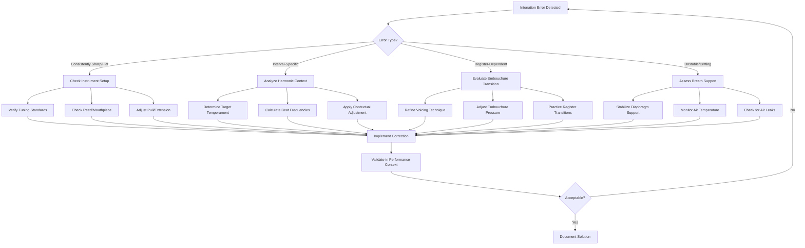

# Lesson 4: Intonation and Tuning

Achieving accurate intonation and tuning is paramount for woodwind instrumentalists, as it determines not only ensemble compatibility but also the physical and perceptual integrity of musical structures. This lesson examines the acoustic physics, mechanical systems, psychoacoustic factors, and systematic optimization strategies that govern intonation and tuning across woodwind instruments.

## First-Principles Acoustic Physics

Woodwind instruments generate sound through the coupling of an acoustic exciter (reed, air jet, or lip-driven oscillation) with a resonant air column. The pitch produced emerges from the interaction between the exciter's preferred oscillation frequency and the resonant modes of the air column.

### Standing Wave Resonance

The air column behaves as a resonator supporting standing waves. For a cylindrical tube open at one end (as in flutes and some organ pipes), the fundamental resonant frequency is:

$$
f_1 = \frac{v}{4L}
$$

where $v$ is the speed of sound in air (approximately 343 m/s at 20°C) and $L$ is the effective acoustic length of the tube. For a cylindrical tube open at both ends (approximated by some saxophone and clarinet configurations with tone holes open), the fundamental is:

$$
f_1 = \frac{v}{2L}
$$

For conical tubes (oboes, bassoons, saxophones), the acoustic behavior differs significantly. A complete cone behaves similarly to a cylinder open at both ends, supporting a full harmonic series. Real instruments approximate truncated cones with complex bore profiles, leading to frequency relationships:

$$
f_n = n \cdot f_1
$$

where $n$ represents the harmonic number. However, real woodwinds deviate from ideal geometry, introducing corrections.

### End Corrections and Bore Geometry

The effective acoustic length differs from the physical length due to end effects. For a simple open end, the end correction is approximately:

$$
\Delta L \approx 0.6r
$$

where $r$ is the radius of the opening. For tone holes, the correction becomes more complex and depends on hole diameter, chimney height, and bore diameter. The correction for a single open tone hole is approximated by:

$$
\Delta L \approx \frac{\pi r_h^3}{2S}
$$

where $r_h$ is the tone hole radius and $S$ is the bore cross-sectional area.

The bore profile critically affects intonation. Cylindrical bores (clarinets) emphasize odd harmonics in the closed-end configuration, producing a darker timbre and requiring the twelfth key to access the second register. Conical bores (oboes, saxophones) support a complete harmonic series and overblow at the octave.

### Temperature Dependence

The speed of sound in air varies with temperature according to:

$$
v = 331.3 \sqrt{1 + \frac{T}{273.15}}
$$

where $T$ is temperature in Celsius. This produces approximately a 0.6 Hz shift per degree Celsius for A440. A 10°C temperature drop lowers pitch by roughly 18 cents (where 100 cents = one semitone). This dependence necessitates continuous adjustment of embouchure and breath support as instruments warm during performance.

### Humidity Effects

Water vapor reduces air density, slightly increasing the speed of sound. The effect is smaller than temperature variation but becomes significant in extreme conditions. High humidity raises pitch by approximately 1-2 cents at typical performance temperatures, while condensation in tone holes can dramatically alter effective bore geometry and introduce unpredictable intonation shifts.

## Psychoacoustic Foundations of Intonation

Physical frequency accuracy represents only one dimension of intonation. Human pitch perception incorporates complex psychoacoustic phenomena that woodwind players must navigate.

### Just Intonation vs. Equal Temperament

Equal temperament divides the octave into twelve logarithmically equal semitones, where the frequency ratio between adjacent semitones is:

$$
r = 2^{1/12} \approx 1.05946
$$

Just intonation uses simple integer frequency ratios (3:2 for perfect fifth, 5:4 for major third) that produce acoustically pure intervals but create incompatibilities when modulating between keys. The major third in equal temperament (frequency ratio 1.2599) differs from the just major third (1.25) by approximately 14 cents, producing audible beating.

Skilled woodwind players adjust intonation contextually: sharpening leading tones, flattening thirds in major chords to approach just ratios, and tempering fifths slightly narrow in melodic contexts. This requires abandoning mechanical adherence to equal temperament in favor of adaptive intonation based on harmonic function and ensemble texture.

### Beat Frequencies and Ensemble Tuning

When two tones of slightly different frequencies $f_1$ and $f_2$ sound simultaneously, they produce amplitude modulation perceived as beats at frequency:

$$
f_{beat} = |f_1 - f_2|
$$

In ensemble contexts, zero beating indicates unison. For harmonic intervals, beating occurs between coinciding partials. A perfect fifth with frequencies $f$ and $1.5f$ produces beating between the third harmonic of the lower note ($3f$) and the second harmonic of the upper note ($3f$) when the interval deviates from the 3:2 ratio.

Experienced players use beat rates as real-time feedback for intonation adjustment. Slow beats (1-2 Hz) indicate near-accuracy; faster beating signals gross deviations requiring immediate correction.

### Critical Bandwidth and Roughness

The ear's critical bandwidth determines the frequency separation at which two tones transition from being perceived as fused to separate. For frequencies near middle C, the critical bandwidth is approximately 100-200 Hz. Intervals narrower than the critical bandwidth produce sensory dissonance or roughness, complicating intonation judgments. This particularly affects dense chords in saxophone quartets or clarinet choirs.

## Embouchure Mechanics and Air Column Control

The embouchure serves as the primary interface for real-time pitch control, modulating both the exciter characteristics and the effective acoustic length of the instrument.

### Reed Vibration Dynamics

Single-reed instruments (clarinet, saxophone) employ a beating reed mechanism. The reed opens and closes against the mouthpiece lay, modulating airflow. The reed's natural frequency, modified by embouchure pressure, couples with air column resonances. Increased lip pressure raises pitch by:

1. Increasing reed stiffness and natural frequency
2. Reducing the effective reed aperture size
3. Altering the phase relationship between reed motion and acoustic pressure

Double-reed instruments (oboe, bassoon) use two reeds vibrating against each other. Embouchure adjustments affect reed separation, scrape profile interaction, and coupling efficiency with the air column. The smaller, stiffer oboe reed provides less pitch flexibility than the larger bassoon reed.

### Voicing and Oral Cavity Resonance

The oral cavity acts as an auxiliary resonator, particularly influential for flute and double-reed instruments. Tongue position, jaw opening, and throat shape modify the impedance seen by the primary air column, effectively altering the acoustic load and shifting pitch. Experienced players develop vowel-like tongue positions ("ee" for sharp, "oh" for flat) to fine-tune intonation across the range.

For flute, the air jet angle and embouchure hole coverage directly control the effective length of the resonator. Rolling the flute in or out changes pitch by several tens of cents, providing continuous adjustment capability.

### Breath Support and Air Speed

Increased breath pressure generally raises pitch, but the relationship is nonlinear and instrument-dependent. For reed instruments operating near their threshold pressure, small pressure increases can cause large pitch shifts. At higher dynamic levels, the relationship stabilizes. Maintaining consistent breath support eliminates low-frequency pitch sag that compromises intonation in sustained passages.

Air speed affects the jet formation in flutes and the reed aperture dynamics in reed instruments. Faster air correlates with higher harmonics and altered spectral balance, indirectly affecting perceived pitch through changes in timbre.

## Systematic Diagnostic and Optimization Framework

### Instrument Setup and Maintenance

Before attributing intonation issues to technique, verify mechanical integrity. Key diagnostics include:

**Reed Assessment**: Single reeds exhibit pitch variation based on strength, tip opening, and facing curve. Softer reeds tend flat; harder reeds sharp. Reed position on the mouthpiece affects pitch by ±20 cents. For double reeds, wire adjustments, tip opening, and scrape balance critically affect pitch. A systematic approach involves maintaining multiple reeds at different stages of adjustment and break-in.

**Bore Cleanliness**: Residue accumulation narrows effective bore diameter, raising pitch. Regular swabbing and pad maintenance preserve acoustic characteristics.

**Pad and Spring Regulation**: Leaking pads introduce air column discontinuities, creating pitch instability and multiphonic tendencies. Spring tension affects key closing speed and seal quality. Professional regulation ensures consistent mechanical response across the instrument.

**Tuning Slide/Barrel Position**: Most instruments provide mechanical pitch adjustment via tuning slides (flute, saxophone), barrels (clarinet), or bocals (bassoon). Pulling these components lowers pitch by lengthening the air column. However, excessive pulling distorts bore taper relationships, compromising certain notes' intonation while correcting overall pitch.

### Pitch Tendency Mapping

Each instrument exhibits characteristic pitch tendencies across its range due to imperfect bore geometry, tone hole placement compromises, and acoustic mode interactions. Systematic mapping involves:

1. **Electronic Tuner Reference**: Using a strobe tuner or spectrum analyzer, measure pitch deviation for each fingered note at mezzo-forte dynamics with neutral embouchure
2. **Tendency Documentation**: Record deviations in cents for chromatic scale across full range
3. **Alternate Fingering Identification**: For problematic notes, research and test alternate fingerings that improve intonation
4. **Embouchure Compensation Strategy**: Develop specific embouchure adjustments for consistently sharp or flat notes

Example pitch tendency data for B♭ clarinet (partial):

| Note | Standard Fingering | Deviation | Alternate Fingering | Embouchure Strategy |
|------|-------------------|-----------|---------------------|---------------------|
| C♯4  | +18 cents         | Sharp     | 1-2-3 RH 1-2-3 + LH 1 | Relax embouchure, open throat |
| A4   | -12 cents         | Flat      | Standard optimal | Firm corners, slight "ee" voicing |
| E5   | +25 cents         | Sharp     | Half-hole technique | Significantly relax, lower jaw |

### Environmental Adaptation Protocols

Temperature changes during performance necessitate continuous adaptation. A structured approach includes:

**Pre-Performance Warmup**: Allowing the instrument to reach thermal equilibrium with playing conditions before tuning establishes a stable baseline. Wood instruments require 15-20 minutes; metal instruments stabilize faster.

**Staged Tuning**: Rather than tuning once, check pitch at 5-minute intervals during warmup, adjusting as the instrument warms. The pitch typically rises 10-20 cents during the first 10 minutes of playing.

**Dynamic Embouchure Calibration**: As pitch rises with temperature, gradually firm embouchure and open throat to prevent sharpening. Mental calibration involves periodic checks against reference pitches or ensemble members.

**Humidity Management**: Maintaining moderate humidity in the case prevents rapid moisture exchange. In dry environments, periodic tone-hole clearing prevents water accumulation-induced intonation crises.

## Advanced Techniques and Extended Methods

### Multiphonic Intonation Control

Multiphonics produce multiple simultaneous pitches through controlled acoustic instabilities. Intonation control requires precise fingering, embouchure pressure, and air speed coordination. Spectral analysis reveals that multiphonic components may deviate from equal temperament by 50+ cents, requiring compositional awareness or intentional tuning adjustments.

### Microtonal Performance

Contemporary compositions frequently demand microtonal accuracy. Quarter-tone scales require:

1. **Fingering Research**: Most quarter-tones emerge from alternate fingerings combining partial hole closure and cross-fingering
2. **Embouchure Precision**: Achieving consistent pitch deviation of 25-50 cents demands refined muscle memory
3. **Electronic Validation**: Real-time pitch visualization via software (e.g., TonalEnergy, Cleartune) provides immediate feedback during practice

### Spectral Tuning in Contemporary Music

Spectral composers (Grisey, Murail) specify tuning based on natural harmonic series rather than equal temperament. Performing these works requires:

- Understanding harmonic series relationships: $f_n = n \cdot f_1$
- Calculating cent deviations from equal temperament for each harmonic
- Developing embouchure and fingering strategies for precise frequency matching
- Ensemble coordination using shared fundamental reference

Harmonic series deviation from equal temperament (from fundamental C2):

| Harmonic | Frequency Ratio | Equal Temperament Approximation | Deviation (cents) |
|----------|-----------------|----------------------------------|-------------------|
| 7        | 7:1             | A♯5                              | -31               |
| 11       | 11:1            | F6                               | -49               |
| 13       | 13:1            | A♭6                              | +41               |

## Practical Training Regimen

### Long Tone Practice for Intonation Stability

Sustained tones expose pitch drift caused by inconsistent breath support or embouchure fatigue. Effective practice involves:

1. **Baseline Establishment**: Play concert F (or instrument-specific stable pitch) at mezzo-forte for 16 beats at ♩ = 60, monitoring pitch with strobe tuner
2. **Tolerance Goals**: Target ±3 cents deviation maximum; elite performers achieve ±1 cent stability
3. **Dynamic Expansion**: Repeat exercise with crescendo/diminuendo, maintaining pitch center
4. **Timbre Variation**: Explore embouchure adjustments that change timbre without affecting pitch, developing independent control

### Interval Practice for Beat Recognition

Training beat frequency perception accelerates ensemble tuning:

1. **Electronic Reference Tones**: Use drone app or synthesizer to produce reference pitch
2. **Unison Matching**: Play unison, adjusting until beats disappear (< 0.5 Hz beat frequency)
3. **Interval Expansion**: Practice perfect fifths, fourths, and octaves, listening for beats between coinciding partials
4. **Temperament Exploration**: Play major third slightly wide (equal temperament), then narrow to just ratio, comparing roughness and clarity

### Harmonic Series Exercises

For instruments capable of producing overtone series (particularly flute and brass techniques adapted to woodwinds):

1. **Fundamental Establishment**: Play lowest note on instrument
2. **Overtone Ascension**: Without changing fingering, adjust embouchure and air speed to sequentially access harmonics 2, 3, 4, 5, etc.
3. **Pitch Verification**: Confirm each harmonic matches theoretical frequency $n \cdot f_1$
4. **Embouchure Mapping**: Document specific embouchure sensations for each harmonic

This exercise develops precise embouchure control transferable to normal playing.

## Diagnostic Tooling and Technology

### Electronic Tuners and Analyzers

Modern tuners range from simple pitch detection to sophisticated spectrum analysis:

**Strobe Tuners**: Display pitch deviation as rotating bands; provide ±0.1 cent accuracy. Essential for professional setup and practice.

**Spectrum Analyzers**: Visualize full harmonic content; reveal timbre-intonation interactions and identify unstable harmonics causing pitch ambiguity.

**Real-Time Pitch Tracking Software**: Applications like SPEAR or Sonic Visualiser provide graphical pitch contours over time, exposing vibrato characteristics and pitch drift patterns.

### Acoustic Measurement Methods

Research-grade approaches for instrument characterization:

**Input Impedance Measurement**: Acoustic impedance spectroscopy reveals resonant mode frequencies, enabling precise fingering optimization and bore profiling analysis.

**Finite Element Modeling**: Computational acoustic simulations predict pitch consequences of bore modifications, informing custom instrument design and repair strategies.

**Anechoic Chamber Testing**: Eliminates room acoustics, providing objective timbre and pitch measurements independent of performance space.

## Ensemble Context and Adaptive Strategies

### Section Intonation in Ensembles

Woodwind sections must achieve unison and blend while compensating for individual instrument characteristics:

**Lead Tuning Reference**: Principal player establishes pitch center; section members tune to principal rather than abstract A440.

**Chord Balancing**: In homophonic textures, adjust thirds and sevenths toward just ratios for maximum consonance. This requires section agreement on temperament philosophy.

**Dynamic-Dependent Adjustment**: Louder playing typically sharpens pitch; section members must uniformly adjust embouchure across dynamic range to maintain unison.

**Vibrato Synchronization**: Mismatched vibrato rates create pseudo-beating and intonation ambiguity. Ensembles benefit from synchronized vibrato rate (5.5-6.5 Hz typical) and depth.

### Intonation in Mixed Timbral Contexts

Performing with strings, brass, or keyboards introduces additional challenges:

**Piano/Fixed Pitch Accommodation**: Pianos tune to equal temperament and drift sharp with temperature. Woodwinds must match piano pitch exactly, suppressing adaptive just intonation instincts.

**String Section Interaction**: String players naturally gravitate toward just intonation and Pythagorean tuning. Woodwinds must blend by adopting similar interval adjustments in melodic contexts.

**Brass Compatibility**: Brass instruments exhibit their own pitch tendencies. Regular sectional rehearsal establishes shared pitch standards and compensation strategies.

## Failure Mode Analysis and Recovery

### Common Intonation Pathologies

**Pitch Sag in Long Phrases**: Decreasing breath pressure causes progressive flattening. Solution involves abdominal compression increase throughout phrase duration, maintaining constant lung pressure.

**Register Break Instability**: Clarinet break (A4-B4) and saxophone palm keys introduce discontinuities. Preemptive embouchure adjustment and voicing modification smooth transitions.

**Altissimo Sharpness**: Extended range fingerings inherently sharp due to shortened effective tube length and incomplete venting. Significant embouchure relaxation and throat opening required; alternate fingerings provide better intonation for certain pitches.

**Cold Start Flatness**: Instruments begin rehearsal flat, gradually warming. Anticipatory embouchure firming prevents initial flat attacks; allowing adequate warmup time eliminates problem systematically.

### Diagnostic Decision Tree

When encountering persistent intonation issues:

1. **Isolate Variable**: Determine if issue is pitch level, stability, interval accuracy, or register-specific
2. **Mechanical Verification**: Rule out instrument malfunction through systematic leak checking and regulation verification
3. **Embouchure Audit**: Record practice session video; analyze jaw position, lip pressure, and throat openness
4. **Acoustic Measurement**: Use spectrum analyzer to verify pitch perception matches physical frequency; rules out psychoacoustic misinterpretation
5. **Environmental Assessment**: Log temperature, humidity, and altitude; correlate with intonation quality
6. **Pedagogical Consultation**: Engage teacher or specialist for external assessment when self-diagnosis reaches limits

### Recovery Protocols

For acute performance situations requiring rapid correction:

**Immediate Pitch Adjustment**: Pull tuning slide/barrel if consistently sharp; push if flat. Accept compromised specific notes to correct ensemble pitch center.

**Embouchure Emergency Compensation**: Dramatic jaw position shift (drop for sharp, raise for flat) provides 30-50 cent range when mechanical adjustment unavailable.

**Alternate Fingering Substitution**: Maintain written pitch using different fingering with better intonation tendency; document successful alternates for future use.

**Strategic Rest Utilization**: If embouchure fatigue causes drift, use rests to reset embouchure position and refresh muscle engagement.

## Conclusion and Integration

Intonation and tuning represent multidimensional challenges integrating acoustic physics, mechanical precision, psychoacoustic awareness, and refined motor control. Mastery requires systematic development across multiple domains:

- **Theoretical Knowledge**: Understanding standing wave physics, temperament systems, and psychoacoustic phenomena
- **Mechanical Skill**: Precise embouchure control, breath support consistency, and equipment maintenance
- **Perceptual Training**: Beat frequency recognition, pitch stability monitoring, and timbre-pitch independence
- **Adaptive Intelligence**: Real-time environmental compensation, ensemble coordination, and strategic problem-solving

The woodwind instrumentalist serves as a living control system, continuously processing auditory feedback and executing biomechanical adjustments to maintain target pitch within complex acoustic and musical contexts. Excellence emerges from deliberate practice informed by first-principles understanding and refined through thousands of hours of attentive repetition.
