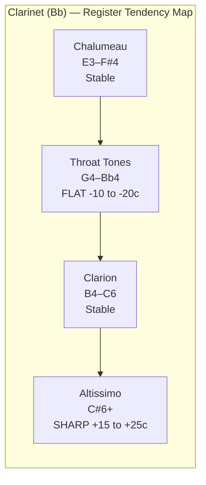
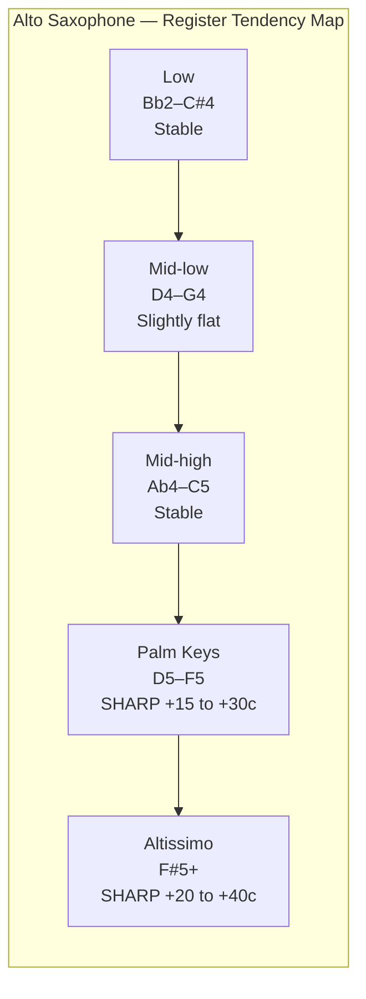

# Lesson 4: Intonation and Tuning for Woodwind Players

Intonation is a physical skill before it's a theoretical one. You'll fix 90% of your pitch problems with embouchure, air column shape, and ears — not with a tuner's needle. This lesson trains you to hear a pitch discrepancy, diagnose which physical lever caused it, and correct it in under a second, in real playing conditions.

---

## 1. The Four Levers You Control Every Second

These are the only tools you have while a note is sounding. Memorize the direction of each one until the response is reflexive.

| Lever | Direction | Approximate Range | Instruments Affected |
|---|---|---|---|
| Embouchure/lip pressure (firmer corners) | Sharp ↑ | ±30–50 cents | All reed instruments |
| Jaw drop / relaxed corners | Flat ↓ | ±30–50 cents | All reed instruments, flute |
| Tongue arch & throat shape ("ee" → "oh") | "ee" sharp, "oh" flat | ±10–20 cents | All winds |
| Air speed (faster jet = sharper on reeds; on flute, faster + lower angle = flatter) | varies | ±5–15 cents | All winds |
| Mechanical pull (barrel, bocal, headjoint roll) | Pulling out = flat | ±15–25 cents/mm | Clarinet, bassoon, oboe, flute |

**Why these work:** air speed and voicing change the effective length and stiffness of the resonating air column before the sound wave ever leaves the instrument. A faster air jet increases internal pressure, which raises the resonant frequency of the enclosed air column slightly — the same physical reason a shorter tube sounds higher. Tongue position changes the volume and shape of your oral cavity, which acts as a secondary resonator feeding the instrument; arching toward "ee" shrinks that cavity and reinforces higher partials, nudging pitch up. You don't need the full acoustics derivation to use this — you need to feel it and repeat it on command.

### 1.1 Bore Geometry — What It Means for Your Hands, Not Your Math

- **Clarinet (cylindrical, closed at the reed end):** suppresses even-numbered harmonics, so it overblows a twelfth instead of an octave. Practical consequence: the throat register (G4–B♭4) uses a fingering/venting combination that is acoustically weak, so those notes come out flat and thin no matter how good your reed is. You compensate with embouchure every single time you cross into that register — it's not optional.
- **Conical bore (saxophone, oboe, bassoon):** behaves like a tube open at both ends, giving a full, even harmonic series and a clean octave overblow. Intonation is more even register-to-register, but the saxophone's palm keys (D6–F6) vent through small, indirect tone holes and consistently run sharp.
- **Flute (cylindrical, open at both ends):** no reed, so pitch control shifts almost entirely to your lips. Rolling the headjoint toward you covers more of the embouchure hole and flattens; rolling away sharpens. Air jet angle (steered by small jaw movements) does the same job a reed does on other instruments.

### 1.2 Temperature: Predictable, So Plan for It

A 10°C rise in internal air temperature raises pitch roughly 18–20 cents (speed of sound increases with temperature, shortening the effective wavelength for a given physical tube length). Going from an 18°C case to 25°C body-warmed instrument during a 10-minute warm-up raises you about 15 cents.

**Concrete actions, not theory:**
- Tune only after a minimum 10-minute blow-in at performance dynamic level, never cold.
- Expect to pull your barrel/bocal/headjoint out 1–2 mm further at concert pitch than during a cold practice-room rehearsal.
- Outdoors in cold weather, pre-set your mechanical pull 1 mm shorter than indoors, firm your corners preemptively, and raise tongue arch — you will be flat all night without this adjustment, and it will not fix itself by "trying harder" on individual notes.

---

## 2. Ear Training: Hearing Beats in Real Time

This is the single highest-value skill in the lesson. A player who can hear beats tunes faster and more reliably than one staring at a strobe tuner, because ensembles drift in real time and the tuner can't follow fast enough.

### 2.1 What a Beat Actually Is

When two tones are close but not identical in frequency, their sound waves alternately reinforce and cancel, producing an audible pulsation called a beat. The beat rate in Hz equals the frequency difference between the two tones — two notes 2 Hz apart beat twice per second, period, regardless of register.

- **4+ beats/sec:** grossly out — audible to any listener, including non-musicians.
- **1–2 beats/sec:** the "wobble" every conductor stops rehearsal for.
- **0–0.5 beats/sec:** near-unison, only trained ears or a tuner will catch it.
- **0 beats/sec:** fused unison.

For intervals other than the unison, beating happens between coinciding overtones rather than the fundamentals. A perfect fifth (3:2 frequency ratio) beats between the 3rd harmonic of the lower note and the 2nd harmonic of the upper note. Because you're comparing harmonics, not fundamentals, intervals beat faster than a unison would at the same absolute pitch offset — this surprises most players the first time they hear it, so expect it and don't mistake a fast interval beat for being wildly out of tune.

### 2.2 Beat Training Drill Sequence

Use a drone app (Tonal Energy, or any sustained synth tone) or a second player/keyboard holding a pitch rock-steady.

**Week 1 — Unison matching, daily, 10 minutes:**
1. Sound the drone on concert B♭. Play the same pitch and slide your pitch (via embouchure/air) until beating stops completely.
2. Deliberately go sharp by a quarter-step. Listen to the beat rate accelerate as you move away from zero.
3. Slide back to zero beats, timing yourself with a stopwatch. Target: under 5 seconds.
4. Repeat 10 times per session at ♩ = 60, then repeat the entire set with the tuner display covered — ears only.

**Week 2 — Perfect fifth:**
1. Drone on C4, play G4 above it.
2. Listen specifically for beating between the 3rd harmonic of the C and the 2nd harmonic of the G — it will sound like a shimmer or roughness riding on top of the two notes, not a separate low pulse.
3. Adjust pitch until that shimmer disappears — this is the acoustically pure (just) fifth.
4. Compare against an equal-tempered fifth from a piano: it beats very slightly (~0.9 Hz at this register). Decide consciously, per context, whether to lock pure (a cappella winds, drone-based playing) or match the tempered piano.

**Week 3 — Major third (the interval that causes the most ensemble arguments):**
1. Drone on C4, play E4.
2. Equal-tempered E is about 14 cents sharper than the pure (just) major third.
3. Practice lowering the E by ear until beats vanish completely — that's just intonation, and it will sound noticeably "flatter" than your tuner's green light. This is correct for a cappella wind ensemble and barbershop-style chord work.
4. Then retune the same E to match an equal-tempered piano reference — notice it now has a faint but present beat. Switch between the two deliberately until you can produce either on command, because you need both: pure for blending with winds/voices, tempered for playing with fixed-pitch instruments.

---

## 3. Instrument-by-Instrument Pitch Tendency Maps

Knowing your instrument's built-in tendencies lets you pre-compensate before the problem is audible, instead of chasing it after the fact.

### 3.1 Clarinet (B♭)

The clarinet carries more inherent intonation irregularity than any other common woodwind, driven by its cylindrical bore and a structurally weak throat register.

**Problem notes and concrete fixes:**

| Note | Tendency | Alternate Fingering | Embouchure Cue |
|---|---|---|---|
| G♯4/A♭4 (throat) | Flat −15¢ | Add side key (key 5, right pinky) | "ee" vowel, raise tongue arch |
| A4 (throat) | Flat −12¢ | Standard + register key only | Firm both corners inward |
| B♭4 (throat) | Flat −18¢ | Side B♭ key, or long B♭ fingering | Maximum corner firmness, don't bite |
| C♯5/D♭5 | Sharp +18¢ | 1-2-3 / 1-2-3 + register key | Drop jaw slightly, shift toward "oh" |
| E5 | Sharp +25¢ | Half-hole left first finger | Noticeably relax embouchure |
| B5 | Sharp +20¢ | Add right-hand ring finger | Relax and open throat |

**Throat tone fix, step by step:**
Throat tones are flat because that fingering combination vents the register hole poorly, starving the upper partials that would otherwise pull the pitch up. The fix is physical, not mechanical — no alternate fingering fully solves it:
1. Raise the back of the tongue toward an "ee" position without changing jaw height.
2. Firm both lip corners inward — think gentle pursing, not biting down.
3. Keep breath support at maximum; throat tones go flat fastest the instant your air support drops, especially at the end of a phrase.
4. Daily drill: chromatic scale G4–B♭4 and back, quarter notes at ♩ = 60, tuner visible for the first week only, then tuner covered. Goal: lock each note within 5 cents without visual feedback within 3 weeks.

### 3.2 Alto Saxophone

| Note | Tendency | Fix |
|---|---|---|
| Low B♭2 | Flat −10¢ | Firm support, slight corner tension, do not let jaw sag on low notes |
| D5 (palm D) | Sharp +20¢ | Drop jaw, shift voicing toward "oh" |
| E♭5 (palm E♭) | Sharp +25¢ | Drop jaw further; alternate: front F fingering with palm D♯/E♭ key released |
| F5 (palm F) | Sharp +30¢ | Significant jaw drop, slightly slower/rounder air stream |

**Palm key drill:** Palm keys run sharp because they vent through small side holes that favor higher partials. Practice long tones on D5–F5 at ♩ = 50, starting each note by dropping the jaw *before* the attack rather than correcting after — correcting mid-note is audible to the audience as a pitch "settle," correcting before the attack is inaudible.

### 3.3 Flute — Pitch Control Through Roll and Air Direction

The flute has no reed — your lower lip and the airstream together form the reed. You have two mechanical/postural controls and one air control:

1. **Headjoint roll:** rolling in (toward your chin) covers more of the embouchure hole, lowering pitch; rolling out uncovers it, raising pitch. Roughly 2mm of roll ≈ 15–20 cents. Use this for your baseline setup, not for note-to-note correction — it's too slow to move mid-phrase.
2. **Jaw/chin position:** a slightly forward jaw directs the air jet downward into the far wall of the embouchure hole, flattening pitch; retracting the jaw aims the jet higher and sharpens. This is your fast, in-phrase correction tool.
3. **Air speed:** faster air without changing direction sharpens slightly (more energy into upper partials); this is why crescendos tend to go sharp and diminuendos tend to go flat — compensate by opening the embouchure hole coverage slightly (roll out a hair, or relax jaw back) as you get louder, and the reverse as you get softer.

**Daily correction drill:** play a long tone messa di voce (soft → loud → soft) on A4 at ♩ = 60 for 8 counts, watching only for pitch drift on the crescendo. Target: hold within 5 cents through the full dynamic range by making the jaw/coverage compensation automatic before volume changes the pitch, not after.

---

## 4. Cross-Instrument Ensemble Tuning Protocol

Use this sequence before every rehearsal and performance — it takes under 5 minutes and prevents 90% of ensemble pitch drift arguments before they start.

1. **Warm up for 10 minutes minimum** at a dynamic close to performance level before touching a tuner or drone.
2. **Tune the long reference note** (usually concert B♭ or A, whichever your section uses) by ear against the drone first, using the beat-matching skill from Section 2 — then check the tuner only to confirm, not to set the pitch initially. This trains your ear instead of outsourcing it.
3. **Set your mechanical baseline** (barrel, bocal, headjoint position) for the room's actual warmed-up temperature, not your practice room's cold baseline.
4. **Walk your personal tendency map** (Section 3) for 60 seconds: hit your instrument's three or four worst notes in isolation and confirm your embouchure correction is loaded and ready before the piece starts.
5. **During the piece**, treat every sustained unison or octave with another player as a live beat-training opportunity — listen for the shimmer, adjust by air/embouchure, not by stopping to look at a tuner.

---

## 5. Practice Log Template

Track progress weekly. Write actual cent deviations from a tuner readout, not just "better/worse" — numbers reveal patterns a general impression hides.

| Week | Note(s) targeted | Cents off (start) | Cents off (end) | Fix that worked |
|---|---|---|---|---|
| 1 | Throat G♯4–B♭4 | −18 | −8 | "ee" arch + firm corners |
| 2 | Palm D5–F5 (sax) | +28 | +12 | Pre-attack jaw drop |
| 3 | Flute A4 messa di voce | +15 (on crescendo) | +4 | Roll-out compensation on crescendo |

Run this log for a minimum of 6 weeks per problem register before moving to a new target — intonation reflexes take longer to automate than finger technique because you're retraining an unconscious muscular habit, not learning new motion.
