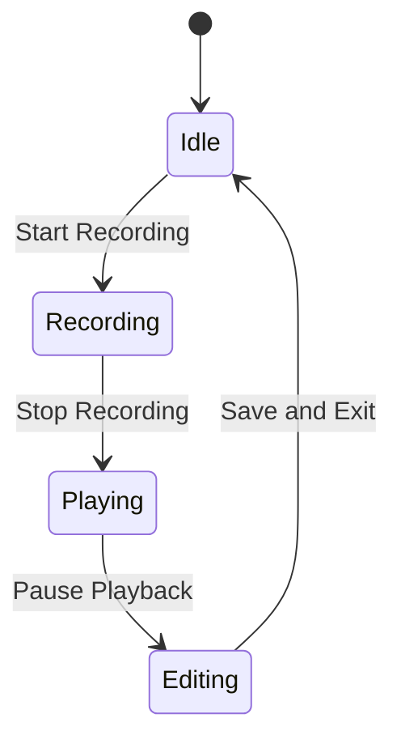
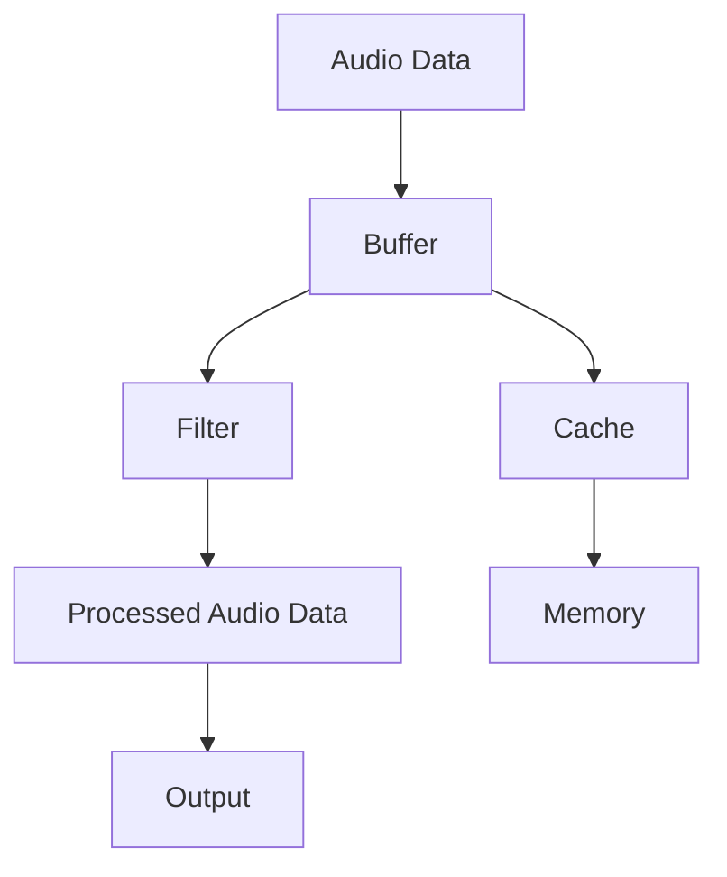
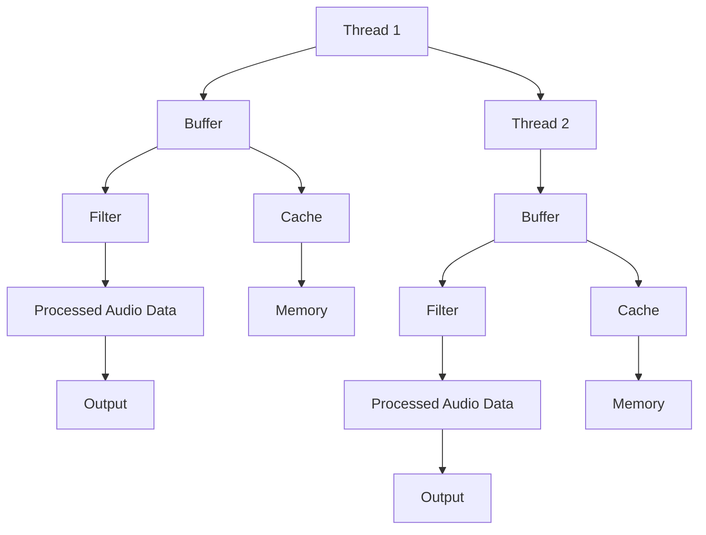

# Advanced Foundation: Acoustics
## 1. Theoretical Invariants & Formal Frameworks

### 1.1 Formal Proofs in Acoustics
Formal proofs in acoustics involve rigorous mathematical derivations and logical arguments to establish the validity of acoustic principles. These proofs often rely on differential equations, wave theory, and Fourier analysis.

**Example: Wave Equation Derivation**
The wave equation is a second-order partial differential equation that describes the propagation of waves, such as sound waves, through a medium. It is given by:

\[ \frac{\partial^2 p}{\partial t^2} = c^2 \nabla^2 p \]

where \( p \) is the acoustic pressure, \( t \) is time, and \( c \) is the speed of sound in the medium. The proof of this equation involves applying Newton's second law to a small volume element of the medium and using the continuity equation.

### 1.2 Kernel or Physical Invariants
Physical invariants in acoustics refer to properties that remain constant under various transformations or conditions. These invariants are crucial for understanding the behavior of sound waves in different environments.

**Example: Conservation of Energy**
One of the fundamental invariants in acoustics is the conservation of energy. In a lossless medium, the total energy of a sound wave remains constant as it propagates. This can be expressed mathematically as:

\[ \frac{dE}{dt} = 0 \]

where \( E \) is the total energy of the wave. This invariant is essential for analyzing the behavior of sound waves in idealized scenarios.

## 2. Low-Level Invariant Taxonomy

### 2.1 Deep Registers
Deep registers in acoustics refer to the lower frequency ranges of sound, typically below 100 Hz. These frequencies are characterized by their long wavelengths and the ability to penetrate obstacles effectively.

**Example: Modal Analysis**
Modal analysis is a technique used to study the behavior of sound waves in deep registers. It involves decomposing the sound field into a set of modes, each with a specific frequency and spatial distribution. This analysis is crucial for understanding the acoustic properties of large spaces, such as concert halls and auditoriums.

### 2.2 Memory Models
In the context of acoustics, memory models refer to the representation of sound waves in digital systems. These models are essential for simulating and analyzing the behavior of sound waves in various environments.

**Example: Digital Signal Processing (DSP)**
Digital signal processing is a field that deals with the representation and manipulation of sound waves in digital form. Memory models in DSP include the use of buffers, filters, and other data structures to store and process sound data. These models are crucial for implementing real-time audio processing algorithms.

### 2.3 Hardware Constraints
Hardware constraints in acoustics refer to the limitations imposed by physical devices used to generate, propagate, and detect sound waves. These constraints can significantly affect the behavior of sound waves and must be taken into account when designing acoustic systems.

**Example: Speaker Impedance**
Speaker impedance is a critical hardware constraint in acoustics. It refers to the opposition that a speaker presents to an alternating current (AC) signal. The impedance of a speaker can vary with frequency and can significantly affect the quality of sound reproduction. Understanding speaker impedance is essential for designing audio systems that deliver high-fidelity sound.

### 2.4 Axiomatic Definitions
Axiomatic definitions in acoustics refer to the fundamental principles that form the basis of the field. These definitions are used to derive more complex concepts and theories.

**Example: Sound Pressure Level (SPL)**
Sound pressure level is a measure of the intensity of sound waves. It is defined as the ratio of the sound pressure to a reference pressure, typically 20 μPa for air. The SPL is expressed in decibels (dB) and is used to quantify the loudness of sound. Understanding the definition and measurement of SPL is essential for analyzing the behavior of sound waves in various environments.

## 3. Micro-Architecture & Concurrency Dynamics

### 3.1 Mermaid and ASCII State Machines
State machines are used to model the behavior of digital systems, including those used in acoustics. Mermaid and ASCII are two popular tools for creating state diagrams.

**Example: State Machine for Audio Processing**
A state machine for audio processing can be used to model the behavior of a digital audio workstation (DAW). The state machine can include states such as "idle," "recording," "playing," and "editing." Transitions between states can be triggered by user actions, such as pressing buttons or using a mouse.

### 3.2 Cache and Race Condition Diagrams
Cache and race condition diagrams are used to model the behavior of digital systems, including those used in acoustics. These diagrams are essential for understanding the performance and reliability of audio processing algorithms.

**Example: Cache Diagram for Audio Processing**
A cache diagram for audio processing can be used to model the behavior of a digital audio workstation (DAW). The cache can include buffers for storing audio data, filters for processing audio data, and other data structures. The cache diagram can be used to analyze the performance of the DAW and identify potential bottlenecks.

**Example: Race Condition Diagram for Audio Processing**
A race condition diagram for audio processing can be used to model the behavior of a digital audio workstation (DAW). The race condition diagram can include threads for processing audio data, buffers for storing audio data, and other data structures. The race condition diagram can be used to analyze the reliability of the DAW and identify potential race conditions.

## 4. Subtle Failure Modes & Boundary Conditions

### 4.1 Subtle Failure Modes
Subtle failure modes in acoustics refer to errors or anomalies that are difficult to detect or diagnose. These failure modes can significantly affect the behavior of sound waves and must be taken into account when designing acoustic systems.

**Example: Standing Waves**
Standing waves are a subtle failure mode in acoustics. They occur when sound waves are reflected back and forth between two boundaries, creating a pattern of constructive and destructive interference. Standing waves can cause uneven sound distribution and can significantly affect the quality of sound reproduction. Understanding standing waves is essential for designing acoustic systems that deliver high-fidelity sound.

### 4.2 Boundary Conditions
Boundary conditions in acoustics refer to the conditions that must be satisfied at the boundaries of a medium. These conditions can significantly affect the behavior of sound waves and must be taken into account when designing acoustic systems.

**Example: Reflection Coefficient**
The reflection coefficient is a boundary condition in acoustics. It refers to the ratio of the reflected sound pressure to the incident sound pressure. The reflection coefficient can vary with frequency and can significantly affect the behavior of sound waves. Understanding the reflection coefficient is essential for designing acoustic systems that deliver high-fidelity sound.

## 5. Master Socratic Inquiries

### 5.1 Research-Grade Discussion Questions

**Question 1:** How can formal proofs be used to establish the validity of acoustic principles in the presence of hardware constraints?

**Question 2:** How can low-level invariant taxonomy be used to analyze the behavior of sound waves in deep registers?

**Question 3:** How can state machines be used to model the behavior of digital audio workstations (DAWs) in the presence of cache and race conditions?

**Question 4:** How can subtle failure modes, such as standing waves, be detected and diagnosed in acoustic systems?

**Question 5:** How can boundary conditions, such as the reflection coefficient, be used to design acoustic systems that deliver high-fidelity sound?
