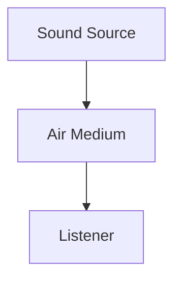

# Beginner Foundation: Acoustics
## 1. Everyday Intuition & First Principles
Imagine you're in a room and you clap your hands. The sound of your clap bounces off the walls, ceiling, and floor, and then it reaches your ears. This is a simple example of acoustics—the study of how sound waves travel through space and interact with objects. Just like how a stone thrown into a pond creates ripples, sound creates waves that travel through the air. Understanding these waves helps us create better music, improve our listening experience, and design spaces that enhance sound quality.

## 2. Foundational Vocabulary & Glossary
- **Sound Wave:** A disturbance that travels through the air (or another medium) as a series of compressions and rarefactions. Think of it like the ripples in a pond.
- **Frequency:** The number of times a sound wave repeats per second, measured in Hertz (Hz). Higher frequencies sound higher (like a bird's chirp), and lower frequencies sound lower (like a lion's roar).
- **Amplitude:** The height of a sound wave, which determines the loudness of the sound. The taller the wave, the louder the sound.
- **Wavelength:** The distance between two consecutive points of a sound wave that are in phase (e.g., two compressions or two rarefactions). Longer wavelengths correspond to lower frequencies.
- **Decibel (dB):** A unit used to measure the intensity of sound. It's a logarithmic scale, meaning a 10 dB increase represents a tenfold increase in sound intensity.
- **Resonance:** The amplification of sound waves when they interact with a space that has a natural frequency matching the sound wave's frequency. Think of a singer hitting a note that makes a glass shatter.

## 3. Visual System Flow
### ASCII Diagram
```
+-------------------+       +-------------------+       +-------------------+
| Sound Source      |------>| Air Medium        |------>| Listener          |
| (e.g., Voice,    |       | (Carries Sound)   |       | (Hears Sound)     |
| Instrument)       |       |                   |       |                   |
+-------------------+       +-------------------+       +-------------------+
```

### Mermaid Flowchart


## 4. Common Beginner Misconceptions & Mental Traps
- **Misconception:** Sound travels instantly. **Reality:** Sound travels at a finite speed (approximately 343 meters per second in air at room temperature).
- **Misconception:** Louder sounds always mean better sound quality. **Reality:** Sound quality is determined by factors like clarity, balance, and frequency response, not just volume.
- **Misconception:** All spaces sound the same. **Reality:** The shape, size, and materials of a room can significantly affect how sound behaves within it.

## 5. Socratic Discussion Starters
- What are some examples of sound sources in your daily life?
- How does the pitch of a sound change when you move closer to or farther from the source?
- Can you describe a space where sound seems to echo more than others? Why do you think that is?
- How does the volume of a sound change if you double the distance from the source?
- What are some ways to reduce unwanted noise in a room?
