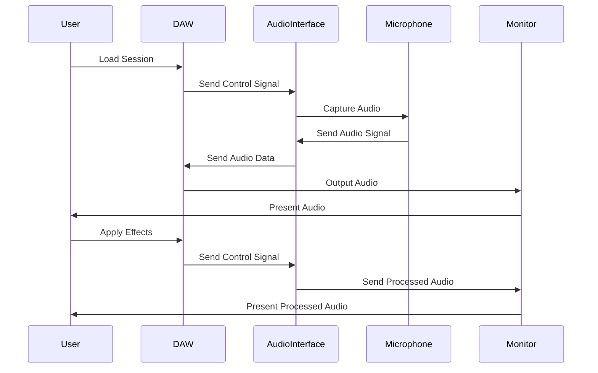

# Intermediate Foundation: Acoustics
## 1. Architectural Mental Model
In the realm of music production, acoustics serves as the foundational layer that shapes the sound environment and the interaction between instruments, spaces, and recording equipment. Building on beginner concepts, it's crucial to develop an architectural mental model that integrates acoustics seamlessly into the production workflow.

### Key Components:
- **Room Acoustics:** Understanding how sound behaves in different spaces, including reflections, reverberation, and absorption.
- **Microphone Placement:** Strategically positioning microphones to capture the desired sound characteristics.
- **Signal Path:** The sequence of equipment and processes through which audio signals travel, from source to output.
- **Acoustic Treatment:** Techniques and materials used to control and improve the acoustic properties of a space.

### Production Architecture:
The architecture of a music production environment is a complex interplay of physical and digital components. A robust architectural mental model should encompass:
- **Studio Design:** The layout and acoustic treatment of the recording space.
- **Equipment Selection:** Choosing appropriate microphones, preamps, mixers, and other gear based on the desired sound.
- **Software Integration:** Seamlessly integrating digital audio workstations (DAWs) with hardware for efficient workflow.

## 2. Systems Taxonomy & Component Protocols
Understanding the taxonomy of acoustics systems and the protocols that govern their interaction is essential for effective music production.

### Standard Interfaces:
- **XLR and TRS:** Common connectors for balanced audio signals.
- **USB and Thunderbolt:** Interfaces for connecting audio interfaces and other peripherals to computers.
- **AES50 and AES67:** Protocols for digital audio networking.

### Protocols:
- **MIDI:** A protocol for controlling electronic musical instruments and other related equipment.
- **SMPTE:** Standards for timecode and synchronization in audio and video production.
- **ACN and AAF:** Formats for audio content and metadata exchange.

### Data Models:
- **Audio Files:** Formats like WAV, AIFF, and FLAC for storing audio data.
- **Metadata:** Information about audio files, including artist, album, and track details.
- **Session Files:** Files that store the state of a DAW, including tracks, settings, and automation.

## 3. Multi-Component Interaction Flow
A detailed understanding of how different components interact is crucial for effective acoustics design and implementation.

### ASCII Sequence Diagram:
```
User -> DAW: Load Session
DAW -> Audio Interface: Send Control Signal
Audio Interface -> Microphone: Capture Audio
Microphone -> Audio Interface: Send Audio Signal
Audio Interface -> DAW: Send Audio Data
DAW -> Monitor: Output Audio
Monitor -> User: Present Audio
User -> DAW: Apply Effects
DAW -> Audio Interface: Send Control Signal
Audio Interface -> Monitor: Send Processed Audio
Monitor -> User: Present Processed Audio
```

### Mermaid Sequence Diagram:


## 4. Architectural Trade-offs & Production Pitfalls
Every architectural decision involves trade-offs, and being aware of these can help avoid common pitfalls in music production.

### Trade-offs:
- **Room Acoustics vs. Digital Processing:** Balancing the acoustic treatment of a space with the use of digital effects.
- **Microphone Placement vs. Signal Path:** Deciding between optimal microphone placement and the most efficient signal path.
- **Analog vs. Digital:** Choosing between analog and digital equipment based on the desired sound quality and workflow.

### Pitfalls:
- **Ignoring Room Acoustics:** Failing to treat a room properly can lead to poor sound quality and unwanted reflections.
- **Overusing Digital Effects:** Excessive use of digital effects can mask the natural characteristics of instruments and vocals.
- **Neglecting Signal Path:** Poor signal path design can introduce noise and degrade audio quality.

## 5. Socratic Discussion Starters
Engaging in thoughtful discussion can deepen understanding and foster innovation in music production.

### Questions:
- How does the acoustic treatment of a room affect the sound captured by microphones?
- What are the advantages and disadvantages of using different microphone placements for various instruments?
- How can digital effects be used to enhance rather than mask the natural characteristics of audio sources?
- What are the key considerations when designing an efficient signal path for a recording setup?
- How do the trade-offs between room acoustics and digital processing impact the overall sound quality of a production?
