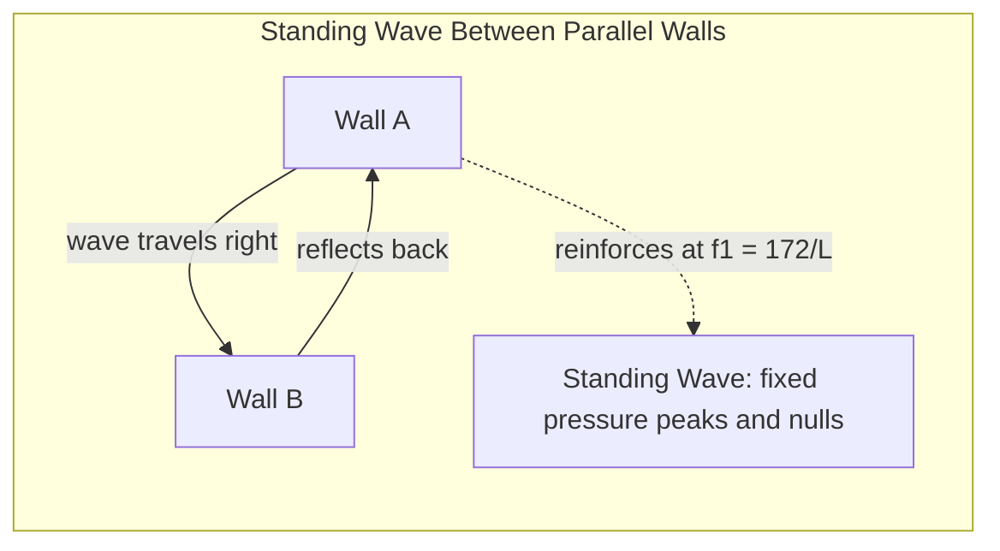
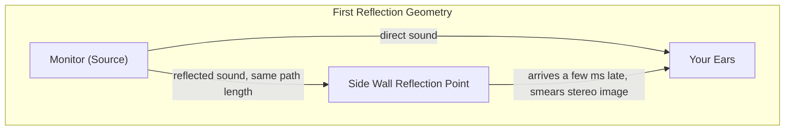

# Acoustics for Musicians and Engineers: A Practical Masterclass

## Why This Matters Before You Touch a Fader

Every decision you make in a studio, a practice room, or a live venue is downstream of acoustics: where you place a mic, why a room sounds boxy, why a guitar amp "disappears" when you turn around, why your mix sounds great on your headphones and collapses in your car. This lab trains your ear and your tools together. You will learn to *hear* a problem, *predict* it from room geometry and wave behavior, and *confirm* it with measurement. Ear first, math second, plugin third — that order matters, because plugins without a trained ear just move the problem around.

### What you need

- **A tape measure and your ears.** Non-negotiable. Most acoustic problems are diagnosed by walking the room and clapping.
- **Audacity** (free) — recording, spectrogram view, and Analyze > Plot Spectrum.
- **Python 3** with `numpy`, `scipy`, `matplotlib` — `pip install numpy scipy matplotlib sounddevice soundfile`.
- **A measurement mic or even your phone** — for the clap-test and decay-time exercises, precision matters less than consistency.
- **REW (Room EQ Wizard)** — free, industry-standard room measurement software. Strongly recommended alongside the Python exercises; REW gives you RT60, waterfall plots, and modal analysis without writing code.

---

## Part 1: The Physics You Actually Need (read once, keep nearby)

Sound is a pressure wave. Three numbers govern almost everything you'll do:

- **Wavelength (λ) and frequency (f):** `λ = speed_of_sound / f`. Speed of sound in air ≈ 343 m/s at 20°C. A 100 Hz wave is about 3.4 m long. A 10 kHz wave is about 3.4 cm long. This single fact explains why bass "gets everywhere" (long wavelengths bend around obstacles and build up in corners) and why treble is directional and easily blocked (short wavelengths reflect like light off a mirror).
- **The Nyquist limit:** a digital system sampling at rate `fs` can only represent frequencies up to `fs/2`. CD audio at 44.1 kHz captures up to 22.05 kHz — above adult hearing range. This is why 44.1/48 kHz is sufficient for final delivery, but higher rates (96/192 kHz) matter during tracking for reduced aliasing and filter headroom, not because your ears detect ultrasonics.
- **Resonance and standing waves:** when a wavelength matches twice a room dimension (or a multiple of it), reflected waves reinforce the original, creating a standing wave — a room mode. This is the single biggest practical problem in small-room acoustics and gets its own section below.

That's the entire formula budget for this lesson. Everything past this point is ears, tape measures, and listening drills.

---

## Part 2: Diagnosing Your Room by Ear (Do This First, Before Any Software)

### Drill 2.1 — The Clap Test
Stand in the center of your room. Clap once, sharply, and listen to the tail.

- **Flutter echo** (a rapid "zzzzt" buzzing decay) = parallel hard walls bouncing sound back and forth. Fix: break parallelism with diffusion or absorption on at least one of the two parallel surfaces.
- **Boomy, muddy tail with no clear pitch** = broadband bass buildup, usually corner-loaded. Fix: bass trap the room's tri-corners (where two walls meet the ceiling or floor).
- **A single "boing" pitched tail** = a dominant room mode at a specific frequency. Walk around the room while humming that pitch — it will swell and vanish as you move through pressure nodes and antinodes.

### Drill 2.2 — Finding Your Room Modes by Ear
1. Generate a slow sine sweep from 20 Hz to 300 Hz (code below) and play it through your monitors at moderate volume.
2. Walk slowly from wall to wall while it plays.
3. Note every frequency where the volume suddenly swells. These are your axial room modes. Write them down — you will EQ or treat around them later, never fight them with brute-force EQ alone (EQ cuts a mode at one point in the room; it's still loud everywhere else).

```python
import numpy as np
import soundfile as sf

sample_rate = 48000
duration = 20.0  # seconds, slow sweep is easier to walk through
f_start, f_end = 20.0, 300.0

t = np.linspace(0, duration, int(sample_rate * duration), endpoint=False)
# Logarithmic sweep: equal time spent per octave, matches how we perceive pitch
k = (f_end / f_start) ** (1 / duration)
phase = 2 * np.pi * f_start * (k**t - 1) / np.log(k)
sweep = 0.4 * np.sin(phase)

# Fade in/out 0.1s to avoid speaker-damaging clicks
fade_len = int(0.1 * sample_rate)
fade = np.linspace(0, 1, fade_len)
sweep[:fade_len] *= fade
sweep[-fade_len:] *= fade[::-1]

sf.write("mode_sweep_20_300hz.wav", sweep.astype(np.float32), sample_rate)
```

**Why this works:** a logarithmic sweep spends equal *time* per octave rather than per Hz, which matches both musical perception and the density of room modes (which cluster more tightly as frequency rises). It's the standard stimulus for room measurement — REW uses the same principle internally.

### Rule of Thumb: Predicting Your Worst Modes Without Software
The lowest, most problematic axial mode in any rectangular dimension is:

`f1 = 172 / L` (L in meters, f1 in Hz)

A 4 m long room has its first axial mode at `172/4 ≈ 43 Hz`. A 3 m wide room: `172/3 ≈ 57 Hz`. Check your kick drum's fundamental and your bass guitar's low E (41 Hz) against these numbers — if they land close to a mode, that note will boom disproportionately in your room on playback, even though the recording itself is fine. This is why bassists complain "it sounds great in the room, terrible on the recording" — their ears were inside a mode, the mic wasn't.



---

## Part 3: Material Behavior — Absorption, Diffusion, Reflection

Treat the room like an instrument, not a liability. Three tools, three different jobs. Confusing them is the most common home-studio mistake.

| Tool | What it does | When to use | What happens if you overuse it |
|---|---|---|---|
| **Absorption** (foam, mineral wool panels, heavy curtains) | Converts sound energy to heat, reduces reflection and reverb tail | First reflection points, corners for bass trapping | A "dead" room with no life; mixes translate poorly because your ear compensates by over-adding reverb/brightness |
| **Diffusion** (QRD diffusers, bookshelves, irregular surfaces) | Scatters reflections in time and direction instead of absorbing them | Rear wall of control room, live rooms that need "liveliness" without flutter | Minimal downside, but expensive and ineffective below ~500 Hz unless very deep |
| **Bass trapping** (thick porous absorption, 4"+ deep, corner-loaded) | Absorbs low-frequency energy where pressure is highest (room corners/boundaries) | Tri-corners (wall-wall-ceiling and wall-wall-floor junctions) | Rarely overused; most home studios are under-treated in bass, not over-treated |

### Drill 3.1 — The Mirror Trick (Finding First Reflection Points)
Have a friend slide a mirror along the side wall at ear height while you sit in the mix position. Everywhere you can see one of your monitors in the mirror is a first-reflection point — put absorption there. This is the highest-value, lowest-cost acoustic treatment you can do. Do both side walls, the ceiling above the mix position, and directly behind the monitors if they're close to the front wall.



**Why it matters acoustically:** the reflected path and the direct path arrive at your ear only 1–3 milliseconds apart, too close for your brain to separate as an echo, but far enough to comb-filter the frequency response — certain frequencies cancel, others reinforce, and your stereo imaging smears. This is why professional control rooms are so aggressively treated at first-reflection points and why cheap foam placed randomly "because it looks treated" does almost nothing.

---

## Part 4: Measuring Your Room — RT60 and the Decay Curve

RT60 is the time it takes sound to decay by 60 dB after the source stops — the standard measure of "how reverberant is this room."

### Target RT60 by room use
- **Vocal booth / isolation booth:** 0.2–0.3s (very dry, controlled)
- **Control room / mix room:** 0.3–0.5s
- **Small-to-mid tracking room (drums, band room):** 0.4–0.8s
- **Concert hall (for reference, not a target you'll hit at home):** 1.5–2.2s

### Measuring RT60 with the Balloon Pop / Clap Method in Python

```python
import numpy as np
import soundfile as sf
from scipy.signal import hilbert

def estimate_rt60(filepath):
    """
    Estimate RT60 from a recorded impulse (balloon pop, clap, or starter pistol).
    Record the impulse into Audacity/your interface first, export as WAV,
    point this function at the file.
    """
    data, sample_rate = sf.read(filepath)
    if data.ndim > 1:
        data = data[:, 0]  # use left channel if stereo

    # Find the impulse peak and trim everything before it
    peak_idx = np.argmax(np.abs(data))
    tail = data[peak_idx:]

    # Envelope via Hilbert transform, convert to dB, normalize to 0 dB at peak
    envelope = np.abs(hilbert(tail))
    envelope_db = 20 * np.log10(envelope / np.max(envelope) + 1e-12)

    # Find where decay crosses -5 dB (ignore direct sound) and -35 dB
    # Linear fit between these points, then extrapolate to -60 dB (Schroeder method)
    above_neg5 = np.where(envelope_db <= -5)[0][0]
    above_neg35 = np.where(envelope_db <= -35)[0][0]

    t = np.arange(len(envelope_db)) / sample_rate
    slope, intercept = np.polyfit(
        t[above_neg5:above_neg35], envelope_db[above_neg5:above_neg35], 1
    )
    rt60 = -60 / slope  # seconds
    return rt60

# Usage:
# rt60 = estimate_rt60("room_clap_impulse.wav")
# print(f"Estimated RT60: {rt60:.2f} seconds")
```

**Why the -5 to -35 dB window:** the first 5 dB of decay includes the direct sound and early reflections, which aren't representative of the diffuse reverberant decay. Extrapolating a clean 30 dB-wide slope out to -60 dB (the "Schroeder method") is the real-world standard because background noise usually buries the true -60 dB point before you can measure it directly.

### Procedure
1. Set your interface to record at 48 kHz, 24-bit, input gain low enough that the clap/pop won't clip.
2. Pop a balloon or do a sharp clap 1–2 meters from the mic, in the position where a singer or instrument would actually be.
3. Export as WAV, run `estimate_rt60()`.
4. Repeat in 3–4 spots in the room (center, corners, near walls) — RT60 varies by position, especially at low frequencies. A single number from one position is misleading.

---

## Part 5: Pure Tones, FFT, and What Your Spectrum Analyzer Is Really Telling You

This is where the original lab's code becomes genuinely useful — but only once you know what you're listening for.

### Drill 5.1 — Generate and Hear the Harmonic Series
A pure sine tone sounds hollow and synthetic because real instruments are never pure tones — they're a fundamental plus harmonics (integer multiples) whose relative strength is the instrument's *timbre*. Build this intuition by ear before you ever look at a plot.

```python
import numpy as np
import soundfile as sf
import matplotlib.pyplot as plt

sample_rate = 44100
duration = 2.0
fundamental = 220.0  # A3

t = np.linspace(0, duration, int(sample_rate * duration), endpoint=False)

def adsr_envelope(n_samples, sr, attack=0.02, decay=0.1, sustain_level=0.7, release=0.3):
    """Simple ADSR so tones don't click on/off — same envelope shape a synth uses."""
    env = np.ones(n_samples)
    a = int(attack * sr)
    d = int(decay * sr)
    r = int(release * sr)
    env[:a] = np.linspace(0, 1, a)
    env[a:a+d] = np.linspace(1, sustain_level, d)
    env[a+d:-r] = sustain_level
    env[-r:] = np.linspace(sustain_level, 0, r)
    return env

env = adsr_envelope(len(t), sample_rate)

# Pure sine: fundamental only
pure = 0.5 * np.sin(2 * np.pi * fundamental * t) * env

# "Sawtooth-like" additive tone: fundamental + harmonics 2-8 at 1/n amplitude
# This is literally how a sawtooth wave is built — it's the brightest, buzziest
# waveform because it contains ALL harmonics at full relative strength
rich_tone = np.zeros_like(t)
for harmonic in range(1, 9):
    rich_tone += (1.0 / harmonic) * np.sin(2 * np.pi * fundamental * harmonic * t)
rich_tone = 0.3 * rich_tone / np.max(np.abs(rich_tone)) * env

sf.write("pure_220hz.wav", pure.astype(np.float32), sample_rate)
sf.write("rich_220hz.wav", rich_tone.astype(np.float32), sample_rate)

# A/B these two files in Audacity. Same pitch, radically different timbre.
```

**Listen first.** Load both files in Audacity. Same fundamental pitch (220 Hz, A3), completely different character — the rich tone sounds like a buzzy synth bass, the pure tone sounds like a tuning fork or flute harmonic. This is the entire basis of subtractive synthesis: start with a harmonically rich wave (saw/square) and *remove* harmonics with a filter to shape timbre.

### Correctly Plotting the Spectrum (fixing the original lab's bug)
The original lab's loop plots `frequencies` against `fft` using the wrong variable (it overwrites the frequency list with the sweep list) and never isolates the positive-frequency half of the FFT, which is mirrored and will double your apparent peaks. Here's the corrected, reusable version:

```python
def plot_spectrum(filepath, max_freq=2000, label=None):
    import soundfile as sf
    data, sr = sf.read(filepath)
    if data.ndim > 1:
        data = data[:, 0]

    n = len(data)
    fft_vals = np.fft.rfft(data)          # rfft: real-input FFT, only returns positive frequencies
    freqs = np.fft.rfftfreq(n, d=1/sr)    # matching frequency bins, no mirroring/aliasing confusion
    magnitude_db = 20 * np.log10(np.abs(fft_vals) + 1e-12)

    plt.plot(freqs, magnitude_db, label=label or filepath)
    plt.xlim(0, max_freq)
    plt.xlabel("Frequency (Hz)")
    plt.ylabel("Magnitude (dB)")
    plt.grid(alpha=0.3)

plt.figure(figsize=(10, 5))
plot_spectrum("pure_220hz.wav", label="Pure sine")
plot_spectrum("rich_220hz.wav", label="Rich harmonic tone")
plt.title("Same fundamental (220 Hz), different harmonic content")
plt.legend()
plt.show()
```

**Why `rfft` instead of `fft`:** for real-valued audio (not complex), the full FFT output is symmetric around the midpoint — the second half is a mirror image carrying no new information. `rfft`/`rfftfreq` return only the useful half directly, which is why professional DSP code never plots raw `fft()` output for real audio. Always use dB magnitude (`20*log10`) for audio spectra, not raw linear magnitude — your ears perceive loudness logarithmically, and a linear plot will make a -40 dB harmonic invisible next to a 0 dB fundamental when in reality it's clearly audible.

---

## Part 6: Hearing Comb Filtering and Phase Cancellation (The Most Common Live-Sound and Mix Problem)

Comb filtering happens whenever the same signal arrives at a listener (or a mic) twice with a short time offset — a reflected wall, a double-miked amp, two mics on one source. It's called "comb" because the resulting frequency response looks like a comb's teeth: alternating peaks and deep nulls.

### Drill 6.1 — Create and Hear Comb Filtering

```python
import numpy as np
import soundfile as sf

sample_rate = 44100
data, sr = sf.read("rich_220hz.wav")  # reuse the harmonic-rich tone from Part 5

# Simulate a reflection arriving 2ms late at 70% amplitude (typical hard-wall reflection)
delay_ms = 2.0
delay_samples = int(sample_rate * delay_ms / 1000)

delayed = np.zeros(len(data) + delay_samples)
delayed[:len(data)] += data
delayed[delay_samples:delay_samples + len(data)] += 0.7 * data

sf.write("comb_filtered_2ms.wav", delayed.astype(np.float32), sample_rate)

# Try delay_ms = 0.5, 5, and 15 and compare by ear:
# 0.5ms: barely audible as tone color change, mostly "phasey"
# 2-15ms: audible as a hollow/nasal quality (classic "phasing" sound)
# 15ms+: starts to separate into a discrete, audible echo
```

A/B `rich_220hz.wav` against `comb_filtered_2ms.wav`. This hollow, nasal, "underwater" quality is exactly what you hear when a snare drum is miked top and bottom without phase alignment, or when you stand in a hard-floored room and the floor reflection cancels part of your vocal's spectrum. **The fix in tracking:** flip polarity on the bottom mic and nudge it in time until the sound thickens up (listen for the nulls filling back in) — this is literally what the "phase" button on your mixer does, and why multi-mic setups are aligned by ear, not by eye.

---

## Part 7: Lab Exercises — Progressive Build

### Lab 7.1 (Beginner): Room Mode Hunt
1. Run the sweep generator from Drill 2.2.
2. Walk your room, log every frequency that swells, within ±5 Hz.
3. Compare against `f1 = 172/L` for your room's length, width, and height.
4. Deliverable: a simple table of predicted vs. heard modes, and a photo of where you'd place a bass trap based on the result.

### Lab 7.2 (Intermediate): RT60 Map
1. Record balloon-pop impulses at 4 positions in your room (center, 2 corners, near a reflective wall).
2. Run `estimate_rt60()` on each.
3. Deliverable: a bar chart (matplotlib) of RT60 by position, with a one-paragraph explanation of why corners usually read higher at low frequency.

```python
positions = ["center", "corner_1", "corner_2", "near_wall"]
rt60_values = [estimate_rt60(f"rt60_{pos}.wav") for pos in positions]

plt.figure(figsize=(8, 5))
plt.bar(positions, rt60_values, color="steelblue")
plt.axhline(0.5, color="red", linestyle="--", label="Control room target (0.5s)")
plt.ylabel("RT60 (seconds)")
plt.title("RT60 by Measurement Position")
plt.legend()
plt.show()
```

### Lab 7.3 (Advanced): Fix a Comb Filter by Ear
1. Record a snare drum (or any percussive source — even a tabletop tap) with two mics: one close, one 1–1.5 meters back.
2. Sum them in your DAW and listen — you should hear the hollow comb-filtered quality.
3. Nudge the far mic's track earlier/later in small increments (try 0.5ms steps) while listening to the sum. Find the position that sounds fullest (reflections reinforcing, not canceling) — this is the "3:1 rule" distance engineers use as a starting point, now verified by ear instead of just assumed.
4. Deliverable: screenshot of the final mic offset in samples, plus a one-line description of how the tone changed from thin/nasal to full.

### Lab 7.4 (Stress Test): Material A/B
1. Clap-test your room baseline.
2. Hang a thick blanket or move a mattress against one wall.
3. Clap-test again from the same spot.
4. Run the RT60 estimator on both recordings.
5. Deliverable: before/after RT60 numbers and a one-paragraph note on which frequencies audibly changed most (bass almost never changes much from a blanket — only highs and low-mids do, because the blanket is acoustically "thin" relative to bass wavelengths. This is the most common beginner misconception: soft furnishings control brightness, not boom).

---

## Part 8: Troubleshooting Reference

| Symptom | Likely Cause | Fix |
|---|---|---|
| Mix sounds great in studio, bass disappears on other systems | Room mode masking or exaggerating specific bass frequencies at mix position | Check mix against RT60-measured mode list; use a reference track; mix at low volume occasionally to avoid Fletcher-Munson masking bass judgment |
| Recorded vocal sounds thin/nasal compared to live | Comb filtering from a nearby hard reflective surface (desk, monitor, music stand) | Move reflective surfaces out of the direct mic-to-source reflection path, or add absorption on the surface |
| Double-tracked or multi-mic'd instrument "disappears" when summed to mono | Phase/time misalignment between mics | Nudge one track in time (Lab 7.3 method) or flip polarity and compare |
| Room sounds fine by ear, mix translates poorly anyway | Treating by ear alone without measurement; asymmetric treatment left/right | Run RT60 and mirror-trick reflection check; verify left/right symmetry in both geometry and treatment |
| FFT plot shows mirrored/duplicate peaks | Used `np.fft.fft()` on real audio and plotted the full output instead of `rfft()` | Switch to `np.fft.rfft()` / `rfft freq()` as shown in Part 5 |
| Impulse-based RT60 measurement gives wildly inconsistent results between takes | Background noise floor too high, or impulse too quiet/clipped | Re-record with lower noise floor (turn off HVAC/fans), ensure impulse peak is strong but not clipping |

---

## Closing Principle

Acoustics is the only part of audio production you can diagnose with zero equipment — your ears, a clap, and a walk around the room will tell you 80% of what you need to know. Software (Python FFTs, REW, FDTD simulators) exists to *confirm and quantify* what you already suspect, not to replace the listening. Always clap first, measure second, treat third, and re-clap to confirm the treatment worked.
