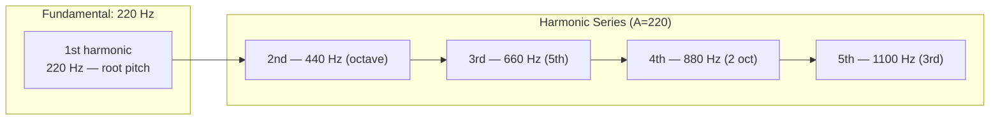
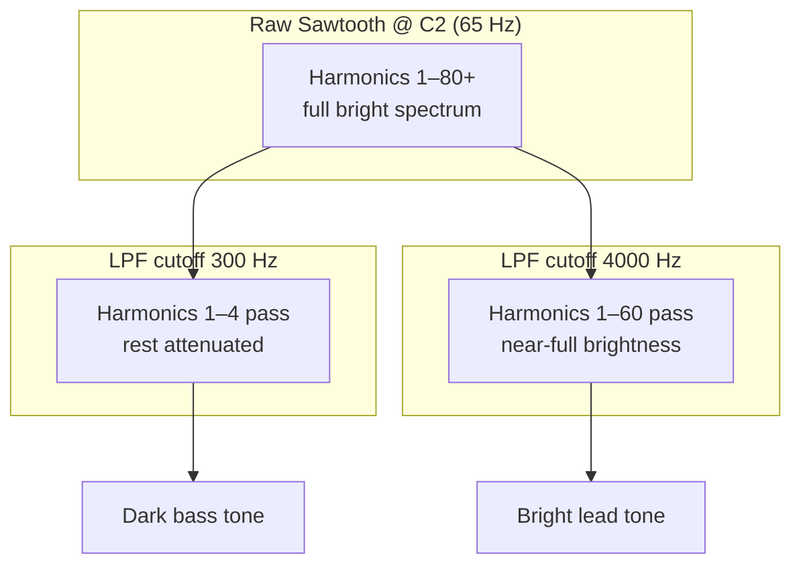
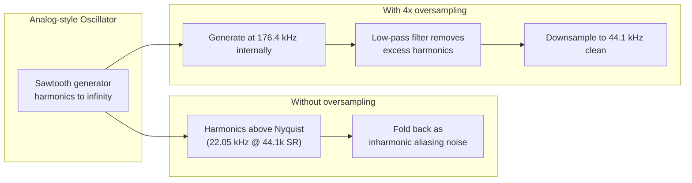

# Lesson 1: Waveforms, Frequency, and the Physical Ear

## Why This Lesson Matters

Every synth patch, every EQ move, every "why does this mix sound muddy" problem traces back to two things: what shape the waveform is, and where its energy sits in frequency. This lesson gets your ears and your hands trained on both, using your DAW or any hardware synth as the lab bench. You'll leave able to identify a waveform by ear, carve harmonics with a filter by feel, and know exactly which frequency range to reach for when a mix problem shows up.

## 1. Acoustic Intuition (Read Once, Keep Short)

A sound is air pressure oscillating back and forth. The *shape* of that oscillation over one cycle is the waveform, and the *rate* of repetition is the frequency, measured in Hertz (cycles per second). Any periodic shape can be built from sine waves stacked at multiples of the fundamental frequency — these multiples are harmonics (also called overtones). This is why a sine wave sounds like "nothing but pitch" (it has no harmonics to color it) while a square wave sounds buzzy and hollow (it stacks only odd harmonics: 1st, 3rd, 5th...) and a sawtooth sounds dense and bright (it stacks every harmonic, odd and even, at full strength). That's the entire theory budget for this lesson — everything else below is ear training and hands-on patching.



| Waveform | Harmonic Content | Character | Classic Use |
|---|---|---|---|
| Sine | Fundamental only | Pure, hollow, no edge | Sub-bass, bells, test tones |
| Triangle | Odd harmonics, steep rolloff (1/n²) | Soft, flute-like | Mellow leads, soft pads |
| Square | Odd harmonics, moderate rolloff (1/n) | Hollow, woody, clarinet-like | Bass synths, retro leads |
| Sawtooth | All harmonics, slow rolloff (1/n) | Bright, buzzy, dense | Classic analog leads, strings, trance basses |

**Ear-training drill:** Load any subtractive synth (Serum, Vital, Massive, even a free VST like Surge XT). Set filter fully open, no envelope, single oscillator. Play one held note (A3, 220 Hz) and cycle sine → triangle → square → saw. Do this with eyes closed for 5 minutes a day for a week. By day 3 you should identify the waveform blind within one second of hearing it. This single drill will do more for your synthesis and mixing instincts than any amount of reading.

## 2. Hands-On Lab: Building and Hearing Harmonics

### Lab A — Harmonic Series by Ear (any DAW, no plugins needed)

1. Create a track with a sine-wave-capable instrument (synth set to pure sine, or a tone generator plugin).
2. Play and hold A2 (110 Hz).
3. On a second track, play A3 (220 Hz) — the octave, 2nd harmonic — simultaneously. Notice how it locks in, nearly disappearing into the first note.
4. Add E4 (330 Hz) — the 3rd harmonic, a fifth above that octave. Still consonant, still "inside" the first tone.
5. Add A4 (440 Hz, 4th harmonic), then C#5 (~554 Hz, 5th harmonic — a major third).
6. Play all five together, then mute them one at a time from the top down.

**What you're training:** this is literally what a single bowed string, a vibrating lip in a trumpet mouthpiece, or a plucked bass string produces as a stack of frequencies simultaneously — a single "note" is already a chord of harmonics, and the proportion of their loudness is what you perceive as timbre, not pitch. Richer high harmonics = brighter perceived tone, even at identical fundamental pitch.

### Lab B — Subtractive Carving: Turn a Saw Into a Bass, a Lead, and a Pad

Using any analog-modeled subtractive synth:

```text
Oscillator: Sawtooth, 1 voice, root note C2 (65.4 Hz)
Filter: Low-pass, 24 dB/oct (ladder-style if available)
```

**Patch 1 — Sub-growl bass:**
- Filter cutoff: ~300 Hz, Resonance: 20%
- Filter envelope: Attack 0 ms, Decay 150 ms, Sustain 10%, tracked to key
- Result: the saw's harmonics above 300 Hz get scooped on every note-on, leaving a fundamental-heavy thump with a short "bite" of upper harmonics at the attack.

**Patch 2 — Bright lead:**
- Filter cutoff: ~4000 Hz (wide open relative to a 65 Hz fundamental = almost all harmonics pass)
- Resonance: 35% (pushes energy right at the cutoff frequency, adding a vocal "aah" formant)
- Result: dense harmonic content survives, giving cut-through-the-mix brightness.

**Patch 3 — Soft pad:**
- Swap oscillator waveform to triangle (same patch otherwise)
- Filter cutoff: ~1200 Hz
- Attack: 400 ms (slow fade-in hides the transient harmonic content)
- Result: because triangle already has weak high harmonics, and the slow attack removes the transient edge, you get a rounded, airy pad with almost no fundamental problems.

**Why this works:** the filter cutoff frequency tells you *how many harmonics survive* above the fundamental. A fundamental at 65 Hz with cutoff at 300 Hz lets through roughly the 1st through 4th harmonics only (65, 130, 195, 260 Hz) — that's why it sounds dark and thumpy no matter how bright the raw oscillator is. Push the cutoff to 4000 Hz and you let through 60+ harmonics — that's the entire difference between "bass" and "lead" from one identical oscillator.



## 3. Pitch, Frequency, and the Keyboard: Equal Temperament in Your Hands

Western equal-temperament tuning spaces every semitone by the same frequency ratio, the twelfth root of two (≈1.0595), so that any interval sounds identical no matter which key you start on. You don't need to compute this — your keyboard already has it built in. What you *do* need is to know the frequency "neighborhoods" so you can navigate a mix by ear and by number:

| Note | Frequency | Register | Mix role |
|---|---|---|---|
| C1 | ~32.7 Hz | Sub-bass | Felt more than heard; kick fundamentals live here |
| C2 | ~65.4 Hz | Bass | Bass guitar low string (open E ≈ 41 Hz), synth bass root |
| C3 | ~130.8 Hz | Low-mid | Male vocal fundamental region, muddiness risk zone |
| C4 (Middle C) | ~261.6 Hz | Midrange | Piano middle C, vocal presence |
| C5 | ~523.3 Hz | Upper-mid | Vocal clarity, lead instrument cut-through |
| C6 | ~1046.5 Hz | High | Harmonic brightness, "air" begins above this |

**Keyboard drill — octave frequency doubling by feel:** sit at a piano or keyboard. Play C2, then jump up one octave to C3 while saying the frequency out loud ("65... 131"). Repeat C3→C4 ("131... 262"), C4→C5 ("262... 523"). Do five round trips. This builds a gut-level map between the physical octave shape on the keys (same finger, same hand shape, 8 white keys up) and the doubling rule, so when an engineer says "boost 8k" or "there's mud at 300 Hz" you have a physical reference point instead of an abstract number.

## 4. Digital Capture: Sample Rate and Aliasing (The Practical Version)

When a microphone signal is converted to digital audio, it's measured (sampled) at a fixed rate — 44,100 or 48,000 times per second in standard production. The Nyquist rule says you can only faithfully capture frequencies up to **half** the sample rate: at 44.1 kHz, that ceiling is 22.05 kHz, comfortably above the ~20 kHz edge of human hearing. Problems only arise when:

1. **You run synthesis algorithms that generate harmonics above Nyquist without filtering them** (common in cheap digital emulations of analog saw/square waves) — the excess harmonics fold back down into the audible range as inharmonic, dissonant artifacts. This is **aliasing**, and it sounds like a metallic, digital "zinginess" especially on high notes.
2. **Troubleshooting step:** if a digital saw/square oscillator sounds harsh or "crunchy" specifically on high notes but clean on low notes, that's your aliasing symptom. Fix: enable oversampling (2x, 4x, or 8x) in the synth/plugin settings if available — this generates the waveform at a higher internal rate, filters out the excess harmonics, then downsamples cleanly. Nearly every modern soft-synth (Serum, Vital, Diva) has an oversampling toggle for exactly this reason. Turn it on when you hear high-note harshness, leave it off otherwise to save CPU.



## 5. FM Synthesis: A Practical First Patch

Frequency modulation sounds intimidating on paper but is simple to feel by hand. Two oscillators: a **carrier** (the pitch you hear) and a **modulator** (which wobbles the carrier's frequency fast enough to generate new harmonics rather than a slow vibrato). The ratio between modulator and carrier frequency determines whether the result sounds musical (harmonic) or metallic (inharmonic).

**Hands-on FM patch (use any 2-operator FM synth, or FM8/Native Instruments, or even Dexed, which is free):**

1. Carrier frequency ratio: 1.00, Modulator ratio: **1.00** → modulator locked to the same pitch as carrier. Raise the modulation index (depth) slowly from 0. Result: the tone gets progressively brighter/buzzier while staying musically "in tune" — this is a classic FM electric piano / bell starting point.
2. Change modulator ratio to **2.00** (one octave above carrier). Same index sweep. Result: hollow, clarinet/bell-like tone — this ratio produces only odd-numbered harmonic reinforcement, similar in flavor to a square wave but with a sharper digital edge.
3. Change modulator ratio to **1.41 (√2, a non-integer ratio)**. Sweep the index. Result: clangorous, bell-like inharmonic tones — non-integer ratios break the harmonic series and produce metallic, bell/gong timbres. This is the classic DX7 "FM bell" trick.

**Practice target:** build all three patches from scratch in under 10 minutes without a preset, naming out loud what ratio and index you're setting and why you expect that result. Repeat until you can predict "integer ratio = musical/tuned, non-integer ratio = metallic/inharmonic" before you hear it, not after.

## 6. Ear-Training Practice Schedule

| Day | Drill | Target |
|---|---|---|
| 1–2 | Waveform ID blind test (sine/tri/square/saw) | 90% accuracy within 1 second per tone |
| 3–4 | Filter cutoff sweep ear-matching: guess cutoff Hz by ear, check against knob value | Within ±20% of actual value |
| 5 | Octave frequency-doubling drill at keyboard | Recite Hz values for C1–C6 from memory |
| 6 | FM ratio ID: integer vs. non-integer by ear | Correctly label "musical" vs "metallic" in 8/10 trials |
| 7 | Aliasing spot-check: toggle oversampling on a saw lead playing a 2-octave run, identify the difference | Describe the harshness difference in your own words |

Fifteen minutes a day of this, for two weeks, builds the frequency-to-sound mapping that lets you mix, patch, and troubleshoot by ear instead of by guesswork — which is the entire point of understanding waveforms and frequency in the first place.
