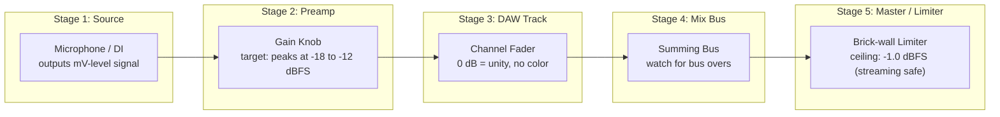
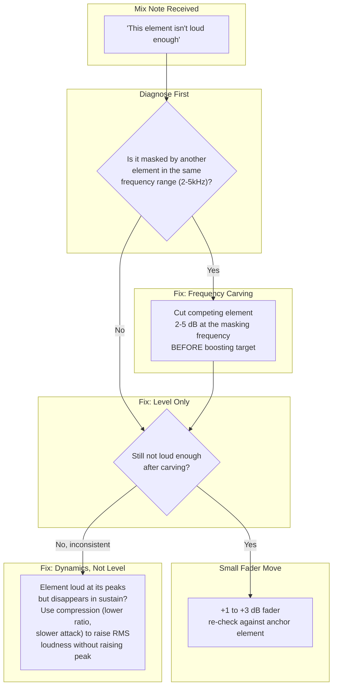

# Lesson 2: Decibel Scaling, Loudness, and Gain-Staging in Practice

## Why This Lesson Exists

You will set faders, you will ride compressor thresholds, you will argue with a mastering engineer about "perceived loudness" versus peak level, and you will need to know in your gut what +3 dB on a fader actually does to the air pressure hitting someone's eardrum. This lesson gives you the working numbers, the meter-reading skills, and the gain-staging drills to make those decisions fast and correctly, on real sessions, under time pressure.

## First-Principles Intuition (Read Once, Keep as Reference)

Your ear does not respond to sound intensity linearly — it responds logarithmically. Double the acoustic power and you *do not* perceive "twice as loud." You perceive a small, consistent step. That single biological fact is the entire reason the decibel exists: it's a unit built to match how loudness actually feels, not an arbitrary engineering convenience.

The two decibel formulas you need, and nothing more:

**Power ratios** (acoustic intensity, RMS power):
$$ \text{dB} = 10 \log_{10} \left( \frac{P}{P_0} \right) $$

**Amplitude/voltage ratios** (signal gain, fader moves, peak levels):
$$ \text{dB} = 20 \log_{10} \left( \frac{V}{V_0} \right) $$

The factor-of-2 difference exists because power is proportional to amplitude squared — squaring a ratio doubles its log. This is the single most common source of confusion for people entering audio from physics or electronics: **when you move a fader, you're working in the 20-log world. When you talk about perceived loudness or SPL from a microphone, you're often in the 10-log world.** Mixing these up is the most common rookie error in gain-staging conversations.

### Numbers You Must Memorize (No Calculator, No Lookup)

These are the only dB-to-ratio conversions you need committed to muscle memory. Every mixing, mastering, and live-sound decision traces back to these:

| dB Change | Amplitude Ratio | Perceived Loudness | Where You'll Use It |
|---|---|---|---|
| +6 dB | ×2 | noticeably louder | doubling a fader's voltage swing |
| +3 dB | ×1.41 (√2) | "a bit louder" | standard pan law compensation, panning center loss |
| +1 dB | ×1.12 | "just noticeable" | mastering loudness trim moves |
| -6 dB | ×0.5 | noticeably quieter | halving signal before a limiter |
| **+10 dB (power)** | **×10 power / ×3.16 amplitude** | **perceived as "twice as loud"** | **the loudness doubling rule** |
| +20 dB | ×10 amplitude | dramatically louder | mic preamp gain range |

**The rule that actually matters in daily practice:** a **10 dB increase in SPL is perceived as roughly a doubling of loudness.** This is not folklore — it's the empirical basis of the phon/sone loudness scale. Use it to sanity-check mix decisions: if a vocal "disappeared," it probably needs a lot more than 1–2 dB; you're likely looking at a 6–10 dB problem, often solved by removing masking frequencies rather than just turning the fader up.

### Equal-Loudness: Why a Kick Drum at -18 dBFS Sounds Louder Than a Hi-Hat at -18 dBFS

The Fletcher-Munson / ISO 226 equal-loudness contours show your ear is most sensitive between roughly 2–5 kHz (this is where consonants and vocal presence live — evolutionarily, this is the frequency range of a crying infant and human speech formants) and dramatically *less* sensitive at the low end (below 100 Hz) and the extreme top end (above 10 kHz).

**Practical consequence, stated as a mixing rule:** two tracks sitting at the identical numeric dBFS level will NOT sound equally loud if their energy sits in different frequency bands. A bass synth at -12 dBFS and a lead vocal at -12 dBFS are not competing on equal footing — your ear will always privilege the vocal's midrange energy. This is why "just turn it up in the mix" fails as a strategy and why EQ carving (cutting competing frequencies, not boosting) is the real tool for loudness balance between simultaneous elements.

**The loudness-at-low-volume problem:** at quiet monitoring levels, the equal-loudness contours steepen — bass and treble fall away far more than midrange. This is why a mix that sounds balanced at loud monitoring levels goes bass-light and dull when played quietly on a laptop speaker. **Always reference your mix at a low monitoring volume (conversational level, roughly 60–70 dB SPL) at least once per session** — it reveals midrange masking problems that loud monitoring hides.

---

## Core Lab 1: Gain-Staging a Signal Chain by Ear and by Meter

Gain-staging is the practical, moment-to-moment application of decibel math. Get it wrong and you either generate hiss (gain staged too low, noise floor exposed) or you clip (gain staged too high, digital distortion). This lab builds the habit of thinking in dB steps at every stage of a signal path.

### The Signal Chain Model

### Step-by-Step Gain-Staging Drill

**Step 1 — Set input gain against the meter, not your eyes on the waveform.**
Record the loudest passage of the performance (the chorus, the snare hit, the slap-bass peak). On the preamp or audio interface gain knob, target peaks hitting **-18 dBFS to -12 dBFS** on the DAW's input meter. This leaves 12–18 dB of headroom before 0 dBFS (digital clipping), which is non-negotiable — digital clipping is a hard wall, unlike analog tape or tube saturation which clips "softly."

**Step 2 — Leave every channel fader at unity (0 dB) when you start mixing.**
Unity gain means the fader neither boosts nor cuts — it's the DAW's "no change" reference point. Starting every fader at 0 dB means your gain-staging decisions from Step 1 are preserved, and you mix by *pulling faders down* from a well-gain-staged starting point rather than pushing everything up into clipping.

**Step 3 — Build the mix by subtraction, in this order:**
1. Set the loudest element (usually kick + bass, or lead vocal in pop) as your 0 dB reference.
2. Pull every other fader down relative to it. Never push a secondary element up past the anchor element.
3. Check your bus meter after every 3–4 fader moves. Target: mix bus peaks around **-6 dBFS**, leaving headroom for the master limiter.

**Step 4 — Gain-stage the master bus for delivery.**
Insert a limiter on the master bus. Set the **ceiling** (output limit) to **-1.0 dBFS** for streaming platforms (Spotify, Apple Music, YouTube all apply their own loudness normalization — see LUFS section below — and headroom above -1 dBFS prevents inter-sample peak distortion after their codecs process the file).

**Metronome-equivalent progressive target for this drill:** run this gain-staging procedure on five different source recordings (clean DI bass, close-mic'd acoustic guitar, condenser vocal, drum room mic, synth stem) until you can set input gain to land peaks in the -18 to -12 dBFS window **in under 60 seconds per track, without looking at the waveform zoom, using only the peak meter.**

---

## Core Lab 2: Hearing and Measuring Loudness — LUFS Workflow

Peak level (dBFS) tells you nothing about perceived loudness. Two mixes can both peak at -1 dBFS and one will sound dramatically louder because it has denser, more compressed energy sitting closer to that peak. This is exactly the gap the ITU-R BS.1770 standard (the basis for LUFS — Loudness Units Full Scale) was built to close, and every streaming platform now enforces loudness targets using it.

### What LUFS Actually Measures (Mechanics, Not Just Theory)

The BS.1770 algorithm works in three concrete stages — know these because you will see them as literal parameters in every loudness meter plugin (Youlean Loudness Meter, Nugen VisLM, iZotope Insight):

1. **K-weighting filter** — a frequency-dependent pre-filter applied before measurement. It attenuates low frequencies (shelf below ~100 Hz) and slightly boosts high-shelf energy above 2 kHz, approximating how the ear weights frequency content at typical listening levels. This is *not* the full equal-loudness contour — it's a simplified, standardized approximation chosen for consistent, repeatable measurement.
2. **Mean-square (power) averaging over a sliding window** — Momentary loudness uses a 400ms window, Short-Term loudness uses a 3-second window. This is why LUFS meters show a "wobble" — they're literally tracking a moving average of power.
3. **Gating** — silent or very quiet passages are excluded from the Integrated (whole-program) loudness calculation, so a song with a quiet intro doesn't get an artificially low overall loudness reading.

### Practical LUFS Targets — Memorize These for Delivery

| Platform / Context | Integrated Target | True Peak Ceiling |
|---|---|---|
| Spotify | -14 LUFS | -1 dBTP |
| Apple Music | -16 LUFS | -1 dBTP |
| YouTube | -14 LUFS | -1 dBTP |
| Broadcast TV (ATSC A/85) | -24 LUFS | -2 dBTP |
| Netflix / streaming video | -27 LUFS | -2 dBTP |
| Club / EDM master (no normalization) | -6 to -8 LUFS | -0.3 dBTP |

**The critical practical insight:** if you master a track to -6 LUFS (loud, heavily limited) and upload it to Spotify, Spotify will turn it DOWN by roughly 8 dB on playback to hit its -14 LUFS target. You did all that limiting work, crushed your transients, and the platform erases the loudness gain anyway — leaving you with only the (often undesirable) side effect of a squashed-sounding master. **Master to the platform's integrated target directly; don't chase loudness you don't get to keep.**

### Lab Drill: Calibrate Your Ear to LUFS

1. Load a reference track you know well into a LUFS meter (Youlean Loudness Meter is free and sufficient).
2. Read its Integrated LUFS value. Note it.
3. Play your own rough mix at matched perceived loudness (use the meter, not the fader, to match — turn down whichever is louder until Integrated LUFS values are within 0.5 LU of each other).
4. A/B them at matched loudness. This is the only fair way to A/B two mixes — comparing at different loudness levels, your brain will almost always judge "louder" as "better," which is a well-documented bias (loudness war psychology), not a mix quality judgment.
5. Repeat this matched-loudness A/B weekly against commercial reference tracks in your genre until identifying genuine tonal/dynamic differences (not loudness differences) becomes automatic — typically 15–20 repetitions.

---

## Core Lab 3: Fader Moves That Match Perceptual Reality

Because the ear's response is logarithmic and roughly matches the **+10 dB = double perceived loudness** rule, here is how to translate common mix requests into actual fader moves instead of guessing:

| Mix Note You'll Hear | What It Actually Means in dB | Fader Action |
|---|---|---|
| "Push the vocal a touch" | +1 to +1.5 dB | nudge fader, barely visible move |
| "Vocal needs to sit forward" | +3 dB | clearly visible fader move, ~10% up |
| "I can't hear the vocal at all" | +6 to +10 dB, OR there's a masking problem | first try EQ cut on competing midrange (guitars/synths at 1–4 kHz) before blindly pushing the fader — a fader push this large usually unbalances everything else |
| "Make the whole mix feel twice as big" | +10 dB on the master bus (into a properly gain-staged system) | do NOT do this via master fader into clipping — this is a loudness/arrangement/dynamics problem, not a single fader move |
| "Pull that back, it's too loud" | -3 to -6 dB | fader down, re-check against anchor element |

**Drill:** With a multitrack session, practice making a +3 dB fader move and a +6 dB fader move *blind* (eyes closed, or fader value hidden), then checking the numeric readout afterward. Repeat until your error margin on a "make this 3 dB louder" request is consistently under 1 dB — this typically takes 20–30 repetitions and builds the ear-to-fader calibration every working mix engineer relies on.

---

## Core Lab 4: Pan Law and the +3 dB Center Problem

This is a direct, high-value application of the amplitude-vs-power dB distinction that catches almost everyone starting out.

**The problem:** In a stereo mix, a mono signal panned hard left or hard right plays out of one speaker at full amplitude. The same signal panned to center plays out of *two* speakers simultaneously, at reduced amplitude per speaker — but because acoustic *power* sums when two independent sources combine at the listening position, a naively-summed center signal is perceived as **louder** than the same signal panned to one side, even though each individual speaker is quieter.

**The fix, built into every professional DAW/console:** a pan law that attenuates the center position by -3 dB (sometimes -4.5 dB or -6 dB depending on the console standard) so that perceived loudness stays constant as you pan a signal from left to center to right.

**Practical check:** Pan a steady source (pink noise, or a sustained synth tone) from hard left to center to hard right while monitoring in mono-safe stereo. If your DAW's pan law is set correctly (check Preferences → Audio → Pan Law, typically default -3 dB), the perceived loudness should stay essentially constant across the sweep. If it bulges in the center, you likely have pan law set to 0 dB (linear) — change it, especially before broadcast or vinyl mastering work where mono-summing compatibility matters.

---

## Core Lab 5: Building a Loudness-Aware EQ Decision Tree

Use this decision tree on every mix note that mentions "loudness," "presence," or "it's buried":

This tree encodes the lesson's core first-principle insight: **perceived loudness is a frequency-domain and time-domain phenomenon, not just a fader position.** Jumping straight to "turn it up" skips the two fixes (EQ carving, compression/RMS shaping) that actually solve 80% of real "it's too quiet" mix notes without wrecking the balance of everything else.

---

## Troubleshooting Reference

| Symptom | Likely Cause | Fix |
|---|---|---|
| Mix sounds great loud, collapses at low volume | Insufficient low/high shelf presence; relying on equal-loudness curve flattening at high SPL | Reference mix at 60–70 dB SPL monitoring level every session |
| Two tracks at same dBFS, one buries the other | Frequency masking, not level — the masking track has midrange energy in the 2–5 kHz sensitivity zone | EQ cut before fader boost (see decision tree above) |
| Master sounds squashed and lifeless after "loudness mastering" | Mastered too loud (e.g., -6 LUFS) then platform-normalized down, leaving only the limiting artifacts | Master directly to platform integrated LUFS target (-14 LUFS for Spotify/YouTube) |
| Center-panned elements seem to "jump out" during a pan sweep | Pan law set to 0 dB (linear) instead of -3 dB | Set DAW pan law to -3 dB (Preferences → Audio) |
| Input recorded too quiet, now hissy when boosted | Gain staged too conservatively at Step 1 (preamp peaks well below -18 dBFS) | Re-gain-stage: target -18 to -12 dBFS peak at the input, not at the fader |
| Can't tell if a mix change actually improved anything | Comparing two versions at different perceived loudness — louder always "wins" the A/B regardless of quality | Loudness-match with a LUFS meter before any A/B comparison |
