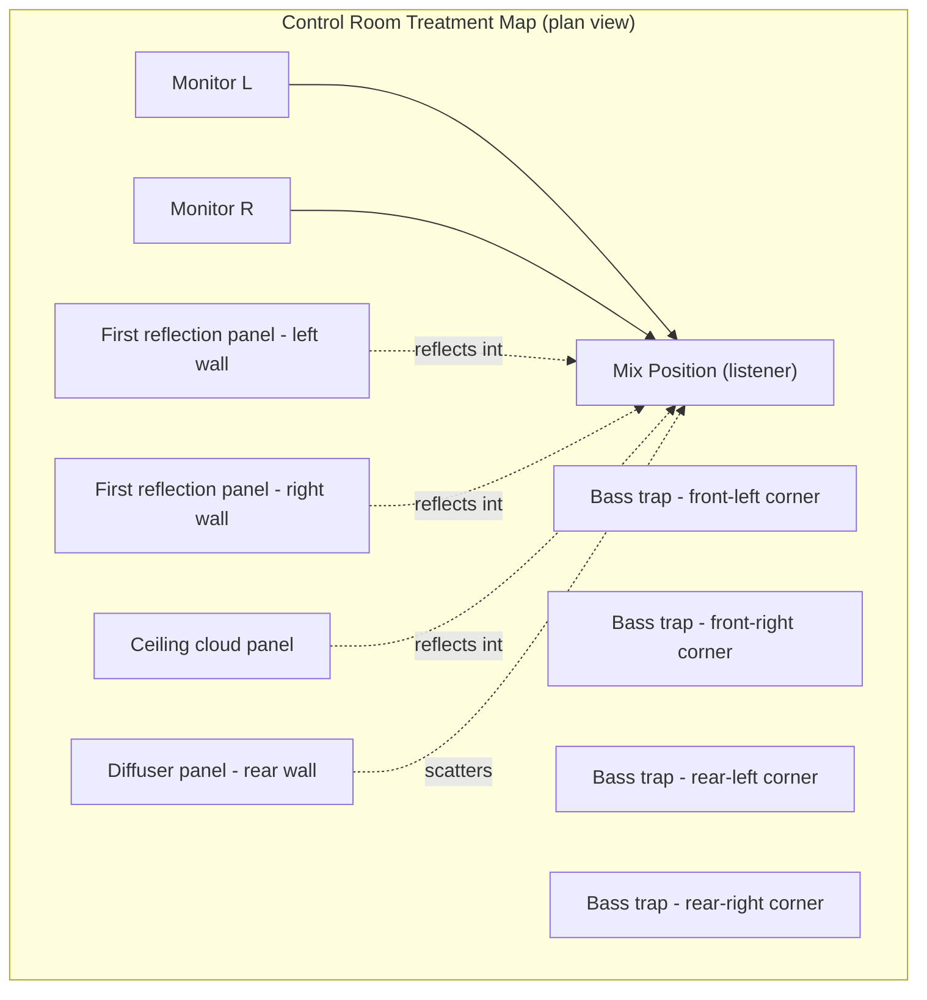
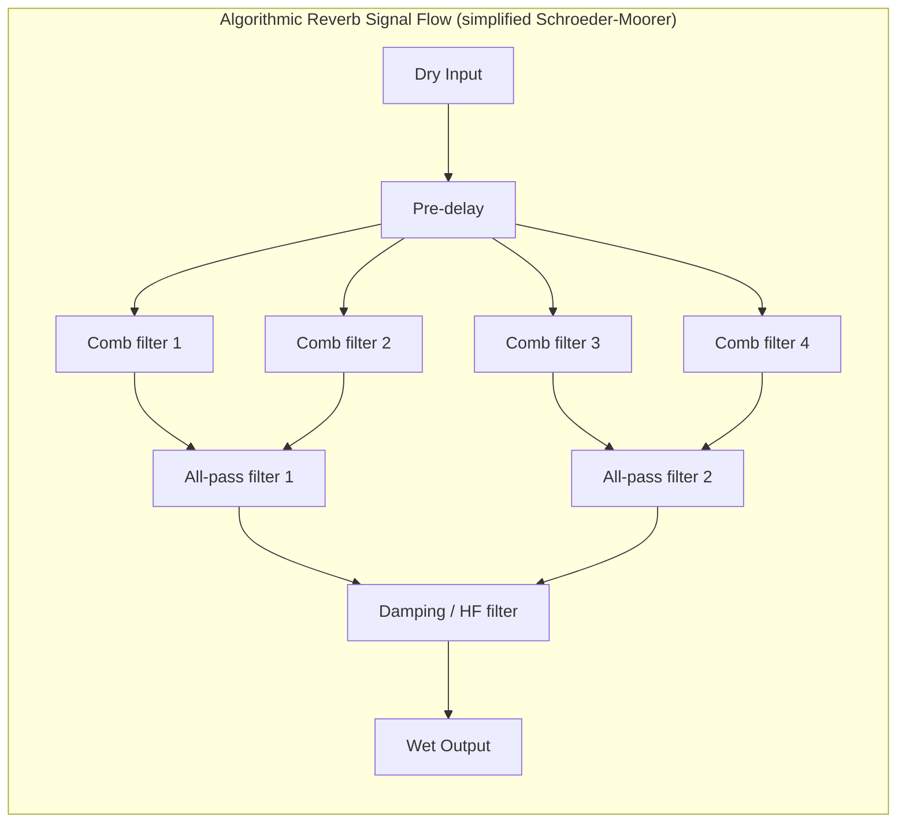

# Lesson 3: Room Acoustics, Reverberation & Studio Treatment

## Why This Matters at the Mixing Position

Every decision you make on a mix — EQ, reverb send, where you place a microphone — is being evaluated through the lens of the room you're sitting in. If your control room has a 12 dB bass buildup at 62 Hz because of a room mode, you will cut 62 Hz out of every mix to compensate, and that mix will sound thin everywhere else. Room acoustics isn't a side topic for architects; it's the lens your ears are judging everything through. This lesson gives you the measurements, the treatment placements, and the reverb-engineering knowledge to get that lens clean.

## 1. First-Principles: What a Room Does to Sound

Sound leaves a source as a pressure wave traveling at **343 m/s** (20°C, sea level — it rises roughly 0.6 m/s per °C, which is why outdoor PA systems drift slightly with temperature). When that wave meets a boundary, three things can happen in some combination: it **reflects**, it gets **absorbed** (converted to heat in a porous or resonant material), or it **transmits** through the boundary into the next space. Everything in acoustic treatment is about shifting that balance deliberately.

**Reverberation** is the sum of thousands of overlapping reflections decaying over time. It's not noise to be eliminated — a totally dead room feels unnatural and claustrophobic (this is why anechoic chambers are disorienting to stand in). The goal is *controlled, even* decay, not *zero* decay.

**RT60** is the time for sound pressure to drop 60 dB after the source stops. The governing relationship (Sabine's equation) is:

$$T_{60} = \frac{0.161V}{S\alpha}$$

Practical reading of this formula — you don't need to calculate it by hand on a session, you need to feel it: **double the absorption on your walls, halve your reverb time.** A concrete-and-glass room rings for seconds; the same room with carpet, curtains, and foam settles in under a second. That's the entire lever you have as a treatment engineer.

**Room modes** are standing waves locked to the room's dimensions — the room literally resonates like a closed pipe at frequencies where the wavelength fits an integer number of times between opposing walls. The practical consequence you'll hear: bass notes that boom in one spot and disappear three feet away, and a general "one note jumps out" problem below ~300 Hz in almost every untreated rectangular room. You don't need the modal equation to fix this — you need bass traps in corners (where all three axial modes reinforce) and you need to avoid mixing with your head at a quarter or half the room's length/width from a wall.

**Target RT60 by room use** (practical reference, not a derivation):
| Room type | Target RT60 | Why |
|---|---|---|
| Vocal/voiceover booth | 0.1–0.3s | Near-dead, no room character on the recording |
| Mix/control room | 0.3–0.5s | Accurate monitoring, minimal coloration |
| Drum/live tracking room | 0.4–1.2s (tunable) | Some liveliness desired, often with movable panels |
| Concert hall (classical) | 1.8–2.2s | Warmth and blend for orchestral sound |
| Chamber music hall | 1.3–1.7s | Clarity with warmth |

## 2. Diagnosing Your Room — A Practical Procedure

You cannot fix a room by ear alone in the first pass; you need a measurement to know where the problems actually are.

### Tools
- A calibrated measurement mic (e.g., Behringer ECM8000, miniDSP UMIK-1 — the UMIK-1 ships with a calibration file matched to its serial number, use it)
- Free software: **Room EQ Wizard (REW)** — industry-standard, free
- A full-range reference speaker or your actual monitors

### Step-by-step sweep measurement
1. Connect measurement mic via an audio interface with phantom power (if condenser).
2. In REW: `Measure → Measurement` tab, select output device as your monitor interface, input as the mic.
3. Set sweep type to **Log Swept Sine**, length 256k samples minimum for low-frequency resolution below 50 Hz.
4. Place the mic at your actual mix position, ears height, pointed at the tweeter axis.
5. Run the sweep at a level loud enough to clear the room's noise floor by 20+ dB but not clipping (aim for roughly 75–80 dB SPL at the mic).
6. Repeat the measurement at 3–5 positions around the listening area (mic moved 20–30 cm) and average — a single point measurement overstates local nulls/peaks.

### Reading the result
- **Waterfall/Spectrogram view**: look for frequencies that ring noticeably longer than their neighbors — these are your room modes. A healthy room shows fairly even decay across the spectrum; a problem room shows a "ridge" of sustained energy at one or two bass frequencies.
- **RT60 by octave band** (REW computes this automatically): if your 125 Hz band RT60 is 2–3x longer than your 1 kHz band, you have excess bass energy that isn't being absorbed — classic small untreated room signature.
- **Frequency response**: nulls (deep notches, often 10+ dB) below 300 Hz usually indicate speaker-boundary interference (SBIR) from a reflective wall or desk surface too close behind the monitors.

## 3. Treatment: What to Buy, Where to Put It

This is the actionable core — treatment is 90% placement, 10% material science.

### Bass traps — corners first, always
Low frequencies carry the most energy and are hardest to absorb (long wavelengths need either thick porous absorption or tuned resonant absorbers). Room corners are where axial pressure modes stack up for *every* mode in the room simultaneously, making corners the highest-leverage placement by far.

- **Trihedral corner traps** (floor-to-ceiling, in all four vertical room corners): single most effective, lowest-cost acoustic treatment you can buy. Minimum 6-inch-thick rigid fiberglass (Owens Corning 703/705 or equivalent) for meaningful absorption down to 100 Hz; thicker (10"+) or resonant membrane traps needed below 80 Hz.
- Don't skip the **ceiling-wall corners** (the horizontal "tri-corner" where two walls meet the ceiling) — commonly neglected, acoustically just as active as floor corners.

### First reflection points — mirror trick
The first reflections off the side walls and ceiling arrive at your ears only a few milliseconds after the direct sound and smear stereo imaging and transient clarity.

**Procedure to find them:** sit in your mix position. Have someone slide a mirror along the side wall at ear height. Mark the spot where you can see the *tweeter* of your monitor reflected in the mirror — that's a first reflection point. Repeat for the opposite wall, the ceiling (tweeter visible looking up), and the desk surface in front of you.

- Place a 2–4 inch thick absorptive panel (acoustic foam or rigid fiberglass panel, roughly 60×120 cm) at each marked point.
- Ceiling point: a "cloud" panel suspended a few inches below the ceiling surface.
- Desk reflection (if monitors sit on a reflective desk): a small panel or the desk's own absorptive surface between monitor and listening position kills comb-filtering from the tabletop bounce.

### Rear wall — diffusion, not just absorption
Dead-absorbing the entire rear wall in a small room can make the space feel unnaturally lifeless and claustrophobic. Better practice: use a **diffuser** (QRD/skyline-style, or even an irregular bookshelf with books of varying depth) on the rear wall behind the mix position. Diffusion scatters reflections in time and direction rather than eliminating them, preserving a sense of space without the flutter echo or modal buildup of a bare hard wall.

### Flutter echo check
Clap sharply in the center of the room. A healthy treated room gives a single tight "thwack" with no afterimage. A rapid metallic "zzzzt" ringing after the clap is **flutter echo** — sound bouncing rapidly between two parallel hard surfaces (often side walls or a hard floor/hard ceiling pair). Fix with either absorption or diffusion on one of the two parallel surfaces; you only need to break up one side of the pair.

### Monitor/listening position geometry
- Equilateral triangle: distance between the two monitors should equal the distance from each monitor to your ears.
- Monitors and ears at the same height — tweeter should fire directly at ear level, not angled up or down.
- Avoid symmetric center placement front-to-back in the room (e.g., exactly at the room's midpoint) — this causes the ceiling and floor modes to reinforce identically at the loudest point of the standing wave. Offset the mix position roughly 38% of the room's length from the front wall as a practical starting point (a long-standing studio design heuristic, not a hard law — measure and adjust).

## 4. Convolution Reverb — Using Real Room Acoustics in a Mix

A convolution reverb takes a recorded **impulse response (IR)** — the recorded "fingerprint" of a real space excited by a short, loud impulse (a starter pistol, balloon pop, or swept sine deconvolved to an impulse) — and mathematically imprints that space's reflection pattern onto your dry signal.

### Capturing your own IR (practical field method)
1. Set up the measurement mic at the listening position you want to capture (e.g., center of a church, a stairwell, a tiled bathroom for a vocal effect).
2. Play a logarithmic sine sweep (20 Hz–20 kHz, 10–20 seconds) through a flat-response speaker placed where the "source" instrument would be.
3. Record the sweep as heard in the room.
4. Deconvolve in REW or Altiverb's IR utility: `Impulse Response → Convert sweep to IR`. This mathematically removes the sweep's own signature and leaves the pure room response.
5. Trim the IR tail where it drops below the noise floor (typically -60 dB) to save CPU — a 6-second tail you never hear is pure wasted computation.
6. Load the resulting WAV into any convolution reverb plugin (Altiverb, Space Designer, Waves IR-1, or the free **Convolver** in most DAWs).

### Why FFT instead of brute-force convolution
Direct time-domain convolution of a 2-second IR (88,200 samples at 44.1kHz) against every incoming audio sample is O(n²) per block — computationally brutal in real time. Convolution plugins instead:
1. Chop the IR into blocks.
2. Transform both input signal and IR blocks to the frequency domain via FFT.
3. Multiply spectra (frequency-domain multiplication = time-domain convolution, but O(n log n)).
4. Inverse-FFT back to the time domain and overlap-add the blocks.

This is why convolution reverbs report "latency" in their plugin info — that's the FFT block size tax, typically 512–2048 samples. For tracking through a convolution reverb in real time, use the plugin's low-latency/"zero-latency" mode if available; it uses smaller partitioned blocks at the cost of some CPU overhead.

### Practical convolution reverb parameters and what they actually do
| Parameter | Effect | Mix move |
|---|---|---|
| Pre-delay | Gap before reverb onset | 15–30ms keeps vocal clarity while adding depth |
| Early/Late balance | Ratio of discrete early reflections to dense late tail | More early = more "room," more late = more "hall/wash" |
| Decay/length | Scales the IR's time axis | Shorten a cathedral IR to 1.5s for a usable vocal reverb without washing the mix |
| Damping (HF) | Rolls off high frequencies in the tail, mimicking air/material absorption over distance | Increase for distant/dark spaces, decrease for bright/close spaces |
| Width | Stereo spread of the reverb return | Narrow for mono-compatible mix bus sends, wide for ambience pads |

**Workflow habit:** always EQ *before* the reverb send (cut mud around 200–400 Hz, cut above 8 kHz if the source is sibilant) rather than only EQing the wet return — a cleaner reverb input produces a cleaner, less muddy tail, and you need far less EQ correction after the fact.

## 5. Algorithmic Reverb — When You're Not Convolving

Algorithmic reverbs (Valhalla Room, Lexicon-style plugins, Eventide Blackhole) don't use a recorded IR at all — they build the reverb tail from a network of **delay lines, all-pass filters, and feedback loops** (Schroeder/Moorer topology, later refined into Dattorro's plate algorithm).

- **Comb filters** (parallel delay lines with feedback) generate the dense buildup of reflections and are the primary source of the reverb's "density" and perceived size.
- **All-pass filters** diffuse the comb filter output further without adding resonant coloration — they smear the signal in time without changing its frequency magnitude response, which is why all-pass stages reduce the "metallic" ringing that raw comb filters produce on their own.
- Algorithmic reverbs are far cheaper on CPU than convolution and are fully parametric in real time (decay, size, diffusion can all be automated smoothly mid-mix), which is why they remain standard for send-effect reverb on vocals and drums despite convolution's realism advantage.

## 6. Practice Drill: Ear-Training for Room Acoustics

You can train your ears to identify RT60 and modal problems the same way you train pitch recognition.

1. **Reverb time matching drill:** Load 5 different algorithmic reverb presets with RT60 values of 0.3s, 0.8s, 1.5s, 2.5s, 4s on a dry vocal or snare sample. Listen blind (have a colleague randomize), guess the RT60 bracket, check the preset. Repeat daily for a week — this builds the same instinctive RT60 judgment a mastering engineer uses walking into an unfamiliar room.
2. **Mode-hunting drill:** Play a slow sine sweep (20–200 Hz) through your monitors at moderate volume and walk around your room. Note where bass suddenly swells or disappears — mark those spots. This maps your room's modal nulls/peaks by ear and tells you exactly where *not* to place your mix position or a kick drum mic.
3. **Flutter echo drill:** Clap in 10 different rooms you have access to (your bathroom, car, office, stairwell) and classify each by ear: dead / natural / ringy / fluttery. This builds the vocabulary and instinct to diagnose a problem room the moment you walk into it, before you ever pull out a measurement mic.
