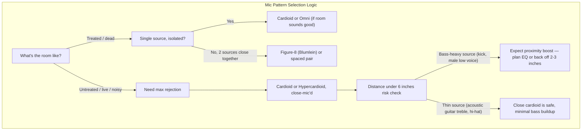
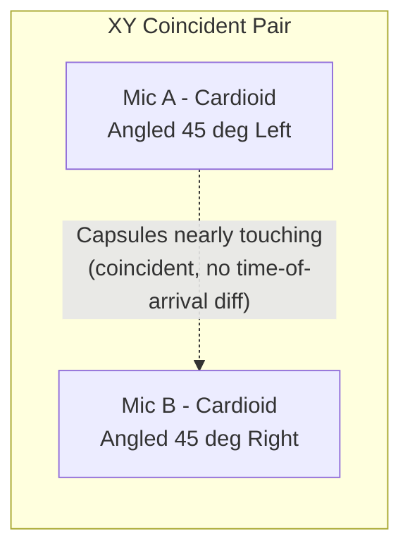
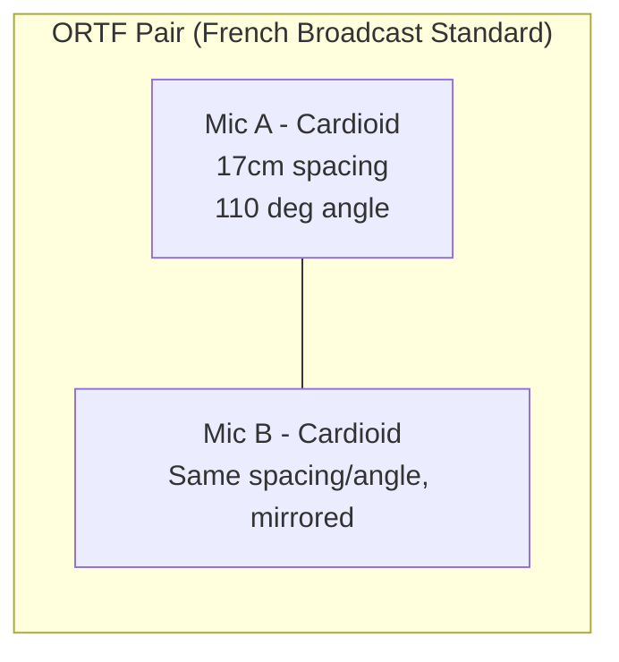
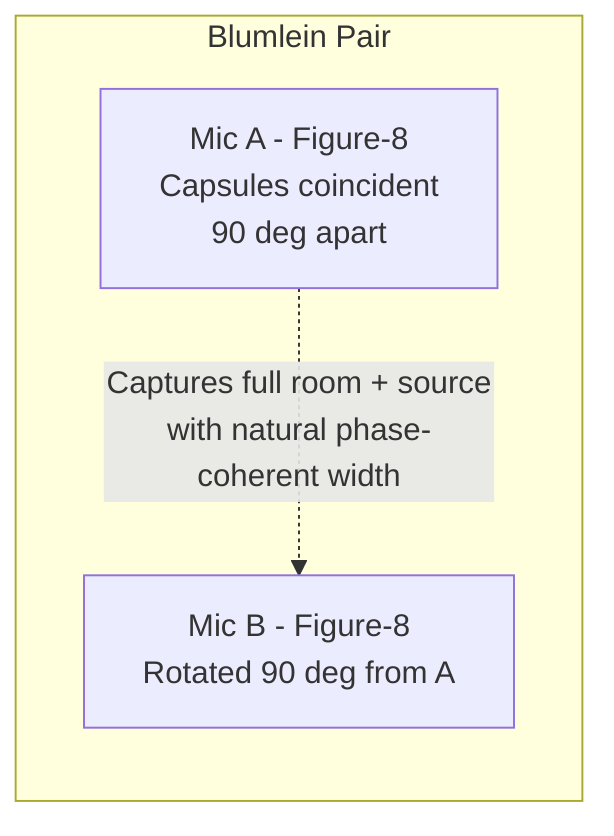
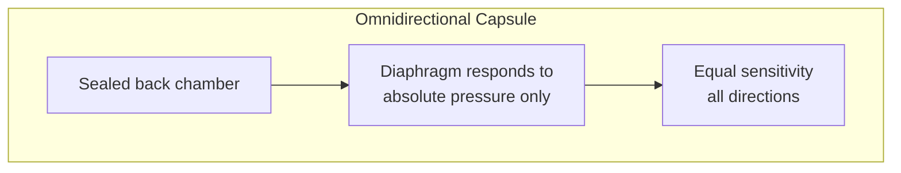
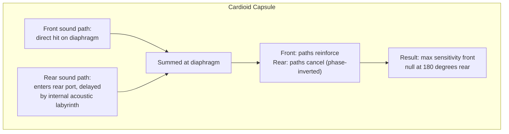
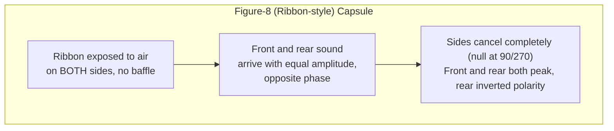

# Lesson 4: Microphone Techniques and Polar Patterns

## Why This Matters: The 15% You Need

A microphone is a pressure sensor wearing a directionality costume. Every polar pattern — cardioid, omni, figure-eight, hypercardioid, shotgun — is just a different arrangement of **sound entering the capsule from the front only, versus front and back, with phase cancellation doing the rejection work.** That single mechanical fact explains proximity effect, off-axis coloration, and why a cardioid mic sounds different pointed at a wall six inches away than three feet away. You don't need the derivation of the first-order cardioid polar equation to use this. You need to know:

1. **Pressure mics (omni)** have a sealed or minimally-vented back. They respond to absolute air pressure at the diaphragm, from any direction, nearly equally. No proximity effect. No off-axis rejection.
2. **Pressure-gradient mics (figure-eight, cardioid, hypercardioid)** have an open back. Sound reaches the diaphragm from both front and rear, through a path that's acoustically delayed on one side. Where the delayed rear path cancels the front path, you get a null. Where it reinforces, you get the lobe. **The polar pattern is literally a map of phase cancellation geometry**, not a different "mode" the mic switches into.
3. **Proximity effect** happens only in pressure-gradient designs, because the bass boost comes from the path-length difference between front and rear entry becoming proportionally large relative to the wavelength as the source gets close. Omnis don't have a rear entry, so they don't boost bass up close — this is why kick drum inside the shell gets an omni or a dynamic with a vent port, not a close cardioid, if you don't want the low end to balloon.

That's the whole theory section. Everything else in this lesson is where to put the mic, which pattern to grab, and how to avoid the five mistakes that ruin 90% of home and small-studio recordings.

---

## 1. The Polar Pattern Decision Tree (Use This Before You Touch a Mic)

```
sub_decision ["Mic Pattern Selection"]
```



**Field rule of thumb:**
- **Dead room + isolation needed** → cardioid.
- **Good-sounding room, want the room in the recording** → omni, pulled back 2–4 feet.
- **Two sound sources need to cancel each other's bleed** (two vocalists facing each other, M/S stereo) → figure-eight.
- **Extreme rejection, long throw, boom pole work** → shotgun (hypercardioid with an interference tube).
- **Loud stage, feedback risk** → cardioid or hypercardioid, never omni.

---

## 2. Dynamic vs. Condenser vs. Ribbon — The Field Decision, Not the Textbook Definition

You already know the transduction mechanics (coil-in-magnet, capacitor plate, ribbon-in-magnet). What matters on a session is **transient response and sensitivity**, because that dictates what survives being 2 inches from a snare versus what needs to sit 8 inches from a whispering vocalist.

| Mic Type | Transient Speed | Self-Noise | SPL Handling | Where It Wins | Where It Fails |
|---|---|---|---|---|---|
| **Dynamic** (SM57, SM58, MD421) | Moderate — diaphragm mass damps fast transients | Low self-noise but low output, needs clean gain | Very high (140+ dB) | Snare top/bottom, guitar cabs, live vocals, toms | Quiet acoustic sources sound dull; lacks top-end air |
| **Condenser, large diaphragm** (U87, C414, AT4050) | Fast, detailed | Low self-noise (if good preamp), high output | High (130-135 dB with pad) | Vocals, acoustic guitar, overheads, voiceover | Picks up room noise, HVAC hum, plosives without a pop filter |
| **Condenser, small diaphragm** (KM184, Rode NT5) | Very fast, most accurate | Slightly higher self-noise than LDC | High | Drum overheads, piano, orchestral sections, hi-hat | Can sound thin/harsh on already-bright sources |
| **Ribbon** (R121, SM7B is dynamic but ribbon-adjacent in use case) | Slowest, smoothest — ribbon mass rolls off harsh transients naturally | Low output, needs a clean high-gain preamp (API, Neve-style) | Moderate-high (careful with brass at close range on vintage ribbons) | Electric guitar cabs, brass, harsh vocalists needing smoothing, drum room mic | Fragile to wind blasts/phantom power miswiring on vintage units; needs serious preamp gain |

**Practical pairing drill:** record the same acoustic guitar strum pattern with (1) a dynamic 2 inches from the 12th fret, (2) an LDC 8 inches back at the same spot, (3) an SDC 10 inches back pointed at the 14th fret. A/B them. You will hear the dynamic sound boxy and close, the LDC sound full and present, the SDC sound detailed but a bit thin. This 15-minute drill teaches more than any spec sheet.

---

## 3. Vocal Mic Placement — Step-by-Step, With Distances

### Pop/R&B lead vocal (cardioid LDC)
1. Mic at **6–8 inches** from mouth, capsule at nose height, angled down slightly so the singer looks slightly up into it — reduces plosive blast and sinus congestion tone.
2. Pop filter **3–4 inches** from the capsule (not touching), singer **3–4 inches** behind that.
3. If the vocalist works the mic (leans in on quiet lines, pulls back on loud ones) — this is a *technique*, not a mistake, called **mic technique riding**. Coach them: lean in 2 inches on whispered lines to trigger proximity-effect warmth, pull back 6+ inches on belted notes to avoid clipping and to tame the inherent loudness.
4. Check the proximity effect at 2 inches versus 8 inches by ear before recording — low male voices will sound muddy at 2 inches on most cardioid LDCs; back off or high-pass the preamp at 80-100 Hz.

### Rock/live vocal (cardioid dynamic, e.g., SM58)
1. Mic **1–2 inches** from lips, angled slightly off-axis (30°) if the singer is a belter, to use the mic's off-axis rolloff as a built-in limiter against harshness.
2. Grip rule: singer's hand should be below the grille, never cupping the ball — cupping the head kills the pattern, creates comb-filtering, and causes feedback.

### Acoustic guitar + vocal simultaneous capture (singer-songwriter)
- **XY pair**: one cardioid SDC on the guitar 12th fret at 8–10 inches, one cardioid LDC on vocal at 7 inches, angled so the null of each rejects the other's source. Point the vocal mic's rear null (180° off-axis) at the guitar, and the guitar mic's null at the mouth. This exploits cardioid rejection geometrically instead of relying on distance alone.

---

## 4. Stereo Miking Techniques — Concrete Setups You Can Build Today







**When to use which:**
- **XY (coincident cardioids, 90°–135° angle apart, capsules nearly touching):** zero phase issues, mono-compatible, tightest stereo image. Use for drum overheads, piano, string quartet in a decent room.
- **ORTF (17 cm spacing, 110° angle):** wider, more natural stereo image with some time-of-arrival cues, still mono-safe-ish. Use for choir, orchestra, ambient room capture.
- **Blumlein (two figure-eights, coincident, 90° apart):** captures front AND back equally — picks up the room reflections behind the mics as much as the source in front. Gorgeous for string sections and drum overheads in a great-sounding room, disastrous in a bad-sounding room because it captures everything including the ugly reflections.
- **Spaced pair (A/B, omnis, 3-10 feet apart):** big, wide, spacious stereo image but **not mono-compatible** — summing to mono can cause comb-filter cancellation. Only use when you know playback will stay stereo (film, ambient music beds).

**Drum overhead drill:** set up XY cardioids 3 feet above the snare, pointed down at a 90° included angle. Record a full pattern. Then switch to ORTF at the same height. Compare stereo width and phase coherence in mono (hit "mono" on your monitor controller or DAW master bus) — XY should sum with zero loss, ORTF slightly less so, and a spaced pair likely shows audible comb filtering (hollow, phasey tone) in mono. This drill is the fastest way to internalize "mono-compatibility" as a physical, audible fact rather than an abstract warning.

---

## 5. Proximity Effect — Using It as a Tool, Not Fighting It as a Bug

Proximity effect is a **predictable, controllable** bass boost in any pressure-gradient (cardioid, hypercardioid, figure-eight) mic as distance to source decreases below roughly 1 foot. It is not a flaw to eliminate — it's a mixing tool available at tracking time.

**Practical distance-to-boost table (cardioid LDC, typical vocal):**

| Distance | Effect | Use Case |
|---|---|---|
| 1–2 inches | Heavy bass boost, intimate "radio voice," risk of popping | Hip-hop ad-libs, intimate whisper vocals, voiceover warmth |
| 3–4 inches | Moderate boost, full-bodied, still some pop risk | R&B/pop lead vocal, close-mic'd acoustic guitar |
| 6–8 inches | Slight boost, natural, standard "good vocal sound" | Default starting point for most lead vocal sessions |
| 12+ inches | Negligible boost, flatter low end, picks up more room | Choir, group vocals, situations needing natural tonal balance |

**Troubleshooting muddy vocal takes:** if a take sounds boomy/boxy in the low-mids (200-500 Hz region) and the singer is a bass-baritone recorded at 3 inches on a cardioid, that's proximity effect compounding with the natural chest resonance of a low voice. Fix at the source — move the mic to 6-8 inches — rather than trying to EQ it out after the fact; subtractive EQ on a boosted resonant buildup leaves an audibly "scooped" artifact. If you must fix after tracking, a high-pass filter around 100-120 Hz with a gentle slope (6-12 dB/octave) combined with a broad -2 to -3dB bell at 250-350 Hz usually recovers clarity without thinning the voice.

---

## 6. Off-Axis Coloration and the Instrument-Facing Angle

Every directional mic sounds different off-axis, not just quieter. High frequencies are the first to roll off and smear as the sound source moves away from the 0° axis, because short wavelengths are more easily diffracted/blocked by the capsule's own grille and body. This is why:

- **Guitar cabs**: angling the mic slightly off-center from the speaker's dust cap (toward the cone edge, roughly 30-45° off-axis) rolls off fizz and harshness from the speaker's high-frequency breakup, producing a smoother, less ice-picky tone. Dead center on the dust cap = maximum brightness and attack; edge of cone = darker, rounder.
- **Horn/brass sections**: a trumpet pointed directly into a cardioid at close range will often sound harsh and farty due to extreme high-SPL transient overload at 0°; angling the mic 20-30° off-axis, or backing off to 2+ feet, tames this without needing a pad.
- **Overhead drum mics**: pointing straight down captures maximum cymbal wash; angling toward the snare/toms and letting cymbals fall more off-axis reduces harsh cymbal bleed in the overheads.

**Drill:** mic a guitar cab dead-center on the dust cap at 2 inches, record a chord. Move the mic to the cone edge, same distance, same chord. A/B — the difference should be immediately obvious as "bright/aggressive" versus "warm/rounded." This single move fixes more harsh guitar tone complaints than any EQ plugin.

---

## 7. Internal Architecture — Why the Diaphragm Position Creates the Pattern







**What this means on a session, concretely:**
- An omni mic has **no null** — you cannot "aim away" from an unwanted sound source with an omni. If there's a noisy air conditioner, you either move the mic, treat the room, or switch to cardioid.
- A cardioid's null is a genuine 180° rear rejection zone, narrow and precise. **Point the exact null at your worst noise source** (a computer fan, a buzzing light fixture) rather than just "pointing the mic away" vaguely — the rejection is most effective exactly at 180°, dropping off as you move toward 150° or 210°.
- A figure-eight has two equally live lobes (front AND back) and two null planes at the sides (90°/270°). This is why Blumlein pairs and M/S (mid-side) stereo techniques exploit figure-eight mics — the side rejection is the sharpest, most mathematically clean null of any pattern, which is exactly what makes M/S decoding work predictably.

---

## 8. Common Failure Modes and Field Fixes

| Symptom | Likely Cause | Fix |
|---|---|---|
| Hollow, phasey tone when two mics are blended | Time-of-arrival mismatch between two mics on the same source (classic kick in/kick out, or snare top/bottom) | Apply the **3:1 rule**: second mic should be at least 3x farther from the first mic's source than the first mic is, OR nudge one mic's track a few samples/ms in the DAW to align the waveforms visually, then listen for the fullest low end |
| Vocal pops on every "P" and "B" | Plosive air blast hitting diaphragm directly | Add a pop filter at 3-4 inches from capsule, or angle the mic 15-20° off-axis from direct mouth position |
| Thin, boxy miced guitar cab tone | Mic pointed dead-center on dust cap too close, capturing cone breakup harshness | Move off-axis toward cone edge, or pull back 1-2 inches |
| Low rumble/handling noise on boom-mounted mic | Mechanical vibration transmitted through stand/boom into capsule (not acoustic at all) | Install a proper shock mount (spider-style, not just foam), check boom arm tension, isolate stand from floor with a mic stand pad if on a stage with foot traffic |
| Crackling/intermittent dropout on condenser mic | Phantom power issue — bad cable, bent XLR pin, or preamp not actually supplying 48V | Swap cable first (cheapest fix, most common cause), verify phantom power switch/LED on preamp, test mic on a different channel |
| Vintage ribbon mic suddenly silent after being plugged into a phantom-powered channel | Phantom power sent into a ribbon mic with no transformer protection can blow the ribbon instantly | **Always confirm phantom power is OFF before connecting any vintage/passive ribbon mic.** This is the single most common way engineers destroy a $3,000 ribbon mic in one plug-in. |
| Harsh sibilance on vocal condenser | Combination of close mic distance, bright mic choice, and resonant "S" frequencies (5-8 kHz) hitting the capsule at full level on-axis | Angle mic 10-15° off-axis from the mouth, increase distance slightly, or address with a de-esser plugin post-capture — but fixing mic angle first reduces how much de-essing is needed |

---

## 9. Session Checklist Before You Hit Record

1. **Pattern selected** based on room quality and isolation need (section 1 decision tree).
2. **Distance set** based on desired proximity effect (section 5 table) — don't default to "close" out of habit.
3. **Null aimed** at the worst noise source in the room if using a directional pattern.
4. **Off-axis angle checked** by ear — slightly de-tune from dead-center if the source is harsh/bright (guitar cabs, brass, aggressive vocalists).
5. **Phantom power verified OFF** before connecting any ribbon mic; verified ON for condensers.
6. **Mono compatibility checked** if recording stereo pairs — hit the mono button, listen for comb filtering, adjust spacing/angle if it collapses badly.
7. **Pop filter/windscreen in place** for close vocal work or any outdoor recording.
8. **Gain staged** so peaks sit around -12 to -18 dBFS in the DAW, leaving headroom without digital clipping.

This checklist takes under two minutes once internalized and prevents the overwhelming majority of "fix it in the mix" problems that are actually unfixable after the fact — comb filtering, proximity mud, and plosive pops are all far easier to prevent at the mic than to repair afterward.
