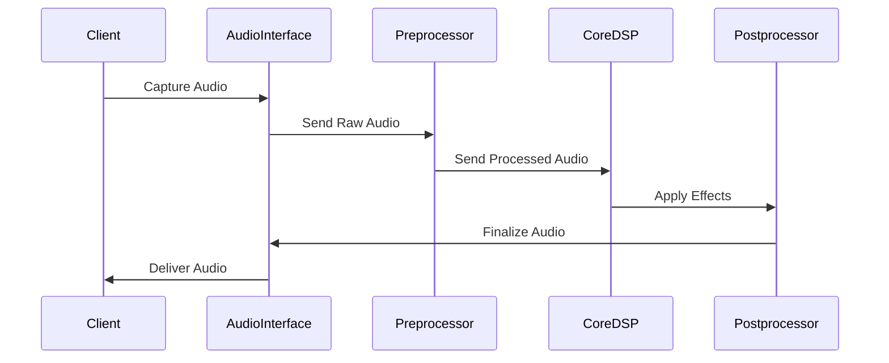

# Intermediate Foundation: Audio DSP
## 1. Architectural Mental Model
Building upon the foundational knowledge of basic DSP concepts, it's crucial to develop a robust mental model of audio DSP architecture. This involves understanding how various components interact to process audio signals efficiently and effectively in a production environment.

### Key Components:
- **Signal Acquisition:** Capturing audio signals from microphones or other sources.
- **Preprocessing:** Initial processing steps like filtering, noise reduction, and normalization.
- **Core DSP Algorithms:** Transformations such as Fourier Transforms, filtering, and effects processing.
- **Postprocessing:** Final adjustments like equalization, compression, and limiting.
- **Signal Output:** Delivery of processed audio to speakers, headphones, or storage.

### Production Architecture:
In a production setting, audio DSP systems are often modular and scalable. The architecture should support real-time processing, low latency, and high throughput. Key considerations include:
- **Modularity:** Components should be interchangeable and reusable.
- **Scalability:** The system should handle varying loads and complexities.
- **Real-time Performance:** Efficient algorithms and optimized code are essential.
- **Interoperability:** Standard interfaces and protocols ensure compatibility with other systems.

## 2. Systems Taxonomy & Component Protocols
Understanding the taxonomy of audio DSP systems and the protocols that govern their components is essential for effective system design.

### Standard Interfaces:
- **Audio Interfaces:** ASIO, Core Audio, WASAPI, etc.
- **Control Interfaces:** MIDI, OSC, etc.
- **Data Models:** Audio sample formats (e.g., PCM, IEEE Float), metadata standards (e.g., ID3, Vorbis Comment).

### Protocols:
- **Audio Transport:** RTP, RTSP, etc.
- **Control Protocols:** MIDI, OSC, etc.
- **Data Exchange:** XML, JSON, etc.

### Data Models:
- **Audio Samples:** PCM, IEEE Float, etc.
- **Metadata:** ID3, Vorbis Comment, etc.

## 3. Multi-Component Interaction Flow
A detailed understanding of how components interact is crucial for designing efficient and effective audio DSP systems.

### ASCII Sequence Diagram:
```
Client -> Audio Interface: Capture Audio
Audio Interface -> Preprocessor: Send Raw Audio
Preprocessor -> Core DSP: Send Processed Audio
Core DSP -> Postprocessor: Apply Effects
Postprocessor -> Audio Interface: Finalize Audio
Audio Interface -> Client: Deliver Audio
```

### Mermaid Sequence Diagram:


## 4. Architectural Trade-offs & Production Pitfalls
Designing an audio DSP system involves numerous trade-offs and potential pitfalls.

### Trade-offs:
- **Latency vs. Quality:** Lower latency can reduce quality, and vice versa.
- **Complexity vs. Performance:** More complex systems can offer better performance but at the cost of increased complexity.
- **Scalability vs. Cost:** Highly scalable systems can be more expensive to develop and maintain.

### Production Pitfalls:
- **Inefficient Algorithms:** Poorly optimized algorithms can lead to high latency and reduced performance.
- **Inadequate Testing:** Insufficient testing can result in undetected bugs and system failures.
- **Lack of Documentation:** Poor documentation can hinder maintenance and future development.

## 5. Socratic Discussion Starters
Engaging in thoughtful discussions can deepen understanding and foster innovation.

### Questions:
- How can we balance latency and quality in real-time audio processing?
- What are the most effective strategies for optimizing DSP algorithms for performance?
- How can we design systems that are both scalable and cost-effective?
- What are the best practices for testing and validating audio DSP systems?
- How can we ensure that our systems remain maintainable and adaptable to future changes?
