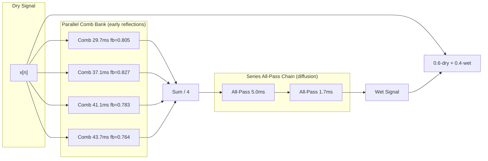
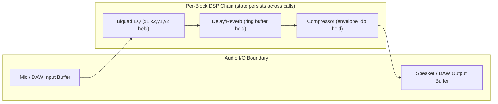

# Audio DSP Masterclass: Building Real-Time Filters, Delays, and Dynamics From Scratch

## Who This Is For and What You Will Build

You will build four production-grade DSP building blocks in Python, verify them against the physics that explains *why* they sound the way they do, then port the core logic to a block-processing structure identical to what you'd write inside a VST/AU plugin (JUCE) or a Eurorack DSP core. By the end you will have:

- A biquad filter engine (Direct Form I and Form II Transposed) with coefficient formulas for low-pass, high-pass, band-pass, notch, and peaking EQ — the same math the Audio EQ Cookbook and nearly every commercial parametric EQ plugin use.
- A circular delay buffer powering a chorus, a flanger, and a Schroeder reverb (comb + all-pass network).
- A soft-knee compressor with proper envelope detection, matching what you'd dial in on an SSL-style bus compressor.
- A block-processing harness that mimics a real plugin's `processBlock()` — the architecture that separates toy scripts from DSP you can ship.

Every exercise ends with a **listening + visual verification step** so you learn to diagnose filters by eye (frequency response plot) and by ear (does it actually sound right) — the same workflow used when debugging a plugin live in a DAW session.

### Required Environment

```bash
pip install numpy scipy matplotlib soundfile sounddevice
```

| Package | Role | Why not the obvious alternative |
|---|---|---|
| `numpy` | Sample arrays, vector math | — |
| `scipy.signal` | `freqz`, `lfilter`, filter design cross-checks | — |
| `soundfile` | WAV read/write | Avoid `pydub`/ffmpeg MP3 round-trips for DSP work — lossy codecs introduce quantization and pre-ringing artifacts that contaminate your analysis before you've even started debugging |
| `sounddevice` | Real-time audio I/O | Lets you *hear* each exercise live, not just plot it |

Cross-check Exercise 1 against a real plugin if you have one — FabFilter Pro-Q 3, Ableton EQ Eight, or the stock Logic Channel EQ all expose the same cutoff/Q/gain controls you're building here.

---

## Core Theory Primer (read once, keep nearby)

Every filter you build in this lesson is governed by one equation, the **difference equation**:

$$y[n] = \frac{1}{a_0}\left(b_0 x[n] + b_1 x[n-1] + b_2 x[n-2] - a_1 y[n-1] - a_2 y[n-2]\right)$$

This is a **biquad**: two poles, two zeros. The output sample depends on the current and past two input samples (`b` coefficients — the feedforward/FIR part) and the past two output samples (`a` coefficients — the feedback/IIR part). The feedback term is what makes a filter resonant or unstable: if the poles (roots of the `a` polynomial) land outside the unit circle in the z-plane, the filter output grows without bound instead of settling. Filter design is pattern-matching `b0, b1, b2, a1, a2` to a target curve — you don't need more theory than this to build professional filters.

---

## Exercise 1: Biquad Filter Engine — Direct Form I, Form II, and the Audio EQ Cookbook

### Direct Form I vs Direct Form II Transposed — which one to actually ship

**Direct Form I** computes the feedforward sum and the feedback sum separately and needs 4 delay registers (`x1, x2, y1, y2`). Rounding errors in the feedforward and feedback paths never interact, which makes it the most numerically robust topology under low-bit-depth or fixed-point arithmetic — the reason it shows up in embedded DSP chips and long resonant filter chains.

**Direct Form II Transposed** collapses the structure to 2 state variables by sharing delay storage between the two sums. It uses half the memory and is what you'll find in most modern C++ plugin codebases (JUCE's `IIRFilter`, SOUL). Default to Form II Transposed in production C++; reach for Form I when you're stacking many high-Q filters in series or targeting fixed-point hardware, where its error isolation actually matters.

```python
import numpy as np
import soundfile as sf
import matplotlib.pyplot as plt

class BiquadDF1:
    """Direct Form I biquad — explicit 4-register implementation.
    This is what's actually running inside analog-modeled EQ plugins."""
    def __init__(self, b, a):
        self.b0, self.b1, self.b2 = b[0]/a[0], b[1]/a[0], b[2]/a[0]
        self.a1, self.a2 = a[1]/a[0], a[2]/a[0]
        self.x1 = self.x2 = 0.0  # input history
        self.y1 = self.y2 = 0.0  # output history

    def process_sample(self, x0):
        y0 = (self.b0 * x0 + self.b1 * self.x1 + self.b2 * self.x2
              - self.a1 * self.y1 - self.a2 * self.y2)
        self.x2, self.x1 = self.x1, x0
        self.y2, self.y1 = self.y1, y0
        return y0

    def process_block(self, x):
        """Sample-by-sample loop — the exact structure a plugin's processBlock()
        uses. Vectorized scipy.lfilter is faster for offline analysis, but
        real-time plugins must process one sample at a time to support
        modulated (automated) coefficients changing mid-block."""
        return np.array([self.process_sample(s) for s in x], dtype=np.float64)


class BiquadDF2T:
    """Direct Form II Transposed — 2-register implementation, the topology
    used in most shipped C++ plugin code. Bit-identical output to DF1
    in floating point; differs only in rounding behavior at low bit depth."""
    def __init__(self, b, a):
        self.b0, self.b1, self.b2 = b[0]/a[0], b[1]/a[0], b[2]/a[0]
        self.a1, self.a2 = a[1]/a[0], a[2]/a[0]
        self.s1 = self.s2 = 0.0  # the two shared state registers

    def process_sample(self, x0):
        y0 = self.b0 * x0 + self.s1
        self.s1 = self.b1 * x0 - self.a1 * y0 + self.s2
        self.s2 = self.b2 * x0 - self.a2 * y0
        return y0

    def process_block(self, x):
        return np.array([self.process_sample(s) for s in x], dtype=np.float64)
```

### The Audio EQ Cookbook coefficient formulas

These are Robert Bristow-Johnson's formulas, used inside nearly every parametric EQ plugin on the market. `Q` controls resonance/bandwidth sharpness — higher Q narrows the band and increases ringing at the cutoff.

```python
def biquad_lowpass(fs, f0, Q=0.707):
    w0 = 2 * np.pi * f0 / fs
    alpha = np.sin(w0) / (2 * Q)
    cosw0 = np.cos(w0)
    b0 = (1 - cosw0) / 2
    b1 = 1 - cosw0
    b2 = (1 - cosw0) / 2
    a0 = 1 + alpha
    a1 = -2 * cosw0
    a2 = 1 - alpha
    return [b0, b1, b2], [a0, a1, a2]

def biquad_highpass(fs, f0, Q=0.707):
    w0 = 2 * np.pi * f0 / fs
    alpha = np.sin(w0) / (2 * Q)
    cosw0 = np.cos(w0)
    b0 = (1 + cosw0) / 2
    b1 = -(1 + cosw0)
    b2 = (1 + cosw0) / 2
    a0 = 1 + alpha
    a1 = -2 * cosw0
    a2 = 1 - alpha
    return [b0, b1, b2], [a0, a1, a2]

def biquad_bandpass(fs, f0, Q):
    """Constant 0 dB peak gain band-pass — isolates a band for telephone/
    lo-fi vocal effects, sidechain detection filtering, or sweep FX."""
    w0 = 2 * np.pi * f0 / fs
    alpha = np.sin(w0) / (2 * Q)
    cosw0 = np.cos(w0)
    b0 = alpha
    b1 = 0
    b2 = -alpha
    a0 = 1 + alpha
    a1 = -2 * cosw0
    a2 = 1 - alpha
    return [b0, b1, b2], [a0, a1, a2]

def biquad_peaking_eq(fs, f0, Q, gain_db):
    """The bread-and-butter 'bell' EQ band. gain_db > 0 boosts, < 0 cuts."""
    A = 10 ** (gain_db / 40)
    w0 = 2 * np.pi * f0 / fs
    alpha = np.sin(w0) / (2 * Q)
    cosw0 = np.cos(w0)
    b0 = 1 + alpha * A
    b1 = -2 * cosw0
    b2 = 1 - alpha * A
    a0 = 1 + alpha / A
    a1 = -2 * cosw0
    a2 = 1 - alpha / A
    return [b0, b1, b2], [a0, a1, a2]

def biquad_notch(fs, f0, Q):
    """Surgical cut — use for removing 50/60Hz hum or a resonant ring."""
    w0 = 2 * np.pi * f0 / fs
    alpha = np.sin(w0) / (2 * Q)
    cosw0 = np.cos(w0)
    b0, b1, b2 = 1, -2 * cosw0, 1
    a0 = 1 + alpha
    a1 = -2 * cosw0
    a2 = 1 - alpha
    return [b0, b1, b2], [a0, a1, a2]
```

### Hands-on build: filter a real test signal and verify by ear AND by eye

```python
fs = 44100
duration = 3.0
t = np.linspace(0, duration, int(fs * duration), endpoint=False)

# Test signal: 500 Hz fundamental + 2000 Hz "harmonic" we want to remove
test_signal = 0.5 * np.sin(2 * np.pi * 500 * t) + 0.3 * np.sin(2 * np.pi * 2000 * t)

b, a = biquad_lowpass(fs, f0=1000, Q=0.707)
filt = BiquadDF1(b, a)
filtered = filt.process_block(test_signal)

# Write both to disk so you can A/B them in headphones or your DAW —
# this is the single most important debugging step DSP engineers skip.
sf.write('test_original.wav', test_signal.astype(np.float32), fs)
sf.write('test_filtered_lowpass.wav', filtered.astype(np.float32), fs)
```

**Listening check:** play `test_original.wav` then `test_filtered_lowpass.wav`. The 2 kHz tone — the harsh, piercing layer — should disappear, leaving only the 500 Hz tone with a slightly duller timbre. No audible difference means your cutoff or Q is likely wrong; confirm with the frequency response plot before assuming the code is broken.

```python
from scipy.signal import freqz

w, h = freqz(b, a, worN=8000, fs=fs)
plt.figure(figsize=(8, 4))
plt.plot(w, 20 * np.log10(np.abs(h) + 1e-12))
plt.axvline(1000, color='r', linestyle='--', label='Cutoff 1 kHz')
plt.title('Low-Pass Biquad — Frequency Response')
plt.xlabel('Frequency [Hz]'); plt.ylabel('Gain [dB]')
plt.xscale('log'); plt.ylim(-40, 5); plt.grid(which='both')
plt.legend(); plt.tight_layout(); plt.savefig('lowpass_response.png')
```

**Diagnostic rule of thumb:** at the cutoff frequency, a Q=0.707 (Butterworth-equivalent) biquad reads **-3.01 dB**. If your plot shows the -3 dB point somewhere else, check that `f0` is in Hz (not normalized to 0–1) and that `fs` matches the actual sample rate of the signal — a sample-rate mismatch between filter design and the signal being filtered is the single most common biquad bug.

### Chaining bands into a full parametric EQ (cascaded biquads)

Real EQ plugins cascade multiple biquads in series. Each band is independent, and gains in dB simply add because dB is already a log scale.

```python
class ParametricEQ:
    """A channel-strip layout: HPF + bell bands, matching a typical
    mixing-console EQ section."""
    def __init__(self, fs):
        self.fs = fs
        self.bands = []

    def add_highpass(self, f0, Q=0.707):
        b, a = biquad_highpass(self.fs, f0, Q)
        self.bands.append(BiquadDF2T(b, a))

    def add_bell(self, f0, Q, gain_db):
        b, a = biquad_peaking_eq(self.fs, f0, Q, gain_db)
        self.bands.append(BiquadDF2T(b, a))

    def process(self, x):
        y = x
        for band in self.bands:
            y = band.process_block(y)
        return y

eq = ParametricEQ(fs)
eq.add_highpass(80)                   # clear sub-80Hz rumble
eq.add_bell(400, Q=1.4, gain_db=-3)   # scoop boxy low-mids
eq.add_bell(3000, Q=0.9, gain_db=2)   # add presence/clarity
mixed = eq.process(test_signal)
sf.write('test_parametric_eq.wav', mixed.astype(np.float32), fs)
```

---

## Exercise 2: Circular Delay Buffers — Chorus, Flanger, and Schroeder Reverb

### Why a circular buffer, mechanically

A delay effect reads a sample from `N` samples in the past while continuously writing new samples in. Shifting an entire array every sample is O(n) per sample and unusable in real time. A **ring buffer** — a fixed-size array with a write pointer that wraps via modulo arithmetic — turns both operations into O(1). This is the mechanism behind every delay/reverb/chorus plugin and every Eurorack digital delay module.

```python
class CircularDelayBuffer:
    def __init__(self, max_delay_samples):
        self.buffer = np.zeros(max_delay_samples, dtype=np.float64)
        self.size = max_delay_samples
        self.write_idx = 0

    def write_read(self, input_sample, delay_samples, feedback=0.0):
        """Write input + feedback-scaled delayed output, read back delayed sample.
        delay_samples can be fractional — linear interpolation between the two
        nearest integer taps prevents the 'zipper noise' you'd hear from
        integer-only delay time changes."""
        read_pos = (self.write_idx - delay_samples) % self.size
        idx0 = int(np.floor(read_pos))
        idx1 = (idx0 + 1) % self.size
        frac = read_pos - idx0
        delayed = self.buffer[idx0] * (1 - frac) + self.buffer[idx1] * frac

        self.buffer[self.write_idx] = input_sample + delayed * feedback
        self.write_idx = (self.write_idx + 1) % self.size
        return delayed
```

### Chorus: short modulated delay (15–35 ms) with an LFO

Chorus mimics multiple slightly-detuned voices by modulating delay time with a slow LFO (0.1–5 Hz). The pitch wobble is a Doppler-like effect: a continuously stretching/compressing delay line shifts pitch up or down as it changes length.

```python
def chorus_effect(x, fs, base_delay_ms=20, depth_ms=5, rate_hz=0.8, mix=0.5):
    max_delay = int(fs * (base_delay_ms + depth_ms) / 1000) + 2
    delay_buf = CircularDelayBuffer(max_delay)
    out = np.zeros_like(x)
    for n in range(len(x)):
        lfo = np.sin(2 * np.pi * rate_hz * n / fs)
        delay_samples = (base_delay_ms + depth_ms * lfo) * fs / 1000
        wet = delay_buf.write_read(x[n], delay_samples, feedback=0.0)
        out[n] = (1 - mix) * x[n] + mix * wet
    return out

chorused = chorus_effect(test_signal, fs, base_delay_ms=20, depth_ms=4, rate_hz=1.2)
sf.write('test_chorus.wav', chorused.astype(np.float32), fs)
```

**Ear-training checkpoint:** `rate_hz` 0.5–2 Hz with `depth_ms` 2–6 ms gives the classic '80s chorus-pedal shimmer. Push `rate_hz` to 4–8 Hz and you cross into vibrato/seasick territory — useful reference points for dialing in a plugin UI by ear instead of guessing.

### Flanger: very short delay (1–10 ms) with feedback — the jet-sweep effect

Mechanically identical to chorus but with a much shorter delay and added feedback, which turns the delay line into a comb filter whose notches sweep as the delay modulates. That moving-notch sweep is the metallic "jet plane" sound.

```python
def flanger_effect(x, fs, base_delay_ms=3, depth_ms=2, rate_hz=0.3, feedback=0.6, mix=0.5):
    max_delay = int(fs * (base_delay_ms + depth_ms) / 1000) + 2
    delay_buf = CircularDelayBuffer(max_delay)
    out = np.zeros_like(x)
    for n in range(len(x)):
        lfo = np.sin(2 * np.pi * rate_hz * n / fs)
        delay_samples = (base_delay_ms + depth_ms * lfo) * fs / 1000
        wet = delay_buf.write_read(x[n], delay_samples, feedback=feedback)
        out[n] = (1 - mix) * x[n] + mix * wet
    return out

flanged = flanger_effect(test_signal, fs, feedback=0.7)
sf.write('test_flanger.wav', flanged.astype(np.float32), fs)
```

**Why feedback creates the sweep, mechanically:** a delay line with feedback is a comb filter that cancels frequencies at odd multiples of `1/(2·delay_time)` and reinforces frequencies at even multiples. As the LFO changes delay time, these notches slide up and down the spectrum. Feedback 0.6–0.9 deepens the notches into the recognizable metallic resonance; above ~0.95 you risk runaway buildup, so **hard-clamp feedback below 1.0 in any user-facing code.**

### Schroeder Reverb: parallel comb filters + series all-pass filters

The classic 1962 Schroeder architecture, still the conceptual basis of algorithmic reverbs in plugins like Valhalla and the stock Logic/Ableton reverbs.

```python
class CombFilter:
    """Feedback comb — creates the dense 'early reflection' buildup."""
    def __init__(self, delay_samples, feedback):
        self.buf = np.zeros(delay_samples)
        self.idx = 0
        self.feedback = feedback

    def process(self, x):
        out = np.zeros_like(x)
        for n in range(len(x)):
            delayed = self.buf[self.idx]
            out[n] = delayed
            self.buf[self.idx] = x[n] + delayed * self.feedback
            self.idx = (self.idx + 1) % len(self.buf)
        return out

class AllPassFilter:
    """Diffuses the comb output without coloring the frequency spectrum —
    this is what turns 'metallic ringing' into a smooth reverb tail."""
    def __init__(self, delay_samples, gain=0.5):
        self.buf = np.zeros(delay_samples)
        self.idx = 0
        self.gain = gain

    def process(self, x):
        out = np.zeros_like(x)
        for n in range(len(x)):
            buf_out = self.buf[self.idx]
            v = x[n] + -self.gain * buf_out
            out[n] = buf_out + self.gain * v
            self.buf[self.idx] = v
            self.idx = (self.idx + 1) % len(self.buf)
        return out

def schroeder_reverb(x, fs):
    # Mutually incommensurate delay lengths (ms) avoid resonant overlap/flutter echo
    comb_delays_ms = [29.7, 37.1, 41.1, 43.7]
    comb_feedbacks = [0.805, 0.827, 0.783, 0.764]
    allpass_delays_ms = [5.0, 1.7]

    wet = np.zeros_like(x)
    for d_ms, fb in zip(comb_delays_ms, comb_feedbacks):
        comb = CombFilter(int(fs * d_ms / 1000), fb)
        wet += comb.process(x)
    wet /= len(comb_delays_ms)

    for d_ms in allpass_delays_ms:
        ap = AllPassFilter(int(fs * d_ms / 1000), gain=0.5)
        wet = ap.process(wet)

    return 0.6 * x + 0.4 * wet

reverbed = schroeder_reverb(test_signal, fs)
sf.write('test_reverb.wav', reverbed.astype(np.float32), fs)
```

**Why these specific delay lengths:** they're chosen to be mutually incommensurate (no small common multiples) so the combs' resonant peaks don't line up. If two combs shared a delay time, their resonances would stack and produce an audible ringing pitch instead of a smooth, pitch-neutral wash. Diffusing energy in time without imposing tonal color is the core design discipline behind every algorithmic reverb.



---

## Exercise 3: Dynamics Processing — A Real Soft-Knee Compressor

A compressor is not a filter — it's a **time-varying gain controller**. Core loop: measure level → decide how much to reduce it → smooth that decision so it doesn't click → apply the gain.

```python
class Compressor:
    def __init__(self, fs, threshold_db=-20, ratio=4.0, attack_ms=10,
                 release_ms=100, knee_db=6, makeup_db=0):
        self.fs = fs
        self.threshold_db = threshold_db
        self.ratio = ratio
        self.knee_db = knee_db
        self.makeup_gain = 10 ** (makeup_db / 20)
        # Attack/release as one-pole smoothing coefficients
        self.attack_coef = np.exp(-1 / (fs * attack_ms / 1000))
        self.release_coef = np.exp(-1 / (fs * release_ms / 1000))
        self.envelope_db = -100.0

    def _gain_computer(self, level_db):
        """Soft-knee gain reduction curve. Below threshold-knee/2: no reduction.
        Above threshold+knee/2: full ratio. In between: smooth quadratic blend
        — this is what makes a compressor 'musical' instead of a hard clamp."""
        knee_start = self.threshold_db - self.knee_db / 2
        knee_end = self.threshold_db + self.knee_db / 2
        if level_db < knee_start:
            return level_db
        elif level_db > knee_end:
            return self.threshold_db + (level_db - self.threshold_db) / self.ratio
        else:
            x = level_db - knee_start
            return level_db + ((1 / self.ratio - 1) * x ** 2) / (2 * self.knee_db)

    def process(self, x):
        out = np.zeros_like(x)
        for n in range(len(x)):
            rectified = abs(x[n]) + 1e-9
            level_db = 20 * np.log10(rectified)

            # Attack when level rises above envelope, release when it falls —
            # this asymmetric smoothing is what gives a compressor its "feel"
            coef = self.attack_coef if level_db > self.envelope_db else self.release_coef
            self.envelope_db = coef * self.envelope_db + (1 - coef) * level_db

            target_db = self._gain_computer(self.envelope_db)
            gain_reduction_db = target_db - self.envelope_db
            gain_linear = 10 ** (gain_reduction_db / 20)

            out[n] = x[n] * gain_linear * self.makeup_gain
        return out

# Build a signal with a quiet verse and a loud chorus hit to hear compression work
quiet = 0.1 * np.sin(2 * np.pi * 220 * t[:len(t)//2])
loud = 0.9 * np.sin(2 * np.pi * 220 * t[len(t)//2:])
dynamic_signal = np.concatenate([quiet, loud])

comp = Compressor(fs, threshold_db=-14, ratio=4.0, attack_ms=5, release_ms=150, makeup_db=6)
compressed = comp.process(dynamic_signal)
sf.write('test_dynamic_signal.wav', dynamic_signal.astype(np.float32), fs)
sf.write('test_compressed.wav', compressed.astype(np.float32), fs)
```

**Diagnostic/ear checkpoint:** A/B `test_dynamic_signal.wav` against `test_compressed.wav`. The loud half should sound noticeably closer in level to the quiet half — gain reduction plus makeup gain doing its job. If the compressed file crackles, `makeup_db` is too high relative to the gain reduction being applied; drop it a few dB.

**Attack/release tuning table (practical starting points, not laws):**

| Source | Attack | Release | Ratio | Why |
|---|---|---|---|---|
| Bass guitar | 10–30ms | 100–250ms | 3:1–5:1 | Slow attack lets the pluck transient through for punch |
| Vocal | 5–15ms | 80–200ms | 2:1–4:1 | Fast enough to catch peaks, slow enough to avoid pumping |
| Drum bus | 1–5ms | 50–100ms | 4:1–8:1 | Fast attack controls transient spikes across the kit |
| Master bus (glue) | 20–30ms | 200–400ms (or auto) | 1.5:1–2:1 | Gentle, mostly inaudible, "glues" the mix together |

---

## Exercise 4: Block Processing Architecture — Thinking Like a Plugin

Toy scripts process an entire array at once. Real plugins process audio in small chunks (typically 64–1024 samples) delivered by the host in a callback, because the whole signal doesn't exist yet — it's streaming live. You must maintain **state between calls** (the delay buffer, the filter's `x1/x2/y1/y2`, the compressor's envelope) exactly like the classes above already do. This is the single most important architectural lesson for moving from "DSP script" to "DSP plugin."

```python
import sounddevice as sd

def run_realtime_lowpass_demo(fs=44100, block_size=256, cutoff=800, duration_s=6):
    """Live microphone -> low-pass filter -> speakers.
    This is the exact callback structure JUCE's processBlock() uses."""
    b, a = biquad_lowpass(fs, cutoff, Q=0.707)
    live_filter = BiquadDF2T(b, a)

    def callback(indata, outdata, frames, time_info, status):
        if status:
            print(status)  # buffer under/overruns show up here — the first
                            # thing to check when you hear clicks/dropouts
        mono_in = indata[:, 0]
        processed = live_filter.process_block(mono_in)
        outdata[:, 0] = processed
        outdata[:, 1] = processed

    with sd.Stream(samplerate=fs, blocksize=block_size, channels=(1, 2),
                    dtype='float32', callback=callback):
        print(f"Live low-pass @ {cutoff}Hz running for {duration_s}s. Talk/play into mic.")
        sd.sleep(int(duration_s * 1000))

# Uncomment to run (requires a working audio input device):
# run_realtime_lowpass_demo(cutoff=800)
```

**The one rule that governs all real-time audio code:** the callback must never block. No file I/O, no memory allocation (`np.zeros()` inside the callback is a latency bug), no locks, no `print()` in production. Pre-allocate every buffer and filter state before the stream starts — exactly why `BiquadDF1`, `BiquadDF2T`, and `CircularDelayBuffer` store their state as instance variables instead of creating new arrays every call.



### Block size vs. latency — the trade-off you'll actually tune

| Block size (samples @ 44.1kHz) | Latency | Use case |
|---|---|---|
| 32–64 | 0.7–1.5 ms | Live tracking monitoring, guitar amp sims — any delay is audible to the performer |
| 128–256 | 2.9–5.8 ms | General mixing, most plugin defaults |
| 512–1024 | 11.6–23.2 ms | Offline mixing, CPU-heavy convolution reverbs, mastering chains where latency doesn't matter |

Smaller blocks mean the callback fires more often per second, raising CPU overhead per sample processed. If you hear clicking or crackling during live monitoring, raise the block size first — that is almost always a buffer underrun, not a bug in your filter math.

---

## Exercise 5: Fault Injection and Stability Stress Testing

Production DSP code must survive parameter extremes without crashing, producing NaNs, or blowing the output into clipping. Test these deliberately — the DSP equivalent of unit testing edge cases.

### Test 1: Cutoff frequency approaching Nyquist

```python
# As cutoff approaches fs/2, the analog-to-digital bilinear transform
# compresses the response nonlinearly — filters become unusably steep
# or unstable right at the edge. Always clamp user input.
def safe_biquad_lowpass(fs, f0, Q=0.707):
    nyquist = fs / 2
    f0_clamped = np.clip(f0, 20, nyquist * 0.99)  # never allow f0 >= Nyquist
    return biquad_lowpass(fs, f0_clamped, Q)

# Demonstrate the failure mode without the guard:
try:
    b, a = biquad_lowpass(fs, f0=22050, Q=0.707)  # exactly at Nyquist
    w, h = freqz(b, a, fs=fs)
    print("Max gain near Nyquist (unguarded):", np.max(np.abs(h)))
except Exception as e:
    print("Failure:", e)
```

### Test 2: High-Q resonance self-oscillation check

```python
def check_filter_stability(b, a):
    """A biquad is stable iff both poles lie strictly inside the unit circle.
    Checking this programmatically catches runaway filters before they
    reach a user's speakers."""
    poles = np.roots(a)
    max_pole_mag = np.max(np.abs(poles))
    stable = max_pole_mag < 1.0
    return stable, max_pole_mag

for Q_test in [0.707, 5, 20, 50]:
    b, a = biquad_peaking_eq(fs, 1000, Q_test, gain_db=12)
    stable, mag = check_filter_stability(b, a)
    print(f"Q={Q_test:>5}: pole magnitude={mag:.4f}  stable={stable}")
```

High Q with large positive gain pushes poles closer to the unit circle — audibly this is the "self-resonating whistle" of cranking a synth filter's resonance knob near max. It's stable (barely), but floating-point rounding in a long feedback chain can tip it over, which is why production filter code often includes a denormal/NaN guard:

```python
def denormal_guard(x, threshold=1e-15):
    """Flush near-zero values to true zero. Without this, decaying
    feedback loops (reverb tails, resonant filters) can stall the CPU
    on denormalized floats — a classic real-time audio performance bug."""
    return np.where(np.abs(x) < threshold, 0.0, x)
```

### Test 3: Silence, DC, and full-scale inputs

```python
test_cases = {
    'silence': np.zeros(fs),
    'dc_offset': np.ones(fs) * 0.9,
    'full_scale_square': np.sign(np.sin(2 * np.pi * 100 * np.linspace(0, 1, fs))),
    'impulse': np.concatenate([[1.0], np.zeros(fs - 1)]),
}

b, a = biquad_lowpass(fs, 1000, Q=0.707)
for name, sig in test_cases.items():
    filt = BiquadDF1(b, a)
    out = filt.process_block(sig)
    has_nan = np.any(np.isnan(out))
    peak = np.max(np.abs(out))
    print(f"{name:>18}: peak_out={peak:.4f}  NaN_present={has_nan}")
```

**What to check:** the `impulse` output is the filter's **impulse response** — for a stable low-pass biquad it should decay to silence within a few hundred samples, never growing. If `dc_offset` produces a NaN, or the output peak exceeds the input (unity DC gain for a properly normalized low-pass reads ~1.0, not 5.0 or `inf`), your `a0` normalization has a bug — verify every coefficient is divided by `a0` before use.

---

## Troubleshooting Reference

| Symptom | Likely Cause | Fix |
|---|---|---|
| Filter sounds identical before/after | `fs` mismatch between design and signal, or cutoff clamped wrong | Print `fs` at both the coefficient call and the signal generation; confirm they match |
| Clicking when changing delay time live | Integer-only delay read index | Use fractional delay with linear (or allpass) interpolation, as in `CircularDelayBuffer` |
| Reverb tail rings at a single pitch | Comb delay times share a common factor | Re-pick delay lengths so none divides evenly into another |
| Compressor "pumps" audibly | Release too fast relative to program material tempo | Lengthen release to 150–300ms, or switch to auto-release if available |
| CPU spikes during long silence/decay | Denormalized floats in a feedback loop | Apply `denormal_guard`, or add a tiny DC bias (-120dB) to force normal float range |
| NaN or `inf` in filtered output | Missing or incorrect `a0` normalization | Divide every `b`/`a` coefficient by `a0` immediately after generating them |
| Crackling only during live mic monitoring | Buffer underrun from a blocking call in the callback | Remove any `print()`, file I/O, or allocation from the callback; raise block size |

---

## Practice Routine: From Script to Ear

Treat this like instrument practice — DSP intuition is built by repeated listening, not just reading code.

1. **Week 1 — Filter ear training:** Sweep a low-pass cutoff from 20kHz down to 200Hz on a full mix (use the `ParametricEQ` class or any DAW EQ) while listening on headphones. Name out loud what frequency range you're losing at each stop (air, presence, body, mud). Repeat with high-pass.
2. **Week 2 — Modulation depth calibration:** Build the chorus effect at three `depth_ms` values (2, 8, 20) and rates (0.5, 2, 6 Hz). Journal which combinations sound like "thickening," "seasick," or "broken."
3. **Week 3 — Compressor by feel:** Compress a drum loop at ratios 2:1, 4:1, 10:1, attack 1ms vs 30ms. Identify "pumping" and "breathing" artifacts by ear before checking the gain-reduction meter.
4. **Week 4 — Build your own effect:** Combine the comb filter with an LFO-modulated delay into a **vibrato** effect (100% wet, no dry mix) and a **pitch-shifted doubler** (two delay lines at slightly different modulation phases). This forces you to recombine the primitives instead of running the provided scripts verbatim.
