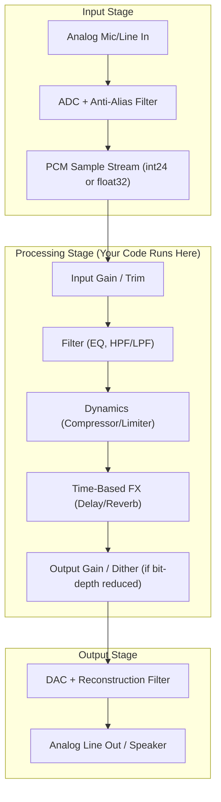

# Audio DSP: Sampling, Filters, Delay Lines, and a Production-Grade Signal Chain

## 1. First-Principles Intuition (Read Once, Then Go Build)

Every DSP effect you will ever write — EQ, compression, reverb, distortion, pitch shifting — reduces to three primitive operations: **delay** (store a past sample), **scale** (multiply by a coefficient), and **sum** (add signals together). A reverb is thousands of delays, scales, and sums arranged cleverly. A chorus is one delay with a wobbling read pointer. Internalize this now so filter design stops feeling like algebra and starts feeling like plumbing.

**Sampling and Nyquist, the practical version:** at 44.1 kHz sample rate, you can faithfully represent frequencies up to 22.05 kHz — half the sample rate, the Nyquist frequency. Anything above that folds back ("aliases") into the audible range as inharmonic noise unrelated to the source material. This is why cheap distortion plugins buzz unpleasantly: clipping a waveform generates harmonics far above Nyquist, those harmonics fold down, and you hear digital grit instead of warm saturation. Professional distortion/saturation plugins oversample — running the nonlinear stage at 4x–16x the sample rate, filtering, then decimating back down — specifically to push those new harmonics above Nyquist before they can fold back into the audible range.

**Quantization, the practical version:** bit depth sets your noise floor, not your "quality" in some vague sense. Each bit gives roughly 6.02 dB of dynamic range: 16-bit yields ~96 dB, 24-bit yields ~144 dB. Record at 24-bit always — storage cost is negligible on modern disks, and the extra headroom protects you against your own gain-staging mistakes. The one place bit depth actually bites you: doing gain changes or EQ in a 16-bit integer pipeline where the arithmetic truncates instead of rounding accumulates quantization error over many operations. This is why every modern DAW processes internally at 32-bit or 64-bit float — floating point essentially eliminates this concern until final export.

**Dither is not optional when reducing bit depth.** Bouncing a 24-bit or 32-bit-float mix down to 16-bit for delivery truncates the low bits, and that truncation error correlates with the signal — it sounds like a faint grainy artifact that swells and fades with quiet passages. Adding a tiny amount of noise (dither) before truncating decorrelates the error from the signal, turning audible distortion into a flat, inaudible noise floor. Rule: dither once, at the final bit-depth-reduction step, never earlier in the chain.

The one piece of math worth keeping in your head: a sine wave of frequency `f` sampled at rate `fs` advances by phase `2π·f/fs` radians per sample. Everything else in this lesson is built by manipulating sequences of numbers, not by solving equations on paper.

---

## 2. Core Architecture of a Real-Time Audio Pipeline



This maps directly onto a real plugin's signal path. If you write a VST/AU, your `processBlock()` function IS the "Processing Stage" box: it receives a buffer of floats, runs steps D through H, and hands the buffer back to the host every few milliseconds, forever, with zero tolerance for a missed deadline.

### Buffer size and latency — the trade-off you tune on every session

Your DAW's audio buffer (64, 128, 256, 512, 1024 samples) sets round-trip latency. At 44.1 kHz:

| Buffer size | Latency (one-way) | Use case |
|---|---|---|
| 64 samples | 1.45 ms | Live tracking, real-time amp sim — needs a fast CPU/interface |
| 128 samples | 2.9 ms | Tracking vocals/instruments, general low-latency work |
| 256 samples | 5.8 ms | Comfortable mixing with moderate plugin load |
| 512–1024 samples | 11.6–23.2 ms | Mixing/mastering with heavy CPU load (convolution reverb, many instances), no live input needed |

**Rule of thumb:** smaller buffer means lower latency but more interrupts per second and higher risk of dropouts if any plugin in the chain can't keep up. If you hear clicking or crackling while tracking, raise the buffer size before blaming your audio interface.

---

## 3. Building a Real Filter: Biquad in Direct Form II Transposed

Stop reading about filters abstractly. Here is a complete, runnable, production-grade biquad filter — the workhorse behind nearly every EQ band, low-pass, high-pass, and shelf you will ever use. This uses the **RBJ Audio EQ Cookbook** formulas, the industry-standard reference implemented in countless commercial plugins.

```c
// biquad.c — a complete, drop-in biquad filter stage.
// Direct Form II Transposed: numerically stable, low coefficient count, cheap.
#include <math.h>

typedef struct {
    double a1, a2, b0, b1, b2; // normalized coefficients (a0 divided out, always 1)
    double z1, z2;             // internal state (delay registers)
} Biquad;

// Process one sample. Call this once per sample, per channel.
static inline double biquad_process(Biquad *bq, double in) {
    double out = bq->b0 * in + bq->z1;
    bq->z1 = bq->b1 * in + bq->z2 - bq->a1 * out;
    bq->z2 = bq->b2 * in - bq->a2 * out;
    return out;
}

// Configure as a low-pass filter.
// fs = sample rate (Hz), fc = cutoff frequency (Hz), Q = resonance (0.707 = no peaking)
void biquad_set_lowpass(Biquad *bq, double fs, double fc, double Q) {
    double omega = 2.0 * M_PI * fc / fs;
    double sn = sin(omega), cs = cos(omega);
    double alpha = sn / (2.0 * Q);

    double b0 = (1.0 - cs) / 2.0;
    double b1 = 1.0 - cs;
    double b2 = (1.0 - cs) / 2.0;
    double a0 = 1.0 + alpha;
    double a1 = -2.0 * cs;
    double a2 = 1.0 - alpha;

    bq->b0 = b0 / a0; bq->b1 = b1 / a0; bq->b2 = b2 / a0;
    bq->a1 = a1 / a0; bq->a2 = a2 / a0;
    bq->z1 = 0.0; bq->z2 = 0.0;
}

// Configure as a peaking EQ bell. gain_db = boost/cut, Q controls bandwidth.
void biquad_set_peaking(Biquad *bq, double fs, double fc, double Q, double gain_db) {
    double A = pow(10.0, gain_db / 40.0);
    double omega = 2.0 * M_PI * fc / fs;
    double sn = sin(omega), cs = cos(omega);
    double alpha = sn / (2.0 * Q);

    double b0 = 1.0 + alpha * A;
    double b1 = -2.0 * cs;
    double b2 = 1.0 - alpha * A;
    double a0 = 1.0 + alpha / A;
    double a1 = -2.0 * cs;
    double a2 = 1.0 - alpha / A;

    bq->b0 = b0 / a0; bq->b1 = b1 / a0; bq->b2 = b2 / a0;
    bq->a1 = a1 / a0; bq->a2 = a2 / a0;
    bq->z1 = 0.0; bq->z2 = 0.0;
}

// Configure as a high-pass filter — mirror of lowpass with sign flips on b terms.
void biquad_set_highpass(Biquad *bq, double fs, double fc, double Q) {
    double omega = 2.0 * M_PI * fc / fs;
    double sn = sin(omega), cs = cos(omega);
    double alpha = sn / (2.0 * Q);

    double b0 = (1.0 + cs) / 2.0;
    double b1 = -(1.0 + cs);
    double b2 = (1.0 + cs) / 2.0;
    double a0 = 1.0 + alpha;
    double a1 = -2.0 * cs;
    double a2 = 1.0 - alpha;

    bq->b0 = b0 / a0; bq->b1 = b1 / a0; bq->b2 = b2 / a0;
    bq->a1 = a1 / a0; bq->a2 = a2 / a0;
    bq->z1 = 0.0; bq->z2 = 0.0;
}
```

**Why Direct Form II Transposed and not the "obvious" textbook form:** it needs only two state variables (`z1`, `z2`) instead of four, which halves memory traffic — real savings in hot loops running at 44,100+ iterations per second per channel. It is also more numerically robust against coefficient quantization than naive Direct Form I when working in single-precision float, which matters once you stack 20+ bands in an EQ chain.

**High-pass filter use case you'll apply constantly:** every channel on a mixing console gets a high-pass at 80–120 Hz to remove mic stand rumble, HVAC noise, and proximity-effect mud, before any other processing. Set `Q = 0.707` (Butterworth, maximally flat, no resonant bump at the cutoff) unless you specifically want a resonant peak there.

### Drill: hear it yourself in 10 minutes (Python prototype before you port to C/JUCE)

```python
# biquad_demo.py — generate a sweep, low-pass it, write a WAV you can A/B in your DAW.
import numpy as np
import soundfile as sf

fs = 44100
duration = 3.0
t = np.linspace(0, duration, int(fs * duration), endpoint=False)
# Logarithmic sweep 100 Hz -> 8000 Hz, good for hearing filter action by ear
sweep = 0.5 * np.sin(2 * np.pi * 100 * (8000/100)**(t/duration) * t)

def biquad_lowpass_coeffs(fs, fc, Q):
    omega = 2 * np.pi * fc / fs
    sn, cs = np.sin(omega), np.cos(omega)
    alpha = sn / (2 * Q)
    b0, b1, b2 = (1 - cs) / 2, 1 - cs, (1 - cs) / 2
    a0, a1, a2 = 1 + alpha, -2 * cs, 1 - alpha
    return b0/a0, b1/a0, b2/a0, a1/a0, a2/a0

def run_biquad(x, b0, b1, b2, a1, a2):
    y = np.zeros_like(x)
    z1 = z2 = 0.0
    for n in range(len(x)):
        out = b0 * x[n] + z1
        z1 = b1 * x[n] + z2 - a1 * out
        z2 = b2 * x[n] - a2 * out
        y[n] = out
    return y

b0, b1, b2, a1, a2 = biquad_lowpass_coeffs(fs, fc=1000, Q=0.707)
filtered = run_biquad(sweep, b0, b1, b2, a1, a2)

sf.write("sweep_dry.wav", sweep, fs)
sf.write("sweep_filtered_1khz_lpf.wav", filtered, fs)
print("Load both WAVs into your DAW and A/B them. Above 1kHz the sweep should audibly dim.")
```

Run it: `pip install numpy soundfile && python biquad_demo.py`. Load both files on two tracks, solo/mute to compare. The sweep's top end darkens progressively past 1 kHz — the cutoff frequency working exactly as the coefficients predict.

### Chaining biquads: building a usable parametric EQ

A single biquad gives you one band. Real EQs cascade several in series, each processing the output of the previous one:

```c
// eq_chain.c — four-band parametric EQ, the architecture inside every channel strip.
typedef struct {
    Biquad hpf;     // low-cut, removes rumble below 100 Hz
    Biquad low_bell;  // 250 Hz, cuts boxiness
    Biquad mid_bell;  // 2 kHz, adds presence
    Biquad high_shelf; // 8 kHz, adds air
} EqChain;

void eq_chain_init(EqChain *eq, double fs) {
    biquad_set_highpass(&eq->hpf, fs, 100.0, 0.707);
    biquad_set_peaking(&eq->low_bell, fs, 250.0, 1.0, -3.0);
    biquad_set_peaking(&eq->mid_bell, fs, 2000.0, 1.4, 2.5);
    biquad_set_peaking(&eq->high_shelf, fs, 8000.0, 0.707, 1.5);
}

double eq_chain_process(EqChain *eq, double in) {
    double x = biquad_process(&eq->hpf, in);
    x = biquad_process(&eq->low_bell, x);
    x = biquad_process(&eq->mid_bell, x);
    x = biquad_process(&eq->high_shelf, x);
    return x;
}
```

Order matters for CPU cost but barely for sound at these gentle gains — convention is low-cut first (remove garbage before shaping tone), shelves last. Watch cumulative gain: four bands each boosting +3 dB can sum to audible clipping headroom loss; always check output level after chaining.

---

## 4. Circular Buffers: The Engine Behind Every Delay/Echo/Reverb Effect

Any effect with a "time" knob — delay, chorus, flanger, reverb pre-delay — is a circular buffer under the hood. Here is a complete, working delay line with feedback, the kind that sits behind an "echo" effect:

```c
// delay_line.c — a feedback delay effect, complete and runnable in any audio callback.
#include <string.h>

#define MAX_DELAY_SAMPLES 88200  // 2 seconds at 44.1kHz

typedef struct {
    float buffer[MAX_DELAY_SAMPLES];
    int write_pos;
    int delay_samples;   // set via delay_set_time_ms()
    float feedback;       // 0.0 - 0.95 safe range; 1.0+ runs away to infinity
    float mix;             // 0.0 = dry only, 1.0 = wet only
} DelayLine;

void delay_init(DelayLine *d) {
    memset(d->buffer, 0, sizeof(d->buffer));
    d->write_pos = 0;
    d->delay_samples = 22050; // default 0.5s at 44.1kHz
    d->feedback = 0.35f;
    d->mix = 0.3f;
}

void delay_set_time_ms(DelayLine *d, float fs, float ms) {
    int samples = (int)(fs * ms / 1000.0f);
    if (samples >= MAX_DELAY_SAMPLES) samples = MAX_DELAY_SAMPLES - 1;
    d->delay_samples = samples;
}

float delay_process(DelayLine *d, float in) {
    int read_pos = d->write_pos - d->delay_samples;
    if (read_pos < 0) read_pos += MAX_DELAY_SAMPLES;

    float delayed = d->buffer[read_pos];
    float to_store = in + delayed * d->feedback;

    d->buffer[d->write_pos] = to_store;
    d->write_pos = (d->write_pos + 1) % MAX_DELAY_SAMPLES;

    return in * (1.0f - d->mix) + delayed * d->mix;
}
```

**Why modulo/wraparound and not a shifting array:** shifting every sample in an 88,200-float buffer on every single audio tick is O(n) per sample — computationally disastrous at 44,100 ticks/second. The circular buffer makes write and read O(1): you move two integer pointers and wrap them. This is the single most important data-structure decision in real-time audio code, and it generalizes to every time-based effect you will ever build.

**Feedback safety rule:** keep `feedback` strictly below 1.0 (0.95 already gives a long, dense trail). At or above 1.0 the signal never decays — each repeat equals or exceeds the last in amplitude, and your delay becomes a runaway oscillator that clips hard and can damage speakers or ears at loud monitoring levels. Always clamp feedback in UI code: `if (fb > 0.95f) fb = 0.95f;`

**Turn this into chorus/flanger:** modulate `delay_samples` continuously with an LFO — a sine wave oscillating the delay time between roughly 5–15 ms for chorus, or 1–10 ms for flanger — and set feedback near zero for chorus, 0.5–0.9 for flanger. That is the entire architectural difference between delay, chorus, and flanger: the same circular buffer, different modulation depth/rate and feedback amount.

```c
// chorus_mod.c — add this to DelayLine for a working chorus effect.
// Call once per sample before delay_process(), with a slowly incrementing phase.
float chorus_lfo_phase = 0.0f; // persists across calls, increment per sample

float chorus_process(DelayLine *d, float fs, float in) {
    const float lfo_rate_hz = 0.8f;   // slow, musical wobble
    const float depth_ms = 4.0f;       // modulation depth around center delay
    const float center_ms = 12.0f;     // base chorus delay

    chorus_lfo_phase += 2.0f * 3.14159265f * lfo_rate_hz / fs;
    if (chorus_lfo_phase > 2.0f * 3.14159265f) chorus_lfo_phase -= 2.0f * 3.14159265f;

    float mod_ms = center_ms + depth_ms * sinf(chorus_lfo_phase);
    delay_set_time_ms(d, fs, mod_ms);
    return delay_process(d, in);
}
```

Note: because `delay_samples` jumps discretely sample-to-sample, true production chorus implementations use **fractional-delay interpolation** (linear or allpass) between buffer samples rather than integer-only delay times — integer-only modulation produces audible stepping/zipper noise as the delay jumps between adjacent sample positions. Linear interpolation between the two nearest samples (`read_pos` and `read_pos+1`, weighted by the fractional part of the computed delay) removes this artifact and is the standard fix.

---

## 5. FFT in Practice: Reading a Spectrum, Not Deriving It

You don't need to derive the FFT to use it correctly. You need to know how to call it and how to interpret the output without misreading it.

```python
# spectrum_analyzer.py — correct, windowed FFT analysis of an audio file.
import numpy as np
import soundfile as sf

def analyze_spectrum(filepath, fft_size=4096):
    data, fs = sf.read(filepath)
    if data.ndim > 1:
        data = data.mean(axis=1)  # collapse to mono for analysis

    start = len(data) // 2
    frame = data[start:start + fft_size]

    # CRITICAL: apply a window function before FFT, or you get spectral leakage —
    # energy smearing across bins that makes peaks look broader/noisier than they are.
    window = np.hanning(len(frame))
    windowed = frame * window

    spectrum = np.fft.rfft(windowed)
    magnitude_db = 20 * np.log10(np.abs(spectrum) + 1e-12)
    freqs = np.fft.rfftfreq(len(windowed), d=1.0 / fs)

    top5_idx = np.argsort(magnitude_db)[-5:][::-1]
    print(f"Sample rate: {fs} Hz, bin resolution: {fs/fft_size:.2f} Hz/bin")
    for idx in top5_idx:
        print(f"  {freqs[idx]:8.1f} Hz  ->  {magnitude_db[idx]:6.1f} dB")

analyze_spectrum("sweep_dry.wav")
```

**The trade-off you must understand to use FFT correctly:** frequency resolution and time resolution fight each other. A 4096-sample FFT at 44.1 kHz gives bin resolution of `44100/4096 ≈ 10.77 Hz` — fine enough to separate 100 Hz from 110 Hz. But that same 4096-sample window spans `4096/44100 ≈ 93 ms` of audio — too coarse to pinpoint a transient like a drum hit in time. For transient-heavy material, use a smaller FFT (512–1024) and accept coarser frequency resolution. For steady-state tonal analysis (identifying a resonant hum frequency), use a larger FFT (4096–8192) and accept coarser time resolution. Every spectrum analyzer UI's "FFT size" control is quietly making this trade-off for you.

**Always window before FFT-ing an arbitrary audio chunk.** Skipping the window function (Hann, Hamming, Blackman-Harris) causes spectral leakage: energy from a pure tone smears into neighboring bins, making a clean sine wave look like it has sidebands it doesn't have. Hann is the safe general-purpose default.

**Reading a real spectrum without fooling yourself:** a sustained 60 Hz hum with visible energy at 120, 180, 240 Hz (integer multiples) is mains electrical interference, not musical content — fix it at the source (ground loop, cable shielding) rather than notching every harmonic in the EQ. A broad hump centered around 200–400 Hz on an acoustic guitar recording usually indicates room resonance or proximity effect, not an EQ problem to carve — move the mic first.

---

## 6. Dynamics Processing: A Working Compressor

```python
# compressor.py — a feedforward peak compressor with attack/release smoothing,
# the same topology used in most mixing-console-style compressor plugins.
import numpy as np

def compress(x, fs, threshold_db=-18.0, ratio=4.0, attack_ms=10.0, release_ms=100.0, makeup_db=6.0):
    threshold = 10 ** (threshold_db / 20.0)
    attack_coeff = np.exp(-1.0 / (fs * attack_ms / 1000.0))
    release_coeff = np.exp(-1.0 / (fs * release_ms / 1000.0))
    makeup = 10 ** (makeup_db / 20.0)

    env = 0.0
    y = np.zeros_like(x)
    for n in range(len(x)):
        rectified = abs(x[n])
        if rectified > env:
            env = attack_coeff * env + (1 - attack_coeff) * rectified
        else:
            env = release_coeff * env + (1 - release_coeff) * rectified

        if env > threshold:
            over_db = 20 * np.log10(env / threshold)
            reduced_db = over_db - (over_db / ratio)
            gain = 10 ** ((reduced_db - over_db) / 20.0)
        else:
            gain = 1.0

        y[n] = x[n] * gain * makeup
    return y
```

**Parameter intuition you actually use when mixing:**

| Parameter | Fast/Low setting does | Slow/High setting does |
|---|---|---|
| **Attack** (1–10 ms) | Catches transients, can squash drum punch/pick attack | Lets transients through, preserves punch, less control of peaks |
| **Release** (50–300 ms) | Pumping/breathing artifacts on sustained material if too fast | Smooth, transparent, but can "hold down" the signal and sound sluggish |
| **Ratio** (2:1–4:1 gentle, 8:1+ limiting) | Subtle leveling | Hard limiting/clamping character |
| **Threshold** | Compresses more of the signal | Only catches the loudest peaks |

**Practical starting points by source** (dial in from here by ear, don't treat as fixed law):

| Source | Threshold | Ratio | Attack | Release |
|---|---|---|---|---|
| Vocal (leveling) | -18 dB | 3:1 | 5–15 ms | 80–150 ms |
| Kick drum (punch preserved) | -12 dB | 4:1 | 20–30 ms (let the beater through) | 100–150 ms |
| Bass (glue) | -15 dB | 3:1–4:1 | 10–20 ms | 100–200 ms |
| Bus/glue compression | -6 dB | 2:1 | 10–30 ms | auto or 100–300 ms |

**Debugging a compressor that "sounds wrong":** audible pumping — volume visibly breathing in time with the kick — means release is too fast relative to program tempo; lengthen it, or switch to auto-release if available. Transients sounding squashed and lifeless means attack is too fast; slow it to 10–30 ms to let the initial hit through before gain reduction engages. If the compressor seems to do nothing, check that your threshold is actually below the signal's peak level — a -30 dB threshold on a signal peaking at -20 dB never triggers.

---

## 7. Failure Modes and Real Debugging Procedures

### Clicks and pops (discontinuities)
**Cause:** a sudden jump in sample value, typically from changing a filter coefficient, delay time, or gain instantaneously instead of smoothing it, or from buffer underruns.
**Fix:** never set a parameter directly in the audio thread from a UI event. Smooth parameter changes with a one-pole lowpass ("parameter smoothing"):
```c
smoothed_gain = smoothed_gain + 0.001f * (target_gain - smoothed_gain); // per-sample, ~ms-scale smoothing
```
Apply this to any parameter that can change during playback: gain, delay time, filter cutoff.

### Denormal numbers silently eating your CPU
**Cause:** recursive filters (biquads, reverbs) decaying toward zero pass through the denormal float range (~1e-38 and smaller), which some CPUs handle 10–100x slower than normal floats, causing random CPU spikes with silent-seeming audio.
**Fix:** flush denormals to zero, either by adding a tiny noise/DC offset to filter state, or by setting the CPU's flush-to-zero (FTZ) / denormals-are-zero (DAZ) flags at the start of the audio thread (on x86, via `_MM_SET_FLUSH_ZERO_MODE` and `_MM_SET_DENORMALS_ZERO_MODE` from `<xmmintrin.h>`).

### Aliasing from nonlinear processing (distortion, waveshaping, bitcrushing)
**Cause:** any nonlinear function applied to a band-limited signal generates new harmonics, some exceeding Nyquist, which fold back as inharmonic noise.
**Fix:** oversample before the nonlinear stage — upsample 4x (interpolate), apply distortion, low-pass filter at the original Nyquist, then downsample back. Mandatory for clean-sounding saturation/distortion.

### Buffer underruns (audio dropouts/crackling during playback)
**Cause:** the processing callback took longer than the buffer's time budget — e.g., 256 samples at 44.1 kHz gives a 5.8 ms budget, and the code took 7 ms.
**Debug procedure:**
1. Increase buffer size temporarily to confirm it's a timing issue rather than a logic bug.
2. Profile the audio callback specifically — look for locks, memory allocation (`malloc`/`new`), file I/O, or logging calls inside the real-time path. **Any of these inside an audio callback is a bug**, not an optimization opportunity. Allocate and open files at initialization, never per-block.
3. Check for denormals as a stealth cause of intermittent spikes.

### Quantization/truncation noise after bit-depth reduction
**Cause:** exporting a float/32-bit mix down to 16-bit without dither.
**Fix:** enable dither in the DAW's export/bounce dialog (typically a checkbox plus noise-shaping option) on the final render only. Never dither at intermediate mix stages, only the last bit-depth-reducing step before delivery.

### Filter self-oscillation / blowing up at extreme Q
**Cause:** setting resonance (Q) very high on a state-variable or ladder filter model pushes poles toward or past the unit circle, and the filter's output grows without bound instead of decaying.
**Fix:** clamp Q to a sane maximum in your UI (most musical filters top out around Q=20 before instability risk), and always test filter sweeps at maximum resonance with a limiter on the output during development — silent testing accidents at 3am have blown more studio monitors than any other DSP bug.

---

## 8. Practice Drills: Build and Verify Your Own Signal Chain This Week

**Drill 1 — EQ band, metronome-style progressive verification:**
1. Implement `biquad_set_peaking()` from Section 3 in your language of choice.
2. Generate a 1 kHz sine wave test tone, process it through the filter set to boost 1 kHz by +6 dB at Q=1.0.
3. Measure output RMS before and after; confirm roughly +6 dB increase (within ~0.3 dB, accounting for Q bandwidth overlap).
4. Sweep the test tone from 20 Hz to 20 kHz in 1/3-octave steps, measure gain at each frequency, and plot it. You should see a bell curve peaking at 1 kHz and falling to 0 dB gain far from center — this is you verifying your own filter's frequency response by direct measurement, the same method engineers use to validate hardware and software EQs before shipping.
5. Chain four peaking bands at different center frequencies (100 Hz, 500 Hz, 2 kHz, 8 kHz) using the `EqChain` pattern from Section 3 — you now have a working 4-band parametric EQ.

**Drill 2 — Delay line to chorus, by ear:**
1. Implement `DelayLine` from Section 4, feed it a guitar DI or vocal recording at `mix = 1.0`, `feedback = 0.0`, fixed delay of 15 ms. You should hear a slap-delay doubling effect, no repeats.
2. Raise `feedback` to 0.4 and reduce `mix` to 0.3 — you now have a rhythmic echo. Try `delay_set_time_ms` values that match the track tempo in eighth notes (`ms = 60000 / BPM / 2`) and verify the echoes land in the groove by ear.
3. Add the `chorus_process` modulation layer at `feedback = 0.0`, `mix = 0.5`. Confirm you hear pitch-wobble thickening without discrete echo repeats. Raise `feedback` toward 0.6 and the character shifts audibly toward flanging — note the exact feedback value where that transition becomes obvious to your ear.

**Drill 3 — Compressor gain-staging, with a stopwatch on your ears:**
1. Implement `compress()` from Section 6 and run it on a drum loop at the vocal starting point (threshold -18 dB, ratio 3:1, attack 10 ms, release 100 ms).
2. Automate release through 50 ms, 150 ms, 300 ms while listening on the same 4-bar loop looped continuously. Identify by ear the release time where pumping becomes audible on your specific material — write that number down, it's your reference starting point for similar-tempo material going forward.
3. Repeat for attack at 1 ms, 10 ms, 30 ms on a transient-heavy source (drum loop or plucked bass) and identify where punch starts getting swallowed.

These three drills build the complete production toolkit: shape frequency content (EQ), shape time (delay/chorus), and shape dynamics (compressor) — the same three categories every commercial plugin and hardware processor falls into.
