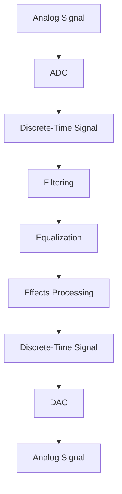

# Lesson 1: Digital Signal Processing Fundamentals

## 1. First-Principles Intuition & Invariants

Digital Signal Processing (DSP) is the cornerstone of modern audio engineering, enabling the manipulation and analysis of sound in digital form. At its core, DSP involves representing audio signals as discrete-time sequences, which can then be processed using mathematical algorithms to achieve a wide range of effects, from simple equalization to complex synthesis. The fundamental principle underlying DSP is the conversion of continuous-time signals into discrete-time signals through a process known as sampling. This conversion is governed by the Nyquist-Shannon sampling theorem, which states that a continuous-time signal must be sampled at a rate at least twice its highest frequency component to avoid aliasing, the phenomenon where high-frequency components are incorrectly represented as lower frequencies.

The process of sampling transforms an analog signal into a sequence of discrete values, each representing the amplitude of the signal at a specific point in time. These discrete values are then quantized, which involves mapping each sampled value to the nearest value in a finite set of possible values. Quantization introduces a form of error known as quantization noise, which is the difference between the original analog signal and the quantized digital signal. The level of quantization noise is determined by the number of bits used to represent each sample; higher bit depths result in lower quantization noise and greater dynamic range.

The mathematical foundation of DSP is rooted in the Discrete Fourier Transform (DFT), a powerful tool for analyzing the frequency content of discrete-time signals. The DFT decomposes a signal into a sum of sinusoidal components, each with a specific frequency, amplitude, and phase. The Fast Fourier Transform (FFT) is an efficient algorithm for computing the DFT, enabling real-time analysis of audio signals. The FFT is widely used in applications ranging from audio equalization to spectral analysis and noise reduction.

Another critical concept in DSP is the use of filters to modify the frequency content of signals. Filters can be designed to pass certain frequency ranges while attenuating others, enabling tasks such as equalization, crossover networks, and noise reduction. Digital filters can be implemented using various algorithms, including finite impulse response (FIR) and infinite impulse response (IIR) filters. FIR filters are characterized by a finite duration impulse response and are typically designed using windowing techniques, while IIR filters have an infinite duration impulse response and are often designed using recursive algorithms.

## 2. Core Architecture & Mechanics

The architecture of a DSP system is designed to efficiently process discrete-time signals using a combination of mathematical algorithms and specialized hardware. At the core of a DSP system is the digital signal processor (DSP), a specialized microprocessor optimized for the execution of DSP algorithms. DSPs are designed with features such as parallel processing capabilities, specialized instruction sets, and high-speed data paths to enable efficient processing of audio signals.

The execution model of a DSP system involves the sequential processing of discrete-time signals through a series of stages, each implementing a specific DSP algorithm. The first stage in the processing pipeline is the analog-to-digital converter (ADC), which samples the analog input signal and converts it into a sequence of discrete values. The sampled values are then passed through a series of processing stages, including filtering, equalization, and effects processing, before being converted back to analog form by a digital-to-analog converter (DAC).

The internal data structures used in DSP systems are designed to efficiently represent and manipulate discrete-time signals. One common data structure is the circular buffer, a fixed-size buffer that is used to store a sequence of sampled values. Circular buffers are particularly useful in DSP applications because they allow for efficient implementation of delay effects, such as echo and reverb. Another important data structure is the complex number, which is used to represent the frequency components of a signal in the frequency domain. Complex numbers are essential for the implementation of the FFT and other frequency-domain algorithms.

The following Mermaid diagram illustrates the core architecture of a DSP system:

## 3. High-Performance Optimization & Failure Modes

High-performance optimization is critical in DSP systems, where real-time processing of audio signals is often required. One key optimization technique is the use of parallel processing, which involves dividing the processing workload across multiple processors or cores. Parallel processing can significantly improve the performance of DSP algorithms, particularly those involving large data sets or complex calculations.

Another important optimization technique is the use of specialized instruction sets, which are designed to accelerate the execution of DSP algorithms. DSPs often include specialized instructions for operations such as multiply-accumulate (MAC), which is a common operation in DSP algorithms. Specialized instruction sets can significantly improve the performance of DSP algorithms by reducing the number of instructions required to perform complex calculations.

Resource scaling is another critical aspect of high-performance optimization in DSP systems. DSP systems often require significant computational resources, including memory and processing power. Resource scaling involves optimizing the use of these resources to ensure that the system can handle the required processing workload without exceeding its capacity. This may involve techniques such as memory caching, data compression, and algorithm optimization.

Failure modes in DSP systems can arise from a variety of sources, including hardware failures, software errors, and input signal anomalies. Hardware failures can occur due to issues such as power supply fluctuations or component failures, while software errors can arise from bugs or incorrect algorithm implementations. Input signal anomalies can occur due to issues such as clipping or noise, which can affect the accuracy of the processing results.

To mitigate failure modes in DSP systems, robust error detection and correction mechanisms are essential. This may involve techniques such as checksums, parity bits, and error-correcting codes. Additionally, implementing fail-safe mechanisms ensures that the system can continue to operate even in the event of a failure.
