# Lesson 2: Frequency Domain Analysis for Audio DSP

## 1. Why You Need This (First-Principles, One Paragraph)

A microphone captures air pressure over time: one number per sample, no notion of "pitch" anywhere in the data. Yet a cello note and a flute playing the same pitch produce wildly different waveforms, because each is a sum of sine waves at different amplitudes and phases — the fundamental plus its overtones. The Fourier transform takes a block of time-domain samples and tells you exactly which sine waves, at which strengths, would add up to reproduce that block. The **Discrete Fourier Transform (DFT)** does this for `N` samples, producing `N` frequency bins spaced `Δf = fs / N` Hz apart (`fs` = sample rate). The **FFT** is just a fast algorithm for computing the same DFT in `O(N log N)` instead of `O(N²)` operations — this is why a plugin can show a real-time spectrum analyzer without melting your CPU. Everything else in this lesson — EQ design, spectrogram reading, pitch detection, spectral processing — is built on correctly choosing `N`, correctly windowing your data, and correctly reading what a bin actually represents.

That's the only equation-heavy paragraph in this lesson. From here it's entirely about using the FFT correctly in real tools and real code.

---

## 2. The Three Numbers That Govern Every FFT You Will Ever Run

Internalize this table before touching any code. Nearly every "my spectrum looks wrong" bug traces back to one of these three relationships.

| Parameter | Formula | Practical Meaning |
|---|---|---|
| Frequency resolution | `Δf = fs / N` | Spacing between bins. Bigger `N` = finer resolution, but... |
| Time resolution | `N / fs` seconds | ...bigger `N` = analysis smeared over a longer window. A fast transient (kick drum attack) gets blurred by a long FFT. |
| Nyquist limit | `fs / 2` | Highest frequency representable without aliasing. At 48 kHz, the top bin is ~24 kHz. |

**The resolution trade-off in practice:**

- Want to see a bass note's exact pitch (low frequency, needs fine `Δf`)? Use a **long FFT** (8192–16384 samples) — you can afford the time smear because bass notes are already slow-moving.
- Want to see a drum transient's exact timing? Use a **short FFT** (512–1024 samples) — sacrifice frequency precision to keep time precision.
- This is the **time-frequency uncertainty trade-off**: you cannot get perfect time localization and perfect frequency localization from one FFT. It's why spectrograms let you choose window size, and why that choice changes what you see.

**Worked example at 48 kHz sample rate:**

| FFT size (N) | Δf (Hz) | Window duration (ms) | Good for |
|---|---|---|---|
| 512 | 93.75 | 10.7 | Transient timing, drum analysis |
| 1024 | 46.9 | 21.3 | General-purpose, live visualizers |
| 2048 | 23.4 | 42.7 | Vocal/instrument EQ matching |
| 4096 | 11.7 | 85.3 | Mastering-grade spectral balance checks |
| 8192 | 5.86 | 170.6 | Resolving closely-spaced bass harmonics |

Rule of thumb for mixing: **2048–4096 for most spectral analysis, 512–1024 for anything percussive or time-critical.**

---

## 3. Windowing: The Step Everyone Forgets

The DFT math assumes your `N`-sample block repeats forever, seamlessly. Real audio doesn't loop like that — you've chopped an arbitrary slice out of a continuous waveform. If the waveform doesn't end where it started in amplitude, you get a sharp discontinuity at the block edge. The FFT interprets that discontinuity as high-frequency energy that isn't really there. This is **spectral leakage**: energy from one true frequency smears sideways into neighboring bins, raising the noise floor and masking quiet harmonics.

The fix: multiply your time-domain block by a **window function** that tapers smoothly to near-zero at both edges before running the FFT. This trades a small amount of main-peak sharpening for a much lower leakage floor.

| Window | Sidelobe suppression | Best for |
|---|---|---|
| Rectangular (none) | Worst (~-13 dB) | Never use for analysis — only for exact periodic test signals |
| Hann | Good (~-31 dB), moderate main-lobe width | General-purpose default, most DAWs use this |
| Hamming | Similar to Hann, slightly different trade-off | Legacy DSP code, interchangeable with Hann |
| Blackman-Harris | Excellent (~-92 dB) sidelobes, wider main lobe | Measuring low-level spectral detail (noise floor, distortion analysis) |

**Rule: if spectral peaks show weird symmetric "skirts" spreading outward, you forgot to window, or you're using rectangular.**

```python
import numpy as np

N = 2048
x = np.random.randn(N)  # stand-in for your audio block

# Apply a Hann window before FFT — do this every time, no exceptions
window = np.hanning(N)
x_windowed = x * window

X = np.fft.rfft(x_windowed)           # real-input FFT, N/2+1 bins
freqs = np.fft.rfftfreq(N, d=1/48000) # bin center frequencies in Hz
magnitude_db = 20 * np.log10(np.abs(X) + 1e-12)

# Compensate for the window's amplitude loss (Hann reduces average level ~-6 dB)
window_gain_correction = 1.0 / np.mean(window)
magnitude_db_corrected = magnitude_db + 20 * np.log10(window_gain_correction)
```

Run this on a block of real audio: `freqs[np.argmax(magnitude_db_corrected)]` gives the dominant frequency in that block — the basis of every pitch detector and tuner.

---

## 4. Reading a Spectrum Like a Mix Engineer

Once you have `magnitude_db` and `freqs`, you're looking at the same data a plugin's analyzer shows you. Here's how to read it for actual mixing decisions:

- **Fundamental + harmonics ladder:** A sustained note shows a tall peak at its fundamental (say, 110 Hz for an A2 bass note) followed by smaller peaks at integer multiples (220, 330, 440 Hz...). The relative height of those harmonics *is* the timbre. A harsh, buzzy bass has strong odd harmonics (3rd, 5th); a round, warm bass has a fast harmonic rolloff.
- **Masking diagnosis:** If two instruments' fundamental peaks or harmonic ladders overlap heavily in the same 2–3 bins, they're fighting for the same frequency space — audible masking. Fix with EQ carving (cut one, boost the other) or arrangement (change one instrument's register).
- **Noise floor vs. signal:** Anything sitting flat and low across all bins is broadband noise (tape hiss, preamp noise, room hum). A spike at exactly 60 Hz (or 50 Hz in Europe) plus harmonics at 120, 180, 240 Hz is mains hum — a diagnostic fingerprint, not a musical note.
- **Resonance hunting (the pro move):** Sweep a narrow boost (+6 to +10 dB, Q around 8–10) across the spectrum while a problem instrument plays. When the boost lands on a resonant/boxy frequency, it jumps out obviously in both the spectrum display and your ears. Cut there instead. This is the standard "subtractive EQ" workflow — frequency-domain intuition applied live.

**Quick-reference frequency map for carving decisions:**

| Range | What lives there | Common fix |
|---|---|---|
| 20–60 Hz | Sub-bass, kick fundamental, room rumble | High-pass non-bass tracks here |
| 60–250 Hz | Bass fundamentals, low-mid warmth | Cut to reduce "muddy," boost to add "weight" |
| 250–500 Hz | Boxiness, cardboard tone | Narrow cut (Q 3–6) is the classic mud fix |
| 500 Hz–2 kHz | Vocal/instrument body, honk | Careful — most perceived loudness lives here |
| 2–5 kHz | Presence, intelligibility, attack transients | Boost for clarity, cut for harshness |
| 5–10 kHz | Sibilance, pick/breath noise | De-ess or dynamic EQ, not static cuts |
| 10–20 kHz | Air, shimmer, cymbal sheen | Gentle broad boost only, easy to overdo |

---

## 5. Architecture: How a Real-Time Analyzer / FFT Plugin Is Built

```mermaid
graph LR
    subgraph sub_input ["Audio Input Stage"]
        A1["Audio buffer (host callback)"]
        A2["Ring buffer accumulator"]
    end

    subgraph sub_prep ["Pre-FFT Preparation"]
        B1["Extract N-sample window"]
        B2["Apply window function (Hann/Blackman-Harris)"]
    end

    subgraph sub_transform ["Transform Stage"]
        C1["FFT (rfft for real-valued audio)"]
        C2["Magnitude = sqrt(re^2 + im^2)"]
        C3["Convert to dB: 20*log10(mag)"]
    end

    subgraph sub_display ["Display / Downstream Use"]
        D1["Log-frequency bin mapping for display"]
        D2["Smoothing / peak-hold"]
        D3["Render to UI or feed to EQ/compressor logic"]
    end

    A1 --> A2 --> B1 --> B2 --> C1 --> C2 --> C3 --> D1 --> D2 --> D3
```



**Key production-grade details this diagram implies:**

1. **Ring buffer accumulator**: audio arrives in small host callback blocks (typically 128–512 samples). Your analyzer's FFT size is usually larger than the callback block, so you accumulate samples into a circular buffer and pull an `N`-sample window out of it on your own schedule.
2. **Overlap-add for smooth continuous display**: analyzers don't wait for a full fresh block each time — they advance by a fraction of `N` (commonly 25–50% hop size) and recompute, giving smooth visual updates instead of jumpy frame-by-frame jumps. This is the same overlap mechanism used in phase vocoders for time-stretching.
3. **Log-frequency bin mapping**: raw FFT bins are linearly spaced in Hz, but human pitch perception and musical notation are logarithmic. A real analyzer UI remaps bins onto a log-frequency x-axis so an octave always occupies equal screen width — this is why a "pro" analyzer display looks different from a naive linear plot.

---

## 6. Production Code: A Correct, Complete Real-Time Spectrum Analyzer Core (Python/NumPy)

This is a complete, runnable block processor, not a toy snippet. Feed it successive audio blocks and it maintains a windowed, overlapped FFT analysis ready for display or further processing.

```python
import numpy as np

class SpectrumAnalyzer:
    """
    Overlap-add FFT analyzer core for real-time audio.
    Feed it audio blocks of any size via process(); it maintains its own
    ring buffer and emits a fresh spectrum every hop_size samples.
    """

    def __init__(self, fft_size=2048, hop_size=512, sample_rate=48000):
        assert hop_size <= fft_size, "hop_size must not exceed fft_size"
        self.N = fft_size
        self.hop = hop_size
        self.fs = sample_rate

        self.window = np.hanning(self.N)
        self.window_gain_comp = 1.0 / np.mean(self.window)

        # Ring buffer holds enough history to always extract one full FFT window
        self.ring = np.zeros(self.N, dtype=np.float64)
        self.write_pos = 0
        self.samples_since_last_fft = 0

        self.freqs = np.fft.rfftfreq(self.N, d=1.0 / self.fs)
        self.last_spectrum_db = np.full(len(self.freqs), -120.0)

    def process(self, audio_block: np.ndarray):
        """
        Push a new block of mono audio samples (float32/float64, range -1..1).
        Returns the latest spectrum in dB if a new FFT frame was computed,
        otherwise returns None (not enough new samples yet for next hop).
        """
        block_len = len(audio_block)
        result = None

        # Shift ring buffer and insert new samples (simple shift-register ring;
        # fine for hop sizes in the hundreds-to-low-thousands range; for very
        # high block rates, replace with a proper circular index to avoid the
        # O(N) cost of np.roll)
        self.ring = np.roll(self.ring, -block_len)
        self.ring[-block_len:] = audio_block

        self.samples_since_last_fft += block_len

        if self.samples_since_last_fft >= self.hop:
            self.samples_since_last_fft = 0
            result = self._compute_fft_frame()

        return result

    def _compute_fft_frame(self):
        windowed = self.ring * self.window
        X = np.fft.rfft(windowed)
        magnitude = np.abs(X) * self.window_gain_comp
        magnitude_db = 20 * np.log10(magnitude + 1e-12)
        self.last_spectrum_db = magnitude_db
        return magnitude_db

    def dominant_frequency(self):
        """Return the Hz value of the strongest bin in the last computed frame."""
        idx = np.argmax(self.last_spectrum_db)
        return self.freqs[idx]

    def band_energy_db(self, f_low, f_high):
        """Average dB level within a frequency band — useful for VU-style band meters."""
        mask = (self.freqs >= f_low) & (self.freqs <= f_high)
        if not np.any(mask):
            return -120.0
        return float(np.mean(self.last_spectrum_db[mask]))


# --- Usage example: simulate feeding 512-sample callback blocks ---
if __name__ == "__main__":
    fs = 48000
    analyzer = SpectrumAnalyzer(fft_size=2048, hop_size=512, sample_rate=fs)

    # Synthesize 1 second of a 220 Hz tone + 3rd harmonic at -12 dB, as a stand-in
    # for a real audio callback stream
    t = np.arange(fs) / fs
    test_signal = (np.sin(2 * np.pi * 220 * t)
                   + 0.25 * np.sin(2 * np.pi * 660 * t))

    callback_size = 512
    for start in range(0, len(test_signal) - callback_size, callback_size):
        block = test_signal[start:start + callback_size]
        spectrum = analyzer.process(block)
        if spectrum is not None:
            dom_freq = analyzer.dominant_frequency()
            low_band = analyzer.band_energy_db(20, 200)
            print(f"Dominant freq: {dom_freq:7.1f} Hz | "
                  f"Sub/bass band (20-200Hz): {low_band:6.1f} dB")
```

Run this and the dominant frequency locks onto ~220 Hz once enough samples accumulate, with the band energy meter responding in real time — exactly the engine behind a DAW's built-in analyzer or a third-party tool like Voxengo SPAN.

---

## 7. High-Performance C: FFTW for Production DSP Code

NumPy is fine for prototyping; a real plugin (VST/AU) needs C/C++ with a proper FFT library. **FFTW** (or **KissFFT** / **PFFFT** for lighter dependencies) is the industry-standard choice. This example is complete and compiles as-is.

```c
// fft_analyzer.c
// Compile: gcc fft_analyzer.c -lfftw3 -lm -o fft_analyzer
#include <fftw3.h>
#include <stdio.h>
#include <math.h>

#define N 2048
#define SAMPLE_RATE 48000.0

int main(void) {
    double *in;
    fftw_complex *out;
    fftw_plan plan;

    // Real-input FFT: use fftw_plan_dft_r2c_1d for real audio (half the
    // memory and roughly 2x faster than complex-to-complex for real signals)
    in  = (double*) fftw_malloc(sizeof(double) * N);
    out = (fftw_complex*) fftw_malloc(sizeof(fftw_complex) * (N / 2 + 1));
    plan = fftw_plan_dft_r2c_1d(N, in, out, FFTW_MEASURE);

    // Build a Hann-windowed test tone: 440 Hz sine
    double window[N];
    for (int n = 0; n < N; n++) {
        window[n] = 0.5 * (1.0 - cos(2.0 * M_PI * n / (N - 1))); // Hann window
        double sample = sin(2.0 * M_PI * 440.0 * n / SAMPLE_RATE);
        in[n] = sample * window[n];
    }

    fftw_execute(plan);

    // Window amplitude compensation
    double window_sum = 0.0;
    for (int n = 0; n < N; n++) window_sum += window[n];
    double window_gain_comp = (double)N / window_sum;

    double bin_width = SAMPLE_RATE / N;

    double peak_mag = 0.0;
    int peak_bin = 0;
    for (int k = 0; k <= N / 2; k++) {
        double re = out[k][0];
        double im = out[k][1];
        double mag = sqrt(re * re + im * im) * window_gain_comp / N;
        if (mag > peak_mag) {
            peak_mag = mag;
            peak_bin = k;
        }
    }

    double mag_db = 20.0 * log10(peak_mag + 1e-12);
    printf("Peak bin: %d  Frequency: %.1f Hz  Magnitude: %.2f dB\n",
           peak_bin, peak_bin * bin_width, mag_db);

    fftw_destroy_plan(plan);
    fftw_free(in);
    fftw_free(out);
    return 0;
}
```

**Why `fftw_plan_dft_r2c_1d` instead of the generic complex-to-complex plan shown in naive tutorials:** real-valued audio has a symmetric spectrum (negative frequencies mirror positive ones), so the real-to-complex transform only needs to compute and store `N/2 + 1` unique bins instead of `N`. That's roughly half the memory and close to double the speed — the difference between a plugin running at 2% CPU versus 4% CPU, which matters when you're running 40 instances across a session.

**Plan creation cost:** `FFTW_MEASURE` benchmarks several algorithm variants at plan-creation time to pick the fastest for your exact `N` — this takes milliseconds to seconds, so **create the plan once at startup/init, never per audio block.** In a real plugin, create all your FFT plans in the constructor or `prepareToPlay`/`initialize` callback, and only call `fftw_execute` in the audio-processing hot path. Calling `fftw_plan_dft_r2c_1d` inside your real-time audio callback is a guaranteed glitch/dropout bug. If you need variable FFT sizes at runtime (e.g. a user-adjustable analyzer resolution), pre-build plans for every supported size at init and switch between them — never build on the fly.

---

## 8. Phase Vocoder Basics: From Analysis to Time-Stretch and Pitch-Shift

The spectrum analyzer only looks at magnitude and throws phase away. A **phase vocoder** keeps the phase information across overlapping frames and uses it to reconstruct audio at a different speed or pitch — the engine behind most time-stretch and pitch-shift tools (Melodyne's basic mode, Ableton's Complex Warp, Serato's pitch-independent time stretch).

The core trick: between two consecutive analysis frames, the phase of a bin should advance by a predictable amount if the signal is a stable sine wave at that bin's frequency. Measuring how much the actual phase *deviates* from that expected advance tells you the true instantaneous frequency inside that bin, more precisely than the bin center alone. Stretch time by changing the hop size on the output side while keeping input hop fixed, and resynthesize using the corrected phase — the pitch stays the same while duration changes. Shifting pitch instead resamples the magnitude/phase data across bins before resynthesis.

```python
import numpy as np

def phase_vocoder_time_stretch(x, stretch_factor, N=2048, hop=512):
    """
    Minimal phase vocoder time-stretch (not pitch-correcting transients perfectly,
    but demonstrates the real algorithm, not a toy).
    stretch_factor > 1.0 = slower/longer output; < 1.0 = faster/shorter.
    """
    window = np.hanning(N)
    analysis_hop = hop
    synthesis_hop = int(hop * stretch_factor)

    num_frames = (len(x) - N) // analysis_hop
    output_len = num_frames * synthesis_hop + N
    output = np.zeros(output_len)

    omega = 2 * np.pi * np.fft.rfftfreq(N) * N / N  # expected phase advance per bin, per hop (normalized)
    phase_accum = np.zeros(N // 2 + 1)
    prev_phase = np.zeros(N // 2 + 1)

    for i in range(num_frames):
        start = i * analysis_hop
        frame = x[start:start + N] * window
        X = np.fft.rfft(frame)
        magnitude = np.abs(X)
        phase = np.angle(X)

        # Phase difference from expected advance = true deviation (instantaneous freq correction)
        expected_advance = omega * analysis_hop
        phase_diff = phase - prev_phase - expected_advance
        # Wrap to [-pi, pi]
        phase_diff = phase_diff - 2 * np.pi * np.round(phase_diff / (2 * np.pi))
        true_advance = expected_advance + phase_diff

        phase_accum += true_advance * (synthesis_hop / analysis_hop)
        prev_phase = phase

        X_new = magnitude * np.exp(1j * phase_accum)
        frame_out = np.fft.irfft(X_new, n=N) * window

        out_start = i * synthesis_hop
        output[out_start:out_start + N] += frame_out

    return output
```

**What matters for a practitioner here, not a DSP theorist:** overlap-add resynthesis without phase correction gives "phasiness" and metallic artifacts on sustained tones — this is why cheap time-stretch sounds robotic on vocals and smooth on drums (drums are mostly transient, phase coherence matters less). Transient detection and phase-locking across bins (identity phase locking) is what separates a $20 plugin from Melodyne.

---

## 9. Reading a Spectrogram (Short-Time Fourier Transform, Visually)

A spectrogram stacks consecutive windowed FFT frames side by side, with time on the x-axis, frequency on the y-axis, and color/brightness showing magnitude. It's the STFT rendered as an image, and reading it correctly is a practical skill independent of writing any code:

- **Horizontal bright bands** = sustained tonal content (sung vowels, sustained guitar notes, synth pads). The bands' vertical spacing is the harmonic series — evenly spaced bands confirm a harmonic (pitched) sound; irregularly spaced or noisy-looking bands indicate inharmonic content (cymbals, distortion, FM synthesis bells).
- **Vertical bright streaks** = transients (snare hits, consonants in speech, pick attacks) — a short burst of energy across many frequencies at once, because a sharp time-domain event spreads broadband in frequency.
- **Diagonal sweeps** = pitch bends, sirens, zips, or synth filter sweeps — frequency changing continuously over time.
- **A gap or notch that appears consistently across a track** = a static EQ cut, a notch filter, or a resonance trap already dealt with upstream.
- **Harmonic rolloff shape at high frequencies** tells you brightness/darkness of a source instantly — a bright cymbal shows energy extending past 10 kHz; a muffled one cuts off sharply around 4–6 kHz.

Most DAWs (Ableton, Logic's "Flex Pitch" view underlying spectrogram, iZotope RX's spectral display) let you adjust FFT size directly on the spectrogram. Increase it to resolve close harmonics in a bass part; decrease it to see exact click/pop locations for spectral repair work in RX — same uncertainty trade-off from Section 2, now visible as an image instead of a single frame's numbers.

---

## 10. Common Bugs and How to Diagnose Them

| Symptom | Root Cause | Fix |
|---|---|---|
| Spectrum has broad "skirts" around every peak, noisy-looking | No windowing, or rectangular window | Apply Hann or Blackman-Harris before FFT |
| Overall levels look ~6 dB too low compared to a reference meter | Forgot window amplitude compensation | Divide by `mean(window)` or equivalent gain factor |
| Spectrum display flickers/jumps frame to frame | Hop size too large relative to FFT size (no overlap) | Use 50–75% overlap (hop = N/4 to N/2) |
| Bass notes look like one blurry blob, can't distinguish pitches below ~80 Hz | FFT size too short for the frequency resolution needed | Increase `N` to 4096 or 8192 for low-frequency analysis |
| Drum transient timing looks smeared across 50+ ms | FFT size too long | Decrease `N` to 512–1024 for percussive/transient analysis |
| Random spike that's always exactly at your sample rate / 2 | Aliasing from signal content above Nyquist (bad upstream anti-aliasing) | Check upstream oversampling/filtering before this signal reaches the FFT |
| Creating an FFTW plan causes audio dropouts/glitches live | Plan created inside the real-time audio callback | Move `fftw_plan_*` calls to initialization, call only `fftw_execute` per-block |
| 60 Hz (or 50 Hz) spike plus harmonics at 120/180/240 Hz | Mains electrical hum picked up by unbalanced cable or bad grounding | Fix the cabling/grounding; a notch filter is a band-aid, not a cure |
| Time-stretched audio sounds "phasey" or metallic on sustained notes | Overlap-add without phase correction (no phase vocoder logic) | Use phase-locked/identity-phase-locking vocoder, or a transient-preserving algorithm (e.g. élastique, WSOLA for mostly-transient material) |
| Spectrogram looks "blocky" with visible frame edges | FFT size too large relative to overlap, or window too short for its hop | Increase overlap to 75%, or use a window with better time-localization for that content |

---

## 11. Practice Drill: Build Ear-to-Spectrum Correlation

This is the single most valuable exercise for developing frequency-domain intuition as a practicing engineer, not just a programmer:

1. Load any DAW with a real-time spectrum analyzer (Voxengo SPAN, iZotope Insight, or your DAW's stock analyzer) on a track.
2. Run a sine sweep (20 Hz–20 kHz, 10 seconds) through it. Watch the peak track across the display while you listen. This calibrates your eyes to your ears — you'll learn exactly where "warm low-mid" (200–400 Hz), "boxy" (400–800 Hz), "presence" (2–5 kHz) and "air" (10 kHz+) sit visually.
3. Switch the analyzer's FFT size setting (if available) between a small size (512–1024) and a large size (4096–8192) while playing a drum loop. Watch how the kick drum's transient spike changes from sharp-and-brief to blurred-and-smeared as `N` increases. This is the time/frequency trade-off made visible.
4. Record yourself singing or playing a sustained note. Freeze the analyzer and count the visible harmonic peaks above the fundamental. Compare a "bright" vocal tone against a "dark/covered" tone on the same pitch — the dark tone's upper harmonic peaks will visibly drop in height. This is the direct visual link between timbre and the frequency domain this entire lesson is built on.
5. Open iZotope RX (or any spectral editor) on a recording with a click, a cough, or a camera-shutter noise bleeding in. Zoom into the spectrogram, select just the offending vertical streak, and use spectral repair/de-click. Compare before/after waveforms and spectrograms to see exactly what got removed, and nothing else — this is the practical payoff of understanding how a transient looks in the frequency domain versus a sustained tone.
6. Build the `SpectrumAnalyzer` class from Section 6, feed it a recording of your own instrument at different dynamic levels (pianissimo vs. fortissimo on the same note), and compare `band_energy_db` readings above 5 kHz. Most instruments brighten (gain high-frequency energy) as you play louder — this is why a mix that sounds balanced at low playback volume can turn harsh when turned up, and it's measurable, not just a feeling.

Run this drill once with real material and the Fourier transform stops being an abstract integral and becomes a tool you can read at a glance.
