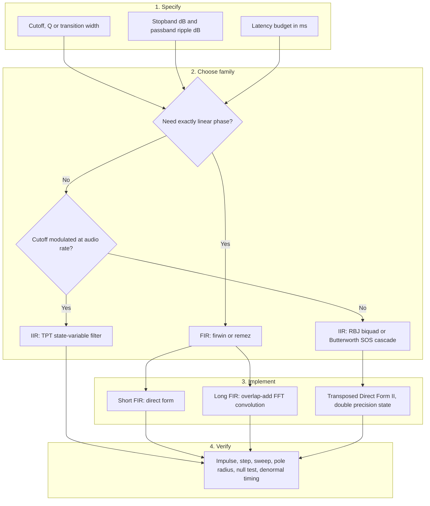
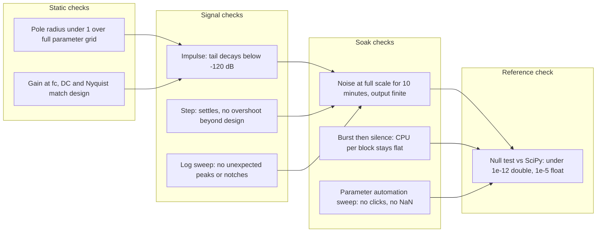

# Lesson 3: Filter Design and Implementation

**Outcome:** by the end you will have working, tested code for the filters used in real audio products: RBJ biquad EQ/filter coefficients, a real-time-safe C++ biquad, stable high-order IIR cascades, FIR designs with measured latency, streaming FFT convolution, and a filter that survives audio-rate cutoff modulation.

**Setup (Python 3.10+, any C++17 compiler):**

```bash
python -m venv .venv && source .venv/bin/activate    # Windows: .venv\Scripts\activate
pip install numpy scipy matplotlib
mkdir filter_lab && cd filter_lab
```

Every script below is a complete file. Run each one and confirm its `PASS` lines before moving on.

---

## 1. First Principles (the 20% you need)

A filter is a linear, time-invariant system. Its impulse response `h[n]` fully describes it. Filtering in time is convolution with `h`, which is multiplication by `H(f)` in the frequency domain. That is why you can design in the frequency domain and run in the time domain.

One difference equation covers every filter in this lesson, with `H(z) = B(z)/A(z)`:

```text
y[n] = b0·x[n] + b1·x[n-1] + ... + bM·x[n-M]  -  a1·y[n-1] - ... - aN·y[n-N]
```

If all `a_k` are zero you have an FIR filter. Otherwise it is an IIR filter. The roots of `B(z)` are the zeros (frequencies cancelled). The roots of `A(z)` are the poles (resonances). The three invariants you must check on every design:

1. **Causality.** Output depends on current and past input only. Real-time code has no other option, so any "zero-phase" result must be offline or must accept latency.
2. **Stability.** Every pole must satisfy `|p| < 1`. FIR filters have no poles and are always stable. A pole at `|p| = 0.9999` is stable on paper and can still ring for seconds or fail after coefficient rounding.
3. **Sampling.** Content above `fs/2` aliases. Digital filters cannot repair aliasing that already happened. Design filters and their stopbands below Nyquist, and expect analog-matching filters (peaking EQ, resonant low-pass) to look "cramped" near Nyquist because of the bilinear transform's frequency warping. At 44.1/48 kHz this shows up above about 10 kHz.

**FIR vs IIR in one table:**

| | FIR | IIR (biquad, SVF, Butterworth) |
|---|---|---|
| Phase | Exactly linear if taps are symmetric | Nonlinear, minimum phase at best |
| Latency | `(N-1)/2` samples for a symmetric filter | Near zero |
| Cost per sample | `N` multiplies (or FFT convolution) | About 5 multiplies per biquad |
| Stability | Always | Must be checked |
| Typical use | Mastering EQ, crossovers, resampling, convolution reverb | Tracking EQ, synth filters, DJ filters, dynamic EQ |



---

## 2. Lab 1: RBJ Biquads, Verified by Measurement

The Audio EQ Cookbook (Robert Bristow-Johnson) gives closed-form coefficients for the filters you use daily. This script builds them, checks stability, checks exact gain at known frequencies, and compares a hand-written Transposed Direct Form II loop against SciPy.

Save as `lab1_rbj.py`:

```python
"""lab1_rbj.py - RBJ cookbook biquads with built-in verification."""
import numpy as np
from scipy import signal

FS = 48000.0
BUTTER_Q = 1.0 / np.sqrt(2.0)


def _finish(b, a):
    b = np.array(b, dtype=float)
    a = np.array(a, dtype=float)
    return b / a[0], a / a[0]          # normalise so a0 == 1


def lowpass(fs, f0, q=BUTTER_Q):
    w0 = 2 * np.pi * f0 / fs
    c, al = np.cos(w0), np.sin(w0) / (2 * q)
    return _finish([(1 - c) / 2, 1 - c, (1 - c) / 2], [1 + al, -2 * c, 1 - al])


def highpass(fs, f0, q=BUTTER_Q):
    w0 = 2 * np.pi * f0 / fs
    c, al = np.cos(w0), np.sin(w0) / (2 * q)
    return _finish([(1 + c) / 2, -(1 + c), (1 + c) / 2], [1 + al, -2 * c, 1 - al])


def bandpass(fs, f0, q):               # constant 0 dB peak gain
    w0 = 2 * np.pi * f0 / fs
    c, al = np.cos(w0), np.sin(w0) / (2 * q)
    return _finish([al, 0, -al], [1 + al, -2 * c, 1 - al])


def notch(fs, f0, q):
    w0 = 2 * np.pi * f0 / fs
    c, al = np.cos(w0), np.sin(w0) / (2 * q)
    return _finish([1, -2 * c, 1], [1 + al, -2 * c, 1 - al])


def peaking(fs, f0, q, gain_db):
    A = 10 ** (gain_db / 40)
    w0 = 2 * np.pi * f0 / fs
    c, al = np.cos(w0), np.sin(w0) / (2 * q)
    return _finish([1 + al * A, -2 * c, 1 - al * A],
                   [1 + al / A, -2 * c, 1 - al / A])


def low_shelf(fs, f0, gain_db):        # shelf slope S = 1
    A = 10 ** (gain_db / 40)
    w0 = 2 * np.pi * f0 / fs
    c = np.cos(w0)
    sq = 2 * np.sqrt(A) * (np.sin(w0) / 2 * np.sqrt(2))
    b = [A * ((A + 1) - (A - 1) * c + sq),
         2 * A * ((A - 1) - (A + 1) * c),
         A * ((A + 1) - (A - 1) * c - sq)]
    a = [(A + 1) + (A - 1) * c + sq,
         -2 * ((A - 1) + (A + 1) * c),
         (A + 1) + (A - 1) * c - sq]
    return _finish(b, a)


def high_shelf(fs, f0, gain_db):       # shelf slope S = 1
    A = 10 ** (gain_db / 40)
    w0 = 2 * np.pi * f0 / fs
    c = np.cos(w0)
    sq = 2 * np.sqrt(A) * (np.sin(w0) / 2 * np.sqrt(2))
    b = [A * ((A + 1) + (A - 1) * c + sq),
         -2 * A * ((A - 1) + (A + 1) * c),
         A * ((A + 1) + (A - 1) * c - sq)]
    a = [(A + 1) - (A - 1) * c + sq,
         2 * ((A - 1) - (A + 1) * c),
         (A + 1) - (A - 1) * c - sq]
    return _finish(b, a)


def gain_db(b, a, f, fs):
    _, h = signal.freqz(b, a, worN=[2 * np.pi * f / fs])
    return 20 * np.log10(abs(h[0]))


def max_pole_radius(a):
    return float(np.max(np.abs(np.roots(a))))


def tdf2(b, a, x):
    """Transposed Direct Form II. This is the loop you will port to C++."""
    z1 = z2 = 0.0
    y = np.empty_like(x)
    for n, xn in enumerate(x):
        yn = b[0] * xn + z1
        z1 = b[1] * xn - a[1] * yn + z2
        z2 = b[2] * xn - a[2] * yn
        y[n] = yn
    return y


def check(name, ok, detail=""):
    print(f"{'PASS' if ok else 'FAIL'}  {name} {detail}")
    return ok


if __name__ == "__main__":
    all_ok = True

    # 1. Butterworth-Q low-pass is -3.01 dB at its cutoff.
    b, a = lowpass(FS, 1000)
    g = gain_db(b, a, 1000, FS)
    all_ok &= check("lowpass -3 dB at fc", abs(g + 3.0103) < 0.01, f"({g:.4f} dB)")

    # 2. Peaking filter hits its programmed gain exactly at f0.
    b, a = peaking(FS, 1000, 2.0, 6.0)
    g = gain_db(b, a, 1000, FS)
    all_ok &= check("peaking +6 dB at f0", abs(g - 6.0) < 1e-6, f"({g:.6f} dB)")

    # 3. Shelves: exact plateau gains at DC and Nyquist.
    b, a = low_shelf(FS, 200, 6.0)
    all_ok &= check("low shelf DC=+6, Nyquist=0",
                    abs(gain_db(b, a, 0, FS) - 6) < 1e-6 and abs(gain_db(b, a, FS / 2, FS)) < 1e-6)
    b, a = high_shelf(FS, 8000, 6.0)
    all_ok &= check("high shelf DC=0, Nyquist=+6",
                    abs(gain_db(b, a, 0, FS)) < 1e-6 and abs(gain_db(b, a, FS / 2, FS) - 6) < 1e-6)

    # 4. Pole radius < 1 across a grid of cutoffs and Qs.
    worst = 0.0
    for f0 in (20, 50, 100, 1000, 5000, 15000, 20000):
        for q in (0.5, 0.707, 2, 8, 20):
            for design in (lowpass, highpass, bandpass, notch):
                worst = max(worst, max_pole_radius(design(FS, f0, q)[1]))
    all_ok &= check("all poles inside unit circle", worst < 1.0, f"(worst radius {worst:.8f})")

    # 5. Hand-written TDF2 matches scipy.lfilter to double precision.
    rng = np.random.default_rng(1)
    x = rng.standard_normal(20000)
    b, a = peaking(FS, 3000, 1.5, -9.0)
    err = np.max(np.abs(tdf2(b, a, x) - signal.lfilter(b, a, x)))
    all_ok &= check("TDF2 loop == lfilter", err < 1e-12, f"(max err {err:.2e})")

    # 6. Save a magnitude plot of a typical 3-band setup.
    try:
        import matplotlib
        matplotlib.use("Agg")
        import matplotlib.pyplot as plt
        f = np.logspace(np.log10(20), np.log10(20000), 1024)
        w = 2 * np.pi * f / FS
        H = np.ones_like(w, dtype=complex)
        for coeffs in (low_shelf(FS, 100, 4), peaking(FS, 1200, 1.0, -5), high_shelf(FS, 9000, 3)):
            H *= signal.freqz(*coeffs, worN=w)[1]
        plt.semilogx(f, 20 * np.log10(np.abs(H)))
        plt.grid(True, which="both"); plt.xlabel("Hz"); plt.ylabel("dB")
        plt.savefig("rbj_response.png", dpi=120)
        print("wrote rbj_response.png")
    except ImportError:
        print("matplotlib not installed, skipping plot")

    raise SystemExit(0 if all_ok else 1)
```

Run: `python lab1_rbj.py`. All lines must print `PASS`.

**What to take from this:**

- Cutoff, gain and Q mean exactly what the cookbook says only at `f0`. Elsewhere the response is whatever the poles and zeros produce.
- Test 3 shows why shelves are trustworthy: their plateau gains are exact, so you can null-test them.
- If you set `f0` above roughly `0.45·fs`, `tan`/`sin` terms degenerate. Clamp `f0` to `0.45·fs` in any UI.

---

## 3. Lab 2: Real-Time-Safe Biquad in C++ (with Denormal Protection)

Rules for audio-thread code: no allocation, no locks, no exceptions, no I/O. The biquad below follows them. It uses Transposed Direct Form II with two state variables.

**Why TDF2 in floating point:** it needs only two states, and its state variables stay small for typical audio filters. Plain Direct Form II (non-transposed) can produce large internal state values. Direct Form I needs four states but is the better choice in fixed-point, because a single wide accumulator absorbs the rounding.

Save as `biquad.cpp`:

```cpp
// biquad.cpp  - TDF2 biquad, denormal guard, correctness test, denormal benchmark.
// Build: g++ -O2 -std=c++17 biquad.cpp -o biquad && ./biquad
// Do NOT add -ffast-math for the benchmark: it sets flush-to-zero at startup and hides the effect.
#include <chrono>
#include <cmath>
#include <cstdint>
#include <cstdio>
#include <vector>
#if defined(__SSE__) || defined(_M_X64)
#include <xmmintrin.h>
#endif

constexpr double kPi = 3.14159265358979323846;

// Flush-to-zero for the current thread while in scope. Create one at the top of processBlock().
struct ScopedNoDenormals {
#if defined(__SSE__) || defined(_M_X64)
    unsigned int prev;
    ScopedNoDenormals() : prev(_mm_getcsr()) { _mm_setcsr(prev | 0x8040u); }  // FTZ | DAZ
    ~ScopedNoDenormals() { _mm_setcsr(prev); }
#elif defined(__aarch64__)
    uint64_t prev;
    ScopedNoDenormals() {
        asm volatile("mrs %0, fpcr" : "=r"(prev));
        asm volatile("msr fpcr, %0" ::"r"(prev | (1ull << 24)));              // FZ bit
    }
    ~ScopedNoDenormals() { asm volatile("msr fpcr, %0" ::"r"(prev)); }
#endif
};

template <typename T>
struct Biquad {
    T b0 = 1, b1 = 0, b2 = 0, a1 = 0, a2 = 0;   // a0 normalised to 1
    T z1 = 0, z2 = 0;

    void setLowpass(double fs, double f0, double q) {
        if (f0 > 0.45 * fs) f0 = 0.45 * fs;     // keep away from Nyquist
        const double w0 = 2.0 * kPi * f0 / fs;
        const double c = std::cos(w0), alpha = std::sin(w0) / (2.0 * q);
        const double a0 = 1.0 + alpha;
        b0 = T((1.0 - c) * 0.5 / a0);
        b1 = T((1.0 - c) / a0);
        b2 = b0;
        a1 = T(-2.0 * c / a0);
        a2 = T((1.0 - alpha) / a0);
    }

    void reset() { z1 = z2 = 0; }

    inline T process(T x) {
        const T y = b0 * x + z1;
        z1 = b1 * x - a1 * y + z2;
        z2 = b2 * x - a2 * y;
        return y;
    }

    void processBlock(const T* in, T* out, int n) {
        ScopedNoDenormals guard;
        for (int i = 0; i < n; ++i) out[i] = process(in[i]);
    }
};

static bool testSineGain() {
    const double fs = 48000.0, f = 1000.0;
    Biquad<double> bq;
    bq.setLowpass(fs, f, 1.0 / std::sqrt(2.0));
    const int n = 48000;
    std::vector<double> in(n), out(n);
    for (int i = 0; i < n; ++i) in[i] = std::sin(2.0 * kPi * f * i / fs);
    bq.processBlock(in.data(), out.data(), n);
    double ei = 0, eo = 0;
    for (int i = n - 4800; i < n; ++i) { ei += in[i] * in[i]; eo += out[i] * out[i]; }
    const double g = 10.0 * std::log10(eo / ei);
    std::printf("%s  gain at fc = %.3f dB (expect -3.010)\n",
                std::fabs(g + 3.0103) < 0.02 ? "PASS" : "FAIL", g);
    return std::fabs(g + 3.0103) < 0.02;
}

static double benchNsPerSample(bool noDenormals) {
    Biquad<float> bq;
    bq.setLowpass(48000.0, 200.0, 0.707);
    const int n = 96000, reps = 50;             // impulse followed by 2 s of silence
    std::vector<float> in(n, 0.0f), out(n);
    volatile float sink = 0;
    auto run = [&] {
        for (int r = 0; r < reps; ++r) {
            in[0] = 1.0f;
            bq.reset();
            if (noDenormals) bq.processBlock(in.data(), out.data(), n);
            else for (int i = 0; i < n; ++i) out[i] = bq.process(in[i]);
            sink = out[n - 1];
        }
    };
    const auto t0 = std::chrono::steady_clock::now();
    if (noDenormals) { ScopedNoDenormals g; run(); } else run();
    const auto t1 = std::chrono::steady_clock::now();
    (void)sink;
    return std::chrono::duration<double, std::nano>(t1 - t0).count() / (double(n) * reps);
}

int main() {
    const bool ok = testSineGain();
    const double slow = benchNsPerSample(false);
    const double fast = benchNsPerSample(true);
    std::printf("denormals allowed: %.2f ns/sample\nflush-to-zero    : %.2f ns/sample\n", slow, fast);
    std::printf("If the first number is clearly larger, your platform pays for denormals.\n");
    return ok ? 0 : 1;
}
```

**Why the denormal guard exists:** a decaying filter tail eventually produces numbers smaller than the smallest normal float (about 1e-38 for `float`). Many CPUs handle those with microcode, 10 to 100 times slower per operation. The symptom is a CPU meter that jumps when audio goes silent. FTZ/DAZ makes the hardware treat those values as zero.

**Rules that go with it:**

- Put `ScopedNoDenormals` at the top of every audio callback. It restores the previous mode on exit, so you do not disturb the host.
- Keep filter **state in double** unless you have measured a need otherwise. Coefficients computed in double, state in double, audio I/O in float is a good default.
- Do not compile the benchmark with `-ffast-math`. It also permits reassociation that can change filter noise behavior.

---

## 4. Lab 3: High-Order IIR Without Blowing Up

A single high-order `(b, a)` polynomial form is numerically fragile because tiny rounding errors in coefficients move poles a lot when they cluster near `z = 1`. Always factor into second-order sections (SOS) and run them in series.

Save as `lab3_sos.py`:

```python
"""lab3_sos.py - why high-order IIR must be run as second-order sections."""
import numpy as np
from scipy import signal

FS = 48000
imp = np.zeros(FS * 2)
imp[0] = 1.0

print(f"{'order':>5} {'fc Hz':>6} | {'ba max|pole|':>13} {'sos max|pole|':>14} | {'ba tail rms':>12} {'sos tail rms':>13}")
for order, fc in [(4, 1000), (8, 100), (10, 40), (12, 20)]:
    b, a = signal.butter(order, fc, fs=FS)
    sos = signal.butter(order, fc, fs=FS, output="sos")
    r_ba = np.max(np.abs(np.roots(a)))
    r_sos = np.max(np.abs(signal.sos2zpk(sos)[1]))
    y_ba = signal.lfilter(b, a, imp)
    y_sos = signal.sosfilt(sos, imp)
    tail = slice(-FS // 2, None)               # last 0.5 s: should be ~0 for a stable filter
    print(f"{order:5d} {fc:6d} | {r_ba:13.9f} {r_sos:14.9f} | "
          f"{np.sqrt(np.mean(y_ba[tail]**2)):12.3e} {np.sqrt(np.mean(y_sos[tail]**2)):13.3e}")

# Design recipes you will use repeatedly (always output='sos'):
sos_lp = signal.butter(4, 8000, btype="low", fs=FS, output="sos")             # 24 dB/oct anti-alias
sos_hp = signal.butter(2, 30, btype="high", fs=FS, output="sos")             # 12 dB/oct rumble filter
sos_lr4 = signal.butter(2, 2500, btype="low", fs=FS, output="sos")           # cascade twice = Linkwitz-Riley 24 dB/oct
sos_lr4 = np.vstack([sos_lr4, sos_lr4])
sos_ell = signal.ellip(6, 0.1, 80, 20000, btype="low", fs=FS, output="sos")  # brickwall-ish: 0.1 dB ripple, 80 dB stop
print("sos shape (sections x 6):", sos_lr4.shape)
```

Run it and read the table. As order rises and cutoff falls, the polynomial `(b, a)` pole radius approaches or exceeds 1 and its tail stops decaying, while the SOS version stays inside the unit circle with a clean tail. The exact crossover depends on your SciPy/NumPy build. Check your numbers rather than trusting a rule of thumb.

**Practice rules:**

- Order of sections: put sections with the highest Q last when input level is hot, or scale each section to prevent internal overflow in fixed-point.
- A Linkwitz-Riley 4th-order crossover is two identical 2nd-order Butterworth sections per band. Low and high bands sum flat in magnitude, which is why speaker crossovers use it.
- In float32, resonant or very low-cutoff biquads (roughly `f0 < fs/1000`, so under 48 Hz at 48 kHz) lose pole precision. Use double state or Lab 6's state-variable filter.

---

## 5. Lab 4: FIR Design, Real Latency, and Taps vs Quality

Specification for this lab: `fs = 48 kHz`, passband to 4 kHz, stopband from 6 kHz, stopband at least 80 dB down, passband ripple at most 0.05 dB. We design it two ways and compare tap counts.

Save as `lab4_fir.py`:

```python
"""lab4_fir.py - windowed-sinc (Kaiser) vs Parks-McClellan for the same spec."""
import warnings
import numpy as np
from scipy import signal

FS = 48000
F_PASS, F_STOP = 4000, 6000
STOP_DB, RIPPLE_DB = 80, 0.05


def measure(h):
    w, H = signal.freqz(h, worN=1 << 15, fs=FS)
    mag = 20 * np.log10(np.maximum(np.abs(H), 1e-12))
    pb = mag[w <= F_PASS]
    sb = mag[w >= F_STOP]
    return pb.max() - pb.min(), sb.max()


def report(name, h):
    ripple, stop = measure(h)
    ok = stop <= -STOP_DB and ripple <= RIPPLE_DB
    lat = (len(h) - 1) / 2 / FS * 1000
    print(f"{'PASS' if ok else 'FAIL'}  {name:18s} taps={len(h):4d}  ripple={ripple:.4f} dB  "
          f"stopband peak={stop:7.1f} dB  latency={lat:.2f} ms")


# 1. Windowed sinc with a Kaiser window. kaiserord estimates length and beta from the spec.
numtaps, beta = signal.kaiserord(STOP_DB, (F_STOP - F_PASS) / (FS / 2))
numtaps |= 1                                           # force odd length -> symmetric, integer-sample delay
h_kaiser = signal.firwin(numtaps, (F_PASS + F_STOP) / 2, window=("kaiser", beta), fs=FS)
report("Kaiser windowed", h_kaiser)

# 2. Parks-McClellan: search for the shortest odd length that meets the same spec.
h_pm = None
with warnings.catch_warnings():
    warnings.simplefilter("ignore")                    # remez warns when it fails to converge at short lengths
    for n in range(31, 401, 2):
        h = signal.remez(n, [0, F_PASS, F_STOP, FS / 2], [1, 0], weight=[1, 10], fs=FS)
        ripple, stop = measure(h)
        if stop <= -STOP_DB and ripple <= RIPPLE_DB:
            h_pm = h
            break
if h_pm is not None:
    report("Parks-McClellan", h_pm)
else:
    print("remez: no length up to 399 met the spec; relax STOP_DB or widen the transition")

# 3. Linear phase check: symmetric taps -> constant group delay of (N-1)/2 samples.
for name, h in (("Kaiser", h_kaiser), ("PM", h_pm)):
    if h is None:
        continue
    sym = np.allclose(h, h[::-1], atol=1e-12)
    gd = signal.group_delay((h, [1.0]), w=[100, 1000, 3000], fs=FS)[1]
    print(f"{name}: symmetric={sym}, group delay at 100/1000/3000 Hz = {np.round(gd, 3)} samples "
          f"(expect {(len(h) - 1) / 2})")

# 4. Latency table for common lengths.
for n in (255, 1023, 4095, 16383):
    print(f"{n:6d} taps -> {(n - 1) / 2 / FS * 1000:7.2f} ms at 48 kHz")
```

**Reading the result:**

- Parks-McClellan usually meets the spec with fewer taps than the Kaiser window, so it costs less CPU and latency. Its tradeoff is design time and occasional non-convergence on very long or very tight specs.
- Latency of a symmetric FIR is `(N - 1) / 2` samples, whatever the cutoff. A 4095-tap mastering-grade filter is about 42.7 ms. This is why linear-phase EQ is unsuitable for live monitoring.
- Narrower transition bands need more taps, roughly in inverse proportion to the transition width. Halving the transition width about doubles the tap count.

---

## 6. Lab 5: Streaming Overlap-Add Convolution

Direct convolution costs `N` multiplies per sample. For `N` beyond roughly 64 to 128, FFT-based overlap-add is cheaper. This class processes fixed-size blocks, keeps the tail between calls, and is verified against `np.convolve`.

Save as `lab5_ola.py`:

```python
"""lab5_ola.py - streaming overlap-add FIR convolution, verified against direct convolution."""
import numpy as np
from scipy import signal


class OverlapAddFIR:
    def __init__(self, h, block):
        self.h = np.asarray(h, dtype=float)
        self.block = block
        self.nfft = 1 << int(np.ceil(np.log2(block + len(self.h) - 1)))
        self.H = np.fft.rfft(self.h, self.nfft)               # precomputed once
        self.tail = np.zeros(len(self.h) - 1)

    def process(self, x):
        assert len(x) == self.block
        y = np.fft.irfft(np.fft.rfft(x, self.nfft) * self.H, self.nfft)[: self.block + len(self.h) - 1]
        y[: len(self.tail)] += self.tail                       # add the previous block's spill-over
        self.tail = y[self.block:].copy()                      # save this block's spill-over
        return y[: self.block]


if __name__ == "__main__":
    rng = np.random.default_rng(7)
    fs = 48000
    h = signal.firwin(1023, 4000, fs=fs)
    block = 512
    x = rng.standard_normal(block * 40)

    ola = OverlapAddFIR(h, block)
    y = np.concatenate([ola.process(x[i:i + block]) for i in range(0, len(x), block)])
    ref = np.convolve(x, h)[: len(x)]
    err = np.max(np.abs(y - ref))
    print(f"{'PASS' if err < 1e-10 else 'FAIL'}  streaming OLA vs np.convolve, max err {err:.2e}")

    # I/O latency added by this scheme on top of the FIR's own delay:
    print(f"filter delay {(len(h) - 1) / 2:.0f} samples + block latency {block} samples "
          f"= {((len(h) - 1) / 2 + block) / fs * 1000:.2f} ms")
```

**Latency note:** this block-based approach adds one block of latency. To get lower latency with long filters (convolution reverb), split the impulse response into partitions (a short first partition in the time domain or a small FFT, longer partitions in larger FFTs). That is uniformly partitioned or non-uniform partitioned convolution. Start with this class, then partition once you can pass its null test.

---

## 7. Lab 6: Filters You Can Modulate (TPT State-Variable Filter)

If cutoff moves every sample (synth filter, envelope follower, auto-wah), a direct-form biquad produces clicks and can go unstable mid-sweep, because its state values are tied to old coefficients. The topology-preserving transform (TPT) state-variable filter, in Andrew Simper's formulation, stays stable and smooth under fast modulation. It outputs low-pass, band-pass and high-pass at once.

Save as `svf.cpp`:

```cpp
// svf.cpp - TPT state-variable filter with stress test under audio-rate cutoff modulation.
// Build: g++ -O2 -std=c++17 svf.cpp -o svf && ./svf
#include <algorithm>
#include <cmath>
#include <cstdio>
#include <random>

constexpr double kPi = 3.14159265358979323846;

struct TptSvf {
    double ic1 = 0, ic2 = 0;            // integrator states
    double a1 = 0, a2 = 0, a3 = 0, k = 1;

    void set(double fs, double fc, double q) {
        fc = std::min(fc, 0.49 * fs);   // tan() blows up at Nyquist
        const double g = std::tan(kPi * fc / fs);
        k = 1.0 / q;
        a1 = 1.0 / (1.0 + g * (g + k));
        a2 = g * a1;
        a3 = g * a2;
    }

    struct Out { double lp, bp, hp; };  // bp has peak gain Q; multiply by k for 0 dB peak

    inline Out tick(double v0) {
        const double v3 = v0 - ic2;
        const double v1 = a1 * ic1 + a2 * v3;
        const double v2 = ic2 + a2 * ic1 + a3 * v3;
        ic1 = 2.0 * v1 - ic1;
        ic2 = 2.0 * v2 - ic2;
        return {v2, v1, v0 - k * v1 - v2};
    }
};

int main() {
    const double fs = 48000.0;
    std::mt19937 rng(123);
    std::uniform_real_distribution<double> noise(-1.0, 1.0);

    TptSvf f;
    double peak = 0.0;
    bool finite = true;
    const int n = 48000 * 20;           // 20 s of white noise, cutoff swept 100 Hz..10 kHz at 0.5 Hz
    for (int i = 0; i < n; ++i) {
        const double t = i / fs;
        const double fc = 100.0 * std::pow(100.0, 0.5 * (1.0 + std::sin(2.0 * kPi * 0.5 * t)));
        f.set(fs, fc, 0.707);           // recomputing every sample is fine for a stress test;
                                        // in production update every 8 to 32 samples
        const auto o = f.tick(noise(rng));
        peak = std::max({peak, std::fabs(o.lp), std::fabs(o.bp), std::fabs(o.hp)});
        if (!std::isfinite(o.lp) || !std::isfinite(o.hp)) finite = false;
    }
    const bool ok = finite && peak < 10.0;
    std::printf("%s  modulated SVF stayed finite, peak |y| = %.3f\n", ok ? "PASS" : "FAIL", peak);
    return ok ? 0 : 1;
}
```

**Modulation rules:**

- Smooth the **cutoff in log-frequency** (one-pole smoother on `log(fc)`), then derive coefficients. Interpolating `a1`/`a2` directly gives wrong responses between the endpoints.
- Update coefficients every 8 to 32 samples for cost. Do it every sample only if `tan()` cost does not matter or you use a lookup or approximation.
- Raise Q to 10 or more and the same test must still pass. If it does not, check your `fc` clamp.

---

## 8. Verification Protocol (Run Before You Ship Any Filter)



Run the static and signal checks in Python (Lab 1 already does most). Run the soak and reference checks on the real build. Reproducing a bug in Python first is faster than debugging a plugin in a host.

---

## 9. Troubleshooting Table

| Symptom | Likely cause | Fix |
|---|---|---|
| Output grows or becomes `NaN` | Pole radius at or above 1, or unclamped `f0` near Nyquist | Print `max(abs(roots(a)))`, clamp `f0` to `0.45·fs`, switch to SOS or SVF |
| Low-frequency filter rings forever or has wrong cutoff in float32 | Poles too close to 1 for float32 coefficients | Double-precision state and coefficients, or the SVF |
| CPU spikes when audio goes silent | Denormals in decaying tails | `ScopedNoDenormals` in every callback, measure with Lab 2's benchmark |
| Clicks when you turn the cutoff knob | Direct-form coefficients switched abruptly or interpolated | Smooth `log(fc)`, use the SVF, or crossfade two filters for 5 to 20 ms |
| Peaking EQ near 16 kHz does not match an analog reference | Bilinear transform frequency warping | Oversample 2x, use a warping-compensated design, or accept it and document it |
| FIR output is late relative to dry signal | Linear-phase delay of `(N-1)/2` samples | Delay the dry path by the same amount, or report latency to the host |
| Passband ripple higher than the plot suggested | Plot used too few frequency points | Evaluate with `worN >= 2**15` |
| Parks-McClellan returns a bad filter | No convergence on a very tight spec | Widen the transition band, lower stopband target, or lower the tap count and retest |
| Level jumps between filter settings | Filter gain not normalized (`bandpass` peak gain, SVF `bp`) | Normalize using the measured gain at `fc` |
| Fixed-point version distorts | Internal overflow or too few accumulator bits | Direct Form I, 64-bit accumulator, scale inputs, saturate on output |

---

## 10. Corrections to Common Claims

Earlier versions of this lesson, and many tutorials, say the following. These are the correct versions.

| Common claim | Correct version |
|---|---|
| "Direct Form I is numerically unstable; Direct Form II fixes it" | Neither is unstable by itself. Direct Form I needs more states. Plain Direct Form II can have large internal states. For floating-point biquads use Transposed Direct Form II. For fixed-point use Direct Form I with a wide accumulator. |
| "Transposed Direct Form II is best for fixed-point" | It is a good floating-point default. Fixed-point designs usually prefer Direct Form I, optionally with error feedback. |
| "Windowing and Parks-McClellan minimize quantization noise" | They minimize approximation error against the ideal response. Quantization noise depends on word length, structure and scaling. |
| "Store coefficients in lookup tables" | Computing 5 coefficients on a parameter change is cheap. Use tables only for expensive trig in tight modulation loops, and interpolate the parameter, not the coefficients. |
| "IIR is always the efficient choice" | A short FIR (under 32 taps) can be as cheap as several biquads. A long FIR costs far less than its tap count suggests when you use FFT convolution. |

---

## 11. Practice Drills (Pass Criteria Are Measurable)

Work through these in order. Do not advance until the target is met.

| # | Drill | Pass criterion |
|---|---|---|
| 1 | Add `notch` and `bandpass` tests to `lab1_rbj.py` (notch gain at `f0`, bandpass gain at `f0`) | Notch below -60 dB at `f0`, bandpass within 0.001 dB of 0 dB |
| 2 | Port `high_shelf` and `peaking` to C++ in `biquad.cpp`, then print their gain at 10 chosen frequencies | Every value within 0.01 dB of the Python result |
| 3 | Chain three `Biquad<double>` objects (low shelf, peak, high shelf) and null-test against `lab1_rbj.py` output on white noise | Max error under 1e-9 |
| 4 | Using Lab 3, build a 4th-order Linkwitz-Riley crossover at 2.5 kHz. Sum low and high outputs. | Sum magnitude flat within 0.1 dB from 20 Hz to 20 kHz |
| 5 | Design a 1 kHz to 3 kHz linear-phase band-pass with `firwin(..., pass_zero=False)` at 80 dB stopband | Meets spec, report latency in ms |
| 6 | Run Lab 5 with block sizes 64, 256, 1024 and time each | Output identical to `np.convolve`, record time per second of audio |
| 7 | Sweep `svf.cpp` Q from 0.5 to 50 under modulation | Output finite at every Q, listen for clicks on a rendered WAV |
| 8 | Run Lab 2's benchmark on two machines or two compilers | Document the denormal cost on each |

**Progression targets for drill 6** (Python reference, then your C++): first reach 10x faster than real time, then 100x, then run in a real audio callback at a 128-sample buffer without missed deadlines.

---

## 12. Quick Reference

- **Default biquad:** RBJ coefficients in double, Transposed Direct Form II, double state, FTZ/DAZ guard.
- **Anything above order 2:** SOS cascade, never `(b, a)`.
- **Cutoff modulated at audio rate:** TPT SVF, smooth `log(fc)`.
- **Linear phase:** FIR, symmetric taps, budget `(N-1)/2` samples of latency.
- **Long FIR:** FFT overlap-add, precompute `rfft(h)` once, partition for low latency.
- **Before shipping:** pole radius grid, impulse tail, null test, 10-minute noise soak, silence-after-burst CPU test.
