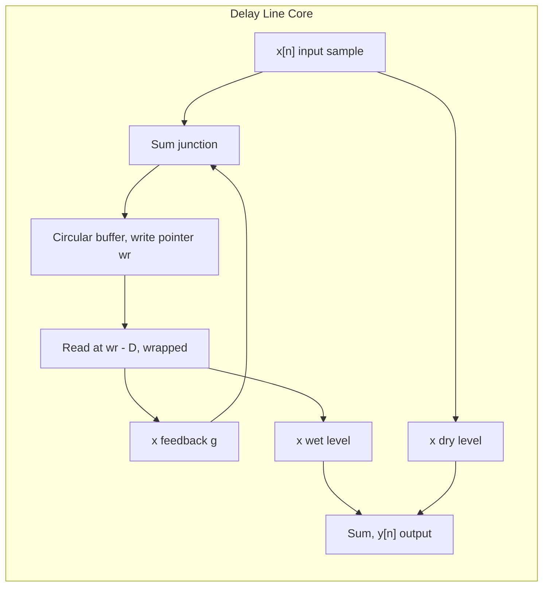
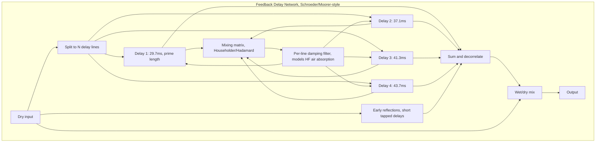
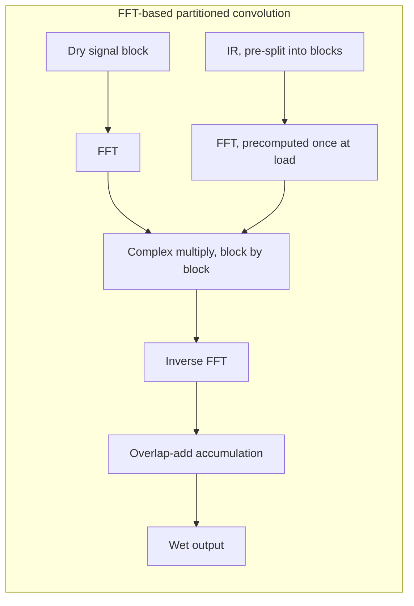
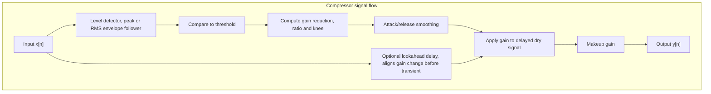
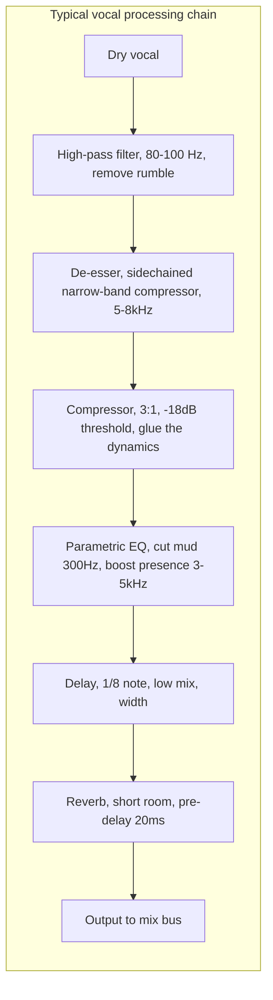

# Lesson 4: Audio Effects and Processing — Delay, Reverb, EQ, and Dynamics

## 1. First-Principles Intuition (Read Once, Build Everything On It)

Every effect in this lesson reduces to one of three operations on a stream of samples: **delay it, filter it, or scale its gain over time.** Reverb is thousands of tiny delays with filtering stacked on top of each other. A flanger is one modulated delay. An EQ is a filter. A compressor is gain scaling driven by the signal's own level. Once you see this, effects stop being magic boxes and become signal flow graphs you can build, tune, and debug by ear and by meter.

**The sampling invariant you can't violate:** a digital signal sampled at rate $f_s$ can only represent frequencies up to $f_s/2$ (Nyquist). At 44.1 kHz that's 22.05 kHz — above human hearing, so it's not a practical limit on the input. It *is* a practical limit inside your algorithm: if you generate harmonics internally (distortion, hard clipping, wavefolding, aggressive feedback), those harmonics can exceed Nyquist and fold back down as audible aliasing garbage, heard as harsh, inharmonic grit that gets worse as you increase drive. This is why distortion plugins oversample internally (process at 4x–8x the rate, generate the harmonics up there where there's headroom, filter, then downsample) — keep this in your back pocket for when you build a saturator.

**The one rule you need from filter theory, with no derivation required:** every recursive filter — a delay with feedback, a comb filter, a biquad EQ — has an implicit "pole" describing how energy recirculates. **Pole inside the unit circle = stable and decaying. Pole on or outside = the filter oscillates forever or blows up.** A feedback coefficient of 0.95 in a delay line sits close to the edge — long, lush decay, borderline risky with floating-point rounding. A feedback coefficient of 1.02 sits outside the edge — the effect will scream and clip within a second. Keep every feedback coefficient strictly below 1.0 in magnitude. Always.

---

## 2. Delay: The Atom of Time-Domain Effects

### 2.1 Mental model

A delay line is a circular buffer. You write the current input sample into the buffer, read out a sample from `delayTime` samples ago, and advance a write pointer that wraps around. Chorus, flanger, slapback echo, ping-pong delay, and the early reflections of a reverb are all this same structure with different read-pointer behavior and different feedback/mix routing.



The feedback path turns a single echo into a decaying series of echoes: each pass through the loop multiplies the signal by `g`, so the n-th repeat has amplitude $g^n$. At `g = 0.5`, each repeat is half as loud as the last — fast, tight decay, good for rhythmic slap delay. At `g = 0.9`, the tail takes far longer to die out — long trailing echoes, watch for buildup on busy material.

### 2.2 Production-grade implementation (C++, real-time safe)

A complete stereo delay with feedback, wet/dry mix, and optional ping-pong (cross-feed between channels) — the core of a real delay plugin. No allocation happens in the audio callback; the buffer is sized once in `prepare()`.

```cpp
#include <vector>
#include <cmath>
#include <algorithm>

class StereoDelay {
public:
    void prepare(double sampleRate, double maxDelaySeconds = 2.0) {
        fs = sampleRate;
        bufferSize = static_cast<size_t>(std::ceil(maxDelaySeconds * fs)) + 4;
        bufferL.assign(bufferSize, 0.0f);
        bufferR.assign(bufferSize, 0.0f);
        writePos = 0;
    }

    void setDelayMs(float ms)   { delaySamples = (ms * 0.001f) * static_cast<float>(fs); }
    void setFeedback(float fb)  { feedback = std::clamp(fb, -0.98f, 0.98f); } // never let |g| reach 1.0
    void setMix(float wet01)    { wetMix = std::clamp(wet01, 0.0f, 1.0f); }
    void setPingPong(bool on)   { pingPong = on; }

    // Linear-interpolated fractional read for smooth delay time changes
    float readInterpolated(const std::vector<float>& buf, float delayInSamples) const {
        float readPos = static_cast<float>(writePos) - delayInSamples;
        while (readPos < 0) readPos += static_cast<float>(bufferSize);

        size_t idx0 = static_cast<size_t>(readPos) % bufferSize;
        size_t idx1 = (idx0 + 1) % bufferSize;
        float frac = readPos - std::floor(readPos);

        return buf[idx0] + frac * (buf[idx1] - buf[idx0]);
    }

    void processBlock(float* left, float* right, int numSamples) {
        for (int n = 0; n < numSamples; ++n) {
            float dL = readInterpolated(bufferL, delaySamples);
            float dR = readInterpolated(bufferR, delaySamples);

            float inL = left[n];
            float inR = right[n];

            // Ping-pong crosses feedback into the opposite channel; standard delay feeds itself
            float fbL = pingPong ? dR * feedback : dL * feedback;
            float fbR = pingPong ? dL * feedback : dR * feedback;

            bufferL[writePos] = inL + fbL;
            bufferR[writePos] = inR + fbR;

            left[n]  = inL * (1.0f - wetMix) + dL * wetMix;
            right[n] = inR * (1.0f - wetMix) + dR * wetMix;

            writePos = (writePos + 1) % bufferSize;
        }
    }

private:
    double fs = 44100.0;
    size_t bufferSize = 0;
    size_t writePos = 0;
    std::vector<float> bufferL, bufferR;
    float delaySamples = 0.0f;
    float feedback = 0.3f;
    float wetMix = 0.3f;
    bool pingPong = false;
};
```

**Why linear interpolation on read, not write:** the write position always lands on an exact integer sample. The read position, computed from a delay time in milliseconds, almost never does. Reading from the nearest integer sample without interpolation causes audible "zipper noise" — stepped artifacts — whenever you automate or modulate delay time, which you will for chorus and flanger next. Linear interpolation is cheap and good enough up to moderate modulation rates; for pristine pitch-shifting delays, upgrade to a 4-point cubic/Hermite interpolator, but start here.

### 2.3 Modulated delay = chorus / flanger / vibrato

Sweep `delaySamples` with an LFO and you get three different effects depending on delay range, feedback, and mix.

| Effect | Delay range | Feedback | Mix | Character |
|---|---|---|---|---|
| Chorus | 15–35 ms | none (0) | 50% wet, detuned copies | Thickening, width |
| Flanger | 1–15 ms | 0.3–0.7, try negative too | 50% wet | Metallic sweep, jet-plane |
| Vibrato | 1–10 ms | none | 100% wet, no dry | Pitch wobble, no doubling |

```cpp
// Add to StereoDelay: call once per block before processBlock, modulating delaySamples
float lfoPhase = 0.0f;
void updateModulation(float rateHz, float depthMs, float baseDelayMs, int blockSize, double fs) {
    float phaseInc = rateHz / static_cast<float>(fs);
    float lfo = std::sin(2.0f * static_cast<float>(M_PI) * lfoPhase);
    lfoPhase += phaseInc * blockSize;
    if (lfoPhase >= 1.0f) lfoPhase -= 1.0f;

    float modMs = baseDelayMs + depthMs * lfo;
    setDelayMs(modMs);
}
```

Negative feedback (`-0.5` instead of `0.5`) on a flanger inverts alternating peaks in the comb filter response, shifting the notch pattern — the difference between "through-zero" and standard flanger tone. A/B both on a drum loop; there's no substitute for hearing it.

### 2.4 Practice drill: tune by ear before you tune by code

1. Set delay to a quarter note at 120 BPM: `delayMs = 60000 / 120 = 500 ms`. Confirm the echo lands exactly on the next beat.
2. Switch to a dotted-eighth delay (the classic U2/Edge-style rhythmic delay): `delayMs = (60000/120) * 0.75 = 375 ms`. This creates a cross-rhythm against straight time.
3. Set feedback to 0.6, then slowly automate delay time by ±20 ms over 4 seconds while audio plays. Listen for zipper noise — if you hear stepping instead of a smooth pitch bend (the Doppler effect you'd expect from a physically moving tape head), your interpolation is broken or missing.

---

## 3. Reverb: Delay Networks at Density

### 3.1 What reverb actually is

A room's impulse response has three phases: **direct sound** (arrives first, unaffected), **early reflections** (discrete, sparse echoes off nearby walls arriving in the first 20–80 ms — these tell your ear the room's size and your position in it), and **late reverberation** (reflections arriving so densely and so reflected-upon-reflection that they blur into a smooth, exponentially decaying wash of noise-like sound).

You could convolve dry audio directly with a recorded impulse response (convolution reverb, section 3.3). The classic, CPU-cheap alternative, still used in most hardware and plugin reverbs, builds the late reverberation algorithmically using a feedback delay network: a set of delay lines of mutually prime lengths, cross-feeding into each other through a mixing matrix, with filters in the loop to shape decay per frequency.



**Why prime, mutually-incommensurate delay lengths:** if two delay lines share a common factor in length, their echoes periodically reinforce each other, producing audible flutter and metallic ringing — a comb-filtered, "boingy" pitch you can hear. Prime millisecond lengths (29.7, 37.1, 41.3, 43.7 ms, and so on) keep the reflections statistically decorrelated, which is what makes dense late reverb sound smooth instead of twangy.

### 3.2 A real, runnable Schroeder reverb (the classic 4-comb + 2-allpass topology)

The textbook Schroeder/Moorer design, still the backbone of countless reverb plugins. Comb filters build the dense decay; allpass filters diffuse it further without coloring the tone.

```cpp
#include <vector>
#include <cmath>

// One feedback comb filter with damping (lowpass in the feedback loop)
class CombFilter {
public:
    void prepare(int delaySamples) {
        buffer.assign(delaySamples, 0.0f);
        idx = 0;
    }
    void setFeedback(float fb) { feedback = fb; }
    void setDamping(float d)   { damp1 = d; damp2 = 1.0f - d; }

    float process(float input) {
        float output = buffer[idx];
        filterStore = (output * damp2) + (filterStore * damp1); // 1-pole LPF in the loop
        buffer[idx] = input + (filterStore * feedback);
        idx = (idx + 1) % buffer.size();
        return output;
    }
private:
    std::vector<float> buffer;
    size_t idx = 0;
    float feedback = 0.84f, damp1 = 0.2f, damp2 = 0.8f, filterStore = 0.0f;
};

// All-pass filter: diffuses the signal in time without changing its frequency magnitude response
class AllpassFilter {
public:
    void prepare(int delaySamples) {
        buffer.assign(delaySamples, 0.0f);
        idx = 0;
    }
    float process(float input) {
        float bufOut = buffer[idx];
        float output = -input + bufOut;
        buffer[idx] = input + (bufOut * 0.5f);
        idx = (idx + 1) % buffer.size();
        return output;
    }
private:
    std::vector<float> buffer;
    size_t idx = 0;
};

class SchroederReverb {
public:
    void prepare(double sampleRate) {
        // Classic Freeverb-derived prime-ish comb lengths (samples at 44.1kHz), scaled by sampleRate
        double scale = sampleRate / 44100.0;
        int combLen[4]  = { 1557, 1617, 1491, 1422 };
        int allpassLen[2] = { 225, 556 };

        for (int i = 0; i < 4; ++i) combs[i].prepare(static_cast<int>(combLen[i] * scale));
        for (int i = 0; i < 2; ++i) allpasses[i].prepare(static_cast<int>(allpassLen[i] * scale));
    }

    void setRoomSize(float size01) {
        for (auto& c : combs) c.setFeedback(0.7f + size01 * 0.28f); // 0.70–0.98, never >= 1
    }
    void setDamping(float d01) {
        for (auto& c : combs) c.setDamping(d01);
    }

    float process(float input) {
        float combSum = 0.0f;
        for (auto& c : combs) combSum += c.process(input);
        combSum *= 0.25f; // average the 4 parallel combs

        float out = combSum;
        for (auto& a : allpasses) out = a.process(out);
        return out;
    }

private:
    CombFilter combs[4];
    AllpassFilter allpasses[2];
};
```

**Parameter mapping for the user-facing knobs:**

| UI knob | Internal parameter | Range | Effect |
|---|---|---|---|
| Room size | comb feedback | 0.70 – 0.98 | Higher = longer decay tail |
| Damping | comb damp1 | 0.0 – 0.9 | Higher = darker, faster-decaying highs, simulating absorptive surfaces like carpet |
| Pre-delay | extra delay before signal hits the network | 0 – 100 ms | Separates direct sound from reverb onset — critical for keeping vocals intelligible |
| Wet/Dry | final mix | 0 – 100% | Blend level |

### 3.3 Convolution reverb

Convolution reverb uses a **recorded** impulse response — an IR captured by playing a sine sweep or balloon pop in a real space and deconvolving the recording — and convolves it directly with the dry signal. More realistic than an FDN, but far more CPU-expensive if done naively. This is where the FFT earns its place in practice, not as an academic aside.



Naive time-domain convolution costs $O(n^2)$: for a 2-second IR at 44.1 kHz (~88,200 samples) that's billions of multiply-adds per second of audio, not real-time feasible on one core. FFT convolution drops this to $O(n \log n)$, but one giant FFT introduces latency equal to the whole IR length. Every real convolution plugin uses **partitioned convolution** instead: split the IR into small blocks (e.g., 128 samples), FFT each block once at load time, and run many small low-latency convolutions in parallel, summed with overlap-add. This is why a convolution reverb's "Mix" and "Pre-delay" respond instantly but IR loading takes a noticeable fraction of a second — that's the blockwise FFT pre-computation running.

**Getting IRs and using convolution right now, no custom DSP required:**

```bash
# Generate a sine sweep capture signal with sox, then record the room's response to it
sox -n sweep.wav synth 10 sine 20-20000

# Audition any IR against dry audio instantly using a stock convolution engine
# (any DAW's built-in convolution reverb, or REAPER's free "Convolver" JS plugin)
```

---

## 4. Equalization: Shaping the Spectrum

### 4.1 Filter types and where you actually use each one

| Filter type | What it does | Typical use |
|---|---|---|
| Low shelf | Boost/cut everything below a frequency, flat above | Adding or removing bass weight |
| High shelf | Boost/cut everything above a frequency, flat below | Air and brightness, or taming harshness |
| Peak/Bell | Boost/cut a bump centered on a frequency, width set by Q | Surgical fixes, tonal shaping |
| Low-pass | Removes everything above cutoff | Taming hiss, de-essing with a sidechain, subtractive synthesis |
| High-pass | Removes everything below cutoff | Removing mud/rumble, cleaning bass bleed on non-bass tracks |
| Notch | Narrow, deep cut at one frequency | Removing hum (50/60 Hz), killing resonant feedback frequencies |

**Q is the sharpness dial.** Low Q (0.5–0.7) is wide, gentle, musical. High Q (5–10+) is narrow, surgical — used to notch out a specific resonance or feedback frequency. A Q around 0.707 on a bell filter is the flattest setting with no ringing; push Q above roughly 3 on a boost and you start hearing the filter ring at its center frequency, like a struck bell.

### 4.2 Production-grade biquad implementation (Direct Form II Transposed)

The actual filter core used in real plugins, implementing the full RBJ (Robert Bristow-Johnson) Audio EQ Cookbook coefficient formulas — the de facto standard every DSP engineer uses for biquad EQ bands.

```cpp
#include <cmath>

class BiquadFilter {
public:
    enum class Type { LowPass, HighPass, LowShelf, HighShelf, Peak, Notch };

    void setParams(Type type, double freq, double q, double gainDb, double sampleRate) {
        double A = std::pow(10.0, gainDb / 40.0);          // amplitude for shelf/peak
        double w0 = 2.0 * M_PI * freq / sampleRate;
        double cosw0 = std::cos(w0), sinw0 = std::sin(w0);
        double alpha = sinw0 / (2.0 * q);

        double b0, b1, b2, a0, a1, a2;

        switch (type) {
            case Type::LowPass:
                b0 = (1 - cosw0) / 2; b1 = 1 - cosw0; b2 = (1 - cosw0) / 2;
                a0 = 1 + alpha;       a1 = -2 * cosw0; a2 = 1 - alpha;
                break;
            case Type::HighPass:
                b0 = (1 + cosw0) / 2; b1 = -(1 + cosw0); b2 = (1 + cosw0) / 2;
                a0 = 1 + alpha;        a1 = -2 * cosw0;   a2 = 1 - alpha;
                break;
            case Type::Peak:
                b0 = 1 + alpha * A;  b1 = -2 * cosw0; b2 = 1 - alpha * A;
                a0 = 1 + alpha / A;  a1 = -2 * cosw0; a2 = 1 - alpha / A;
                break;
            case Type::LowShelf: {
                double sq = std::sqrt(A) * 2.0 * alpha;
                b0 =    A*((A+1) - (A-1)*cosw0 + sq);
                b1 =  2*A*((A-1) - (A+1)*cosw0);
                b2 =    A*((A+1) - (A-1)*cosw0 - sq);
                a0 =       (A+1) + (A-1)*cosw0 + sq;
                a1 =   -2*((A-1) + (A+1)*cosw0);
                a2 =       (A+1) + (A-1)*cosw0 - sq;
                break;
            }
            case Type::HighShelf: {
                double sq = std::sqrt(A) * 2.0 * alpha;
                b0 =    A*((A+1) + (A-1)*cosw0 + sq);
                b1 = -2*A*((A-1) + (A+1)*cosw0);
                b2 =    A*((A+1) + (A-1)*cosw0 - sq);
                a0 =       (A+1) - (A-1)*cosw0 + sq;
                a1 =    2*((A-1) - (A+1)*cosw0);
                a2 =       (A+1) - (A-1)*cosw0 - sq;
                break;
            }
            case Type::Notch:
                b0 = 1; b1 = -2*cosw0; b2 = 1;
                a0 = 1 + alpha; a1 = -2*cosw0; a2 = 1 - alpha;
                break;
        }

        // Normalize so a0 = 1 (required for the recursive form below)
        this->b0 = b0/a0; this->b1 = b1/a0; this->b2 = b2/a0;
        this->a1 = a1/a0; this->a2 = a2/a0;
    }

    // Direct Form II Transposed: numerically robust, standard in real plugins
    float process(float x) {
        float y = b0 * x + z1;
        z1 = b1 * x + z2 - a1 * y;
        z2 = b2 * x - a2 * y;
        return y;
    }

private:
    double b0 = 1, b1 = 0, b2 = 0, a1 = 0, a2 = 0;
    double z1 = 0, z2 = 0; // state registers, not a circular buffer — this is the efficiency win
};
```

**Why Direct Form II Transposed and not the "obvious" Direct Form I:** Direct Form I needs 4 separate delay registers, two for input history and two for output history. Direct Form II Transposed needs only 2 state variables and is proven more numerically robust against floating-point round-off at low frequencies. This is the form you'll find in JUCE's `IIRFilter` and most open-source EQ plugins. Use it as your default; reach for Direct Form I only if you have a specific fixed-point reason.

### 4.3 Chaining bands into a parametric EQ

A real parametric EQ is N biquads in series, each independently configured:

```cpp
class ParametricEQ {
public:
    void prepare(double sampleRate) { fs = sampleRate; }

    void setBand(int index, BiquadFilter::Type type, double freq, double q, double gainDb) {
        bands[index].setParams(type, freq, q, gainDb, fs);
    }

    float process(float x) {
        for (auto& band : bands) x = band.process(x);
        return x;
    }

private:
    double fs = 44100.0;
    BiquadFilter bands[6]; // e.g. HPF, low shelf, 3x bell, high shelf — a typical 6-band channel strip
};
```

### 4.4 Practice drill: train your ears to hear frequencies

This is the actual skill that separates a mixing engineer from someone who can read a manual. Run this weekly.

1. Load a full mix bus. Insert a bell filter, Q = 4, gain = +12 dB (exaggerated on purpose, for training).
2. Sweep the frequency knob slowly from 20 Hz to 20 kHz over 30 seconds while listening.
3. Stop and name the frequency range every time something jumps out: mud (200–400 Hz), boxiness (400–800 Hz), nasal/honk (800 Hz–2 kHz), harshness/presence (2–5 kHz), sibilance/air (5–12 kHz).
4. Remove the boost, apply a corrective cut of -3 dB at the frequency you identified, Q = 1.0. A/B against bypass. If you can't tell the difference, the cut was probably too narrow or too small — widen the Q or increase the cut to 4–6 dB while training. You'll use far more subtle amounts in a real mix.

---

## 5. Dynamics Processing: Compression, the Fourth Pillar

No lesson on audio effects is complete without compression. It's the most-used processor in every mix, and it's explicitly gain-vs-time, not frequency or delay based.

### 5.1 Mental model

A compressor is an automatic volume control. It constantly measures the input level and, whenever that level crosses a **threshold**, reduces gain by an amount set by the **ratio**. **Attack** controls how fast it reacts once the signal crosses threshold; **release** controls how fast it lets go afterward. **Knee** controls whether the transition at threshold is abrupt (hard knee) or gradual (soft knee).



### 5.2 Complete, runnable compressor

```cpp
#include <cmath>
#include <algorithm>

class Compressor {
public:
    void prepare(double sampleRate) { fs = sampleRate; }

    void setThresholdDb(float t) { thresholdDb = t; }
    void setRatio(float r)       { ratio = r; }               // e.g. 4.0 = 4:1
    void setAttackMs(float ms)   { attackCoeff = timeToCoeff(ms); }
    void setReleaseMs(float ms)  { releaseCoeff = timeToCoeff(ms); }
    void setKneeDb(float k)      { kneeDb = k; }
    void setMakeupDb(float m)    { makeupGain = std::pow(10.0f, m / 20.0f); }

    float process(float x) {
        float inputDb = 20.0f * std::log10(std::max(std::abs(x), 1e-6f));

        // Soft-knee gain computation
        float overshoot = inputDb - thresholdDb;
        float gainReductionDb;
        if (overshoot <= -kneeDb / 2.0f) {
            gainReductionDb = 0.0f;
        } else if (overshoot >= kneeDb / 2.0f) {
            gainReductionDb = overshoot - (overshoot / ratio);
        } else {
            // Quadratic interpolation through the knee region
            float t = overshoot + kneeDb / 2.0f;
            gainReductionDb = ((1.0f / ratio - 1.0f) * t * t) / (2.0f * kneeDb);
        }

        // Attack/release envelope smoothing of the gain reduction itself
        float targetReduction = gainReductionDb;
        float coeff = (targetReduction > envelopeDb) ? attackCoeff : releaseCoeff;
        envelopeDb = targetReduction + coeff * (envelopeDb - targetReduction);

        float gainLinear = std::pow(10.0f, -envelopeDb / 20.0f);
        return x * gainLinear * makeupGain;
    }

private:
    float timeToCoeff(float ms) const {
        return std::exp(-1.0f / (0.001f * ms * static_cast<float>(fs)));
    }

    double fs = 44100.0;
    float thresholdDb = -18.0f, ratio = 4.0f, kneeDb = 6.0f, makeupGain = 1.0f;
    float attackCoeff = 0.0f, releaseCoeff = 0.0f, envelopeDb = 0.0f;
};
```

### 5.3 Practical starting points by source (dial these in, then trust your ears)

| Source | Threshold | Ratio | Attack | Release | Why |
|---|---|---|---|---|---|
| Vocal, lead | -18 dB | 3:1 – 4:1 | 5–15 ms | 80–150 ms | Fast enough to catch peaks, slow enough not to kill consonant transients |
| Bass guitar | -20 dB | 4:1 – 6:1 | 10–30 ms | 100–300 ms | Evens out note-to-note level without pumping |
| Kick drum | -15 dB | 4:1 | 1–5 ms, or slower to let the click through | 50–100 ms | Fast attack controls the hit; slow attack lets the transient punch through uncompressed |
| Full mix bus, glue | -10 dB | 2:1 | 10–30 ms | auto/program-dependent | Gentle, musical cohesion, no audible pumping |

**Diagnosing audible pumping, the #1 beginner compressor mistake:** if you hear the mix "breathing" or visibly swelling in volume after loud hits, your release is too fast relative to the material's rhythm, or your ratio/threshold combination is too aggressive for the source. Fix order: lengthen release first. If it still pumps, reduce ratio before touching threshold.

---

## 6. Putting It Together: A Signal Chain You'll Actually Build



**Order matters, and here's why:** high-pass before compression prevents sub-bass rumble from falsely triggering gain reduction. Compression before EQ means you're not chasing a moving target — boost a frequency before compressing and the compressor reacts differently depending on how much energy sits in that band. Delay and reverb go last because they're meant to process the already-shaped dry signal; reversing this order, running reverb before EQ, means your EQ starts coloring the reverb tail too. That's sometimes a deliberate choice for a dark, washy reverb, but it should be a choice, not an accident.

### Lab: build this chain today

1. In any DAW, insert a high-pass filter, compressor, EQ, delay (send/return), and reverb (send/return) on a vocal track, in that order.
2. Set the HPF corner at 90 Hz. Set the compressor per the vocal row in the table above. Set the EQ: cut 2–3 dB at 300 Hz (mud), boost 2 dB at 4 kHz (presence) with Q = 1.
3. Set delay to an eighth note at your song's tempo, mixed in at 15–20% via a send, not inserted dry on the main channel — this way the delay repeats can stay reverb-free or be treated differently from the dry vocal.
4. Set reverb pre-delay to 20 ms (keeps the direct vocal articulate before the wash arrives) and decay/room size short, 1.2–1.8 seconds, for an intimate vocal sound.
5. Bypass each processor one at a time while listening in context. If removing a processor makes no audible difference, question whether it needs to be there. This habit, the bypass test, is the fastest way to develop critical mixing judgment.
