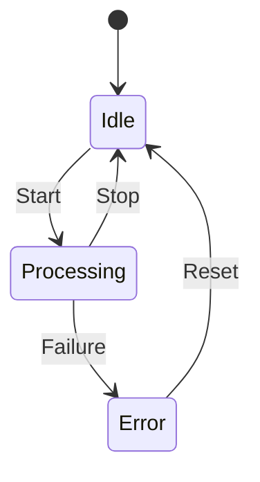

# Advanced Foundation: Audio Effects

## 1. Theoretical Invariants & Formal Frameworks

### Formal Proofs
Formal proofs in audio effects involve rigorous mathematical demonstrations that certain properties hold under all conditions. For instance, proving that a digital filter maintains a specific frequency response regardless of input signal characteristics.

### Kernel or Physical Invariants
Kernel invariants refer to properties that remain constant across different implementations of an audio effect. For example, the invariance of the impulse response of a linear time-invariant (LTI) filter, which dictates that the output is solely dependent on the current and past inputs, not future inputs.

## 2. Low-Level Invariant Taxonomy

### Deep Registers
Deep registers in audio processing refer to the internal state variables of an audio effect that are not directly accessible to the user. These registers can hold critical information such as filter coefficients or delay line contents, which must be preserved across processing iterations to maintain the effect's integrity.

### Memory Models
Memory models define how data is stored and accessed in an audio processing system. Ensuring that memory models are consistent and predictable is crucial for maintaining the invariants of audio effects. For example, ensuring that a delay line's memory is not overwritten during concurrent access can prevent audio glitches.

### Hardware Constraints
Hardware constraints, such as the precision of digital-to-analog converters (DACs) and analog-to-digital converters (ADCs), can impose limits on the achievable invariants of audio effects. Understanding these constraints is essential for designing effects that perform reliably across different hardware platforms.

### Axiomatic Definitions
Axiomatic definitions provide the foundational truths upon which audio effects are built. For example, the axioms of linear algebra underpin the design of matrix-based audio effects, ensuring that operations on audio signals are mathematically consistent.

## 3. Micro-Architecture & Concurrency Dynamics

### Mermaid State Machines


### ASCII State Machines
```
[ Idle ] --Start--> [ Processing ]
[ Processing ] --Stop--> [ Idle ]
[ Processing ] --Failure--> [ Error ]
[ Error ] --Reset--> [ Idle ]
```

### Cache Diagrams
Cache diagrams illustrate how data is cached in an audio processing system to improve performance. For example, a cache diagram might show how filter coefficients are stored in a cache to reduce memory access times.

### Race Condition Diagrams
Race condition diagrams highlight potential race conditions in concurrent audio processing systems. For example, a race condition diagram might show how two threads accessing a shared delay line can lead to inconsistent results.

## 4. Subtle Failure Modes & Boundary Conditions

### Subtle Failure Modes
Subtle failure modes in audio effects can arise from unexpected interactions between different components. For example, a subtle failure mode might occur when a feedback loop in a reverb effect causes instability due to floating-point precision errors.

### Boundary Conditions
Boundary conditions refer to the limits of an audio effect's operation. For example, the boundary condition for a delay effect might be the maximum delay time that can be achieved without causing audio glitches. Understanding boundary conditions is essential for designing effects that perform reliably under all conditions.

## 5. Master Socratic Inquiries

### Research-Grade Discussion Questions
1. How can formal proofs be used to ensure the invariance of audio effects across different implementations?
2. What are the implications of hardware constraints on the design of audio effects, and how can these constraints be mitigated?
3. How can race conditions be identified and resolved in concurrent audio processing systems?
4. What are the mathematical foundations of audio effects, and how do these foundations ensure the reliability and consistency of audio processing?
5. How can subtle failure modes be identified and addressed in audio effects, and what are the potential consequences of ignoring these failure modes?
