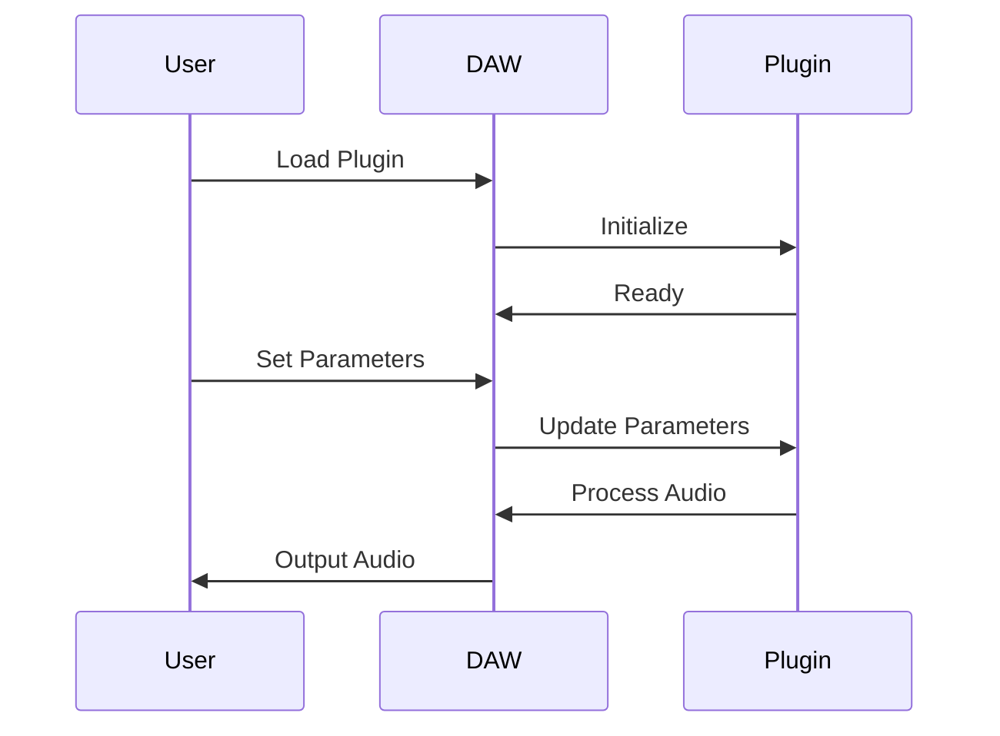

# Intermediate Foundation: Audio Effects
## 1. Architectural Mental Model
In the realm of audio effects, understanding the architectural mental model is crucial for designing robust and efficient systems. Building upon the foundational knowledge of individual effects, the intermediate model emphasizes the integration of these effects into a cohesive production architecture. This involves understanding how different effects interact within a signal chain, how they are processed, and how they contribute to the overall sound design.

### Key Concepts:
- **Signal Chain:** A sequence of audio processing devices or software modules through which a signal passes. Each effect in the chain modifies the signal in some way.
- **Modulation:** Techniques that alter the amplitude, frequency, or other characteristics of a signal over time, such as chorus, flanger, and phaser.
- **Distortion:** Processes that introduce non-linearities into the signal, such as overdrive, distortion, and bit-crushing.
- **Delay:** Effects that create echoes by delaying the signal, including reverb, delay, and ping-pong delay.
- **Dynamics:** Techniques that control the amplitude of a signal, such as compression, limiting, and gating.

### Architectural Considerations:
- **Latency:** The delay introduced by processing the signal. Minimizing latency is essential for real-time applications.
- **Modular Design:** Building systems from interchangeable components that can be easily modified or replaced.
- **Scalability:** Designing systems that can handle increasing complexity without significant performance degradation.

## 2. Systems Taxonomy & Component Protocols
Understanding the taxonomy of audio effects and the protocols that govern their interaction is essential for effective system design. This section delves into the standard interfaces, protocols, and data models that define how audio effects are implemented and integrated.

### Taxonomy of Audio Effects:
- **Time-Based Effects:** Delay, reverb, echo, flanger, phaser.
- **Frequency-Based Effects:** Equalization, crossover networks, filters.
- **Amplitude-Based Effects:** Compression, limiting, gating, noise reduction.
- **Modulation Effects:** Chorus, flanger, phaser, tremolo, vibrato.
- **Distortion Effects:** Overdrive, distortion, bit-crushing, saturation.
- **Spectral Effects:** Granular synthesis, spectral processing.

### Standard Protocols:
- **VST (Virtual Studio Technology):** A standard for audio processing plugins developed by Steinberg.
- **AU (Audio Unit):** A standard for audio processing plugins developed by Apple.
- **AAX (Avid Audio Extensions):** A standard for audio processing plugins developed by Avid.
- **LV2 (Linux Audio Virtualization):** An open standard for audio processing plugins.

### Data Models:
- **Audio Buffers:** Data structures that hold audio samples for processing.
- **Control Signals:** Data structures that hold parameters for controlling effects.
- **MIDI (Musical Instrument Digital Interface):** A protocol for controlling musical instruments and audio equipment.

## 3. Multi-Component Interaction Flow
Understanding how different audio effects interact within a signal chain is essential for designing effective systems. This section provides detailed ASCII and Mermaid sequence diagrams that illustrate the interaction flow of multi-component systems.

### ASCII Sequence Diagram:
```
User -> DAW: Load Plugin
DAW -> Plugin: Initialize
Plugin -> DAW: Ready
User -> DAW: Set Parameters
DAW -> Plugin: Update Parameters
Plugin -> DAW: Process Audio
DAW -> User: Output Audio
```

### Mermaid Sequence Diagram:


## 4. Architectural Trade-offs & Production Pitfalls
Designing effective audio effect systems involves making trade-offs between various architectural considerations. This section explores some of the key trade-offs and potential pitfalls that engineers and practitioners should be aware of.

### Key Trade-offs:
- **Latency vs. Quality:** Minimizing latency can reduce the quality of the audio processing. Balancing latency and quality is essential for real-time applications.
- **Complexity vs. Performance:** More complex systems can provide better sound design but may require more processing power and memory. Balancing complexity and performance is essential for efficient systems.
- **Modularity vs. Integration:** Modular systems are easier to modify and replace but may require more integration effort. Balancing modularity and integration is essential for effective systems.

### Production Pitfalls:
- **Signal Degradation:** Over-processing the signal can degrade the quality of the audio. Avoiding signal degradation is essential for high-quality systems.
- **Feedback Loops:** Feedback loops can cause instability and unwanted artifacts. Avoiding feedback loops is essential for stable systems.
- **Resource Contention:** Resource contention can cause performance degradation and instability. Avoiding resource contention is essential for efficient systems.

## 5. Socratic Discussion Starters
Socratic discussions are an effective way to bridge the gap between architecture and low-level implementation. This section provides some questions that can be used to facilitate Socratic discussions about audio effect systems.

### Discussion Starters:
- **How do different audio effects interact within a signal chain?**
- **What are the trade-offs between latency and quality in audio effect systems?**
- **How can modular design be used to create flexible and efficient audio effect systems?**
- **What are some common pitfalls in designing audio effect systems?**
- **How can feedback loops be avoided in audio effect systems?**
- **What are some best practices for minimizing resource contention in audio effect systems?**

By exploring these questions, engineers and practitioners can deepen their understanding of audio effect systems and develop more effective and efficient designs.
