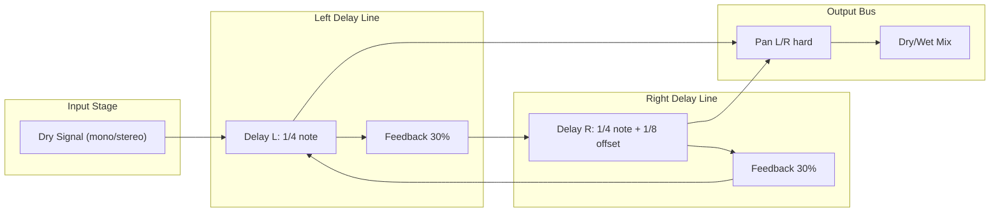
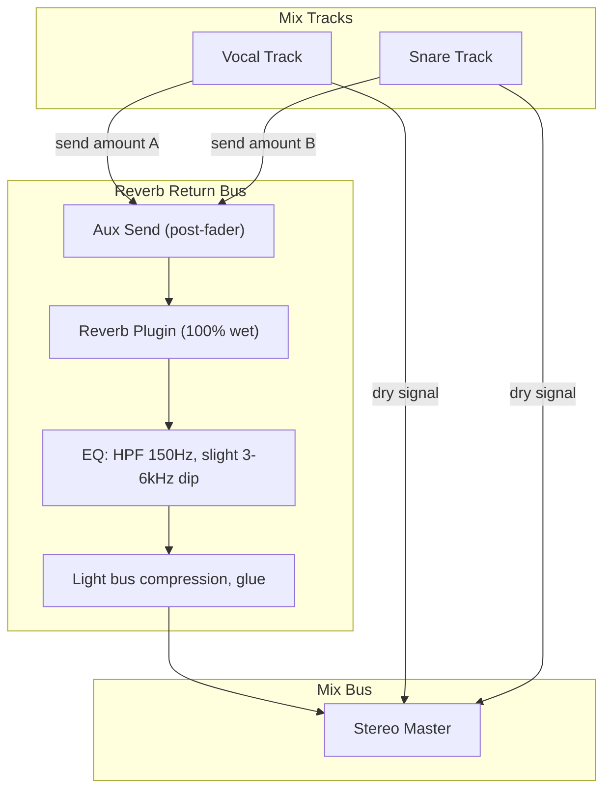
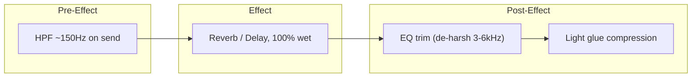

# Audio Effects: DSP Theory, Plugin Engineering, and Mix Application

## Who This Is For and What You Need

This is a working masterclass for mixing engineers, sound designers, and audio DSP programmers. You will build real-time effects from scratch in C++/JUCE, understand exactly why a comb filter sounds like a comb filter, and learn the mix-engineering judgment for when to reach for delay vs. reverb vs. modulation. Install:

- **A real DAW**: Reaper (cheap, scriptable) or Ableton Live. Audacity is fine for destructive single-track experiments but has no automation lanes, no sidechain routing, and no real-time plugin hosting workflow — it will not teach you how effects behave in a mix.
- **JUCE** (juce.com) + a C++ IDE (Xcode, Visual Studio, or CLion). This is how virtually every commercial audio plugin (FabFilter, Valhalla, Soundtoys) is actually built.
- **Python 3** with `numpy`, `scipy`, `matplotlib`, and `soundfile` — for impulse response analysis and verifying your filters, not for "plotting perceived richness" on a 1–10 subjective scale. We measure what's measurable (frequency response, group delay) and reserve the ear for what isn't.

---

## Part 1: The Physics in One Paragraph

Every delay-based effect (echo, chorus, flanger, phaser, most reverbs) is built from one primitive: a **delay line**, a buffer that stores past samples and plays them back `N` samples later. Mixing a delayed copy with the dry signal creates constructive and destructive interference at frequencies where the delay time equals a multiple of the period: `f = n / T` for integer `n`. This carves a "comb" of notches and peaks into the frequency response — hence **comb filter**. A **feedback** path (output routed back into the delay input) turns a single echo into a decaying series of echoes, because each pass through the loop attenuates by the feedback gain `g` (must satisfy `|g| < 1` or the loop diverges into runaway oscillation). Modulating the delay time with an LFO moves the comb notches around in real time — that movement *is* chorus and flanging. Reverb is the same primitive at massive scale: thousands of overlapping, decaying reflections dense enough that the ear stops hearing discrete echoes and perceives "space." That's the entire theoretical foundation. Everything below is application.

---

## Part 2: Delay — Mix Engineering First

### What delay actually does to a mix

Delay creates perceived space and rhythm without the frequency-smearing of reverb. It's more surgical: you control exactly when the repeat lands.

### Setting delay time musically, not numerically

Never dial in "500ms" blind. Sync to tempo using note-division math:

```
delay_ms = 60000 / BPM × note_division_multiplier

Quarter note   = 60000 / BPM
Dotted eighth  = 60000 / BPM × 0.75
Eighth note    = 60000 / BPM × 0.5
Triplet eighth = 60000 / BPM × (1/3)
```

At 120 BPM: quarter = 500ms, dotted-eighth = 375ms, eighth = 250ms. The classic U2/Edge guitar delay sound is dotted-eighth — it creates a syncopated pulse that feels ahead of the beat rather than just repeating it. Every real DAW delay plugin has a "sync" toggle that computes this for you; use it, but know the math so you can set it by ear when a track has no clean tempo grid (live recordings, rubato passages).

### Practical delay patcher (Reaper/Ableton, works in Audacity too)

| Parameter | Slap-back (rock vocal) | Rhythmic (guitar/synth) | Ambience (subtle width) |
|---|---|---|---|
| Time | 80–120 ms | dotted-8th or 1/4 note, synced | 20–35 ms (below echo threshold) |
| Feedback | 0% (single repeat) | 25–40% | 10–15% |
| Filtering | HPF 400Hz, LPF 6kHz on repeats | HPF 300Hz | HPF 800Hz, LPF 4kHz |
| Mix | 15–25% | 20–35% | 10–20%, pan dry/wet opposite sides |

**Why filter the repeats:** unfiltered feedback accumulates low-mid mud fast because each pass re-injects the same frequency content. A high-pass on the feedback path (not just the output) makes successive repeats progressively thinner and darker, which is what a real acoustic echo does (air absorbs highs over distance) and keeps the low end of your mix from turning to soup after four or five repeats.

**Below 35ms = comb filter, not echo.** Below the Haas fusion threshold (~20–35ms depending on material) the ear can't resolve two discrete events; instead it hears the comb-filtering interference pattern as timbre change — a thickening or a slight hollowing. This is the exact mechanism behind doubling and short-slap ADT (Automatic Double Tracking) effects from 60s Abbey Road records.

### Ping-pong delay routing (stereo bounce)



Offsetting the R delay time slightly from L (e.g., L=1/4, R=1/4+1/16) avoids the two channels locking into a static, boring symmetric bounce and creates genuine stereo movement.

### Troubleshooting

- **Repeats sound muddy/boomy**: feedback path has no HPF, or feedback % too high for the material's low end. Drop feedback to under 25% and add a 300Hz+ high-pass in the feedback loop.
- **Delay "disappears" in the mix**: it's probably masked by reverb or other delays occupying the same time pocket. Solo the delay return, confirm the time value, then pull dry/wet down rather than boosting wet level (boosting wet level widens dynamic range problems instead of fixing masking).
- **Runaway feedback / self-oscillation**: feedback gain at or above 100%, or a feedback-path gain stage clipping and re-feeding hot signal. Cap feedback coefficient at 0.95 in code, always.

---

## Part 3: Reverb — Mechanics and Mix Placement

### Early reflections vs. tail — what you're actually hearing

Real reverb has two perceptually distinct parts:
1. **Early reflections (0–80ms)**: discrete, sparse bounces off nearest surfaces. These tell your brain the *size and shape* of a room — they are the primary spatial cue, more than the tail.
2. **Late reverberant tail**: the dense, exponentially decaying wash of reflections too numerous to resolve individually. This carries the sense of *reflectivity/liveness* of the surfaces (RT60, the time for the tail to decay 60dB).

A reverb's "Room Size" parameter controls the delay-line lengths feeding the early reflections and the density of the late network; "Damping" applies a low-pass filter inside the feedback loops of the tail so high frequencies decay faster than lows — exactly like real air/material absorption.

### Parameter reference with mix-ready starting points

| Reverb type | Decay (RT60) | Pre-delay | Damping | Use case |
|---|---|---|---|---|
| Room | 0.3–0.8s | 0–10ms | High | Drums, adding "glue" without obvious wetness |
| Plate | 1–2s | 10–20ms | Medium | Vocals, snare — dense, no obvious early reflections |
| Hall | 2–4s | 20–50ms | Low–Medium | Strings, pads, cinematic material |
| Spring | 0.5–1.5s | near 0 | Low, metallic resonance | Guitar (surf/rockabilly character) |

**Pre-delay is the most underused parameter.** Setting pre-delay to 20–40ms pushes the reverb's onset slightly after the direct sound, preserving transient clarity and vocal intelligibility while still letting the tail bloom. Zero pre-delay on a vocal buries the consonants. Rule of thumb: pre-delay in ms ≈ 1/8 note at song tempo, as a starting point, then tune by ear.

### Routing reverb correctly: send/return, not insert



Running reverb as a send (100% wet on the return track, each source sends a variable amount) instead of an insert per-track means: one CPU-efficient reverb instance serves the whole mix, all reverberant tracks share a cohesive "room," and you can EQ and compress the reverb return independently — HPF the return at 150Hz to kill low-end mud (reverb almost never needs sub-200Hz energy), and a gentle dip at 3–6kHz keeps the tail from turning harsh/sibilant.

### Troubleshooting

- **Mix sounds washy/undefined**: too much send level, RT60 too long for tempo, or no pre-delay. Fix order: add pre-delay first, then shorten decay, then reduce send level last.
- **Vocal reverb fights the lyrics**: automate the send — more on sustained vowels and phrase ends, duck it during busy rhythmic passages, or insert a gate before the reverb return keyed off the dry vocal.
- **Reverb return causes phase cancellation with dry**: check reverb plugin's dry/wet knob isn't double-mixing dry signal into the return path when you're already running it as a 100%-wet send — this is the single most common beginner routing bug.

---

## Part 4: Modulation Effects — Chorus, Flanger, Phaser

These three sit on the same spectrum of "modulated delay," distinguished by delay time range and feedback:

| Effect | Delay time | Feedback | LFO rate | Character |
|---|---|---|---|---|
| Chorus | 15–35ms | none/minimal | 0.5–3 Hz | Thickening, multiple-voice shimmer |
| Flanger | 0–20ms, often starting near 0 | high, can self-resonate | 0.1–1 Hz typical, can go audio-rate | Jet-sweep, metallic sweep |
| Phaser | n/a (uses all-pass filter stages, not a true delay line) | moderate | 0.2–2 Hz | Swirling, less metallic than flange |

**Why chorus thickens instead of sweeping like a flanger**: chorus uses a longer base delay (15–35ms, above the comb-notch-density that produces an audible metallic sweep) and typically multiple independently-modulated voices with no feedback, so you get pitch-wobble and width without the aggressive resonant notches. Flanger's short delay (down near 0ms) packs comb notches close together across the spectrum, and feedback resonates at each notch, producing the characteristic jet-engine sweep.

### Chorus patch for mix width

- Rate: 0.8–1.2 Hz (slow enough to feel like natural pitch drift, not vibrato)
- Depth: modest — enough to detune ±5-10 cents equivalent, not ±50
- Voices: 2–4 delay lines, each with independent LFO phase offset, panned across stereo field
- Mix: 20–30% wet on guitars/synths for width; near 100% wet only for deliberate "ensemble" effects

### Troubleshooting

- **Chorus sounds seasick/out of tune**: depth too high. Pull depth back before touching rate.
- **Flanger won't "jet"**: feedback too low, or delay time range too long. Jet flange needs feedback above ~70% and delay sweeping near 0–10ms.
- **Phaser sounds thin**: too few all-pass stages. Commercial phasers use 4–12 stages (4 = subtle, 12 = thick/dramatic).

---

## Part 5: Build It — Real-Time Delay Line in JUCE/C++

This is a complete, compiling DSP class for a feedback delay with a one-pole low-pass damping filter in the feedback path — the actual building block behind delay, chorus, and the early-reflection stage of a reverb. No stubs.

```cpp
// DelayLine.h — mono feedback delay with damped feedback path
#pragma once
#include <vector>
#include <cmath>

class DelayLine
{
public:
    void prepare(double sampleRate, float maxDelaySeconds = 2.0f)
    {
        sr = sampleRate;
        bufferSize = static_cast<int>(maxDelaySeconds * sr) + 4;
        buffer.assign(bufferSize, 0.0f);
        writeIndex = 0;
        dampState = 0.0f;
    }

    void setDelayTimeMs(float ms)
    {
        delaySamples = juce::jlimit(1.0f, (float)(bufferSize - 2), ms * 0.001f * (float)sr);
    }

    void setFeedback(float fb)       { feedback = juce::jlimit(0.0f, 0.95f, fb); }  // hard cap: prevents runaway oscillation
    void setDampingCutoffHz(float hz)
    {
        // one-pole lowpass coefficient inside the feedback loop
        // models high-frequency air absorption on each repeat
        float x = std::exp(-2.0f * 3.14159265f * hz / (float)sr);
        dampCoeff = x;
    }
    void setMix(float wet) { wetMix = juce::jlimit(0.0f, 1.0f, wet); }

    // process one sample, mono
    float processSample(float input)
    {
        // fractional read index with linear interpolation (avoids zipper noise on modulated delay)
        float readPos = (float)writeIndex - delaySamples;
        while (readPos < 0) readPos += bufferSize;

        int idx0 = (int)readPos;
        int idx1 = (idx0 + 1) % bufferSize;
        float frac = readPos - (float)idx0;
        float delayed = buffer[idx0] + frac * (buffer[idx1] - buffer[idx0]);

        // one-pole damping filter in the feedback path
        dampState = delayed * (1.0f - dampCoeff) + dampState * dampCoeff;

        float feedbackSample = input + dampState * feedback;

        buffer[writeIndex] = feedbackSample;
        writeIndex = (writeIndex + 1) % bufferSize;

        return input * (1.0f - wetMix) + delayed * wetMix;
    }

    // allows external LFO modulation for chorus/flanger built on this same class
    void modulateDelaySamples(float deltaSamples)
    {
        delaySamples = juce::jlimit(0.0f, (float)(bufferSize - 2), delaySamples + deltaSamples);
    }

private:
    std::vector<float> buffer;
    int bufferSize = 0;
    int writeIndex = 0;
    double sr = 44100.0;
    float delaySamples = 441.0f;
    float feedback = 0.3f;
    float wetMix = 0.5f;
    float dampCoeff = 0.2f;
    float dampState = 0.0f;
};
```

```cpp
// ChorusVoice.h — built directly on DelayLine, adds an LFO sweep
#pragma once
#include "DelayLine.h"

class ChorusVoice
{
public:
    void prepare(double sampleRate)
    {
        sr = sampleRate;
        delay.prepare(sampleRate, 0.05); // 50ms max — chorus/flanger range, not echo range
        delay.setFeedback(0.0f);         // classic chorus: no feedback
        delay.setDampingCutoffHz(8000.0f);
        delay.setMix(0.5f);
        delay.setDelayTimeMs(baseDelayMs);
    }

    void setRateHz(float hz) { lfoIncrement = hz / (float)sr; }
    void setDepthMs(float ms) { depthMs = ms; }

    float processSample(float input)
    {
        // sine LFO, output range [-depthMs, +depthMs] around base delay
        float lfoValue = std::sin(2.0f * 3.14159265f * lfoPhase);
        lfoPhase += lfoIncrement;
        if (lfoPhase >= 1.0f) lfoPhase -= 1.0f;

        delay.setDelayTimeMs(baseDelayMs + lfoValue * depthMs);
        return delay.processSample(input);
    }

private:
    DelayLine delay;
    double sr = 44100.0;
    float baseDelayMs = 20.0f;   // center of chorus range
    float depthMs = 4.0f;
    float lfoPhase = 0.0f;
    float lfoIncrement = 0.02f;  // ~1Hz at 44.1kHz block-rate call pattern — set via setRateHz in real use
};
```

**Wiring into a JUCE `AudioProcessor::processBlock`:**

```cpp
void MyDelayPlugin::processBlock(juce::AudioBuffer<float>& buffer, juce::MidiBuffer&)
{
    auto* left  = buffer.getWritePointer(0);
    auto* right = buffer.getNumChannels() > 1 ? buffer.getWritePointer(1) : left;

    for (int sample = 0; sample < buffer.getNumSamples(); ++sample)
    {
        left[sample]  = delayLineL.processSample(left[sample]);
        right[sample] = delayLineR.processSample(right[sample]);
    }
}
```

Call `delayLineL.prepare(sampleRate)` and set parameters inside `prepareToPlay()`. Expose `delaySamples`, `feedback`, `dampingCutoffHz`, and `wetMix` as `juce::AudioParameterFloat` in your `AudioProcessorValueTreeState` so a host DAW can automate them — this is what turns the class above into an actual loadable plugin rather than a standalone test harness.

---

## Part 6: Verify, Don't Guess — Impulse Response Analysis

Never trust your ears alone to confirm a filter or effect is behaving correctly — verify it with an impulse response and FFT, the way working DSP engineers debug plugins before they ship.

```python
import numpy as np
import soundfile as sf
import matplotlib.pyplot as plt

def analyze_impulse_response(filepath, sr=44100):
    """
    Load a rendered impulse response (impulse in, your effect applied, render to wav)
    and plot both the time-domain decay and the frequency response.
    Use this to verify comb-filter notch spacing, RT60 decay time, and
    damping filter cutoff actually land where you set them.
    """
    audio, file_sr = sf.read(filepath)
    if audio.ndim > 1:
        audio = audio[:, 0]  # analyze left channel

    # --- Time domain: decay envelope (for RT60 verification) ---
    envelope_db = 20 * np.log10(np.abs(audio) + 1e-12)

    # --- Frequency domain: magnitude response via FFT ---
    n_fft = 2 ** 16
    spectrum = np.fft.rfft(audio, n=n_fft)
    freqs = np.fft.rfftfreq(n_fft, d=1.0 / file_sr)
    magnitude_db = 20 * np.log10(np.abs(spectrum) + 1e-12)

    fig, (ax1, ax2) = plt.subplots(2, 1, figsize=(10, 7))

    ax1.plot(np.arange(len(audio)) / file_sr, envelope_db)
    ax1.set_title("Decay Envelope (verify RT60 / feedback decay rate)")
    ax1.set_xlabel("Time (s)")
    ax1.set_ylabel("Level (dB)")
    ax1.grid(True)

    ax2.semilogx(freqs[1:], magnitude_db[1:])
    ax2.set_title("Frequency Response (verify comb notch spacing, damping rolloff)")
    ax2.set_xlabel("Frequency (Hz, log scale)")
    ax2.set_ylabel("Magnitude (dB)")
    ax2.set_xlim(20, 20000)
    ax2.grid(True, which='both')

    plt.tight_layout()
    plt.savefig("impulse_response_analysis.png", dpi=150)
    plt.show()

    # Quantitative check: first comb notch frequency should equal 1 / (2 * delay_time_seconds)
    return freqs, magnitude_db

# Usage: render a single-sample impulse through your plugin in your DAW, export to wav,
# then run: analyze_impulse_response("my_delay_ir.wav")
```

**What to check in the output:** for a delay set to `T` seconds with feedback, the frequency response should show notches at `f = (n + 0.5)/T` Hz (odd harmonics pattern for a simple feedforward comb) and the decay envelope's slope gives you the actual RT60 — compare it against what the feedback coefficient predicts: `RT60 ≈ -3 × T / log10(feedback)`. If your measured decay doesn't match this, your damping filter or feedback clamp has a bug, not your ears.

---

## Part 7: Fault Injection — Know the Failure Modes

Pushing parameters to extremes isn't just a curiosity drill — it's how you find the bugs a casual listening test misses, and how you know what guardrails to code into a plugin before shipping it.

| Fault condition | Expected behavior | What it reveals if it's wrong |
|---|---|---|
| Feedback ≥ 1.0 | Must be clamped (code above caps at 0.95) | Unclamped feedback diverges to full-scale clipping/noise within seconds — a real bug, not a creative effect |
| Negative delay time | Not physically meaningful; UI should reject or clamp to 0 | If a plugin silently accepts it, check whether it's wrapping to buffer-length minus abs(value), which will produce a nonsense delay time, not negative time |
| Modulation depth exceeding base delay time (chorus/flanger) | `delaySamples` hits 0 or goes negative mid-sweep | Audible clicks/zipper noise — confirms your `jlimit` clamp in `modulateDelaySamples` is doing its job; remove it and you'll hear the glitch immediately |
| Reverb room size > 1.0 or < 0 | Most plugins internally clamp 0–1; verify yours does | Unclamped values can push internal delay-line lengths negative, causing array index crashes in naive implementations — this is a real, shippable-bug class |
| Sample rate mismatch (effect designed at 44.1kHz, session at 96kHz) | Delay times in ms should stay correct; LFO rates in Hz should stay correct | If you hardcoded sample counts instead of computing from `sampleRate` in `prepare()`, effect timing breaks at non-44.1k rates — test every plugin at 48k and 96k before shipping |

Run each of these against the JUCE code in Part 5 by temporarily removing a `jlimit` call and confirming you get the predicted failure — this is the single fastest way to understand why the clamps exist instead of taking it on faith.

---

## Quick Reference

### Delay time to BPM sync (quarter note ms)

| BPM | 1/4 | 1/8 | Dotted 1/8 | Triplet 1/8 |
|---|---|---|---|---|
| 90 | 667 | 333 | 500 | 222 |
| 100 | 600 | 300 | 450 | 200 |
| 120 | 500 | 250 | 375 | 167 |
| 140 | 429 | 214 | 321 | 143 |

### Send-bus signal chain order (reverb/delay returns)



### Core parameter cheat sheet

| Effect | Parameter | Safe range | Danger zone |
|---|---|---|---|
| Delay | Feedback | 0–0.6 | >0.9 self-oscillates |
| Delay | Time | 20ms (comb) to 2000ms (echo) | negative = invalid |
| Reverb | Pre-delay | 0–50ms | >100ms separates from source audibly |
| Reverb | RT60 | 0.3–4s | >6s buries transients in dense mixes |
| Chorus | Depth | ±2 to ±10 cents equiv. | beyond: audible pitch wobble/seasickness |
| Flanger | Feedback | 0–0.9 | ≥0.95 self-resonates into near-oscillation |
| Phaser | Stages | 4–12 | odd counts possible but even counts are standard for symmetric notches |
