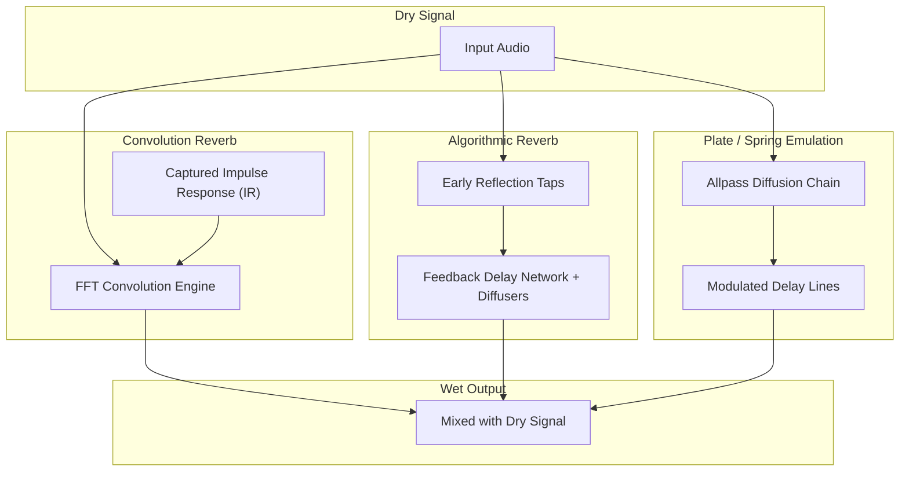
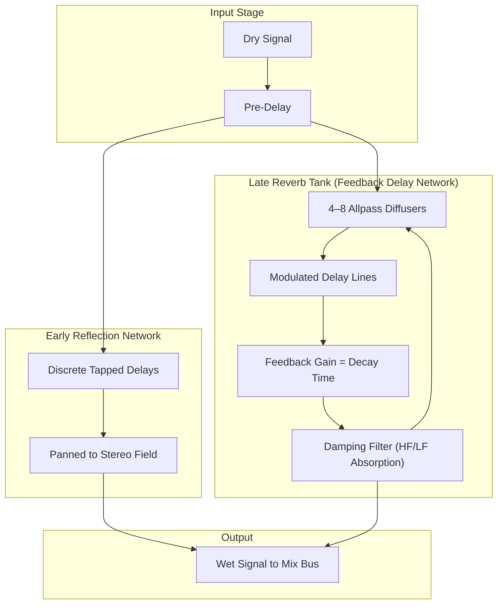

# Lesson 1: Reverb — Algorithms, Parameters, and Mix Craft

## 1. First-Principles Intuition (Read Once, Then Go Twiddle Knobs)

Reverb is every reflection of a sound off every surface in a room, summed together and smeared out over time. Clap once in a tiled bathroom versus a carpeted bedroom and you hear the whole story: hard, parallel, reflective surfaces create dense, long, bright reverb; soft, irregular, absorptive surfaces kill it fast.

Three things define any reverb, real or digital:

- **Early reflections (0–80 ms):** The first handful of discrete bounces off the nearest walls, floor, and ceiling. Your brain uses the spacing and loudness of these to judge room *size* and your *distance* from the walls. Tight, closely-spaced early reflections = small room. Sparse, spread-out ones = large hall.
- **Decay / late reverberation (80 ms onward):** Thousands of reflections arriving so densely they fuse into a smooth, exponentially-decaying wash of noise-like sound. This is what you perceive as "the reverb tail." Its rate of decay is measured as **RT60**: the time for the reflections to drop 60 dB below the initial sound level. A bedroom might have RT60 ≈ 0.3–0.5 s; a cathedral, 4–8 s.
- **Diffusion:** How quickly discrete echoes turn into smooth wash rather than staying audible as distinct slaps or flutter. Hard parallel walls (racquetball court) give low diffusion — you hear flutter echo and ringing. Irregular surfaces (cathedral with columns, statues, pews) give high diffusion — smooth wash, no audible repeats.

That's the entire physical model you need to operate any reverb plugin or hardware unit. Everything else in this lesson is: how do algorithms fake this convincingly, and how do you dial it in on a real mix.

## 2. The Three Reverb Algorithm Families and When to Reach for Each

### Convolution Reverb — "the real room, captured"

**What it actually does:** someone fired a starter pistol (or played a swept sine tone, cleaner) inside a real hall, church, stairwell, or through a real hardware reverb unit, and recorded the result. That recording — the impulse response (IR) — contains the complete fingerprint of how that space reflects sound. The plugin takes your dry signal and mathematically "stamps" that fingerprint onto it via convolution, computed efficiently with FFT blocks so it runs in real time.

**Why use it:** unmatched realism and specificity. If you need "this exact famous scoring stage" or "a real elevator shaft," convolution is the only honest answer.

**Why NOT to use it as your default:** IRs are frozen. You cannot smoothly change room size or decay time with a knob — you load a different IR file instead. CPU cost is higher than algorithmic reverb, especially for long halls at high sample rates. Modulation (the slight pitch wobble that keeps algorithmic tails from sounding metallic) is usually absent, so very long convolution tails on sustained material can occasionally ring or phase oddly.

**Production move:** convolution reverb is your tool for realism on dialogue, foley, and orchestral/acoustic recordings where you're trying to match a real or specific space. For pop/rock vocal and synth work, algorithmic usually wins because it's more flexible and more forgiving in a dense mix.

### Algorithmic Reverb — "the workhorse"

This is what 90% of reverb plugins (Valhalla, Lexicon-style, Logic's ChromaVerb, Ableton's Reverb) actually run under the hood. No recorded IR — the whole tail is synthesized from delay lines, allpass filters for diffusion, and a feedback network that recirculates the signal to build density.

The feedback loop (C1→C2→C3→C4→back to C1) is the engine room. Signal recirculates through allpass diffusers and delay lines; each pass loses a little energy to the damping filter and feedback gain. That's literally what RT60 is on a knob: feedback gain close to 1.0 = long decay, lower = short decay. The **modulated delay lines** (slow LFO on delay time, usually a few cents of pitch wobble) exist specifically to prevent the metallic ringing you'd get from a static feedback loop — this is why turning a reverb's "modulation" or "diffusion" knob to zero makes long tails sound glassy/robotic.

**Why use it:** full real-time control over decay time, size, pre-delay, damping, diffusion — nothing is baked in. Lower CPU cost than convolution for comparable tail length. This is your daily driver for mixing.

### Plate and Spring Emulations — "the vibe tools"

Plate reverb (EMT 140 heritage) physically excited a 2×3 meter sheet of hanging steel with a transducer and picked up its vibration with a contact pickup. Spring reverb (used in guitar amps) sends the signal through a coiled metal spring. Both are mechanical delay/diffusion systems, modeled digitally as dense allpass chains with characteristic resonances baked in.

**Why use it:** plate reverb has no "early reflection" character at all because there's no room — it's smooth, dense, and slightly metallic-bright from note one. That's exactly why it flatters vocals and snares: no boxy early-reflection coloration, just lush density. Spring reverb's characteristic "boing" and narrow bandwidth is intentional — don't fight it, it's the sound of surf-rock and vintage amp tone, not a flaw to correct.

## 3. The Controls That Actually Matter — Parameter by Parameter

Every reverb, regardless of family, exposes some subset of these. Learn what each one is physically doing and you can operate any plugin without reading a manual.

| Parameter | What it physically models | Practical range | Mix effect |
|---|---|---|---|
| **Pre-delay** | Time between direct sound and first reflection arriving — i.e., distance from source to nearest wall | 0–120 ms | Pushes reverb "behind" the dry signal so transients and lyrics stay intelligible. Vocal pre-delay of 20–40 ms is the single highest-value move in a mix. |
| **Decay / RT60** | How absorptive the room surfaces are | 0.3 s (vocal booth) – 8 s (cathedral) | Longer decay = bigger, more washy, more likely to clash with busy arrangements. |
| **Size** | Room dimensions — affects spacing of early reflections | Small / Medium / Large / Hall | Bigger size without longer decay = spacious but still controlled (good for drums). |
| **Diffusion** | Surface irregularity — how fast echoes smear into wash | 0 (flutter/slap) – 100 (smooth wash) | Low diffusion on drums gives "room mic" slap; high diffusion on pads gives cloud-like smoothness. |
| **Damping (HF/LF)** | Frequency-dependent absorption — air and soft furnishings eat highs; heavy materials eat lows | HF damping 2 kHz–12 kHz cutoff | Rolling off highs in the tail = warmer, more natural, less sibilant wash. Essential on vocal reverb. |
| **Width** | Stereo spread of the wet signal | Mono – 100% stereo | Narrow width on verb keeps low end of a mix centered and solid; wide verb opens up the stereo field for pads. |
| **Wet/Dry or Mix** | Ratio of processed to unprocessed signal | Send level, not insert level, in a mix context | Controls perceived distance — more wet = sounds farther away. |

## 4. Hands-On Lab: Building a Reverb Send Bus That Actually Sits in a Mix

This is the workflow every working mix engineer uses, in any DAW (Ableton, Logic, Pro Tools, Reaper, Cubase — the signal flow is identical).

### Step 1 — Set up the send, not an insert

Never put reverb directly on a vocal or instrument track as an insert if you want mix control. Instead:

1. Create an **Aux/Return track** named `Verb - Vocal`.
2. Insert your reverb plugin on that aux track. Set the plugin's own **Mix/Dry-Wet knob to 100% wet** — the "dry" blend now happens at the fader level, not inside the plugin.
3. On your vocal track, add a **send** routed to `Verb - Vocal`, starting at roughly **-18 dB to -12 dB**.
4. Pull the send up while soloed-with-context (play the full mix, not solo) until you can *just* hear the tail when the vocal stops. If you can hear reverb while the vocal is still singing over dense syllables, it's too wet — pull back.

### Step 2 — Dial pre-delay to protect the attack

Set pre-delay to roughly **1/32 to 1/16 note at your song's BPM** (use a delay-time calculator or your DAW's note-synced pre-delay control). At 120 BPM that's about 15–30 ms. This gives the reverb time to "get out of the way" of the consonant attacks before blooming.

**Drill:** Solo the vocal + reverb return. Set pre-delay to 0 ms, then sweep up in 10 ms steps while singing/playing back a line with hard consonants ("Peter Piper picked..."). Stop increasing pre-delay the moment the consonants snap into focus and the reverb tail clearly starts *after* rather than *under* them.

### Step 3 — Damping to taste, decay to the song's tempo

- Set **HF damping around 5–8 kHz** on vocals to avoid a sizzly, harsh tail (sibilance gets amplified by untamed high-frequency reverb).
- Set **decay time so the tail dies out before the next phrase or downbeat** at the song's tempo. A fast rule of thumb: decay time should resolve within one bar at the track's BPM for rhythmically dense material; ballads can sustain 2+ bars.

**Drill, metronome-anchored:** Loop a 4-bar vocal phrase against a click at 90 BPM. Automate decay time from 1.0 s → 2.5 s → 4.0 s across three passes and listen for the point where the tail starts audibly bleeding into the next phrase's attack. That's your ceiling — back off 15–20% from it for the final setting.

### Step 4 — EQ the reverb return, not just the dry signal

Insert an EQ **after** the reverb plugin on the aux track:
- **High-pass around 150–250 Hz** on the return to stop reverb from muddying the low end — reverb almost never needs to carry bass energy.
- **Low-pass or gentle shelf around 8–10 kHz** if the tail feels harsh even after internal damping.

This is the single most underused trick in amateur mixes: an untreated reverb return dumps low-mid mud and high-end hiss straight into the mix bus. EQ-ing the wet signal independently from the dry signal fixes both in seconds.

### Step 5 — Automate send level for sections

Raise the vocal reverb send by 2–4 dB going into a chorus or outro to open up the space; pull it back in dense verses so the reverb doesn't compete with words. This single automation move reads as "production polish" more than almost any plugin choice.

## 5. Convolution Reverb Lab: Loading and Matching a Real IR

1. Load a convolution reverb plugin (e.g., a stock IR convolver) on an aux return.
2. Load an IR labeled for the context you need — "Scoring Stage," "Church," "Small Room" categories are standard in most IR libraries.
3. Match **pre-delay and EQ exactly as in Section 4** — convolution reverbs still benefit from a high-pass on the return and a pre-delay before the IR to control attack clarity. Many convolution plugins allow trimming the start of the IR itself — trim any silence at the head of the IR file so you're not accidentally doubling pre-delay.
4. If the plugin exposes an **IR length/decay trim** control, use it to shorten an overly long IR rather than searching for a "shorter" IR file — this preserves the exact tonal character of the space while fitting the song's tempo.

## 6. Troubleshooting Guide

| Symptom | Likely Cause | Fix |
|---|---|---|
| Vocal reverb sounds muddy/boxy | No high-pass on the return; decay too long | HPF return at 200 Hz; shorten decay |
| Reverb tail sounds metallic/ringing | Modulation/diffusion set too low on algorithmic reverb | Increase diffusion or modulation depth 2–3 clicks |
| Can't hear the reverb at all in full mix | Send level too low, or masked by competing mid-range elements | Raise send 2–3 dB; EQ a presence dip (2–4 kHz) in masking instrument |
| Reverb smears transients / consonants unclear | Pre-delay set to 0 or too short | Increase pre-delay to 20–40 ms (sync to 1/16 note) |
| CPU overload with multiple reverb instances | Each track running its own reverb insert instead of one shared aux send | Consolidate to 2–3 shared aux reverb returns (short/medium/long) for the whole mix |
| Convolution reverb sounds thin/boxy compared to algorithmic | IR captured too close to source (dry-heavy capture) or wrong IR category loaded | Try a different IR category (hall vs. room); blend 20% algorithmic reverb underneath for density |
| Reverb washes out a busy mix | Using one long hall reverb on everything | Use short room/plate verb on drums and rhythm instruments; reserve long hall verb for lead vocal/pads only |

## 7. Practice Checklist Before You Call a Mix Done

- [ ] Every reverb is on an aux send, not an insert (unless intentionally printing/committing for creative sound design).
- [ ] Pre-delay set and checked against consonant/transient clarity by ear, not just by eye on a waveform.
- [ ] Reverb return has its own HPF/LPF independent of the dry track's EQ.
- [ ] Decay time confirmed against song tempo — tail resolves before the next downbeat in rhythmically active sections.
- [ ] At least one short (room/plate) and one long (hall) reverb bus exist for different instrument roles — don't run everything through a single giant verb.
- [ ] A/B the mix with reverb sends muted entirely — if the mix doesn't noticeably lose depth and glue, the reverb levels are too low to be doing their job.
