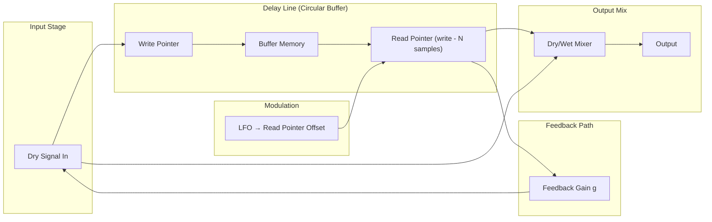

# Lesson 2: Delay Techniques — Echo, Modulation, and Spatial Depth

## 1. Why Delay Works: The 15% You Need

Every delay effect, from a slapback echo to a lush chorus, is built on one operation: **store a sample, play it back later, optionally mix some of it back into the input.** That's it. Everything else — chorus, flanger, doubling, dub echoes, ping-pong delays, reverb's early reflections — is a variation on delay time, feedback amount, and modulation of that delay time.

**Acoustic grounding (one paragraph, as promised):** A natural echo off a wall happens because sound has to travel out to the surface and back. Delay time ≈ 2 × distance ÷ 343 m/s, so a wall 17 m away gives you ~100 ms back — exactly the kind of discrete, audible repeat you'd dial into a digital delay pedal. Digital delay replicates this by storing audio in a buffer and reading it back out N samples later, where N = delay time in seconds × sample rate. At 44.1 kHz, 100 ms = 4,410 samples of buffer. You don't need to compute this by hand on the gig — every delay plugin and pedal gives you a ms or note-division knob — but understanding that **delay time is just a sample count** is what lets you reason about aliasing, modulation artifacts, and CPU cost later in this lesson.

**The perceptual thresholds that actually matter for mixing decisions:**

| Delay time | What you hear | Use case |
|---|---|---|
| 0–15 ms | Comb filtering, "doubling," thickness, not heard as a separate event | Unison doubling, short chorus |
| 15–35 ms | Slapback, Haas effect (stereo widening without a perceived second source) | Rockabilly vocal slap, width tricks on mono sources |
| 35–100 ms | Distinct short echo, rhythmic doubling | Ska/reggae guitar skank delay, vocal ad-lib tails |
| 100 ms+ | Clearly separate repeat, can be tempo-synced | Dub delays, ambient pads, dotted-eighth guitar lines |

The **Haas effect** is the single most useful fact in this table for mix engineers: delay one channel by 15–35 ms relative to the other and the brain fuses them into one sound localized toward the earlier (louder-seeming) source, while gaining width — without the comb-filter mess you get from true stereo detuning.

---

## 2. Delay Line Architecture

A delay line is a circular (ring) buffer: a fixed-size array where a write pointer advances every sample and wraps back to zero at the end. A read pointer, offset behind the write pointer by N samples, pulls out the delayed signal.



**Signal flow in plain terms:**
1. Incoming sample gets written into the buffer at the write pointer, then the write pointer advances.
2. The read pointer, sitting N samples behind, pulls out the old sample — that's your delayed/wet signal.
3. A fraction of that wet signal (the **feedback gain**, 0–1) gets added back into the input before the next write — this creates repeating echoes, each one quieter than the last by the feedback factor.
4. The dry/wet mixer blends the original (dry) and delayed (wet) signal for output.
5. If modulating (chorus/flanger), an LFO continuously nudges the read pointer's fractional offset instead of keeping it fixed.

### Working difference equation (feedback delay)

```text
y[n] = x[n] + g * y[n - N]
```

Where `N` is the delay in samples and `g` is feedback gain (keep `|g| < 1` or the loop grows unbounded — literally the only hard rule in delay design).

### Minimal working circular buffer delay (C++, drop-in DSP block)

```cpp
// SimpleDelay.h — mono feedback delay line, no placeholders, ready to compile
#pragma once
#include <vector>
#include <cmath>

class SimpleDelay {
public:
    void prepare(double sampleRate, float maxDelaySeconds = 2.0f) {
        sr = sampleRate;
        bufferSize = static_cast<size_t>(sr * maxDelaySeconds) + 1;
        buffer.assign(bufferSize, 0.0f);
        writeIndex = 0;
    }

    void setDelayMs(float ms) {
        delaySamples = (ms / 1000.0f) * static_cast<float>(sr);
        delaySamples = std::min(delaySamples, static_cast<float>(bufferSize - 1));
    }

    void setFeedback(float fb)   { feedback = std::clamp(fb, 0.0f, 0.98f); } // 0.98 cap: avoid runaway
    void setMix(float wet)       { wetMix = std::clamp(wet, 0.0f, 1.0f); }

    float processSample(float input) {
        // Fractional read with linear interpolation (prevents "stair-step" aliasing on short delays)
        float readPos = static_cast<float>(writeIndex) - delaySamples;
        while (readPos < 0) readPos += static_cast<float>(bufferSize);

        size_t idx0 = static_cast<size_t>(readPos) % bufferSize;
        size_t idx1 = (idx0 + 1) % bufferSize;
        float frac = readPos - std::floor(readPos);
        float delayed = buffer[idx0] * (1.0f - frac) + buffer[idx1] * frac;

        float toWrite = input + delayed * feedback;
        buffer[writeIndex] = toWrite;
        writeIndex = (writeIndex + 1) % bufferSize;

        return input * (1.0f - wetMix) + delayed * wetMix;
    }

private:
    std::vector<float> buffer;
    size_t bufferSize = 0;
    size_t writeIndex = 0;
    double sr = 44100.0;
    float delaySamples = 0.0f;
    float feedback = 0.3f;
    float wetMix = 0.3f;
};
```

**Why linear interpolation matters:** if you only ever read whole-sample integer positions, modulating the delay time (chorus/flanger) produces audible "steps" — quantization noise riding on the pitch modulation. Interpolating between two adjacent samples gives you smooth, click-free sweeps. This is the difference between a cheap-sounding chorus and a vintage-analog-sounding one.

### Tempo-synced delay times (the number every live/studio musician actually needs)

```text
delay_ms = (60000 / BPM) * note_division_multiplier
```

| Note value | Multiplier |
|---|---|
| Quarter note | 1.0 |
| Dotted eighth | 0.75 |
| Eighth note | 0.5 |
| Triplet eighth | 0.333 |

At 120 BPM: quarter = 500 ms, dotted-eighth = 375 ms (the classic U2/Edge guitar delay setting), eighth = 250 ms. Dial these directly into any tempo-sync delay pedal/plugin instead of eyeballing a knob.

---

## 3. Modulated Delays: Chorus, Flanger, Vibrato — What Actually Differs

All three use the exact same delay-line-plus-LFO architecture above. What separates them is **delay time range**, **feedback amount**, and **dry/wet mix**. Know these three parameter sets cold:

| Effect | Base delay | LFO rate | LFO depth | Feedback | Mix | Character |
|---|---|---|---|---|---|---|
| **Chorus** | 15–25 ms | 0.5–3 Hz | ±2–8 ms | None/low (0–0.1) | 40–60% wet | Thickening, multi-voice shimmer |
| **Flanger** | 1–10 ms | 0.1–1 Hz | ±1–5 ms | High (0.4–0.9), often inverted polarity | 50% wet (classic "jet" sound at 50/50) | Metallic sweep, jet-plane whoosh |
| **Vibrato** | 5–15 ms | 4–8 Hz | ±3–10 ms | None | 100% wet (no dry signal at all) | Pitch wobble, no doubling |

**The mechanism in one sentence each:**
- **Chorus** mixes a short, slowly-modulated delayed copy with the dry signal — the constantly-shifting delay time creates constantly-shifting micro pitch-shifts (Doppler-like), simulating multiple slightly-detuned players.
- **Flanger** does the same at much shorter delay times with feedback, which creates a moving **comb filter** — peaks and notches in the frequency spectrum that sweep up and down, producing the metallic sweep. Comb filter peaks occur at frequencies where `f = n / delay_time` for integer n, which is why shortening the delay raises the notch frequencies and widens the sweep character.
- **Vibrato** is the modulated delay with zero dry signal mixed in — you only hear the wobbling pitch, no comb filtering, because there's no two-signal interference happening.

### Practical patch recipe: classic 80s chorus (hardware or plugin)

1. Delay time: 20 ms base
2. LFO: sine wave, rate 0.8 Hz, depth ±4 ms
3. Feedback: 0 (pure chorus has none)
4. Mix: 50/50
5. Stereo trick: run two chorus voices, LFOs 90° out of phase, pan hard L/R — this is how Roland Dimension/Juno chorus patches get their width without visible phasing in mono.

### Practical patch recipe: jet-flanger sweep

1. Delay time: 3 ms base
2. LFO: triangle wave (sharper sweep character than sine), rate 0.2 Hz
3. Feedback: 0.7, **polarity inverted** (subtract instead of add) — this is what gives flanger its hollow, "through-zero" character vs. chorus's fuller tone
4. Mix: locked at 50%, never adjust — the 50/50 ratio is what creates full-depth nulls in the comb filter

---

## 4. Rhythmic & Spatial Delay Techniques (Performance-Practical)

### Slapback (rockabilly/surf guitar)
- 80–120 ms, single repeat, feedback at 0 or near-0 (one echo only), mix 25–35%.
- Practice drill: play a single quarter-note riff at 100 BPM, metronome click on beat, and tune delay time until the single echo lands exactly on the off-beat eighth. This trains your ear to hear delay time as a rhythmic subdivision, not just a texture.

### Dub/reggae delay (guitar skank, vocal toasts)
- 300–450 ms, feedback 0.4–0.6, heavy filtering on the repeats (low-pass the feedback path so each repeat gets darker — classic Lee Perry/King Tubby move).
- If your delay unit has a filter-in-feedback-loop option, engage it; if not, follow the delay with a static low-pass filter at ~2 kHz on an aux/send return so only the wet signal darkens, not the dry.

### Ping-pong stereo delay
- Delay output alternates hard left, hard right on successive repeats. Set delay time to a dotted-eighth or triplet against the groove so the bouncing repeats create a rhythmic cross-pattern rather than a straight echo.
- Drill: loop a drum groove at 90 BPM, set a ping-pong delay to triplet-eighth (≈ 222 ms at 90 BPM), send a single guitar stab through it, and listen for the delay filling the "holes" between your dry hits — that's the arrangement technique, not just a sound.

### Reverse delay (creative/production technique)
- Record a short buffer, reverse its playback, then re-delay the reversed chunk back into the timeline — classic "swell before the note" effect heard on psychedelic guitar and vocal pre-rolls.
- DAW technique (no plugin needed): reverse an audio clip, apply a short delay/reverb to the reversed clip, re-reverse the processed result, and nudge it to land right before the downbeat it's "announcing."

---

## 5. CPU, Memory, and Failure Modes — Debugging a Delay Implementation

### Buffer sizing (the actual engineering constraint)
Buffer memory in bytes = `maxDelaySeconds × sampleRate × bytesPerSample × numChannels`. A 2-second stereo delay at 48 kHz, 32-bit float: `2 × 48000 × 4 × 2 ≈ 768 KB`. Trivial on any modern CPU — **buffer size is never your bottleneck.** The real costs are:

1. **Interpolation math per sample** (for modulated delays) — negligible at audio-rate for a single delay line, but adds up fast in multi-tap or granular delay designs with dozens of simultaneous taps. Profile with a release-mode build before assuming you need SIMD.
2. **Denormal numbers in the feedback loop** — on x86, when feedback decay brings samples down near-zero (think 1e-30), the FPU can drop into slow denormal-handling mode and spike CPU usage on a silent passage. Fix: flush denormals to zero (`_MM_SET_FLUSH_ZERO_MODE(_MM_FLUSH_ZERO_ON)` on SSE, or add a tiny DC offset/noise floor inside the feedback path).

### Common bugs and their symptoms

| Symptom | Cause | Fix |
|---|---|---|
| Clicking/popping when changing delay time | Read pointer jumps discontinuously to new position | Use interpolated crossfade between old/new read position, or ramp delay time changes over a few ms instead of stepping |
| Runaway volume / screeching feedback | Feedback gain ≥ 1.0, or added without clamping | Hard-clamp feedback to < 1.0 (practically ≤ 0.95); add a soft limiter in the feedback path as a safety net |
| Metallic/robotic artifact on modulated delay | No interpolation on fractional read position | Implement linear (or better, cubic) interpolation — see code above |
| Buffer overrun / garbage audio / crash | Read pointer computed without wrapping modulo buffer size | Always `% bufferSize` (or manual wraparound check) after computing read index, especially after subtracting delay samples from write index |
| Delay time doesn't match tempo when BPM changes | Fixed ms value instead of recalculated from current BPM | Recompute `delay_ms` from the tempo-sync formula every time host BPM changes; subscribe to host tempo callback in plugin formats (VST/AU) rather than polling |
| Left/right channels drift out of sync in ping-pong delay | Single shared read/write pointer reused incorrectly across channels | Use fully independent delay line instances per channel, only cross-feed the *signal*, never share buffer indices |

### Optimization priorities, in order of actual impact
1. **Correct denormal handling** — biggest hidden CPU killer in long-release feedback delays.
2. **Avoid reallocating buffers per block** — allocate once in `prepare()`/`setup()`, never in the per-sample `process()` call.
3. **SIMD/vectorization** — only worth it once you have many parallel delay taps (multi-tap, granular, or doing block-based rather than per-sample processing); premature SIMD on a single mono delay line is wasted engineering time.
4. **Multithreading the delay line itself** — almost never justified; a single delay line is cheap enough that thread-hop overhead costs more than it saves. Reserve parallelism for running many independent effect instances (e.g., per-track processing), not for internals of one delay.
