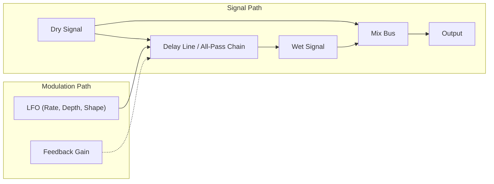
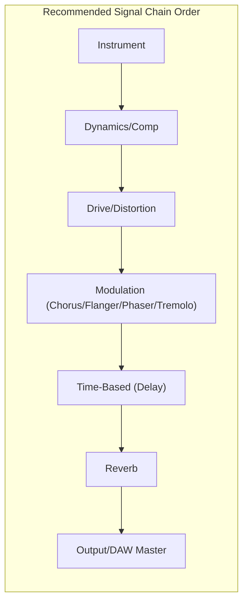

# Lesson 3: Modulation Effects — Chorus, Flanger, Phaser & Tremolo

## 1. Why This Matters: The Physics in One Paragraph

Every modulation effect is built from the same raw material: a **delay line** (or a filter whose frequency sweeps) driven by a slow oscillator called the **LFO** (low-frequency oscillator, typically 0.1–10 Hz). When you delay a copy of a signal by a few milliseconds and mix it back with the original, the two copies interfere — some frequencies cancel, others reinforce, producing comb-filter notches. If that delay time *moves* over time (modulated by the LFO), the notches sweep up and down the spectrum, which the ear reads as motion, shimmer, or width. Chorus, flanger, and phaser are the same trick at three different delay ranges and feedback amounts: chorus (15–35 ms delay, no feedback, pitch-detune character), flanger (1–15 ms delay, strong feedback, metallic sweep), phaser (no delay line at all — all-pass filters shifting phase instead). Tremolo skips delay entirely and modulates amplitude directly. Once you internalize "short delay + LFO + feedback amount = effect family," you can dial in any modulation effect from first principles instead of memorizing presets.



---

## 2. Tremolo — Amplitude Modulation (Start Here)

Tremolo is the simplest effect in the family and the best place to build intuition before touching delay lines.

### 2.1 Mechanics
An LFO output, ranging 0 to 1, multiplies the input signal's gain sample-by-sample. Depth controls how far the gain dips (0% = no effect, 100% = signal drops to silence at the trough). Rate controls cycles per second.

### 2.2 Practical Settings by Genre
| Style | Rate | Depth | Waveform | Effect |
|---|---|---|---|---|
| Surf/clean guitar (Fender-style) | 4–6 Hz | 40–60% | Sine | Smooth pulsing |
| Synth pads | 2–3 Hz | 20–30% | Sine | Subtle breathing |
| Dub/reggae skank emphasis | 6–8 Hz | 70–90% | Triangle | Choppy pulse |
| Helicopter/stutter (modern) | 8–16 Hz | 100% | Square | Hard on/off gating |

### 2.3 Working DSP Code (Real-Time Safe, C++)

```cpp
// Tremolo.h — drop-in mono processor, no allocations in processBlock
class Tremolo {
public:
    void prepare(double sampleRate) {
        sr_ = sampleRate;
        phase_ = 0.0;
    }

    void setRateHz(float hz)    { rateHz_ = hz; }
    void setDepth(float depth)  { depth_ = std::clamp(depth, 0.0f, 1.0f); }
    void setWaveform(int shape) { waveform_ = shape; } // 0=sine,1=triangle,2=square

    float processSample(float in) {
        float lfo = generateLFO();
        // Map LFO [-1,1] -> gain [1-depth, 1]
        float gain = 1.0f - depth_ * 0.5f * (1.0f - lfo);
        phase_ += rateHz_ / sr_;
        if (phase_ >= 1.0) phase_ -= 1.0;
        return in * gain;
    }

private:
    float generateLFO() {
        switch (waveform_) {
            case 1: // triangle
                return 4.0f * std::abs(phase_ - std::floor(phase_ + 0.75f) + 0.25f) - 1.0f;
            case 2: // square
                return (phase_ < 0.5) ? 1.0f : -1.0f;
            default: // sine
                return std::sin(2.0 * M_PI * phase_);
        }
    }

    double sr_ = 44100.0, phase_ = 0.0;
    float rateHz_ = 5.0f, depth_ = 0.5f;
    int waveform_ = 0;
};
```

**Debugging checklist:**
- Zipper noise on rate/depth changes → you're not smoothing parameter changes. Add a one-pole smoother (`param += (target - param) * 0.01f` per sample) before using `rateHz_`/`depth_`.
- DC thump at phase wraparound → confirm `phase_` wraps with subtraction, not modulo on floats (float modulo near 1.0 causes discontinuities).

---

## 3. Chorus — Modulated Delay, No Feedback

### 3.1 Mechanics
A circular buffer stores recent input samples. A **fractional-delay read pointer** scans back through the buffer at a delay time that oscillates between roughly 15–35 ms, driven by a slow LFO (0.5–3 Hz). Because the delayed copy's pitch rises when the delay time shortens and falls when it lengthens (Doppler-like effect from the changing read speed), you get a natural detuning — the "multiple voices" illusion. Depth controls how far the delay time swings; mix ratio controls how "thick" vs. "subtle" it sounds.

### 3.2 Circular Buffer with Linear Interpolation (Core Primitive)

```cpp
class ModulatedDelayLine {
public:
    void prepare(double sampleRate, float maxDelayMs) {
        sr_ = sampleRate;
        bufferSize_ = static_cast<int>(sr_ * maxDelayMs / 1000.0) + 4;
        buffer_.assign(bufferSize_, 0.0f);
        writeIdx_ = 0;
    }

    void write(float sample) {
        buffer_[writeIdx_] = sample;
        writeIdx_ = (writeIdx_ + 1) % bufferSize_;
    }

    // delaySamples can be fractional — linear interpolation smooths pitch artifacts
    float readInterpolated(float delaySamples) {
        float readPos = static_cast<float>(writeIdx_) - delaySamples;
        while (readPos < 0) readPos += bufferSize_;
        int idx0 = static_cast<int>(readPos);
        int idx1 = (idx0 + 1) % bufferSize_;
        float frac = readPos - idx0;
        return buffer_[idx0] * (1.0f - frac) + buffer_[idx1] * frac;
    }

private:
    std::vector<float> buffer_;
    int bufferSize_ = 0, writeIdx_ = 0;
    double sr_ = 44100.0;
};
```

### 3.3 Full Chorus Processor

```cpp
class Chorus {
public:
    void prepare(double sr) {
        delay_.prepare(sr, 50.0f); // 50ms max covers chorus + light flange range
        sr_ = sr;
        phase_ = 0.0;
    }

    void setRateHz(float hz)   { rateHz_ = hz; }
    void setDepthMs(float ms)  { depthMs_ = ms; }      // swing range, e.g. 5ms
    void setCenterMs(float ms) { centerMs_ = ms; }      // base delay, e.g. 20ms
    void setMix(float mix)     { mix_ = std::clamp(mix, 0.0f, 1.0f); }

    float processSample(float in) {
        delay_.write(in);
        float lfo = std::sin(2.0 * M_PI * phase_);
        phase_ += rateHz_ / sr_;
        if (phase_ >= 1.0) phase_ -= 1.0;

        float delayMs = centerMs_ + depthMs_ * lfo;
        float delaySamples = delayMs * 0.001f * static_cast<float>(sr_);
        float wet = delay_.readInterpolated(delaySamples);

        return in * (1.0f - mix_) + wet * mix_;
    }

private:
    ModulatedDelayLine delay_;
    double sr_ = 44100.0, phase_ = 0.0;
    float rateHz_ = 1.2f, depthMs_ = 4.0f, centerMs_ = 20.0f, mix_ = 0.5f;
};
```

**Stereo trick (do this live, not just in code):** run two chorus instances with LFOs 90° out of phase (`phase2_ = phase1_ + 0.25` wrapped), pan one hard left and one hard right. This is how virtually every commercial chorus pedal (CE-1, CE-2, Boss CE-5) creates its stereo width — true stereo chorus is two mono chorus voices in quadrature, not a single effect with a "stereo" checkbox.

### 3.4 Dialing In a Chorus by Ear (Hands-On Procedure)
1. Set mix to 100% wet, depth to 0 — confirm you hear a clean delayed copy with no pitch wobble.
2. Slowly raise depth from 0 while rate stays at 1 Hz — you should hear pitch "seasick" wobble emerge gradually. Stop before it sounds like vibrato on steroids (typically 2–6 ms depth for guitar/vocal).
3. Raise rate to 2–4 Hz — faster shimmer, more "chorus," less "detuned."
4. Pull mix back to 30–50% wet — this is where chorus sits in a mix without smearing pitch definition.
5. A/B against Boss CE-2 reference settings: Rate 2 o'clock, Depth 1 o'clock — translates to roughly rate 1.0 Hz, depth 3 ms, center 15 ms.

---

## 4. Flanger — Short Delay + Feedback

### 4.1 Mechanics
Flanger reuses the exact same `ModulatedDelayLine` class as chorus — the difference is **delay range** (1–15 ms instead of 15–35 ms) and the addition of a **feedback path** that routes the wet output back into the delay input. Feedback is what turns gentle comb filtering into the aggressive "jet plane" sweep: each pass through the loop reinforces the notches, sharpening them into resonant peaks.

### 4.2 Flanger Processor with Feedback

```cpp
class Flanger {
public:
    void prepare(double sr) {
        delay_.prepare(sr, 20.0f); // 20ms max covers flange range with headroom
        sr_ = sr;
        phase_ = 0.0;
        fbState_ = 0.0f;
    }

    void setRateHz(float hz)    { rateHz_ = hz; }
    void setDepthMs(float ms)   { depthMs_ = ms; }      // e.g. 3ms
    void setCenterMs(float ms)  { centerMs_ = ms; }      // e.g. 4ms
    void setFeedback(float fb)  { feedback_ = std::clamp(fb, -0.95f, 0.95f); }
    void setMix(float mix)      { mix_ = std::clamp(mix, 0.0f, 1.0f); }

    float processSample(float in) {
        float inputWithFeedback = in + fbState_ * feedback_;
        delay_.write(inputWithFeedback);

        float lfo = std::sin(2.0 * M_PI * phase_);
        phase_ += rateHz_ / sr_;
        if (phase_ >= 1.0) phase_ -= 1.0;

        float delayMs = centerMs_ + depthMs_ * lfo;
        float delaySamples = std::max(0.5f, delayMs * 0.001f * static_cast<float>(sr_));
        float wet = delay_.readInterpolated(delaySamples);

        fbState_ = wet; // feed wet signal back for next sample
        return in * (1.0f - mix_) + wet * mix_;
    }

private:
    ModulatedDelayLine delay_;
    double sr_ = 44100.0, phase_ = 0.0;
    float rateHz_ = 0.3f, depthMs_ = 3.0f, centerMs_ = 4.0f;
    float feedback_ = 0.6f, mix_ = 0.5f;
    float fbState_ = 0.0f;
};
```

**Positive vs. negative feedback — hear the difference:**
- Positive feedback (`+0.6`) → emphasizes odd harmonics, classic metallic "jet" flange (Van Halen "Unchained" intro).
- Negative feedback (`-0.6`) → emphasizes even harmonics, hollower, more vocal/nasal character.

**Critical stability rule:** never let `|feedback_|` reach 1.0 — the loop becomes a runaway oscillator and will clip/scream. Clamp hard at ±0.95 in code, and in a modular rig, always ride the feedback pot by ear, never crank it blind.

### 4.3 Through-Zero Flanging (Advanced Technique)
True analog "through-zero" flange (the sound of two tape machines, one slightly ahead, one slightly behind) requires the delay to cross zero — meaning you need a second, undelayed signal and modulate the *relative* delay positive and negative. Practical approximation: run centerMs_ at half your depth (e.g. center 3 ms, depth 3 ms) so the LFO sweeps from near-0 ms to 6 ms, keeping one side of the sweep always near the "zero" crossing. This gets you close to true-TZ character without the dual-transport complexity.

---

## 5. Phaser — All-Pass Filter Chain (No Delay Line)

### 5.1 Mechanics
A phaser does not delay the signal at all. Instead it chains several **first-order all-pass filters**, each of which passes all frequencies at unity gain but shifts their phase by a frequency-dependent amount. When the phase-shifted signal is mixed back with the dry signal, frequencies where the phase shift hits 180° cancel completely — producing a notch. The LFO modulates each all-pass filter's center frequency, sweeping the notches up and down. More stages = more notches = denser, more "liquid" sound. A classic 4-stage phaser (MXR Phase 90 style) gives 2 notches; an 8-stage (Small Stone/Phase 100 style) gives 4 notches.

### 5.2 All-Pass Filter Stage + Full Phaser

```cpp
class AllPassStage {
public:
    void prepare(double sr) { sr_ = sr; z1_ = 0.0f; }

    float process(float in, float cutoffHz) {
        // First-order all-pass coefficient from cutoff frequency
        float tan_arg = M_PI * cutoffHz / static_cast<float>(sr_);
        float a = (std::tan(tan_arg) - 1.0f) / (std::tan(tan_arg) + 1.0f);
        float out = a * in + z1_;
        z1_ = in - a * out;
        return out;
    }

private:
    double sr_ = 44100.0;
    float z1_ = 0.0f;
};

class Phaser {
public:
    static constexpr int kNumStages = 6; // 3 notches; try 4 or 8 for fewer/more

    void prepare(double sr) {
        sr_ = sr;
        for (auto& s : stages_) s.prepare(sr);
        phase_ = 0.0;
        fbState_ = 0.0f;
    }

    void setRateHz(float hz)      { rateHz_ = hz; }
    void setMinFreqHz(float f)    { minFreq_ = f; }   // e.g. 200 Hz
    void setMaxFreqHz(float f)    { maxFreq_ = f; }   // e.g. 2000 Hz
    void setFeedback(float fb)    { feedback_ = std::clamp(fb, -0.9f, 0.9f); }
    void setMix(float mix)        { mix_ = std::clamp(mix, 0.0f, 1.0f); }

    float processSample(float in) {
        float lfo = 0.5f * (1.0f + std::sin(2.0 * M_PI * phase_)); // 0..1
        phase_ += rateHz_ / sr_;
        if (phase_ >= 1.0) phase_ -= 1.0;

        // Exponential sweep sounds more musical than linear across the band
        float cutoff = minFreq_ * std::pow(maxFreq_ / minFreq_, lfo);

        float signal = in + fbState_ * feedback_;
        for (auto& stage : stages_) {
            signal = stage.process(signal, cutoff);
        }
        fbState_ = signal;

        return in * (1.0f - mix_) + signal * mix_;
    }

private:
    std::array<AllPassStage, kNumStages> stages_;
    double sr_ = 44100.0, phase_ = 0.0;
    float rateHz_ = 0.4f, minFreq_ = 200.0f, maxFreq_ = 2000.0f;
    float feedback_ = 0.0f, mix_ = 0.5f;
    float fbState_ = 0.0f;
};
```

**Stage count tuning guide:**
| Stages | Notches | Character | Reference pedal |
|---|---|---|---|
| 4 | 2 | Sparse, subtle sweep | MXR Phase 90 |
| 6 | 3 | Balanced, classic funk/rock phase | Small Stone |
| 8 | 4 | Dense, "liquid" swirl | Phase 100 |
| 12 | 6 | Lush, almost chorus-like | Studio/plugin phasers |

### 5.3 Feedback for Resonance
Setting `feedback_` above 0 pushes the notches into resonant peaks, giving the classic "squelchy" funk-guitar phase sound (think Isley Brothers rhythm guitar). Keep it under 0.7 for musical use — above that it starts to self-oscillate and whistle at the notch frequencies.

---

## 6. Modulation Rate & Waveform: Practical Ear Training Drill

This drill builds the instinct to recognize and dial in modulation character without staring at a screen.

**Setup:** load any modulation plugin (stock chorus/flanger/phaser in your DAW, or the code above via JUCE/plugin host). Mute everything except rate and depth.

1. **Rate sweep, fixed depth (5 min):** Hold depth constant at 50%. Sweep rate from 0.1 Hz to 10 Hz over 30 seconds while listening to a sustained guitar or pad note. Name the transition points out loud: "below 1 Hz = breathing," "2–5 Hz = classic chorus/vibrato," "above 8 Hz = buzzy, almost ring-mod." Write down the Hz value where it stops sounding musical to you.
2. **Waveform A/B, fixed rate/depth (5 min):** Lock rate at 3 Hz, depth at 40%. Switch between sine, triangle, and square LFO shapes. Sine = smooth, vocal. Triangle = slightly more linear/mechanical. Square = on/off chopping (useful for tremolo, harsh for chorus/flange).
3. **Feedback ladder, flanger only (5 min):** Set flanger feedback at 0, 0.3, 0.6, 0.9 in steps, holding everything else fixed. Note at what point the sweep goes from "chorus-like" (0) to "metallic jet" (0.6) to "self-oscillating whistle" (0.9+).

Metronome-anchored version for rhythmic tremolo work: set tremolo rate to match song tempo subdivisions — quarter notes at 120 BPM = 2 Hz, eighth notes = 4 Hz, sixteenth notes = 8 Hz (`rateHz = BPM/60 * subdivisionsPerBeat`). Practice switching a tremolo pedal's rate knob by ear to lock to a drummer's hi-hat at 90, 110, 130 BPM without looking at a tap-tempo light.

---

## 7. Signal Chain Placement (Where Modulation Goes in a Pedalboard/Rack)

Order matters because each effect reacts differently to what comes before it.



**Why this order:**
- Modulation **after** drive/distortion: the harmonic content distortion adds gives chorus/flanger more material to sweep through, producing a richer sweep. Modulation before distortion gets flattened and compressed by the gain stage, muddying the effect.
- Modulation **before** delay/reverb: feeding a modulated signal into reverb creates a shimmering, diffuse tail that still tracks the sweep; reversing the order makes the modulation sound thin because it's modulating an already-diffuse reverb tail.
- Exception worth knowing: some genres (shoegaze, ambient) deliberately put chorus or phaser *after* reverb for a wash-like, detached texture — know the rule so you can break it on purpose.

---

## 8. Troubleshooting Reference

| Symptom | Cause | Fix |
|---|---|---|
| Clicking/popping when changing rate or depth | Parameter changed instantly, discontinuity in delay read position | Smooth parameter changes with a one-pole filter over ~10–20ms before applying |
| Chorus sounds like vibrato, no "ensemble" width | Only one voice / mono processing | Add a second delay voice with LFO phase offset (quadrature) and pan L/R |
| Flanger won't build up the "jet" sweep | Feedback too low or delay range too long (into chorus territory) | Push feedback to 0.5–0.8, pull delay range down to 1–10ms |
| Flanger screams/self-oscillates uncontrollably | Feedback ≥ 1.0 or DC offset accumulating in feedback loop | Clamp feedback ≤ 0.95; add a tiny DC blocker (one-pole highpass at ~5 Hz) in the feedback path |
| Phaser notches sound static, no sweep | LFO not connected to filter cutoff, or rate set to 0 | Verify `cutoff` recalculates every sample from `lfo`, confirm `rateHz_ > 0` |
| Phaser sounds thin/weak compared to reference pedal | Too few stages or mix too low | Increase stage count (try 8), push mix toward 50-60% wet |
| Aliasing/harsh digital artifacts on chorus/flanger at short delay times | Reading the delay buffer without interpolation at fractional sample positions | Always use linear (or better, cubic Hermite) interpolation for delay reads, never truncate to integer index |
| Effect disappears in a mix even though it sounds great solo | Mix percentage too high in isolation, masked by other instruments | Re-tune wet/dry while listening in full mix context, not solo |
| Stereo chorus sounds narrower in mono playback (phone speaker, club PA) | LFOs in exact phase opposition causing mono cancellation | Use 90° (quadrature) offset instead of full 180° inversion between L/R LFOs |

---

## 9. Practice & Implementation Checklist

- [ ] Build or load the `ModulatedDelayLine` class and verify a static (unmodulated) delay sounds clean with no clicks.
- [ ] Implement chorus; tune by ear to match a reference pedal (CE-2 settings above) before trusting your own numbers.
- [ ] Implement flanger on the same delay-line class; confirm feedback stability clamp before letting feedback exceed 0.8.
- [ ] Implement phaser with the all-pass chain; A/B 4-stage vs. 8-stage on the same guitar DI to internalize the density difference.
- [ ] Run the rate/waveform ear-training drill (Section 6) for 15 minutes with a metronome.
- [ ] Place each effect in a full signal chain (drive → mod → delay → reverb) and verify the ordering rule in Section 7 by swapping mod before/after drive and listening for the difference.
- [ ] Record a short clip with each effect and compare against a commercial reference (Boss CE-2 chorus, EHX Electric Mistress flanger, MXR Phase 90) to close the loop on your ear-training.
