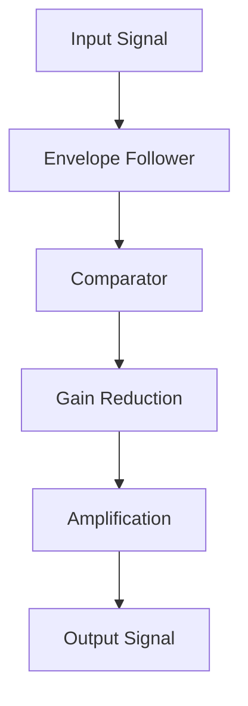

# Lesson 4: Dynamic Processing

## 1. First-Principles Intuition & Invariants

Dynamic processing in audio engineering is a fundamental technique for controlling the amplitude of an audio signal over time. Essential for achieving a balanced and polished sound, enhancing clarity and impact, and ensuring audio remains within technical playback limitations, dynamic processing involves manipulating audio dynamics—specifically, variations in loudness and volume—through compressors, limiters, gates, and expanders.

The theoretical foundation of dynamic processing is deeply rooted in signal processing and psychoacoustics. From a signal processing perspective, audio signals are composed of time-varying amplitudes representing sound wave pressure variations. These variations can be extremely dynamic, with sudden peaks and troughs that can overwhelm playback systems or diminish clarity. Dynamic processors mitigate these issues by applying gain reduction to the signal when it exceeds a certain threshold, thereby maintaining a more consistent and controlled dynamic range.

Psychoacoustically, the human ear is highly sensitive to dynamic changes in sound. Fletcher-Munson curves, which describe equal-loudness contours, illustrate how our perception of loudness is not linear but depends on the frequency content of the sound. Dynamic processing can shape the perceived loudness of an audio signal, making it more pleasing by emphasizing certain frequencies and reducing others. For instance, a compressor can reduce the dynamic range of a vocal track, making quieter parts more audible and louder parts less overwhelming, while preserving the performance's overall character.

Mathematically, the operation of a dynamic processor is described using a transfer function mapping input amplitudes to output amplitudes. This transfer function is typically non-linear, with a characteristic curve defining the relationship between the input signal and the gain reduction applied by the processor. The curve's shape is determined by several key parameters: threshold, ratio, attack time, release time, and knee type. The threshold parameter defines the level at which the processor begins to apply gain reduction, while the ratio parameter determines the reduction amount once the threshold is exceeded. Attack and release times control the processor's response to changes in the input signal, and the knee type (hard or soft) determines the transition smoothness between unprocessed and processed regions of the curve.

## 2. Core Architecture & Mechanics

The core architecture of a dynamic processor involves interconnected components analyzing the input signal and applying gain reduction as needed. At a high level, the process can be broken down into several key stages: detection, comparison, gain reduction, and amplification.

**Detection**: The first stage involves detecting the input signal's amplitude using an envelope follower, which extracts the envelope by smoothing out amplitude fluctuations. Envelope follower techniques include peak detection, RMS (root mean square) detection, or a combination of both. The choice of detection method significantly impacts the processor's behavior, influencing its response to transients and sustained tones.

**Comparison**: Once the envelope is detected, it is compared to a predefined threshold level. If the envelope exceeds the threshold, the processor applies gain reduction. The threshold level is critical, determining the processor's sensitivity and the amount of gain reduction. A lower threshold results in more gain reduction, while a higher threshold results in less.

**Gain Reduction**: The gain reduction applied is determined by the ratio parameter, which defines the reduction amount once the threshold is exceeded. The ratio is expressed as a ratio of input to output levels, such as 4:1 or 10:1. A higher ratio results in more aggressive gain reduction, while a lower ratio results in more subtle reduction. Gain reduction is typically applied using a logarithmic scale, ensuring the perceived loudness reduction is natural and musically pleasing.

**Amplification**: After gain reduction, the signal is amplified to restore the overall level. The amount of amplification is determined by the makeup gain parameter, compensating for the gain reduction to ensure the processed signal's overall level matches the unprocessed signal.

The internal data structures and algorithms used to implement these stages vary depending on the processor type and desired performance characteristics. Commonly, digital signal processing techniques such as filtering, envelope detection, and gain reduction algorithms are employed. For example, a compressor might use a low-pass filter to smooth the envelope, a comparator to compare the envelope to the threshold, and a gain reduction algorithm to apply necessary reduction.

The following Mermaid diagram illustrates the core architecture of a dynamic processor:

In this diagram, the input signal is first passed through an envelope follower to extract the envelope. The envelope is then compared to the threshold level using a comparator, and the resulting gain reduction is applied using a gain reduction algorithm. Finally, the signal is amplified to restore the overall level of the audio.

## 3. High-Performance Optimization & Failure Modes

The performance of a dynamic processor is critical for handling real-time audio processing demands, such as live sound reinforcement or professional audio production, where low latency and high precision are essential. Several optimization techniques can enhance performance.

One key technique is using efficient algorithms and data structures to implement core functions. For example, employing fast Fourier transforms (FFT) for envelope detection or optimizing gain reduction algorithms can significantly reduce computational overhead. Additionally, parallel processing and hardware acceleration can further enhance performance, ensuring the processor meets real-time requirements.
