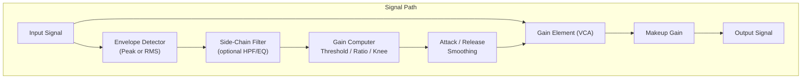
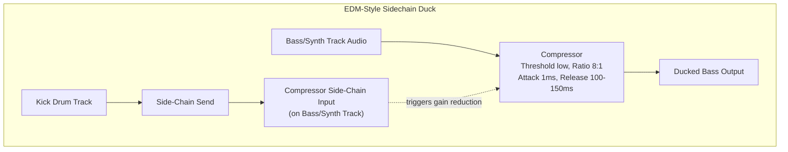

# Lesson 4: Dynamic Processing — Compressors, Limiters, Gates & Expanders

## 1. First-Principles Intuition (Read Once, Then Go Twist Knobs)

A dynamic processor is an automatic volume knob. It listens to the signal, decides if it's too loud or too quiet relative to a reference level, and turns the fader up or down faster than a human could. Everything else — attack, release, knee, ratio — is just tuning *how* that automatic hand moves.

Two things matter for intuition, and you can stop there:

- **Why compress at all:** Recorded sources (vocals, bass, drums) have far more dynamic range than the context they'll sit in (a pop mix, a podcast feed, a club PA). Compression narrows the gap between the loudest and quietest moments so the track sits consistently without a human riding the fader. Perceptually, ears judge loudness on an *average energy* basis (think RMS, not peak), so pulling peaks down lets you push the average up — that's the entire "loudness war" trick in one sentence.
- **Why gates/expanders exist:** Compression makes quiet signal louder — including hiss, bleed, and room noise. A gate or expander pulls the floor *down* instead of pulling the ceiling down, cleaning up the signal compression would otherwise amplify.

One formula worth internalizing because it changes how you read a compressor's GUI:

```text
Gain Reduction (dB) = (Input Level - Threshold) × (1 - 1/Ratio)     [above threshold only]
```

At a 4:1 ratio, 8 dB over threshold becomes 8 × (1 − 0.25) = 6 dB of gain reduction — the signal is only 2 dB over threshold at the output. At ∞:1 (a limiter), virtually all of the overage is removed: the output is clamped at the threshold. That's the whole mental model. Stop doing math and start listening — your ear is the real detector circuit from here.

---

## 2. Core Architecture & Signal Flow



Read this left to right: the **side-chain** (top path: detector → filter → gain computer → smoothing) never touches the actual audio. It only calculates a control voltage telling the **gain element** (bottom path) how much to turn the real signal down. This split — control path vs. audio path — is why side-chain EQ and external side-chain inputs work: you can feed the detector a *different* signal than the one being processed (classic example: duck a bass synth using the kick drum as the trigger, without the kick ever appearing in the output).

### 2.1 The five knobs, and what each one actually does to the sound

| Parameter | What it controls | Practical effect | Typical starting point |
|---|---|---|---|
| **Threshold** | Level above which reduction begins | Lower = more of the signal gets squeezed | Set so GR meter shows 3–6 dB on loud peaks |
| **Ratio** | Amount of reduction above threshold | 2:1–4:1 = glue/control; 8:1–20:1 = aggressive/pumping; ∞:1 = limiting | 3:1 for vocals, 4:1 for bus glue |
| **Attack** | How fast gain reduction engages | Fast (0.1–5 ms) tames transients, can kill punch; slow (10–30 ms) lets transient through, controls sustain | 10 ms vocals, 30–50 ms drum bus (let the "thwack" through) |
| **Release** | How fast gain returns to unity after signal drops below threshold | Fast release = pumping/breathing artifacts on sustained material; slow = smoother but can "miss" the next transient | 100–250 ms, or use Auto/Program-Dependent release |
| **Knee** | Hard vs. soft transition at threshold | Soft knee = gentle onset, more transparent; hard knee = obvious, aggressive onset | Soft knee for vocals/mix bus, hard knee for drum smash |

### 2.2 Detector type changes the *character*, not just the number

- **Peak detection** reacts to the instantaneous waveform — fast, grabby, good for brick-wall limiting and transient control (drum overheads, snare).
- **RMS detection** averages energy over a short window (~10–50 ms) — smoother, more "musical," reacts to perceived loudness rather than instantaneous spikes. Used for vocal bus and mix bus compression where you want gentle, program-dependent behavior rather than every syllable grabbing the meter.

Most hardware-modeled plugins (1176, LA-2A, SSL bus comp) blend these: the 1176 is peak-detecting and fast (hence its aggressive, "in your face" character on vocals/bass); the LA-2A uses an opto-cell that behaves like program-dependent RMS with inherent slow-ish attack and release, giving its famously smooth, musical glue.

---

## 3. Lab 1 — Vocal Compression From Scratch (DAW-Agnostic)

Goal: tame a dynamic vocal take without squashing the performance into cardboard.

**Setup**
1. Insert a compressor post-EQ (cut problem resonances first — compressing a boomy low-mid will make the boom louder, not fix it).
2. Set Ratio to 3:1, Attack to 15 ms, Release to Auto (or 150 ms if no auto mode), soft knee.
3. Play the loudest phrase in the take. Pull Threshold down until the gain reduction meter shows **4–6 dB** on the loud words and barely moves (0–1 dB) on quiet words.
4. Add Makeup Gain until the processed signal is perceptually as loud as the bypassed signal (A/B at matched loudness — this is critical, louder almost always sounds "better" to your brain even when it's worse).
5. Bypass/engage repeatedly. Listen for:
   - **Pumping** (volume breathing up and down unnaturally) → lengthen release or switch to Auto release.
   - **Dulled transients / lifeless consonants** → lengthen attack to 20–30 ms so the "t" and "s" sounds punch through before gain reduction grabs.
   - **Still too dynamic** → add a second compressor stage in series at a gentler ratio (2:1) rather than cranking one compressor's ratio to 8:1 — two light compressors in series sound more transparent than one heavy one (serial gain-staging).

**Drill:** Process the same vocal phrase three ways — fast attack/fast release, slow attack/slow release, fast attack/slow release — and log what changes in a notebook. This builds the ear-training that lets you dial in compression by feel instead of by numbers.

---

## 4. Lab 2 — Parallel (New York) Compression on Drum Bus

Goal: add punch and density without losing the transient snap of the original drum hits.

1. Duplicate the drum bus to an aux/parallel track (or route via a send at unity gain).
2. On the **parallel** track only, insert a compressor: Ratio 10:1–20:1, fast Attack (1–3 ms), fast Release (50–80 ms), threshold pulled down hard so GR meter shows **15–20 dB** of reduction — yes, that's extreme, that's the point.
3. High-pass the parallel track at ~150 Hz if kick drum thump is getting muddy/distorted under heavy squash.
4. Blend the crushed parallel track under the dry drum bus (start around -12 dB relative to dry, push up until you feel the mix thicken without the dry track's transients disappearing).

**Why this works and straight compression doesn't achieve the same thing:** heavy compression on the main bus kills the transients you're trying to preserve. Running the squashed version in parallel lets you keep 100% of the original transient (the dry signal) while adding the sustained "glue" and perceived loudness from the crushed signal underneath it. This is an additive, not a transfer-function, trick — mix two different transfer functions of the same signal instead of trying to find one curve that does both jobs.

---

## 5. Gates & Expanders — Cleaning the Floor

A **noise gate** is a dynamic processor that works in reverse: when the signal falls *below* a threshold, it attenuates (or fully mutes) rather than reducing peaks above a threshold.

### 5.1 Gate parameters (same five knobs, inverted logic)

| Parameter | Function |
|---|---|
| **Threshold** | Level below which the gate starts closing |
| **Ratio / Range** | How much attenuation is applied when closed (gate = up to total silence; expander = gentler, e.g. 2:1) |
| **Attack** | How fast the gate opens when signal crosses threshold (keep fast, 1–5 ms, or you clip the front of transients) |
| **Hold** | Minimum time the gate stays open once triggered (prevents chatter on decaying sounds) |
| **Release** | How fast the gate closes after signal drops back below threshold |

### 5.2 Practical use case: tom mics bleeding snare/hat

1. Insert a gate on each tom mic channel.
2. Set threshold just above the noise floor / bleed level (hit the tom, dial threshold down until a hard hit opens the gate and a bleed-only passage stays closed).
3. Attack: 1–2 ms (toms have fast attack transients, you need the gate open before the hit).
4. Hold: 50–100 ms (let the natural tom decay ring out before gate closes).
5. Release: 100–200 ms (closes smoothly, not an abrupt chop).

**Failure mode — gate chatter:** if the gate opens/closes rapidly during a sustained, borderline-threshold passage (common on bleed-heavy toms or a noisy guitar amp), it sounds like a stutter or machine-gun artifact. Fix by increasing **Hold** time first, then widening the **Range**/ratio so "closed" isn't full silence (a gentler -20 dB attenuation rather than -60 dB hides the transition).

---

## 6. Side-Chain Techniques (Real Patches You Can Build Today)



**Build it:**
1. Route the kick drum's output to a side-chain send (most DAWs: right-click compressor → "side-chain input" → select kick bus).
2. On the bass/synth compressor, enable external side-chain, select the kick send as source.
3. Ratio 8:1–∞:1, Attack as fast as the plugin allows (near-instant), Release 100–150 ms tuned to the track tempo so the bass "pumps" back in rhythmically before the next kick hit.
4. Threshold: pull down until each kick hit visibly ducks the bass 6–10 dB on the gain reduction meter.

**Why it works:** the kick's audio never reaches the output — only its envelope triggers the gain computer. This carves out frequency/amplitude space for the kick in every beat without EQ, and it's the mechanism behind the "pumping" sound that defines EDM, house, and pop sidechain compression.

**Side-chain EQ (de-essing) variant:** instead of an external track, filter the *same* signal's side-chain input to only respond to a frequency band — a de-esser is just a compressor whose side-chain has a band-pass/high-pass filter centered on 4–8 kHz sibilance, so it only clamps down during "s" and "sh" sounds and leaves the rest of the vocal untouched.

---

## 7. Limiting — The Final Gatekeeper

A limiter is a compressor with Ratio effectively at ∞:1 and (usually) a fast lookahead buffer, used as the last device in a chain to guarantee output never exceeds a ceiling (critical for broadcast/streaming loudness standards and to protect downstream gear from clipping).

**Mastering chain limiter settings to start from:**
- Ceiling: **-1.0 dBFS** (leaves headroom for lossy codec encoding overshoot — MP3/AAC encoding can create inter-sample peaks above 0 dBFS even if your file reads exactly 0 dBFS).
- Lookahead: 1–5 ms (lets the limiter see a peak coming and react before it, rather than after — avoids audible "catch-up" distortion on transients).
- Release: Auto/Program-dependent if available; otherwise 50–100 ms as a starting point, adjusted by ear until pumping disappears.

**Failure mode — over-limiting:** pushing more than 3–4 dB of gain reduction through a limiter on program material (not just stray peaks) causes audible distortion, loss of transient punch, and the "brick-walled," fatiguing sound associated with over-loud masters. Diagnostic: if the gain reduction meter is active almost 100% of the time rather than spiking only on peaks, you're limiting the *mix*, not just the peaks — back off upstream gain staging instead of fighting it at the limiter.

---

## 8. Troubleshooting Table (Real Symptoms → Real Fixes)

| Symptom | Likely Cause | Fix |
|---|---|---|
| Vocal sounds "squashed" and lifeless | Ratio too high or attack too fast | Drop ratio to 2:1–3:1, slow attack to 20–30 ms, consider serial light compression instead |
| Audible pumping/breathing on sustained pads or bus | Release too fast relative to program material | Switch to Auto release or lengthen manually; check Release isn't shorter than natural note decay |
| Compressor "doesn't seem to do anything" | Threshold set above signal peaks, or ratio too low | Watch the GR meter — if it never moves, the compressor is bypassed in effect |
| Gate cuts off the start of notes/transients | Attack too slow | Reduce gate attack to 1–3 ms |
| Gate chatters/stutters on sustained bleed | Threshold sits inside the noise's fluctuation range | Raise Hold time, widen Range so "closed" state is partial not total attenuation |
| Sidechain duck doesn't sound rhythmic/tight | Release time not tempo-synced | Calculate release from tempo (e.g., 1/8 note at 120 BPM ≈ 250 ms) and set manually or use tempo-sync mode |
| Limiter sounds distorted/crunchy | Too much gain reduction (>4 dB) sustained | Reduce input drive before the limiter; fix gain staging upstream, use limiter only for peak catching |
| Master sounds loud but flat/lifeless compared to reference | Over-limiting removing all transient contrast | Target -14 LUFS integrated for streaming instead of chasing maximum loudness; A/B against a commercial reference track at matched loudness |

---

## 9. Practice Routine for Ear Training (Do This Weekly)

1. **Threshold-finding drill (10 min):** Load any vocal or bass stem. With a compressor at fixed 4:1 ratio, slowly sweep the threshold from no effect to heavy squashing while watching only the GR meter — train your eye to predict what you're about to hear before you hear it.
2. **Attack/release blind test (10 min):** Set up 4 presets on the same compressor — fast/fast, fast/slow, slow/fast, slow/slow — and A/B them blind (have someone else select, or randomize) until you can identify each by ear alone.
3. **Parallel blend drill (10 min):** On a drum bus, practice blending a heavily crushed parallel compression track from fully dry to fully wet and locate the "sweet spot" by ear, then check your chosen blend level in dB against your instinct from the previous session — track whether your instinct is drifting toward over-processing over time (a common trap as ears fatigue).

Consistent repetition of these three drills over a few weeks builds the instinctive, fast threshold/attack/release judgment that separates an engineer who reads meters from one who mixes by ear.
