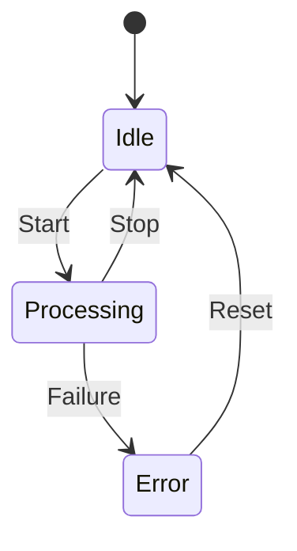

# Advanced Foundation: Audio Engineering

## 1. Theoretical Invariants & Formal Frameworks

### 1.1 Formal Proofs in Audio Engineering

Formal proofs are essential in establishing the correctness of algorithms and systems in audio engineering. For instance, proving the stability of a digital filter involves demonstrating that the filter's impulse response is absolutely summable. This can be achieved using the Z-transform and the concept of poles and zeros.

**Example: Stability of a Digital Filter**

A digital filter is stable if all its poles lie inside the unit circle in the Z-plane. Mathematically, this can be expressed as:

\[ |z| < 1 \]

where \( z \) is a pole of the filter's transfer function \( H(z) \).

### 1.2 Kernel or Physical Invariants

Kernel invariants refer to the properties that remain unchanged under certain transformations. In audio engineering, these invariants often relate to the physical properties of sound and the constraints of digital signal processing.

**Example: Nyquist-Shannon Sampling Theorem**

The Nyquist-Shannon Sampling Theorem states that a continuous-time signal can be reconstructed from its samples if the sampling rate is at least twice the highest frequency component of the signal. This theorem is a fundamental invariant in digital audio processing.

\[ f_s \geq 2f_{max} \]

where \( f_s \) is the sampling frequency and \( f_{max} \) is the maximum frequency component of the signal.

## 2. Low-Level Invariant Taxonomy

### 2.1 Deep Registers

Deep registers in audio engineering refer to the low-frequency components of a signal, typically below 100 Hz. These components are crucial for the perception of bass and the overall richness of a sound.

**Example: Subwoofer Management**

Subwoofer management involves ensuring that the low-frequency components of a signal are accurately reproduced. This includes crossover networks and equalization techniques to prevent distortion and ensure clarity.

### 2.2 Memory Models

Memory models in audio engineering describe how data is stored and accessed in digital audio systems. Understanding memory models is essential for optimizing performance and minimizing latency.

**Example: Cache Optimization**

Cache optimization involves organizing data in memory to minimize cache misses and improve processing speed. Techniques such as data prefetching and loop unrolling can be used to optimize memory access patterns.

### 2.3 Hardware Constraints

Hardware constraints refer to the limitations imposed by the physical components of an audio system. These constraints can affect the performance and quality of audio processing.

**Example: Bit Depth and Dynamic Range**

Bit depth determines the number of bits used to represent each sample in a digital audio signal. Higher bit depths provide greater dynamic range and reduced quantization noise. Common bit depths include 16-bit, 24-bit, and 32-bit.

### 2.4 Axiomatic Definitions

Axiomatic definitions provide the foundational principles upon which audio engineering is built. These definitions are used to derive more complex concepts and algorithms.

**Example: Fourier Transform**

The Fourier Transform is a mathematical tool used to analyze the frequency components of a signal. It is based on the axiomatic definition of a complex exponential function and the concept of orthogonality.

\[ X(k) = \sum_{n=0}^{N-1} x(n) e^{-j2\pi nk/N} \]

where \( X(k) \) is the frequency-domain representation of the signal \( x(n) \).

## 3. Micro-Architecture & Concurrency Dynamics

### 3.1 State Machines

State machines are used to model the behavior of digital audio systems. They provide a visual representation of the system's states and transitions, making it easier to analyze and optimize performance.

**Example: Mermaid State Machine**



### 3.2 Cache Dynamics

Cache dynamics refer to the behavior of data in the cache memory of an audio system. Understanding cache dynamics is essential for optimizing performance and minimizing latency.

**Example: Cache Diagram**

```ascii
+-------------------+
|       Cache       |
+-------------------+
|   Block 0: Data   |
|   Block 1: Data   |
|   Block 2: Data   |
|   Block 3: Data   |
+-------------------+
```

### 3.3 Concurrency and Race Conditions

Concurrency and race conditions are critical issues in audio engineering, especially in real-time systems. Proper synchronization techniques are essential to ensure the correct and efficient execution of audio processing tasks.

**Example: Race Condition Diagram**

```ascii
+-------------------+       +-------------------+
|   Thread 1        |       |   Thread 2        |
+-------------------+       +-------------------+
|   Read Data       |       |   Write Data      |
|   Process Data    |       |   Update Data     |
+-------------------+       +-------------------+
          |                           |
          +---------------------------+
                    Race Condition
```

## 4. Subtle Failure Modes & Boundary Conditions

### 4.1 Subtle Failure Modes

Subtle failure modes in audio engineering refer to errors that are difficult to detect and diagnose. These failures can affect the quality and performance of audio systems.

**Example: Quantization Noise**

Quantization noise is a subtle failure mode that occurs when a continuous-time signal is converted to a discrete-time signal. It is caused by the rounding of sample values and can be minimized by using higher bit depths.

### 4.2 Boundary Conditions

Boundary conditions refer to the limits of a system's performance and behavior. Understanding boundary conditions is essential for designing robust and reliable audio systems.

**Example: Clipping**

Clipping is a boundary condition that occurs when the amplitude of a signal exceeds the maximum value that can be represented by the system. It results in distortion and can be prevented by using appropriate signal processing techniques.

## 5. Master Socratic Inquiries

### 5.1 Research-Grade Discussion Questions

1. **Formal Proofs:** How can formal proofs be used to establish the correctness of digital audio algorithms?
2. **Kernel Invariants:** What are the physical invariants that must be preserved in digital audio processing?
3. **Memory Models:** How do memory models affect the performance and quality of audio systems?
4. **Hardware Constraints:** What are the key hardware constraints that must be considered in audio engineering?
5. **Axiomatic Definitions:** How do axiomatic definitions provide the foundation for audio engineering?
6. **State Machines:** How can state machines be used to model and optimize the behavior of digital audio systems?
7. **Cache Dynamics:** What are the key factors that affect cache performance in audio systems?
8. **Concurrency and Race Conditions:** How can concurrency and race conditions be managed in real-time audio processing?
9. **Subtle Failure Modes:** What are the subtle failure modes that can affect the quality and performance of audio systems?
10. **Boundary Conditions:** How can boundary conditions be identified and managed in audio engineering?

These questions are designed to promote deep and thoughtful discussion among staff engineers, security researchers, and theoretical specialists in the field of audio engineering.
