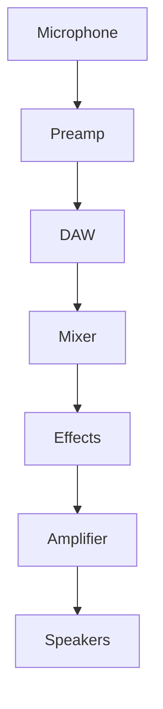

# Beginner Foundation: Audio Engineering
## 1. Everyday Intuition & First Principles
Imagine you're in a room with a band playing. The sound of the drums, the guitar, the vocals—all these sounds are captured by microphones and then mixed together to create a cohesive piece of music. Audio engineering is the art and science of capturing, manipulating, and reproducing sound. Just like a chef combines ingredients to create a dish, an audio engineer combines different sounds to create a musical masterpiece. The goal is to make sure that every element of the music is heard clearly and that the overall sound is balanced and pleasing to the ear.

## 2. Foundational Vocabulary & Glossary
- **Microphone:** A device that converts sound waves into electrical signals. Think of it as a translator between sound and electricity.
- **Speaker:** Converts electrical signals back into sound waves. It's the opposite of a microphone, turning electricity back into sound.
- **Amplifier:** Increases the strength of an electrical signal. It's like a booster for your sound.
- **Mixer:** A device that combines multiple audio signals into a single output. It allows you to control the volume, panning, and effects of each input.
- **Equalizer (EQ):** A tool used to adjust the frequency response of an audio signal. It helps in boosting or cutting certain frequencies to improve the sound quality.
- **Compressor:** A device that reduces the dynamic range of an audio signal. It ensures that loud and quiet parts of a recording are more balanced.
- **Reverb:** An effect that simulates the natural reverberation of a space. It adds depth and space to a recording.
- **DAW (Digital Audio Workstation):** Software used for recording, editing, and producing audio. It's the digital equivalent of a mixing board and tape recorder.

## 3. Visual System Flow
### ASCII Diagram
```
[Microphone] -> [Preamp] -> [DAW] -> [Mixer] -> [Effects] -> [Amplifier] -> [Speakers]
```

### Mermaid Flowchart


## 4. Common Beginner Misconceptions & Mental Traps
- **Misconception:** Audio engineering is just about turning up the volume.
  - **Reality:** While adjusting volume is part of it, audio engineering involves much more, such as balancing different elements, applying effects, and ensuring clarity.
- **Misconception:** You need expensive equipment to start.
  - **Reality:** While high-quality gear can improve sound, you can start with basic equipment and software to learn the fundamentals.
- **Misconception:** Audio engineering is too technical and complicated.
  - **Reality:** Like any skill, it can be learned step by step. Start with the basics and gradually build your knowledge.

## 5. Socratic Discussion Starters
- What is the primary difference between a microphone and a speaker?
- How does an equalizer help in improving the sound quality of a recording?
- Can you explain the role of a compressor in audio engineering?
- Why is it important to understand the basics of acoustics when setting up a recording space?
- How does the choice of microphone affect the sound of a recording?
- What are the benefits of using a DAW in audio production?
- How does reverb add depth and space to a recording?
- Can you describe a simple workflow for recording and mixing a song?
