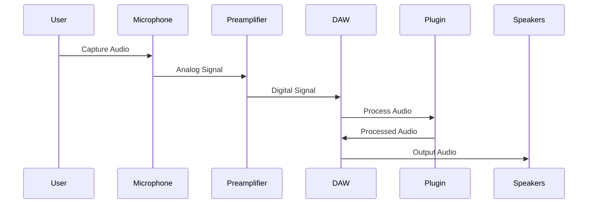

# Intermediate Foundation: Audio Engineering
## 1. Architectural Mental Model
Building on your foundational knowledge, it's crucial to develop a robust mental model of audio engineering architecture. This involves understanding the flow of audio data through various components and systems, from the initial capture to the final output. Here are some key concepts to consider:

- **Signal Flow:** Understand the path audio signals take through your system, including inputs, processing, and outputs. This includes microphones, preamplifiers, mixers, digital audio workstations (DAWs), and speakers.
- **Component Interactions:** Recognize how different components interact with each other. For example, how a DAW interfaces with hardware interfaces, and how plugins and virtual instruments operate within the DAW.
- **Modular Design:** Think of your audio system as a series of modular components that can be combined in various ways to achieve different results. This includes understanding how to integrate hardware and software components effectively.

## 2. Systems Taxonomy & Component Protocols
Understanding the taxonomy of audio systems and the protocols that govern their interactions is essential for advanced audio engineering. Here are some key areas to explore:

- **Standard Interfaces:** Familiarize yourself with standard interfaces such as USB, Thunderbolt, AES50, and ADAT. These interfaces define how different components communicate and transfer audio data.
- **Protocols:** Learn about protocols like MIDI, MADI, and ASIO. MIDI is used for control signals, while MADI and ASIO are used for high-speed audio data transfer.
- **Data Models:** Understand the data models used in audio engineering, such as PCM (Pulse Code Modulation) and DSD (Direct Stream Digital). These models define how audio data is encoded and stored.

## 3. Multi-Component Interaction Flow
To deepen your understanding of how audio systems work, it's helpful to visualize the interaction flow between components. Here is a detailed ASCII and Mermaid sequence diagram illustrating the interaction between a microphone, preamplifier, DAW, and speakers:

### ASCII Sequence Diagram
```
User -> Microphone: Capture Audio
Microphone -> Preamplifier: Analog Signal
Preamplifier -> DAW: Digital Signal
DAW -> Plugin: Process Audio
Plugin -> DAW: Processed Audio
DAW -> Speakers: Output Audio
```

### Mermaid Sequence Diagram


## 4. Architectural Trade-offs & Production Pitfalls
When designing and implementing audio systems, it's important to be aware of the trade-offs and potential pitfalls. Here are some key considerations:

- **Latency vs. Quality:** Balancing low latency with high audio quality is a common trade-off. Lower latency can be achieved with less processing, but this may compromise audio quality.
- **Scalability:** Designing systems that can scale with your needs is crucial. This includes considering the number of channels, processing power, and storage requirements.
- **Compatibility:** Ensuring compatibility between different components and systems is essential. This includes understanding the protocols and data models used by each component.

## 5. Socratic Discussion Starters
To deepen your understanding of audio engineering architecture, consider the following questions:

- How do different interfaces and protocols impact the performance and quality of your audio system?
- What are the trade-offs between using hardware and software components in your audio system?
- How can you design a scalable audio system that meets your current and future needs?
- What are the potential pitfalls of integrating different components and systems, and how can you avoid them?
- How do you balance low latency with high audio quality in your audio system?
