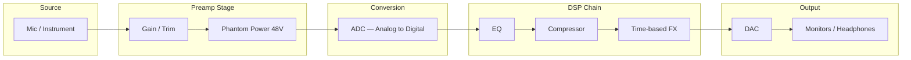

# Audio Engineering Masterclass: DSP, Synthesis & Signal Flow

## Who This Is For & Lab Setup

This is a hands-on DSP and studio engineering lab built around SuperCollider (synthesis + real-time DSP scripting), Audacity (editing, spectral analysis, destructive processing), and REAPER or any DAW with a signal-generator/analyzer plugin (for gain-staging drills). You will build working synths, measure real signal levels, intentionally break things, and fix them using the same diagnostic process a studio engineer uses on a malfunctioning signal chain.

**Install before starting:**

```bash
# macOS
brew install --cask audacity
brew install supercollider

# Ubuntu/Debian
sudo apt install audacity supercollider sc3-plugins

# Windows: download installers from audacityteam.org and supercollider.github.io
```

Verify SuperCollider's server boots cleanly — this is your first diagnostic checkpoint, not busywork:

```supercollider
s.boot;
// Post window must show: "Server 'localhost' booted."
// If you see "Exception in World_OpenUDP": another process owns port 57110.
// Fix: s.options.bindAddress = "127.0.0.1"; s.reboot;
```

---

## Part 1: Gain Staging and the Decibel — Why Levels Aren't Arbitrary

Before touching a single plugin, internalize the one piece of theory that governs every decision downstream: **digital audio clips at 0 dBFS with no headroom above it, unlike analog tape which saturates musically.** A sine wave sample value is stored as a float typically clamped to ±1.0. Push a signal 1% over that ceiling and you get hard digital clipping — flat-topped waveforms, broadband harmonic garbage, not the soft compression analog gear gives you.

This single fact drives the entire gain-staging discipline:

- Track peak levels in the **-18 dBFS to -12 dBFS** range for headroom, not 0 dBFS.
- Mix bus peaks around **-6 dBFS** before mastering, leaving 6 dB for the mastering/limiting stage.
- RMS (perceived loudness) sits well below peak — a snare hit might peak at -6 dBFS but average -20 dBFS RMS, which is why peak meters alone lie to you about loudness.

**Drill: find your own clip point by ear and by meter.**

```supercollider
(
// Clean, safely-gained sine
{ SinOsc.ar(440, 0, 0.5) }.play;
)
```

```supercollider
(
// Same oscillator pushed past 1.0 — listen for the harsh buzz
{ SinOsc.ar(440, 0, 2.5) }.play;
)
```

Open SuperCollider's scope (`s.scope`) while running both. The first shows a clean sine. The second shows a flat-topped square-ish wave — that's what clipping looks like on an oscilloscope, and that harmonic garbage is why clipped recordings sound harsh and can't be fixed later. **There is no "unclip" plugin.** This is why gain staging happens at tracking time, not mix time.

---

## Part 2: Signal Flow Diagnostics

Every audio problem — hum, distortion, phase cancellation, latency — traces to a point in the signal chain. Learn to localize faults by signal-chain bisection, the same technique used for debugging any pipeline.



**Diagnostic procedure for "I hear a problem" (hum, crackle, distortion):**

1. **Bisect the chain.** Solo the track, bypass every plugin. Problem gone? It's in the DSP chain — re-enable one plugin at a time. Problem persists with everything bypassed? It's upstream — preamp, cable, or source.
2. **Check gain staging first.** Clipping disguises itself as "weird distortion." Look at the input meter pre-fader. If it's pinned red, that's your answer before you even open a plugin.
3. **Hum at 50/60 Hz (or harmonics at 100/120 Hz)** = ground loop or unbalanced cable run. Fix: balanced TRS/XLR instead of unbalanced TS, or a ground-loop isolator.
4. **Phase cancellation** (thin, hollow sound when combining two mics on one source) — flip polarity on one input and compare. In a DAW this is a "ø" or "polarity invert" button, not "phase," which is a different, continuous parameter — know the terminology distinction, it matters when talking to other engineers.

---

## Part 3: Subtractive Synthesis — Building Sound From First Principles

A sawtooth wave contains all harmonics (1st, 2nd, 3rd...) decaying at 1/n amplitude; a square wave contains only odd harmonics (1st, 3rd, 5th...), which is why it sounds hollow compared to a saw. Subtractive synthesis starts with a harmonically rich source and carves it with a filter — this is the entire concept, everything else is detail.

### Lab: Build a Complete Subtractive Patch in SuperCollider

```supercollider
(
SynthDef(\subtractiveLead, {
    arg freq = 220, cutoff = 2000, resonance = 0.3,
        attack = 0.01, decay = 0.3, sustain = 0.6, release = 0.5,
        amp = 0.4, gate = 1, pan = 0;

    // Harmonically rich source: sawtooth
    var osc = Saw.ar(freq) + (Saw.ar(freq * 1.005) * 0.5); // detuned 2nd saw for thickness

    // 24dB/oct resonant low-pass (ladder-filter style via Moog VCF emulation)
    var filterEnv = EnvGen.kr(Env.adsr(0.05, 0.2, 0.4, 0.3), gate);
    var filtered = MoogFF.ar(osc, cutoff + (filterEnv * 3000), resonance * 3.5);

    // Amplitude envelope — shapes the note's life cycle
    var ampEnv = EnvGen.kr(Env.adsr(attack, decay, sustain, release), gate, doneAction: 2);

    var sig = Pan2.ar(filtered * ampEnv * amp, pan);
    Out.ar(0, sig);
}).add;
)

// Play it, hold the gate open
(
x = Synth(\subtractiveLead, [\freq, 110, \cutoff, 800, \resonance, 0.4]);
)

// Release the note (triggers the release stage of the envelope)
x.set(\gate, 0);
```

**Why `MoogFF` and not a generic `LPF`:** `LPF.ar` in SuperCollider is a gentle 12dB/octave 2-pole filter — fine for subtle EQ-like shaping. `MoogFF` emulates the 4-pole transistor ladder topology of a real Moog, giving you the classic 24dB/octave slope with resonance that self-oscillates near the top of its range. This is the difference between "sounds like a mild tone control" and "sounds like a synth."

**The ADSR envelope — what each stage controls and how it maps to real playing dynamics:**

| Stage | Parameter | What it controls | Typical range |
|---|---|---|---|
| Attack | Time from gate-on to peak | How fast the sound "arrives" — 0 = percussive pluck, 0.5s+ = pad swell | 0.001s – 2s |
| Decay | Time from peak down to sustain level | The initial settle, like a piano hammer strike dying to its ringing level | 0.05s – 1s |
| Sustain | **Level**, not time — held while gate stays open | How loud the note stays while you hold a key | 0.0 – 1.0 |
| Release | Time from gate-off to silence | How the note "lets go" — short = staccato, long = pads/reverb tails | 0.01s – 4s |

Common beginner mistake: treating sustain as a time value. It's a **level**. The note holds at that amplitude for as long as the gate stays open (as long as the key is held), however long that is.

### Drill: Filter Sweep by Ear — Train Your Cutoff Recognition

```supercollider
(
x = Synth(\subtractiveLead, [\freq, 110, \cutoff, 200, \resonance, 0.6]);
)
// Slowly sweep cutoff from dark to bright while it sustains:
x.set(\cutoff, 100);
x.set(\cutoff, 500);
x.set(\cutoff, 1500);
x.set(\cutoff, 4000);
x.set(\cutoff, 8000);
x.set(\gate, 0);
```

Run this sweep daily for a week. Goal: be able to guess the approximate cutoff frequency (within an octave) of any filtered patch you hear, the same way a guitarist develops relative pitch for intervals. This is a trainable ear skill, not innate talent.

---

## Part 4: LFO Modulation Routing — East Coast vs. West Coast Thinking

An LFO (low-frequency oscillator, below ~20 Hz, below audible range) modulates a parameter rather than producing audible tone directly. "East Coast" synthesis (Moog-style, what Part 3 built) routes an LFO to filter cutoff or pitch for vibrato/wah effects. "West Coast" synthesis (Buchla-style) prefers wavefolding over filtering, shaping timbre by folding a waveform back on itself rather than subtracting harmonics.

```supercollider
(
SynthDef(\lfoFilterWah, {
    arg freq = 110, cutoffBase = 1000, lfoRate = 4, lfoDepth = 800,
        amp = 0.4, gate = 1;

    var osc = Saw.ar(freq);
    var lfo = SinOsc.kr(lfoRate, 0, lfoDepth, cutoffBase); // modulates around cutoffBase
    var filtered = MoogFF.ar(osc, lfo.clip(20, 10000), 0.3);
    var ampEnv = EnvGen.kr(Env.adsr(0.01, 0.2, 0.7, 0.5), gate, doneAction: 2);

    Out.ar(0, Pan2.ar(filtered * ampEnv * amp, 0));
}).add;
)

y = Synth(\lfoFilterWah, [\freq, 110, \lfoRate, 4]);
y.set(\lfoRate, 0.5);  // slow wah
y.set(\lfoRate, 8);    // fast tremolo-like wobble
y.set(\gate, 0);
```

**Why `.clip(20, 10000)` matters:** `MoogFF`'s cutoff argument fed a negative or absurdly high frequency from an unclamped LFO will produce silence or aliasing artifacts. Always clamp modulated parameters to the receiving UGen's valid range — this single line prevents an entire category of "my patch randomly glitches" bugs.

### Eurorack Equivalent (for hardware/modular practitioners)

If translating this patch to modular hardware:

| SuperCollider element | Eurorack equivalent | Module example |
|---|---|---|
| `Saw.ar(freq)` | VCO sawtooth output | Any VCO (Mutable Instruments Plaits, Doepfer A-110) |
| `MoogFF.ar` | Low-pass VCF (24dB ladder) | Doepfer A-108, MI Ripples |
| `SinOsc.kr(lfoRate...)` | LFO module, patched to filter CV input | Doepfer A-143-3, triggered/free-run |
| `EnvGen.kr(Env.adsr...)` | ADSR envelope generator | Doepfer A-140, Make Noise Maths |
| `gate` argument | Gate output from sequencer/keyboard | Any sequencer's gate out, 1V/oct standard |
| `Out.ar(0, sig)` | VCA into mixer input | Any VCA module, e.g. Intellijel Quad VCA |

The **1V/octave standard**: every 1 volt of CV (control voltage) rise shifts pitch up exactly one octave, regardless of manufacturer — this is why Eurorack modules from different brands reliably interoperate for pitch tracking.

---

## Part 5: DSP Fundamentals — Sampling, Nyquist, and Why Your FFT Analysis Lies to You Sometimes

**The one paragraph of theory you actually need:** Digital audio samples a continuous waveform at discrete time intervals (the sample rate, e.g., 44,100 times per second = 44.1kHz). The Nyquist theorem states you can only accurately represent frequencies up to half the sample rate — at 44.1kHz, that's 22.05kHz, comfortably above human hearing (~20kHz). Try to record or synthesize a frequency above that Nyquist limit and it **aliases**: it folds back down and appears as a false, lower frequency that was never actually played. This is why cheap synth algorithms that generate raw sawtooth/square waves without bandlimiting sound harsh and buzzy at high pitches — the harmonics above Nyquist alias into inharmonic garbage.

### Lab: Hear Aliasing Directly

```supercollider
(
// A naive, non-bandlimited sawtooth made from a phasor — WILL alias at high frequencies
{
    var phase = Phasor.ar(0, 1 * (20000/s.sampleRate), 0, 1);
    (phase * 2 - 1) * 0.4;
}.play;
)
```

```supercollider
(
// SuperCollider's built-in Saw UGen is bandlimited (anti-aliased) — compare the difference
{ Saw.ar(8000) * 0.4 }.play;
)
```

Open the FFT analyzer (`FreqScope.new` or Audacity's `Analyze > Plot Spectrum`) on both. The naive phasor-based sawtooth at high frequency shows inharmonic spectral junk above Nyquist folded back into the audible range; the built-in `Saw` UGen stays clean. This is the practical reason production-grade synth engines bandlimit their oscillators (using techniques like BLIT or minBLEP), and why "I wrote my own oscillator and it sounds bad at high notes" is almost always an aliasing bug, not a bug in your envelope or filter code.

### Spectral Analysis Workflow in Audacity (Real Diagnostic Use)

This is how you actually use FFT analysis on a mix, not as an academic exercise:

1. Select a problem region (e.g., a muddy bass section).
2. `Analyze > Plot Spectrum`, set size to **2048 or 4096 samples** (bigger window = better frequency resolution, worse time resolution — this tradeoff is fundamental, not a settings quirk).
3. Look for energy buildup in the **200–400 Hz range** — this is the classic "mud" zone in most mixes.
4. Cross-reference against the waveform view: a spectral spike that's also visually present across the whole track duration is tonal (fix with EQ notch); a spike only in transient moments is likely a resonant ring from a drum or room mode (fix with transient-targeted dynamic EQ).

---

## Part 6: Core Effects — Delay-Line DSP You Can Build and Reason About

Every time-based effect (delay, chorus, flanger, reverb's early reflections) is built from the same primitive: a circular buffer you write into and read from with varying offset. Understanding this unlocks why these effects behave the way they do.

```supercollider
(
SynthDef(\stereoDelay, {
    arg in = 0, delayTime = 0.35, feedback = 0.4, mix = 0.3, maxDelay = 2.0;
    var dry = In.ar(in, 2);
    var delayed = LocalIn.ar(2);
    var fed = dry + (delayed * feedback);
    var wet = DelayC.ar(fed, maxDelay, delayTime);
    LocalOut.ar(wet);
    Out.ar(0, (dry * (1 - mix)) + (wet * mix));
}).add;
)
```

**Why `feedback` must stay below 1.0:** each pass through the loop multiplies the signal by `feedback`. At exactly 1.0 the signal never decays — infinite sustain, eventually clipping as new input keeps adding energy with nowhere to dissipate. Above 1.0 it's runaway feedback, the audio equivalent of a divide-by-zero. **This maps directly to the Audacity Echo effect's feedback parameter** — the same math, the same danger zone above ~0.85–0.9 in practice.

**Chorus and flanger are the same delay-line structure with two changes:**
- **Chorus:** very short delay (15–35 ms) with the delay time itself modulated by a slow LFO, feedback near 0. The slight, shifting pitch mismatch between dry and delayed signal creates the "multiple voices" shimmer.
- **Flanger:** even shorter delay (1–15 ms) with higher feedback (0.5–0.9), same LFO modulation. The short delay time creates comb filtering — audible notches — and the moving delay time sweeps those notches, producing the signature "jet swoosh."

```supercollider
(
SynthDef(\chorusVoice, {
    arg in = 0, rate = 0.8, depth = 0.008, baseDelay = 0.02;
    var dry = In.ar(in, 2);
    var modDelay = SinOsc.kr(rate).range(baseDelay - depth, baseDelay + depth);
    var wet = DelayC.ar(dry, 0.05, modDelay);
    Out.ar(0, dry + wet);
}).add;
)
```

Change `baseDelay` from `0.02` to `0.008` and `depth` to `0.004` in the same patch — you've just turned your chorus into a flanger. Same code shape, different time constants, categorically different-sounding effect. That's the insight worth remembering over memorizing separate "chorus algorithm" and "flanger algorithm" as unrelated things.

---

## Part 7: Fault Injection — Breaking Things on Purpose to Learn Diagnosis

Professional engineers debug by inducing known failures and recognizing the signature. Run every one of these and actually listen/look — pattern recognition under controlled failure is the skill.

### Fault 1: Envelope Parameter Violations

```supercollider
(
// BROKEN: negative attack time, sustain above 1.0, negative release
{
    var env = EnvGen.kr(Env.adsr(-0.1, 0.5, 1.5, -0.5), Gate.kr(1, 1));
    SinOsc.ar(440, 0, env * 0.5)
}.play;
)
```

**What happens:** `Env.adsr` with a negative attack typically clamps to near-zero internally in SuperCollider rather than erroring loudly — so this is more dangerous than an obvious crash, it silently misbehaves. A sustain above 1.0 doesn't clip visually in the envelope but will push your amplitude multiplication over 1.0 downstream, causing digital clipping that sounds like distortion with no visible error message. **This is the single most common "silent" bug in synthesis work:** out-of-range parameters that don't crash, they just subtly or badly degrade the sound.

**Fix — always clamp user-facing or externally-driven parameters at the SynthDef boundary:**

```supercollider
(
SynthDef(\safeEnv, {
    arg freq = 440, amp = 0.5, attack = 0.1, decay = 0.5, sustain = 0.3, release = 1, gate = 1;
    var safeAmp = amp.clip(0, 1);
    var safeAttack = attack.max(0.001);
    var safeSustain = sustain.clip(0, 1);
    var safeRelease = release.max(0.001);
    var env = EnvGen.kr(
        Env.adsr(safeAttack, decay.max(0.001), safeSustain, safeRelease),
        gate, doneAction: 2
    );
    Out.ar(0, SinOsc.ar(freq.max(20), 0, env * safeAmp));
}).add;
)
```

### Fault 2: Runaway Feedback (Signal Chain Blowup)

```supercollider
(
// BROKEN: feedback coefficient above 1.0 — will build toward clipping/noise
SynthDef(\runawayDelay, {
    arg in = 0, feedback = 1.3;
    var dry = In.ar(in, 2);
    var delayed = LocalIn.ar(2);
    var fed = dry + (delayed * feedback);
    var wet = DelayC.ar(fed, 2.0, 0.3);
    LocalOut.ar(wet);
    Out.ar(0, wet);
}).add;
)
```

**Diagnostic signature:** level meter climbs over several seconds and pins at 0 dBFS, sound becomes a wall of clipped noise. This is the DSP equivalent of an unbounded loop accumulating state. **Fix:** clamp `feedback.clip(0, 0.95)` at the SynthDef boundary, same principle as Fault 1.

### Fault 3: Server Overload / CPU Fault

```supercollider
(
// BROKEN: spawning far more synths than necessary, or a UGen graph that's needlessly expensive
1000.do({
    Synth(\subtractiveLead, [\freq, rrand(100, 2000), \gate, 1]);
});
)
```

**Diagnostic signature:** check `s.avgCPU` and `s.peakCPU` in the post window, or open the server meter (`s.meter`). CPU pinned near 100%, audio dropouts/crackling. **Real-world equivalent:** this is the same failure mode as a live mixing console or DAW session with too many plugin instances — crackling and dropouts under CPU load, not a "broken" effect.

**Recovery procedure (memorize this, it's your emergency stop in any live SuperCollider session):**

```supercollider
s.freeAll;      // frees all running synths, keeps server alive
// or, nuclear option if the server itself is unresponsive:
s.reboot;
```

### Fault 4: Audacity — Invalid Effect Parameters

Open `Effect > Echo...` and enter `-100` for delay time. Audacity will reject or clamp the value (behavior varies by version — some show a validation error, others silently floor it to the minimum). **The diagnostic habit this teaches:** always check the post-effect waveform/meter after applying any effect with manually-typed parameters, don't trust that the UI caught your typo. The same discipline applies to typing automation values or plugin parameters in any DAW.

---

## Part 8: Parameter Sweep Methodology — Measuring, Not Just Listening

Ad-hoc "try some values and see" is how Exercise 2 of most tutorials works. A real engineer sweeps systematically and records the measured result, not just an impression.

**Procedure using SuperCollider + Audacity together:**

1. In SuperCollider, render each parameter configuration to a soundfile instead of live playback, so you have an artifact to measure:

```supercollider
(
~renderConfig = { |freq, cutoff, resonance, outPath|
    var score = Score.new([
        [0.0, [\s_new, \subtractiveLead, 1000, 0, 0,
               \freq, freq, \cutoff, cutoff, \resonance, resonance]],
        [2.0, [\n_set, 1000, \gate, 0]],
        [3.0, [\c_set, 0, 0]]
    ]);
    score.recordNRT(
        outputFilePath: outPath,
        sampleRate: 44100,
        headerFormat: "WAV",
        duration: 3.5
    );
};
)

~renderConfig.(220, 500, 0.2, "~/sweep_cutoff_500.wav".standardizePath);
~renderConfig.(220, 1500, 0.2, "~/sweep_cutoff_1500.wav".standardizePath);
~renderConfig.(220, 4000, 0.2, "~/sweep_cutoff_4000.wav".standardizePath);
```

2. Import all three WAVs into Audacity as separate tracks. `Analyze > Plot Spectrum` each one at the same selection length.
3. **What you're verifying, concretely:** as cutoff rises from 500 → 1500 → 4000 Hz, the spectral plot's high-frequency rolloff point should visibly shift right. If it doesn't move, your filter routing is broken (e.g., the envelope isn't actually reaching the filter's cutoff argument) — this is how you catch a wiring bug in your SynthDef before you trust it in a mix.

This render-and-measure loop — change one parameter, render, analyze, compare against a prediction — is the actual empirical method, distinct from just turning a knob and going "yeah that sounds different."

---

## Quick Reference

### SuperCollider Essentials

```supercollider
s.boot;                              // start audio server
s.meter;                             // level meters
s.scope;                             // oscilloscope view
s.freeAll;                           // kill all synths, keep server alive
s.reboot;                            // nuclear option if server hangs
s.avgCPU; s.peakCPU;                 // CPU diagnostics

{ SinOsc.ar(440, 0, 0.5) }.play;     // quick test tone
FreqScope.new;                       // real-time FFT display
```

### Gain Staging Targets (Digital)

| Stage | Target peak level |
|---|---|
| Individual track recording | -18 to -12 dBFS |
| Mix bus pre-master | -6 dBFS |
| Mastered/delivered file | -1 to -0.3 dBFS (streaming-safe headroom) |

### Delay-Effect Parameter Danger Zones

| Parameter | Safe range | Failure mode above/below |
|---|---|---|
| Feedback coefficient | 0.0 – 0.85 | ≥1.0 = runaway buildup, clipping |
| Delay time (chorus) | 15–35 ms | <10ms starts flanging (comb filtering audible) |
| Delay time (flanger) | 1–15 ms | >20ms becomes a discrete echo, not a flange |
| ADSR sustain | 0.0 – 1.0 (level, not time) | >1.0 causes downstream clipping |

### Diagnostic Checklist for "Something Sounds Wrong"

1. Check input gain staging before touching any plugin — is it clipping at the source?
2. Bisect the chain: bypass everything, reintroduce one stage at a time.
3. Hum at 50/60Hz or harmonics → ground loop/unbalanced cabling.
4. Thin/hollow tone on combined mic sources → check polarity (ø) invert.
5. Open FFT/spectrum analyzer on the problem region before guessing — look, don't just listen.
6. If synthesized and glitching at high pitch → suspect aliasing from a non-bandlimited oscillator.
7. If a DSP patch sounds "stuck loud" or distorts over time → suspect feedback coefficient ≥ 1.0.
