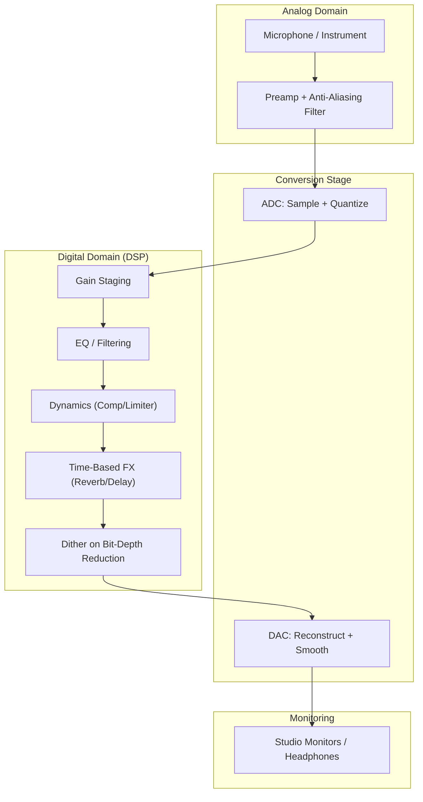
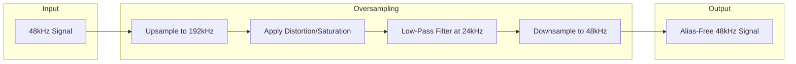
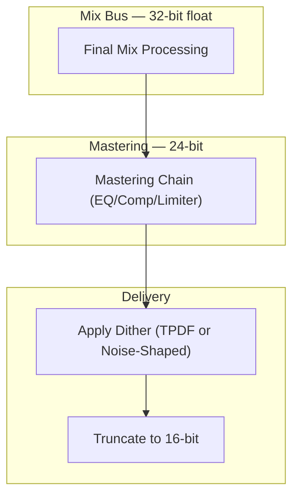

# Lesson 1: Digital Audio Fundamentals — Sampling, Quantization & DSP in Practice

## 1. First-Principles Intuition (Read Once, Apply Forever)

Every decision you make in a DAW session — sample rate, bit depth, buffer size, plugin order — traces back to two physical constraints: **Nyquist's limit** and **quantization noise floor**. Get these intuitions right and every weird artifact you ever hear (aliasing zing, digital grit, latency stutter) becomes diagnosable instead of mysterious.

**Nyquist-Shannon in one paragraph, no derivation:** a sampled signal can only unambiguously represent frequencies up to half the sample rate (the Nyquist frequency). At 44.1 kHz, that's 22.05 kHz — above human hearing, which is why CD audio works. Any energy above that limit folds back down into the audible band as a false, inharmonic frequency. This fold-back is **aliasing**, and it is not subtle — it sounds like digital distortion, metallic ringing, or "zinginess" on cymbals and synth saws. It is the single most common beginner mixing mistake when using distortion, bitcrushers, or cheap sample-rate conversion.

**Bit depth in one paragraph:** each bit of depth gives roughly 6 dB of usable dynamic range (16-bit ≈ 96 dB, 24-bit ≈ 144 dB). More bits = finer amplitude steps = lower noise floor, not "better sound" in a tonal sense. This is why you record and mix at 24-bit or 32-bit float (headroom and rounding-error tolerance during processing) but can safely deliver a final master at 16-bit (final listening noise floor is already inaudible under room noise).

**The practical takeaway you'll use every session:**

| Parameter | What it actually controls | Your working default |
|---|---|---|
| Sample rate | Highest frequency you can represent cleanly | 48 kHz for video/music delivery, 96 kHz if heavy pitch/time manipulation or analog modeling plugins are in the chain |
| Bit depth (recording/mixing) | Noise floor + headroom for math errors during processing | 24-bit int or 32-bit float, always |
| Bit depth (final delivery) | Final noise floor | 16-bit dithered for CD/streaming, 24-bit for mastering handoff |
| Buffer size | Round-trip latency vs. CPU headroom | 64–128 samples tracking, 512–1024 mixing |

---

## 2. Signal Chain Architecture



Walk this chain in your head every time you troubleshoot a signal problem: is the issue happening before the ADC (gain staging, mic placement), in the digital chain (plugin ordering, clipping between stages), or after the DAC (monitor/headphone issue, room acoustics)? 90% of "my mix sounds bad" problems are solved by isolating which stage of this chain is actually broken.

### Why anti-aliasing filters sit *before* the ADC, not after

Once aliasing happens, it is mathematically irreversible — the false frequency is now indistinguishable from a real one. This is why every audio interface has a fixed analog low-pass filter before the converter chip, silently removing content above Nyquist before sampling even happens. You never see this filter in software; it's baked into the hardware. The lesson: you cannot "fix" aliasing after the fact with EQ, because by the time you're looking at the digital signal, the damage already looks like legitimate audio content.

---

## 3. Gain Staging Drill — The Foundation Skill Nobody Practices

Most audio quality problems are gain-staging problems, not EQ or compression problems. Here is a concrete, repeatable drill using any DAW (Reaper, Logic, Pro Tools, Ableton — the meters work the same everywhere).

**Setup:** load a drum loop or any transient-rich sample onto a track.

**Step 1 — Input gain.** Set input/clip gain so the loudest transient peaks at **-12 dBFS to -18 dBFS** on the track meter, never above -6 dBFS. This isn't superstition — it leaves 12–18 dB of headroom before the 0 dBFS hard digital ceiling, which is unforgiving (unlike analog tape, digital clipping is instant, harsh, and unrecoverable).

**Step 2 — Plugin gain matching.** Insert an EQ plugin. Boost a band by 6 dB. Listen — it will sound "better" purely because it's louder, not because the EQ move was musically correct. Pull the plugin's output gain down by roughly the same amount you boosted, so input and output loudness match (use a loudness meter or just A/B by ear with the bypass button). This is called **gain-matched A/B testing** and it is the only honest way to evaluate whether a processing decision actually improved the sound.

**Step 3 — Bus/master headroom.** Sum 8–16 tracks into a mix bus. Check the master fader peak. If it's clipping (hitting red), you have two legitimate fixes: pull down individual track faders (correct — fixes the actual gain-staging problem) or slap a limiter on the master to "catch" the peaks (band-aid — hides the problem and will cause pumping/distortion under heavier mixes). Always fix at the source first.

**Metronome-style progressive target for this drill:** repeat this gain-staging pass on five different mixes before moving to EQ/compression lessons. Muscle memory for "where do my peaks sit" needs repetition, exactly like scales on an instrument.

---

## 4. Digital Filters — What They Actually Do and How to Hear Them

A digital filter is a small feedback/feedforward equation run on every sample. You don't need the full derivation to use filters correctly, but you do need to know what the two common topologies sound/behave like in practice.

### Biquad filter — the building block of every EQ plugin you own

A biquad is a 2nd-order filter (one that can make a peak, notch, shelf, or resonant slope). Every parametric EQ band in every plugin is built from cascaded biquads.

**Direct Form I vs Direct Form II — practical difference, not academic trivia:**
- **Direct Form I**: more numerically stable at low bit depths, more multiply-add operations, used in hardware/embedded DSP where stability under fixed-point math matters more than CPU cost.
- **Direct Form II (Transposed)**: fewer stored states, lower CPU cost, used in almost all software plugins since modern CPUs run 32/64-bit float where the stability difference is negligible.

You will never need to choose between these as a mixing engineer — plugin developers choose for you — but knowing this explains why some vintage hardware-modeled EQ plugins let you pick "topology" as a tone option: they're literally modeling rounding-error behavior as a *feature*, not a bug.

### A working biquad peak filter, in real C++ (the exact math every EQ plugin runs per sample)

```cpp
// Biquad peaking EQ — Direct Form II Transposed
// Audio-rate coefficient calculation (RBJ Cookbook formulas)
#include <cmath>

struct BiquadPeak {
    double b0, b1, b2, a1, a2; // coefficients
    double z1 = 0.0, z2 = 0.0; // state (delay registers)

    void setParams(double sampleRate, double freqHz, double q, double gainDB) {
        double A  = std::pow(10.0, gainDB / 40.0);
        double w0 = 2.0 * M_PI * freqHz / sampleRate;
        double alpha = std::sin(w0) / (2.0 * q);
        double cosw0 = std::cos(w0);

        double b0_ = 1.0 + alpha * A;
        double b1_ = -2.0 * cosw0;
        double b2_ = 1.0 - alpha * A;
        double a0_ = 1.0 + alpha / A;
        double a1_ = -2.0 * cosw0;
        double a2_ = 1.0 - alpha / A;

        // Normalize by a0 so a0 = 1
        b0 = b0_ / a0_;
        b1 = b1_ / a0_;
        b2 = b2_ / a0_;
        a1 = a1_ / a0_;
        a2 = a2_ / a0_;
    }

    // Call once per audio sample
    float process(float xIn) {
        double x = static_cast<double>(xIn);
        double y = b0 * x + z1;
        z1 = b1 * x - a1 * y + z2;
        z2 = b2 * x - a2 * y;
        return static_cast<float>(y);
    }
};
```

**How to actually use this:** this is the real block you'd drop into a JUCE or RTAudio plugin project. `freqHz` is your EQ band center, `q` controls bandwidth (narrow = surgical notch, wide = musical boost), `gainDB` is boost/cut amount. Run `setParams()` whenever the user moves a knob; run `process()` once per sample in the audio callback. This is not a toy — this is the production algorithm inside Pro-Q, Waves, and most native EQ plugins, modulo UI and oversampling dressing.

---

## 5. Anti-Aliasing and Oversampling — Hearing the Problem, Then Fixing It

**Diagnostic drill:** load a saw wave synth at a low note (say, 55 Hz) into a distortion or saturation plugin. Crank the drive hard. Listen for an inharmonic, metallic shimmer riding on top of the distorted tone that doesn't track the pitch of the note musically. That shimmer is aliasing — the distortion stage generated harmonics above Nyquist, which folded back down into audible, musically-wrong frequencies.

**The fix in a real session:** check if your distortion/saturation plugin has an "oversampling" control (most modern ones do — Decapitator, Soundtoys, Serum's distortion module). Turn it from 1x to 4x or 8x. Oversampling works by:

1. Upsampling the signal (e.g., 4x — turning 48 kHz into 192 kHz) using interpolation.
2. Running the nonlinear distortion math at the higher rate, pushing the alias frequencies above the new, much higher Nyquist limit.
3. Low-pass filtering to remove anything above the original Nyquist.
4. Downsampling back to the original rate.

The alias energy gets filtered out before it folds back into your audible range. Cost: CPU. This is why oversampling is usually off by default (CPU savings) and why you should turn it on for final bounces even if you leave it off while tracking/arranging to save CPU headroom.



---

## 6. Dither — The Deliberate Noise That Fixes Quantization Error

**The problem:** when you reduce bit depth (e.g., bouncing a 24-bit mix down to a 16-bit delivery file), you are throwing away the bottom 8 bits of amplitude resolution. Without correction, quiet passages and reverb tails develop audible, correlated distortion — the quantization error becomes mathematically tied to the signal, which your ear hears as graininess or a subtle "digital" edge, especially on fades to silence.

**The fix:** dither adds a tiny, calibrated amount of noise (below -90 dBFS, inaudible on its own) before the bit-depth truncation. This decorrelates the quantization error from the signal, converting that correlated distortion into uncorrelated noise — which your ear perceives as a slightly higher but completely benign noise floor instead of audible grain.

**Practical rule, not optional:** always apply dither exactly once, at the very last bit-depth reduction in your chain, never earlier and never more than once.



**Session checklist for correct dither usage:**
- Working in 32-bit float internally the whole session? Good — no dither needed until final export.
- Exporting a 24-bit stem for a mastering engineer? No dither — they need full resolution, dithering now just adds unnecessary noise they'll have to dither again later ("double dithering" is a real, audible mistake).
- Exporting the final 16-bit consumer file yourself? Dither here, once, as the literal last step before export.

---

## 7. Latency, Buffer Size & Real-Time Performance

**The physical trade-off you tune every session:** buffer size controls how many samples the audio interface collects before handing them to your CPU for processing. Smaller buffer = lower latency (good for playing/singing in real time against existing tracks) but more CPU interrupts per second (higher risk of dropouts/glitches, "XRUNs"). Larger buffer = more stable processing, higher latency (bad for live performance monitoring, fine for mixing where nothing needs to feel "instant").

| Buffer size (samples) @ 48kHz | Round-trip latency | Use case |
|---|---|---|
| 32 | ~2 ms | Guitar amp sim monitoring while tracking, drummers with in-ear clicks |
| 64–128 | ~3–6 ms | General tracking, vocalists |
| 256 | ~11 ms | Light mixing with a handful of plugins |
| 512–1024 | ~22–44 ms | Heavy mixing sessions, mastering, bouncing |

**Debugging procedure when you get crackling/dropouts (the real troubleshooting checklist, in order):**

1. **Raise the buffer size first.** This is the single highest-leverage fix and costs you nothing except monitoring latency, which doesn't matter unless you're actively recording a live performer.
2. **Check CPU meter per-core, not just aggregate.** Many DAWs show total CPU% but a single overloaded plugin thread can crackle the whole system even at 20% aggregate load — look for one core pegged at 100%.
3. **Freeze or render CPU-heavy tracks** (reverb-heavy orchestral patches, granular synths, convolution reverbs) to audio instead of running them live.
4. **Check sample rate mismatches** — a session running at 48 kHz with an imported 44.1 kHz file not properly resampled will cause audible pitch/time artifacts and sometimes dropouts, depending on DAW handling.
5. **Disable Bluetooth/WiFi audio drivers competing for the same audio subsystem** on laptops — a classic, underrated dropout cause.
6. **Check USB/Thunderbolt bus contention** — other high-bandwidth devices (external drives, webcams) sharing a bus with your audio interface can starve it of bandwidth during a session.

---

## 8. Failure Mode Reference Table

| Symptom | Root Cause | Fix |
|---|---|---|
| Metallic, inharmonic shimmer on distorted/saturated sounds | Aliasing — harmonics generated above Nyquist folding back down | Enable oversampling (4x/8x) on the offending plugin |
| Grainy/gritty quiet passages and fade-outs | Quantization error from bit-depth reduction without dither | Apply dither once, at final bit-depth reduction only |
| Hard digital clicks/pops, not musical distortion | Digital clipping — signal exceeded 0 dBFS | Pull back gain at the clipping stage; never rely on limiter alone |
| Crackling during playback under heavy plugin load | Buffer underrun (XRUN) — CPU couldn't finish processing in time | Raise buffer size; freeze/render heavy tracks; check per-core CPU |
| Phasey, hollow tone after bouncing/exporting | Sample rate conversion done with low-quality resampler, or two tracks at different sample rates summed without proper conversion | Match all source material to session sample rate using a high-quality SRC (DAW's built-in resampler set to "best" quality, not "fast") |
| Mix sounds "loud but weak," collapses on small speakers | Over-limiting on master bus masking gain-staging problems upstream | Fix individual track gain staging before reaching for a brickwall limiter |

---

## 9. Practice Assignment

Before moving to Lesson 2 (Mixing & Dynamics Processing), complete this once with your own material:

1. Record or import a 4–8 track rough mix.
2. Run the gain-staging drill (Section 3) on every track — document peak levels before/after.
3. Deliberately induce aliasing: push a drum bus through heavy saturation with oversampling off, then on. A/B and write down, in your own words, what changes.
4. Bounce the mix twice: once at 24-bit (no dither) for your own archive, once at 16-bit (with dither) as a "delivery" file. Open both in a spectrum analyzer and visually compare the noise floor below -80 dBFS.
5. Deliberately set your buffer size to 32 samples and try mixing with 15+ plugin instances active. Note when and where it breaks. Then raise it to 512 and note the latency cost when trying to play a virtual instrument live against the mix.

This assignment is designed to make every failure mode in Section 8 something you've personally heard and caused on purpose — the fastest way to build real diagnostic ears.
