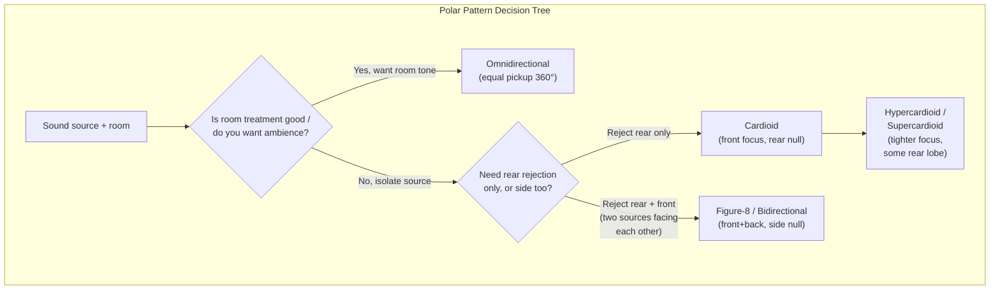
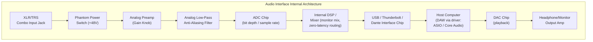

# Lesson 2: Audio Interfaces and Microphones — Signal Chain Mastery

## 1. Why This Matters: The Transduction Chain Determines Your Ceiling

Every recording you will ever make is limited by the weakest link in this chain: **sound source → microphone → cable → preamp → ADC → DAW**. You cannot fix a bad transducer choice or a clipped preamp in the mix. Get the physical capture right, and everything downstream gets easier. Get it wrong, and no amount of plugin processing recovers what was never captured.

**The core physics in one paragraph:** a microphone is a transducer converting acoustic pressure variations (sound waves hitting a diaphragm) into analog voltage. A dynamic mic does this via electromagnetic induction (moving coil in a magnetic field, per Faraday's law — motion induces current). A condenser mic does it via capacitance change (a charged diaphragm moving relative to a fixed backplate changes capacitance, producing a voltage swing that needs amplification via an internal FET). An ADC then samples that continuous voltage at a fixed rate (44.1/48/96/192 kHz) and quantizes each sample to a binary value (16/24 bit). The **Nyquist theorem** dictates your sample rate must be at least 2× the highest frequency you want to capture cleanly — this is why 44.1 kHz (covering up to ~22 kHz, beyond human hearing) became the CD standard, and why 48 kHz is the video/broadcast standard. That's the last formula you need for today. Everything else in this lesson is ears, hands, and gain staking.

---

## 2. Microphone Types: Choosing the Right Transducer for the Job

### 2.1 Dynamic Microphones (Moving Coil)

**Mechanism:** Diaphragm attached to a voice coil suspended in a permanent magnet's field. Sound pressure moves the diaphragm, the coil moves through the magnetic field, inducing a small AC voltage directly — no external power needed.

**Practical characteristics:**
- Handles very high SPL (120+ dB) without distorting — safe on screaming vocals, snare drums, guitar cabs at stage volume.
- Lower sensitivity (~1.5–2.5 mV/Pa) — needs 50–60+ dB of clean preamp gain for quiet sources, which is why cheap interfaces sound noisy on dynamic mics.
- Naturally rolls off above ~15 kHz and below ~50 Hz — this is a feature, not a bug, for rejecting rumble and harshness.
- Rugged, no capsule power required, tolerates humidity and rough handling.

**Go-to applications:** Shure SM57 (snare, guitar amps, horn bells), SM7B (broadcast vocal, loud vocalists), Electro-Voice RE20 (kick drum, broadcast).

### 2.2 Condenser Microphones (Capacitive)

**Mechanism:** Two plates form a capacitor — one fixed backplate, one thin conductive diaphragm. A polarizing voltage (externally supplied as **phantom power**, or internally via an electret pre-charge) sits across the capacitor. Diaphragm movement changes the gap, changing capacitance, which changes voltage at fixed charge. This signal is tiny and high-impedance, so an onboard FET buffer/impedance converter is mandatory before the signal can travel down a cable.

**Practical characteristics:**
- High sensitivity (~10–25 mV/Pa) — picks up fine detail, room tone, fret noise, breath. Great for subtlety, unforgiving of a bad-sounding room.
- Needs **48V phantom power** (standard) from the interface or an external PSU.
- Lower max SPL before capsule distortion — large-diaphragm condensers often include a built-in -10/-20 dB pad switch for loud sources.
- Extended high-frequency response (often flat to 20 kHz+) — this is why they sound "airy" or "present" on vocals and acoustic instruments.

**Go-to applications:** Large-diaphragm condenser (Neumann U87, AKG C414) for lead vocal, acoustic guitar, voiceover. Small-diaphragm condenser (DPA 4011, Schoeps) for orchestral/choir, overheads, precise transient capture.

### 2.3 Ribbon Microphones (the often-skipped third category)

**Mechanism:** A thin corrugated aluminum ribbon suspended in a magnetic field acts as both diaphragm and conductor — a dynamic mic with near-zero mass moving. Produces an extremely natural, smooth high end with a gentle top-end rolloff.

**Practical characteristics:**
- Very low output — needs a clean preamp with 60+ dB of gain on tap (a cheap/noisy preamp will reveal its hiss here).
- Fragile to wind blasts and phantom power (never apply 48V to an unbalanced or faulty ribbon circuit — it can destroy the ribbon).
- Natural darkness flatters harsh sources: brass, distorted guitar cabs, aggressive vocalists.

**Go-to applications:** Royer R-121 on guitar cabs, RCA-style ribbons on brass sections and vintage-voiced vocals.

---

## 3. Polar Patterns: Directional Control Is a Mixing Decision Made at Capture Time

The polar pattern determines how much the mic rejects off-axis sound — this is your first and cheapest noise-reduction and bleed-control tool, decided before you ever touch a fader.

**Practical rules:**
- **Cardioid** — the studio workhorse. Rejects ~15-20 dB at 180° off-axis. Use for vocals, amps, anything where you want to minimize room spill. Watch the **proximity effect**: bass response increases sharply as the source gets within a few inches of the capsule — this is why close-mic'd cardioid vocals sound "fuller" and why you back off the mic (or engage a bass-cut switch) for boomy voices.
- **Omnidirectional** — no proximity effect, most natural low end, but captures everything in the room equally. Use for ambient room mics, orchestral capture in a good hall, or when you want zero handling-noise/wind-noise coloration (omni capsules are inherently less sensitive to plosive wind blasts).
- **Figure-8** — used for Mid-Side (M/S) stereo recording and for two performers facing each other across one mic (classic ribbon-mic duet technique).
- **Hypercardioid/Supercardioid** — tighter front lobe, better isolation in loud multi-source settings (drum overheads, film boom work), but has a small rear pickup lobe you must manage by aiming the null correctly.

---

## 4. The Analog Chain: Gain Staging From Capsule to Converter

This is the single most important practical skill in this lesson. **Gain staking** means setting the correct signal level at every stage so you maximize signal-to-noise ratio without ever clipping.

```mermaid
graph TD
    subgraph chain ["Signal Chain: Acoustic Source to Digital Audio"]
        A["Acoustic Source
(voice/instrument)"] -->|"sound pressure"| B["Microphone Capsule
(transduction)"]
        B -->|"mic-level signal
~ -60 to -40 dBu"| C["Preamplifier
(gain stage)"]
        C -->|"line-level signal
~ +4 dBu"| D["Analog-to-Digital
Converter (ADC)"]
        D -->|"PCM digital stream
e.g. 24-bit / 48kHz"| E["Digital Signal
Processor / Mixer"]
        E --> F["DAW
(recording / playback)"]
        F -->|"digital out"| G["Digital-to-Analog
Converter (DAC)"]
        G -->|"line-level signal"| H["Monitor / Headphone
Amplifier"]
        H --> I["Speakers / Headphones"]
    end
```

### 4.1 Setting Gain Correctly — Step-by-Step Procedure

1. **Connect mic, enable phantom power if condenser.** Check interface switch/software toggle; verify mic requires it (never apply 48V to a vintage ribbon unless explicitly rated for it).
2. **Have the performer play/sing at their loudest expected dynamic**, not a quiet soundcheck mumble. Gain staging must account for peak performance energy.
3. **Set preamp gain so peaks land around -12 to -6 dBFS on the DAW meter.** This leaves 6-12 dB of headroom above the loudest moment — digital clipping (0 dBFS) is instant, harsh, unrecoverable distortion, unlike analog tape or tube saturation which clips more gracefully.
4. **Never gain-stage to "as hot as possible."** Modern 24-bit converters have ~110-120 dB of dynamic range; you do not need to push levels near 0 dBFS to escape noise floor. Recording at -18 dBFS average (classic EBU R128-adjacent broadcast habit) with peaks at -6 dBFS is completely safe and clean on any modern interface.
5. **Check for a ground loop hum (50/60 Hz buzz)** before committing to a long take — lift the ground on a DI box or use a balanced XLR connection (which cancels common-mode noise via its differential pair) rather than troubleshooting during mixdown.

### 4.2 Troubleshooting the Analog Chain (Real Problems, Real Fixes)

| Symptom | Likely Cause | Fix |
|---|---|---|
| Harsh digital crackle/distortion on loud peaks | Signal clipping at ADC (0 dBFS) | Lower preamp gain 6-10 dB, re-take |
| Constant hiss under the signal | Preamp gain pushed too high to compensate for a quiet source, raising noise floor | Move mic closer (respect proximity effect), or swap to higher-sensitivity capsule |
| Low-frequency rumble / boom | Proximity effect on cardioid mic too close, or mic stand touching floor/desk transmitting vibration | Back mic off source 2-4 inches, use a shock mount + isolation pad |
| 60Hz (US) / 50Hz (EU) hum | Ground loop between unbalanced gear and balanced interface | Use balanced TRS/XLR runs throughout; ground-lift DI if needed |
| Phantom power "thump" or mic cutting out | Phantom power toggled with mic live, or cheap unbalanced cable not carrying 48V reliably | Always toggle phantom power with gain down/muted; use a proper shielded balanced XLR cable |
| Comb-filtering / hollow sound on two mics on one source | Mics not time-aligned, destructive phase interference | Apply the 3:1 rule — second mic should be at least 3× the distance from the first mic as the first mic is from the source |

---

## 5. Audio Interface Architecture Deep Dive

### 5.1 Core Components and What Actually Matters When Buying One

**What actually matters for sound quality (in priority order):**

1. **Preamp quality and gain range** — more impactful than the ADC itself for most project-studio use cases. Look for 60+ dB of clean gain if you plan to use dynamic or ribbon mics regularly.
2. **Driver stability** (ASIO on Windows, Core Audio on Mac) — a technically superior converter is useless if the driver crackles, drops out, or adds unpredictable latency. Read user reports on driver reliability before chasing THD specs.
3. **Converter quality (ADC/DAC)** — modern interfaces from reputable brands (Focusrite, Universal Audio, RME, MOTU, Antelope) all have converters that are transparent to human hearing at 24-bit/48kHz+. Beyond a certain quality floor, this stops being the differentiator.
4. **I/O count and connectivity** matched to your actual use case — don't buy 18 inputs for a solo podcaster; don't buy 2 inputs for a drum session requiring 8+ mics.

### 5.2 Latency: What It Is and How to Manage It

**The mechanism:** every digital audio signal path introduces processing delay — ADC conversion time, USB buffer transfer, DSP processing, DAC conversion time. Round-trip latency is what a performer hears as delay between playing a note and hearing it back through headphones when monitoring "through the computer" (DAW monitoring) rather than directly off the interface (direct/zero-latency monitoring).

**Practical fix — buffer size tradeoff:**

| Buffer Size (samples) | Latency @ 48kHz | Use Case |
|---|---|---|
| 32-64 | ~1-2 ms | Live tracking, performer needs tight feel, minimal plugin use |
| 128-256 | ~3-6 ms | Standard tracking with a few monitoring plugins |
| 512-1024 | ~10-21 ms | Mixing/mastering, heavy plugin chains, no live performer listening back |
| 2048+ | ~40+ ms | Final rendering/bouncing only — never for tracking |

**Rule of thumb:** lower buffer = lower latency but higher CPU load risk (clicks/pops if the computer can't keep up). Raise the buffer when mixing (no one is playing live against the latency), lower it when tracking a performer who needs to hear themselves in time.

**If a vocalist complains about hearing themselves "late" or "doubled":** switch on the interface's **zero-latency direct monitoring** feature (hardware-level mix of input signal with playback, bypassing the computer entirely) rather than fighting software buffer settings.

---

## 6. Practical Lab: Gain Staging and Mic Placement Drill

**Setup:** one dynamic mic (SM57-class) and one condenser mic (any large-diaphragm), one interface with two inputs, a DAW of your choice.

**Drill 1 — Gain Staking by Ear and Meter (15 min)**
1. Set up the condenser on vocals, cardioid pattern, phantom power on.
2. Have the vocalist perform their loudest line from the piece 3 times.
3. Adjust the interface gain knob until those loud peaks consistently hit -8 to -6 dBFS on the DAW meter.
4. Record a full take. Check the waveform: if you see any flat-topped ("squared off") peaks, you clipped — lower gain 3 dB and retake.

**Drill 2 — Proximity Effect Mapping (10 min)**
1. Cardioid condenser, vocalist speaks the same phrase at four distances: 12 inches, 6 inches, 3 inches, 1 inch.
2. Listen back and note the bass buildup at each distance.
3. Identify the "sweet spot" distance for this particular voice — most baritone/bass voices sound best at 6-8 inches to avoid muddiness; thinner voices may benefit from the fullness at 3-4 inches.

**Drill 3 — The 3:1 Rule for Two Mics on One Source (10 min)**
1. Mic an acoustic guitar with one mic at the 12th fret, 6 inches away.
2. Add a second mic near the soundhole.
3. Move the second mic until it is at least 18 inches from the first mic (3× the 6-inch distance) to avoid phase cancellation.
4. Sum both mics to one track, check for a thin/hollow sound (comb filtering) — if present, nudge the second mic until it disappears.

**Drill 4 — Buffer Size Latency Test (5 min)**
1. Set buffer to 1024 samples. Try to play along with a click track through headphones using software monitoring.
2. Note the "behind the beat" feeling from latency.
3. Drop buffer to 64 samples and repeat — note the tightened feel.
4. Switch to zero-latency direct hardware monitoring and repeat once more — note it feels instantaneous regardless of buffer size, because you're no longer hearing the signal round-trip through the computer.

---

## 7. Key Specs Glossary (Reference, Not Memorization)

- **Frequency response** — the range of frequencies a mic/interface captures within a stated tolerance (e.g., "20 Hz – 20 kHz ±3 dB"). A flatter response = more neutral, uncolored capture.
- **Sensitivity** — output voltage per unit of sound pressure (mV/Pa). Higher sensitivity = less preamp gain needed = better noise floor for quiet sources.
- **Self-noise / Equivalent Noise Level (ENL)** — the noise floor the mic itself generates, stated in dB(A) SPL. Lower is better; under 15 dB(A) is excellent for a condenser, under 20 dB(A) is very good.
- **Max SPL** — the loudest sound pressure level the mic can handle before its output distorts (usually stated at 0.5% or 1% THD). Check this before putting a condenser in front of a guitar cab or kick drum.
- **Impedance** — mic output impedance (usually 150-300 ohms) should be significantly lower than the preamp's input impedance (typically 1-2 kΩ+) to avoid signal loading and high-frequency loss. This is handled automatically by any modern professional gear — only becomes a troubleshooting issue with vintage or mismatched equipment.
- **Bit depth** — number of amplitude quantization steps per sample (16-bit = 65,536 steps; 24-bit = 16.7 million steps). Record at 24-bit always; it costs nothing extra in storage relative to the headroom benefit.
- **Sample rate** — number of amplitude samples captured per second (44.1kHz, 48kHz, 96kHz). 48kHz is the standard for most modern production; higher rates matter mainly for extensive pitch/time manipulation or scientific/archival work, not for average perceptual fidelity gains.
