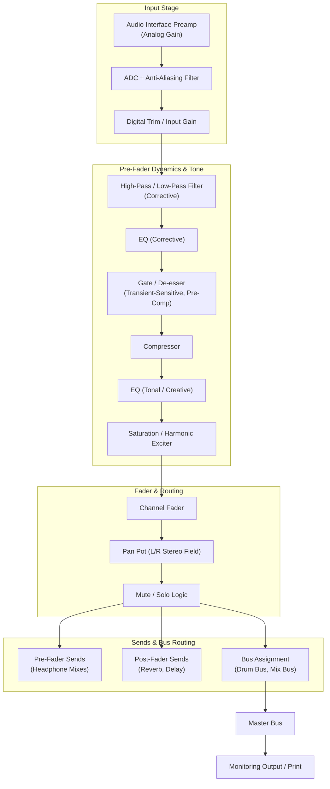
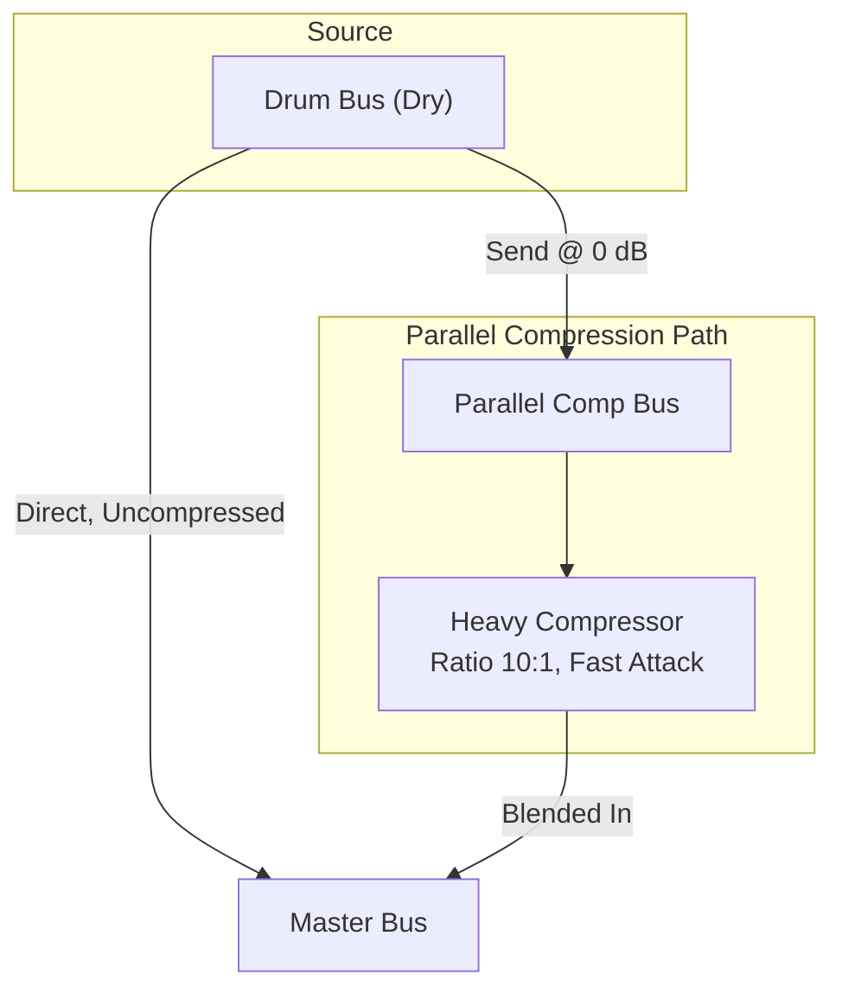
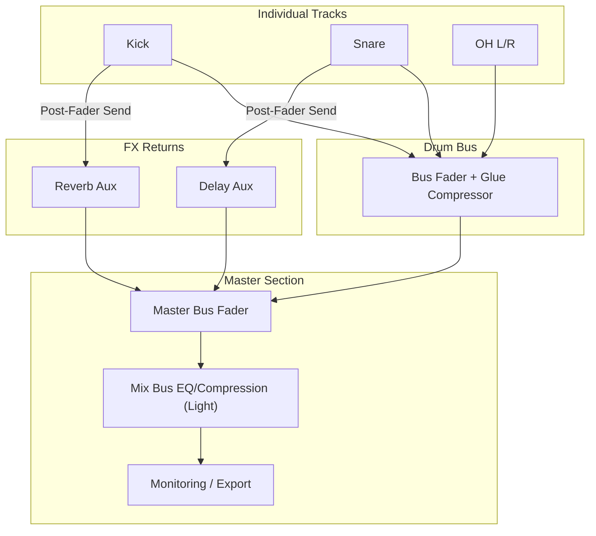

# Lesson 3: Mixer and DAW Operations — Gain Staging, Routing, and Signal Flow Discipline

## 1. First-Principles Intuition: Why Gain Staging Is the Whole Game

A DAW mixer is a chain of digital multipliers and adders. Every plugin, fader, and bus send is doing one of two things: multiplying your signal by a coefficient (gain, in linear amplitude) or summing it with other signals. The entire discipline of "good mixing technique" is really about controlling *where in that chain* a signal sits relative to two hard boundaries:

- **The noise floor** (bottom): in a 24-bit/32-bit float session this is so low it's a non-issue for level-setting, but it still matters at the analog input stage (your audio interface's preamp) and inside any plugin doing bit-reduction or vintage emulation.
- **Clipping at 0 dBFS** (top): full-scale digital audio has a hard ceiling. Exceed it and you get flat-topped waveforms — audible as harsh distortion, not the "warm" kind.

The practical consequence: **gain-stage every plugin in the chain**, not just the channel fader at the end. A compressor pushed too hot into a saturator, even if the final fader is pulled down to a safe level, still clips internally at full-scale precision stages and definitely clips if any plugin is running at legacy fixed-point 24-bit internal processing. Treat every insert as its own mini mixer: set its input to hit a sane average level (roughly -18 dBFS to -12 dBFS RMS for most processors, hotter only for things designed to be driven, like tape or tube saturators) and match its output level so the next plugin in the chain isn't surprised.

Sample-accurate automation and the sample/block architecture matter practically in exactly one way you need to internalize early: your **buffer size (64–512 samples) trades latency for CPU headroom**. Small buffers = low round-trip latency for tracking but higher risk of underruns/clicks under CPU load. Large buffers = rock-solid playback and mixing but unusable latency for live input monitoring. This is the single most common support-ticket in home studios ("clicking and popping"), and the fix is almost always buffer size, not a corrupted session.

## 2. Gain Staging Workflow (The Actual Procedure)

Do this on every new session, every new track, before you touch an EQ or compressor.

**Step 1 — Set input gain at the source.**
On the audio interface (hardware gain knob, not a DAW fader), aim for peaks around **-18 dBFS to -12 dBFS** on the interface meter while the performer plays/sings at real performance dynamics, not a soft soundcheck level. This leaves 12–18 dB of headroom for transients you didn't anticipate (a drummer hitting harder on the take, a vocalist belting the chorus).

**Step 2 — Confirm the channel fader sits near unity (0 dB) during recording.**
If you need to push the fader far above or below unity to get a usable monitoring level, the problem is at the source gain, not the fader. Fix it there. A fader riding at +10 dB because the mic gain was too low means you're also amplifying the noise floor by 10 dB.

**Step 3 — Gain-stage every insert plugin.**
For each plugin in the channel's insert chain:
1. Check its input meter (most modern plugins show one).
2. If it's hitting the plugin's internal clip point, insert a **Trim/Utility gain plugin** before it and pull the level down.
3. After the plugin processes (especially saturation, distortion, or heavy compression that adds makeup gain), check the output level and trim it back to match what the next stage expects.

**Step 4 — Set bus/group levels before touching sends.**
Route drums, for example, to a Drum Bus. Get the bus fader at unity with individual channel faders doing the balancing *before* you start adding bus compression. Compressing a bus that's already clipping internally produces a different (worse) result than compressing one sitting at a healthy -18 dBFS average.

**Step 5 — Master bus stays conservative until mastering.**
Mix bus peaks should sit around **-6 dBFS to -3 dBFS** at the loudest moment, with no limiter slamming it to 0 dBFS during mixing. Save final loudness decisions for the mastering stage (a dedicated pass, ideally on a fresh chain, not a limiter left on during the whole mix).

## 3. Channel Strip Anatomy and Real Processing Order

Every channel strip is a fixed-order pipeline. Knowing the order lets you predict interactions instead of guessing.

**Why this order matters in practice:**

- **Filter before compressor**: a boomy low end (sub-80 Hz rumble, mic stand vibration) will trigger your compressor's gain reduction on energy you don't even want in the mix. High-pass it first so the compressor reacts to the signal you actually care about.
- **De-esser/gate before the main compressor**: compressing first raises the sibilance or bleed along with everything else, making it harder to tame afterward. Deal with transient problems before you compress the dynamic range.
- **Creative EQ after compression**: compression changes the harmonic balance (pulling down loud transients changes the perceived brightness). EQ-ing for tone *after* the compressor reacts to what you'll actually hear in the final balance, not the uncompressed source.
- **Pre-fader vs. post-fader sends is not a style choice, it's functional**: a headphone/monitor send must be pre-fader, because the performer needs a stable monitor mix independent of where you're riding the main fader. A reverb/delay send is almost always post-fader, so the wet signal rides proportionally with the dry signal as you automate the fader — otherwise a fader pulled down leaves the reverb sitting unnaturally loud relative to the dry sound.

## 4. Bus Routing Patterns You'll Actually Use

### Pattern A: Subgroup Bus (Drum Bus, BGV Bus)
Route 8 drum mic channels → one "Drums" bus → Master. Benefits:
- One fader controls the overall drum level in the mix without disturbing your internal balance.
- One compressor across the bus ("bus glue," typically an SSL-style bus compressor: ratio 2:1–4:1, attack 10–30 ms, release auto or 100–300 ms, 2–4 dB of gain reduction on peaks) ties the kit together into one cohesive sound, something no amount of individual-channel compression replicates.

### Pattern B: Send/Return Bus (Reverb, Delay)
Create an Aux/FX track with a reverb plugin. On every channel that needs reverb, add a **post-fader send** to that Aux at an appropriate level, instead of inserting a separate reverb instance on every channel. Benefits:
- One CPU-efficient reverb instance instead of fifteen.
- All reverberated signals share the same "room," which is how real acoustic spaces actually work — every instrument in a hall is colored by the same reverberant field, not fifteen different simulated rooms.

### Pattern C: Parallel Processing Bus (Parallel Compression / "New York Compression")
Duplicate a bus's signal to a second bus via a send at unity (0 dB) gain, heavily compress that second bus (ratio 8:1–20:1, fast attack, fast release, 10+ dB of gain reduction), and blend it back under the uncompressed original. This adds density and perceived loudness without squashing the original transients — you hear the punch of the dry signal and the sustain/body of the squashed signal simultaneously.

### Pattern D: Sidechain Routing (Ducking)
Route the kick drum's output as a **sidechain input** to a compressor inserted on the bass or synth bus. The compressor doesn't process the kick itself — it uses the kick's envelope to trigger gain reduction on the bass, carving out space for the kick to punch through every hit. Typical settings: ratio 4:1–8:1, fast attack (1–5 ms), release tuned to the tempo (an eighth or sixteenth note at the song's BPM, often 80–150 ms), threshold set so reduction only happens on kick hits, not the overall bass level.

## 5. Automation: Practical Rules, Not Just "It's a Timeline"

Automation lanes record parameter values against the timeline, interpolated between points. Three rules that prevent the most common automation mistakes:

1. **Automate the fader for level changes, not the plugin's internal gain knob**, unless you specifically need a plugin parameter (like filter cutoff) to sweep. The fader is purpose-built for this: smoothly interpolated, zero-latency to adjust, and visually clear in the arrangement.
2. **Write automation in passes, not all at once.** First pass: broad level rides (verse quieter, chorus louder). Second pass: micro-dynamic fixes (one word that's too loud, a cymbal crash that masks a vocal line). Trying to do both simultaneously produces overcorrected, jittery automation curves.
2. **Use read/write/touch/latch modes correctly:**
   - **Touch**: parameter follows your fader move only while you're physically touching the control, then snaps back to the previous automation value on release. Best for quick fixes on top of existing automation.
   - **Latch**: like touch, but stays at the new value after you release until playback stops. Best for writing a new automation pass from scratch.
   - **Write**: continuously overwrites automation for the entire duration playback runs, even where you don't touch the control. Dangerous — it will flatten existing automation to the current static value anywhere you don't move the fader. Use only when replacing an entire automation lane intentionally.

## 6. Troubleshooting: Real Symptoms, Real Causes

| Symptom | Likely Cause | Fix |
|---|---|---|
| Clicks/pops during playback, no CPU meter spike | Buffer underrun from a plugin doing heavy lookahead or oversampling | Increase buffer size (e.g., 128 → 512 samples) for mixing; drop back down only when tracking live input |
| Clicks/pops with a visible CPU spike | A single plugin instance (often a convolution reverb or granular synth) is CPU-heavy | Freeze or render that track to audio; bypass it to confirm, then consider a lighter-weight alternative |
| Static/digital distortion that doesn't look like clipping on the meter | Internal clipping inside a plugin running at a lower internal bit depth/headroom than the host session | Insert a trim plugin before the offending plugin and reduce input level by 6–12 dB |
| Phase cancellation / thin sound when two mic'd sources are blended | Time-of-arrival difference between mics (e.g., kick in/out mics, DI + mic'd amp) | Nudge one track by a few samples/ms to align waveforms, or flip polarity (phase invert) and compare |
| Reverb send sounds wrong when automating a vocal fader down | Send is set to pre-fader instead of post-fader | Switch to post-fader send so wet signal tracks proportionally with the dry fader |
| Loud transient briefly causes the whole mix to "pump" unexpectedly | Master bus limiter or glue compressor has too fast a release reacting to one bus spike | Increase release time or lower ratio on the bus/master compressor; check if one track (often a crash cymbal or kick) is the outlier causing it |
| A plugin's automation "jumps" instead of smoothly sweeping | Automation written in Latch/Write mode created a stair-step of points instead of a continuous curve | Select the automation lane, use a smoothing/thin command, or re-draw with a ramp/line tool between two points |

## 7. Practice Drill: Build a Gain-Staged Mix Template (30–45 min)

This is a hands-on session exercise, not reading. Open your DAW and do the following, timing yourself:

1. **(5 min)** Create 8 audio tracks, name them (Kick, Snare, OH-L, OH-R, Bass, GtrL, GtrR, Vox).
2. **(5 min)** Route Kick/Snare/OH-L/OH-R to a new bus named "Drums." Route GtrL/GtrR to a bus named "Guitars."
3. **(5 min)** Insert a trim/utility gain plugin as the first insert on every track (habit-building, even on silent tracks).
4. **(10 min)** Load a test signal (pink noise or a reference mix stem) on each track at varying levels (some clipping, some at -40 dBFS) and practice using the trim plugin to bring every channel to a consistent -18 dBFS RMS average before it hits any EQ/compressor insert slots.
5. **(5 min)** Create one Aux/FX bus with a reverb, add post-fader sends from three tracks to it at -12 dB send level, confirm wet signal rides correctly when you automate the dry fader down 10 dB.
6. **(5–10 min)** Save this as a template ("Gain-Staged Starter Template") for every future session. This single habit eliminates the majority of "why does my mix sound muddy/harsh" problems before you've touched a single creative decision.

## 8. Signal Flow Reference Diagram

Every arrow in this diagram is a real decision you make in the DAW's routing matrix, not an abstract concept. Trace your own session against this structure: can you point to the exact bus, send, and fader that each arrow represents? If not, that's the gap to close before adding more plugins.
