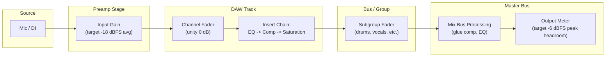
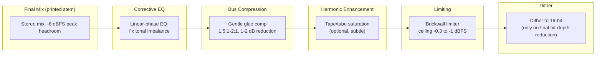

# Lesson 4: Advanced Audio Engineering — Gain Staging, EQ, Compression, and Mix-Bus Mastering

## 1. First-Principles Intuition (Read Once, Apply Forever)

Three physical facts explain almost every decision you make at the mixing desk:

1. **Sound is pressure variation over time.** Amplitude is loudness, frequency is pitch, phase is timing offset. When two sources share frequency content and arrive at slightly different times (two mic'd guitar amps, a DI + mic'd signal), their waves add constructively at some frequencies and cancel at others. This is **comb filtering** — the hollow, phasey sound you hear when you nudge two tracks against each other. Fix it by ear (nudge in 1–5 ms steps while soloing both tracks) or with a phase-rotation/alignment tool, not by EQ.

2. **Every sound is a stack of sine waves (Fourier).** A guitar chord, a kick drum, a voice — each is a fundamental frequency plus harmonics/overtones at integer (or inharmonic, for drums/bells) multiples. EQ works because you're reshaping that harmonic stack. Knowing *where* an instrument's energy lives lets you carve space instead of guessing:
   - Kick fundamental/punch: 50–100 Hz. Beater click/attack: 2.5–5 kHz.
   - Bass fundamental: 40–200 Hz. Growl/definition: 700 Hz–1.2 kHz.
   - Vocal body: 200–500 Hz. Presence/intelligibility: 2–5 kHz. Air: 10–14 kHz.
   - Snare crack: 2–4 kHz. Body: 150–250 Hz.

3. **Decibels are logarithmic, not linear.** A 3 dB increase is roughly double the acoustic power but only a perceptible "slightly louder." A 10 dB increase is roughly double the *perceived* loudness. This is why a compressor's ratio of 4:1 sounds dramatic while a 1.5:1 ratio is nearly transparent — the ear's response to level change is compressed too, so small dB moves on a fader or EQ (1–3 dB) are usually the correct move, not 10 dB swings.

Everything below — gain staging, EQ, compression, mastering — is applied engineering built on these three facts. The math (FFT bin resolution, filter transfer functions) matters to plugin *developers*; as a mixing engineer you need the audible consequences, which is where we'll spend 90% of this lesson.

---

## 2. Signal Flow & Gain Staging (Do This Before Anything Else)

Bad mixes are usually gain-staging problems wearing an EQ costume. Get this right first.

**Target levels, concretely:**
- Track input: average around **-18 dBFS RMS**, peaks no higher than **-6 dBFS**, on a 24-bit recording. This leaves headroom and keeps every plugin downstream operating in its designed sweet spot (most analog-modeled plugins are calibrated assuming signal around -18 dBFS).
- Channel fader: start near **unity (0 dB)**. If you need +10 dB on the fader to hear the track, the input gain was too low — go back and fix gain at the source, don't compensate with the fader.
- Master bus: leave **6 dB of headroom** (peaks around -6 dBFS) before any mastering limiter. Mastering engineers need this room; clipping the mix bus is not recoverable later.

**Procedure — gain staging a 24-track session:**
1. Record/import all tracks. Zero every fader to unity.
2. Solo each track, play the loudest section, read the input meter. If it's clipping or below -24 dBFS average, adjust the clip gain (not the fader) with the Gain knob on the clip or a trim plugin first in the chain.
3. Bring faders up from full-down together while listening to the full mix, roughest/loudest section first (usually the chorus or drop).
4. Build levels in this order: drums (kick/snare first, then overheads/room, then bass) → bass → lead vocal → harmony/doubles → guitars/keys → FX returns. Each new element should sit in the mix without you needing to pull down what's already there.

---

## 3. Equalization — Surgical and Musical

### 3.1 Filter types and when to reach for each

| Filter type | Slope | Use case |
|---|---|---|
| High-pass (HPF) | 12–24 dB/oct | Remove rumble, mic handling noise, proximity-effect mud below the instrument's fundamental |
| Low-pass (LPF) | 12–24 dB/oct | Tame harsh cymbal bleed, de-fizz distorted guitars, darken samples |
| Bell (peak) | Q-dependent | Boost/cut a specific resonance or formant |
| Shelf | Fixed, gentle | Broad tonal tilt (brighten/darken overall) |
| Notch | Narrow, high Q (8–12) | Kill a single resonant frequency (room mode, feedback, string buzz) |

### 3.2 Concrete HPF settings by source (do this on every track, every time)
- Kick drum: HPF at 30–40 Hz (keep sub punch, remove mic stand rumble).
- Bass guitar/synth bass: HPF at 30 Hz only if there's genuine sub-bass content you want; otherwise leave the fundamental alone.
- Snare: HPF at 80–100 Hz.
- Electric guitar: HPF at 90–120 Hz (removes proximity mud, nothing musical lives there).
- Vocals: HPF at 80–100 Hz (male), 100–120 Hz (female), adjust by ear for breath/pop noise.
- Overheads/room mics: HPF at 150–200 Hz to remove low-end buildup that fights the kick.

### 3.3 Subtractive-first workflow (the professional default)
Cutting is more predictable than boosting because it removes problems instead of amplifying a frequency that might already be too present elsewhere.

**Procedure — finding a resonant problem by ear:**
1. Insert a bell EQ, set Q to narrow (around 8–10), gain boost +12 dB.
2. Sweep the frequency slider slowly from 200 Hz to 8 kHz while the track plays solo.
3. When you hit a frequency that sounds harsh, boxy, or honky, that's the resonance. Stop there.
4. Flip the boost to a cut of -3 to -6 dB at that frequency, widen the Q slightly (3–5), and A/B with the EQ bypassed.

**Common problem frequencies to listen for:**
- 200–400 Hz: "boxiness" / cardboard-box sound. Common on acoustic guitar, male vocals, toms.
- 500–800 Hz: "honk" / nasal quality. Common on vocals, horns.
- 2–4 kHz: harshness/fatigue when overdone, but also where intelligibility lives — cut carefully, in 1–2 dB steps.
- 6–9 kHz: sibilance region for vocals (use de-essing here, not static EQ — see 3.4).

### 3.4 De-essing (sibilance control)
A static EQ cut at 6–8 kHz dulls the whole vocal. A de-esser is a compressor with its detector filtered to only that band, so it ducks "S" and "T" sounds without touching the rest of the vocal.

**Settings to start from:** split-band de-esser, detection band 5–8 kHz, threshold set so it engages 3–6 dB of reduction only on sibilant consonants (watch the gain reduction meter — it should flash only on "s"/"sh" sounds, sitting flat otherwise).

### 3.5 Frequency-slotting multiple instruments (arrangement-level EQ)
When kick and bass fight for the same low end:
1. Decide which owns the fundamental. Common convention: kick owns 60–80 Hz punch, bass owns 80–200 Hz body.
2. Cut a narrow notch (-3 dB, Q=4) in the bass at the kick's punch frequency, and a complementary notch in the kick at the bass's fundamental, so each has clear territory.
3. Verify in mono — this is where masking becomes audible fastest.

---

## 4. Compression — Dynamics Control That Actually Sounds Controlled

A compressor turns down signal automatically once it crosses a threshold, by a ratio, and turns it back up (makeup gain) to restore perceived loudness. The *feel* of compression comes almost entirely from attack and release, not threshold/ratio.

### 4.1 Parameter cheat sheet

| Parameter | What it does | Typical starting range |
|---|---|---|
| Threshold | Level above which compression engages | Set so gain reduction meter shows 3–6 dB on loud hits |
| Ratio | How much reduction above threshold (4:1 = 4 dB in becomes 1 dB out) | 2:1 (gentle) to 8:1 (heavy) |
| Attack | Delay before compression kicks in | 1–10 ms (lets transient through), 20–50 ms (tames transient) |
| Release | Time to return to no reduction | 50–250 ms, or sync to tempo |
| Knee | How gradually ratio ramps in near threshold | Soft knee = transparent; hard knee = obvious, aggressive |

### 4.2 Instrument-specific starting points

**Kick drum (punch preservation):**
- Attack: 10–30 ms (let the beater transient through before clamping).
- Release: 80–150 ms.
- Ratio: 4:1. Threshold for 4–6 dB gain reduction on the loudest hits.
- *Why this attack time:* the transient (click) happens in the first few milliseconds; compressing it kills the punch. Let it pass, then grab the body/sustain.

**Bass guitar (evenness):**
- Attack: 5–15 ms.
- Release: 100–200 ms, or set to "auto"/program-dependent if available.
- Ratio: 3:1 to 5:1, threshold for 4–8 dB reduction.
- Goal: every note sits at a consistent level so the bass doesn't disappear on quieter notes and doesn't jump out on louder ones.

**Lead vocal (two-stage approach — industry standard):**
- Stage 1, leveling: slow-ish compressor, ratio 2:1–3:1, attack 10–20 ms, release 150–300 ms, aiming for 3–5 dB gentle reduction. This evens out performance dynamics.
- Stage 2, catching peaks: second compressor (or limiter) after stage 1, fast attack (1–3 ms), ratio 4:1–10:1, catching only the occasional loud peak (1–3 dB reduction). This is "insurance," not tone-shaping.

**Drum bus / glue compression (parallel cohesion):**
- Attack: 10–30 ms. Release: fast, often tempo-synced to eighth or quarter notes so the compressor "breathes" with the groove.
- Ratio: 2:1–4:1. Gain reduction: 2–4 dB, barely visible on the meter.
- *Why slow-ish attack matters here:* this is "glue" compression — you want cohesion across the kit, not pumping. If you hear the compressor, back off threshold or lengthen attack.

### 4.3 Parallel compression (New York compression) — adds punch without killing dynamics
1. Duplicate the drum bus (or vocal) to an aux/parallel track.
2. On the parallel track, compress hard: ratio 10:1–20:1, fast attack (1 ms), fast release (50–100 ms), threshold low enough for 10–15 dB of gain reduction.
3. Blend the heavily-squashed parallel track underneath the clean track (start around -10 to -14 dB relative to the dry signal) until you hear density and punch without losing the original transient.

### 4.4 Common compression failure modes and fixes

| Symptom | Cause | Fix |
|---|---|---|
| Pumping/breathing, volume audibly rising after loud hits | Release too fast relative to tempo | Lengthen release, or sync to tempo (quarter/eighth note) |
| Transient/punch disappears | Attack too fast | Lengthen attack to 10–30 ms to let transient through |
| Vocal sounds strangled, consonants jump out | Ratio too high, single-stage doing all the work | Split into 2-stage compression (leveling + peak-catching) |
| Compression "doesn't do anything" audibly but meter shows reduction | Threshold/ratio fine but makeup gain masking the effect | A/B bypass at matched loudness, not just by ear with makeup gain on |

---

## 5. Mix Bus and Mastering Chain

Mastering is not "make it louder." It's matching tonal balance, dynamics, and loudness to a target platform while preserving headroom for codecs.

### 5.1 Step-by-step mastering chain settings

1. **Corrective EQ** — broad strokes only, 1–2 dB moves. Common moves: gentle low shelf cut below 40 Hz (remove inaudible rumble that eats limiter headroom), small presence shelf +1 dB at 8–10 kHz for "air" if the mix feels dull.
2. **Bus compression ("glue")** — ratio 1.5:1–2:1, attack 10–30 ms, release 100–300 ms (or auto), targeting only **1–2 dB** of gain reduction on peaks. This is about cohesion, not loudness.
3. **Saturation (optional)** — tape or tube emulation driven lightly, adds harmonic content in the 2nd/3rd order that the ear reads as "warmth" or "size." Use sparingly; it's easy to overcook.
4. **Limiting** — this is where loudness happens. Set ceiling to **-0.3 to -1.0 dBFS** (leaves room for lossy codec overshoot — MP3/AAC encoding can create inter-sample peaks above 0 dBFS even from a track that measures 0 dBFS). Target integrated loudness by platform:

| Platform | Target integrated loudness (LUFS) | True peak ceiling |
|---|---|---|
| Spotify / Apple Music | -14 LUFS | -1 dBTP |
| YouTube | -14 LUFS | -1 dBTP |
| Club / DJ / CD | -9 to -6 LUFS | -0.3 dBTP |
| Broadcast (EBU R128) | -23 LUFS | -1 dBTP |

Streaming platforms turn down anything louder than their target to match it — mastering louder than -14 LUFS for Spotify gains you nothing but reduced dynamic range; the platform will just attenuate it back down.

5. **Dither** — apply dither **once**, only on the final sample/bit-depth conversion (e.g., 24-bit mix down to 16-bit for CD/streaming delivery). Dithering adds a tiny calibrated noise floor that randomizes quantization error, preventing distortion artifacts on quiet passages. Never dither more than once in a chain — each pass adds noise with no benefit.

### 5.2 Measuring instead of guessing
Use a loudness meter (integrated LUFS, true peak, and LRA — loudness range) on your master bus. Procedure:
1. Play the full track start to finish (integrated LUFS requires full-length measurement, not a 10-second loop).
2. Read integrated LUFS and compare to your target platform.
3. Read LRA (loudness range) — a pop master typically sits around 4–8 LU; if yours is below 3, you've likely over-compressed/over-limited and squashed all dynamic contrast.
4. Read true peak — must stay under your ceiling even accounting for inter-sample peaks (True Peak metering, not sample peak, catches these).

---

## 6. DSP Fundamentals You Actually Need (Kept to the 15% Theory Budget)

- **Sample rate and Nyquist limit:** a digital system can represent frequencies up to half the sample rate. At 44.1 kHz, that's 22.05 kHz — above human hearing, so this is not a practical constraint for mixing decisions at standard rates. Record/mix at 48 kHz (video/broadcast standard) or 44.1 kHz (music/CD standard); higher rates (96/192 kHz) mainly help if you're pitch-shifting/time-stretching heavily or doing heavy nonlinear processing, not for everyday tracking.
- **Bit depth and dynamic range:** 24-bit audio gives about 144 dB of theoretical dynamic range versus 96 dB for 16-bit. This is why you record at 24-bit with headroom to spare, then dither down to 16-bit only at final delivery — the extra bits give you room for gain-staging mistakes without audible quantization noise.
- **Why linear-phase EQ exists for mastering:** a standard (minimum-phase) EQ shifts the phase relationship between frequencies around the cut/boost point, which is inaudible on individual tracks but can smear transients when applied to a full mix with wide, broad moves. Linear-phase EQ avoids this at the cost of pre-ringing (a tiny pre-echo) and added latency — acceptable on a mastering bus, often not worth it on individual tracks where minimum-phase EQs sound more "natural" and punchy.

That's the theory budget spent. Everything else in this lesson is what you do with your hands and ears.

---

## 7. Practice Routine — Building Mix Engineer Instincts

Treat critical listening like scales: deliberate, repeated, measurable.

**Week 1 — Frequency ID drill (15 min/day):**
Use a parametric EQ on a reference track. Boost a narrow bell +15 dB, sweep it slowly across the spectrum with eyes closed, and name the frequency range before looking at the plugin display (e.g., "that's around 3 kHz, vocal presence region"). Check against the display. Repeat daily; this builds the frequency-to-sound mental map every working engineer relies on.

**Week 2 — Compression A/B drill:**
Take one drum loop. Set up four compressor presets: (a) fast attack/fast release, (b) slow attack/fast release, (c) fast attack/slow release, (d) slow attack/slow release, all at the same threshold/ratio. Bypass-compare each against the dry signal at matched loudness. Write down in one sentence what each combination does to the transient and the sustain.

**Week 3 — Gain staging a full session from scratch:**
Take a multitrack stem pack (many are freely available for practice — look for "multitrack stems" from mixing-practice sites). Gain-stage every track to -18 dBFS average per section 2, build the mix with faders only (no EQ or compression) until balance is musical, then layer in corrective EQ and compression per sections 3–4.

**Week 4 — Full mastering pass with metering:**
Take your own finished mix, apply the chain in section 5, and hit the published LUFS targets for Spotify (-14 LUFS, -1 dBTP) and for club/CD (-9 LUFS, -0.3 dBTP) as two separate masters. Compare LRA between the two and listen for how much dynamic contrast was traded away in the louder version.
