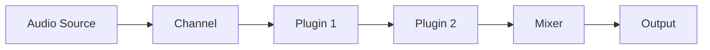

# Beginner Foundation: Audio Plugins
## 1. Everyday Intuition & First Principles
Imagine you're in a kitchen, and you have a basic recipe for making a cake. Now, think of audio plugins as special tools in your kitchen that can change how your cake tastes. Just like you can use a mixer to blend ingredients or a whisk to create airiness, audio plugins allow you to manipulate and enhance your audio in various ways. Whether you want to make your music sound brighter, richer, or more dynamic, audio plugins are the tools that help you achieve that.

## 2. Foundational Vocabulary & Glossary
- **Plugin:** A software tool that adds specific functionality to your audio production software. Think of it as a special kitchen gadget.
- **Effect:** A type of plugin that alters the sound of an audio signal. For example, reverb adds space and echo to a sound.
- **Instrument:** A type of plugin that generates sound, like a virtual synthesizer or drum machine.
- **Host:** The main software application (e.g., Ableton Live, FL Studio) that runs the plugins. It's like the kitchen where you use all your tools.
- **Channel:** A path in your host software where audio signals travel. Each channel can have its own set of plugins.
- **Parameter:** A setting within a plugin that you can adjust to change its effect. For example, the decay time in a reverb plugin controls how long the echo lasts.

## 3. Visual System Flow
### ASCII Diagram
```
[Audio Source] --> [Channel] --> [Plugin 1] --> [Plugin 2] --> [Mixer] --> [Output]
```
### Mermaid Flowchart


## 4. Common Beginner Misconceptions & Mental Traps
- **Misconception:** All plugins are necessary for good music. **Trap:** Overusing plugins can clutter your sound and make it muddy. Start with a few essential ones and build from there.
- **Misconception:** Plugins are magic buttons that fix bad recordings. **Trap:** While plugins can enhance your audio, they can't fix poor recording quality. Focus on capturing good sound first.
- **Misconception:** Expensive plugins are always better. **Trap:** Many free plugins offer excellent quality and are just as effective as their paid counterparts. Don't limit yourself based on cost.

## 5. Socratic Discussion Starters
- What are the primary differences between an effect plugin and an instrument plugin?
- How do you think the order of plugins in a channel affects the final sound?
- Can you describe a scenario where you might use a reverb plugin? Why?
- How do you balance using plugins with maintaining the natural quality of your recordings?
- What are some common mistakes beginners make when using plugins, and how can they avoid them?
