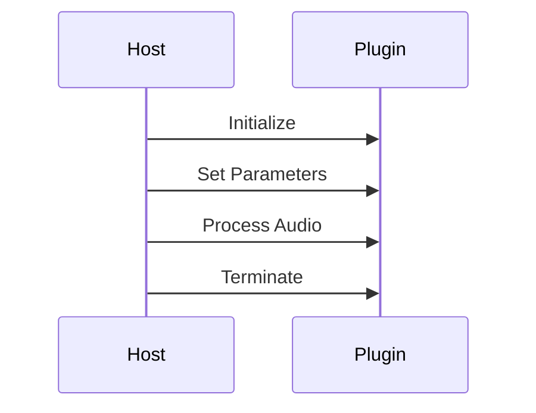

# Intermediate Foundation: Audio Plugins
## 1. Architectural Mental Model

In the realm of audio plugins, understanding the architectural mental model is crucial for mastering the design and implementation of robust audio processing tools. This section assumes a foundational knowledge of audio processing and focuses on the broader architecture of plugin systems.

### Key Concepts:
- **Plugin Types:** VST, AU, AAX, etc.
- **Host Environment:** DAWs (Digital Audio Workstations) like Ableton Live, Logic Pro, Pro Tools, etc.
- **Processing Chain:** The sequence of audio processing stages from input to output.

### Mental Model:
Imagine an audio plugin as a modular component within a larger audio processing system. The host environment (DAW) acts as the orchestrator, managing the lifecycle of plugins, including initialization, processing, and termination. Each plugin is responsible for a specific audio processing task, such as equalization, reverb, or synthesis. The host communicates with plugins through standardized interfaces, ensuring interoperability and seamless integration.

## 2. Systems Taxonomy & Component Protocols

Understanding the taxonomy of audio plugins and the protocols that govern their interaction is essential for designing and implementing effective audio processing tools.

### Standard Interfaces:
- **VST (Virtual Studio Technology):** Developed by Steinberg, VST is one of the most widely used plugin formats. It supports both 32-bit and 64-bit architectures and includes a comprehensive API for plugin development.
- **AU (Audio Unit):** Developed by Apple, AU is a plugin format specifically designed for macOS. It supports both 32-bit and 64-bit architectures and includes a rich set of features for audio processing.
- **AAX (Avid Audio Extensions):** Developed by Avid, AAX is a plugin format specifically designed for Pro Tools. It supports both 32-bit and 64-bit architectures and includes a range of features for audio processing.

### Protocols:
- **MIDI (Musical Instrument Digital Interface):** MIDI is a protocol for controlling musical instruments and other audio equipment. It is commonly used for communication between plugins and host environments.
- **Audio Data Formats:** Common audio data formats include PCM (Pulse Code Modulation), which is used for digital audio, and IEC 61937, which is used for digital audio transmission.

### Data Models:
- **Audio Buffers:** Audio buffers are used to store audio data for processing. They are typically implemented as arrays of floating-point numbers, with each element representing a sample of audio.
- **Parameter Models:** Parameter models are used to store the values of plugin parameters, such as gain, frequency, and Q-factor. They are typically implemented as structures or classes, with each field representing a parameter.

## 3. Multi-Component Interaction Flow

Understanding the interaction flow between plugins and host environments is essential for designing and implementing effective audio processing systems.

### ASCII Sequence Diagram:
```
Host Environment -> Plugin: Initialize
Host Environment -> Plugin: Set Parameters
Host Environment -> Plugin: Process Audio
Host Environment -> Plugin: Terminate
```

### Mermaid Sequence Diagram:


## 4. Architectural Trade-offs & Production Pitfalls

Designing and implementing audio plugins involves a range of architectural trade-offs and potential pitfalls. Understanding these trade-offs and pitfalls is essential for designing and implementing effective audio processing tools.

### Trade-offs:
- **Performance vs. Quality:** High-quality audio processing often requires more computational resources, which can impact performance. Designers must balance performance and quality to meet the needs of their target audience.
- **Interoperability vs. Customization:** Standardized interfaces and protocols ensure interoperability between plugins and host environments, but they can also limit customization. Designers must balance interoperability and customization to meet the needs of their target audience.

### Pitfalls:
- **Memory Leaks:** Memory leaks can occur when plugins fail to release memory that is no longer needed. This can lead to performance degradation and system instability.
- **Latency:** Latency can occur when plugins introduce delays in audio processing. This can impact the responsiveness of the host environment and the overall user experience.
- **Crashes:** Crashes can occur when plugins fail to handle errors gracefully. This can lead to system instability and data loss.

## 5. Socratic Discussion Starters

Socratic discussion starters are questions that encourage critical thinking and deep understanding of audio plugin architecture.

### Questions:
- How do the different plugin formats (VST, AU, AAX) impact the design and implementation of audio plugins?
- How do the different audio data formats (PCM, IEC 61937) impact the design and implementation of audio plugins?
- How do the different parameter models impact the design and implementation of audio plugins?
- How do the different interaction flows impact the design and implementation of audio plugins?
- How do the different architectural trade-offs impact the design and implementation of audio plugins?
- How do the different production pitfalls impact the design and implementation of audio plugins?
