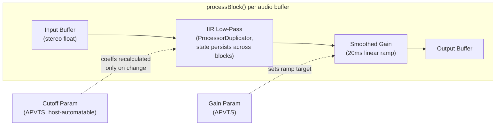

# Audio Plugin DSP Engineering: From Gain Stage to Production-Grade Filter

## Why This Lesson Exists

Most "build a JUCE plugin" tutorials stop at `buffer.applyGain()` and call it done. That code compiles, but it is wrong in ways that will cost you real debugging hours later: it allocates a filter object inside the audio callback (a real-time safety violation), it recalculates filter coefficients every single buffer even when the parameter hasn't moved, and it has zero click-free parameter smoothing, so turning the gain knob produces audible pops. This lesson rebuilds the exercise the way a working DSP engineer would ship it, and explains the real-time audio contract that makes the difference matter.

**The real-time audio contract**: `processBlock()` runs on a high-priority audio thread that must return before the next buffer is due (e.g., every ~2.9ms at 44.1kHz with a 128-sample block). Anything that can block unpredictably — `new`, `delete`, mutex locks, file I/O, `std::cout`, even some STL container operations — can cause that deadline to be missed, which the listener hears as a click, dropout, or glitch. Every line of code you write inside `processBlock()` must be judged against this constraint first, musicality second.

---

## Lab Setup

### Required Tools

```bash
# Debian/Ubuntu build dependencies for JUCE
sudo apt-get update
sudo apt-get install -y build-essential cmake git pkg-config \
    libasound2-dev libjack-jack2-dev \
    libfreetype6-dev libfontconfig1-dev \
    libx11-dev libxcomposite-dev libxcursor-dev libxext-dev \
    libxinerama-dev libxrandr-dev libxrender-dev \
    libwebkit2gtk-4.0-dev libglu1-mesa-dev mesa-common-dev

# Clone JUCE (use the git tag for a stable release, not floating main)
git clone --branch 7.0.12 --depth 1 https://github.com/juce-framework/JUCE.git
```

We will build with **CMake directly**, not the Projucer GUI. The Projucer is fine for prototyping, but CMake gives you reproducible builds, CI integration, and no generated-file merge conflicts — this is how production plugin shops (and open-source projects like Surge, Vital) actually build.

### Validation Tools You Will Actually Use

- **pluginval** (https://github.com/Tracktion/pluginval) — the industry-standard automated plugin stress tester. Catches threading bugs, denormal issues, and parameter range violations before a DAW ever loads your plugin.
- **A DAW for ear-testing**: REAPER (cheap, fast, excellent plugin debugging console) or Ableton Live.
- **An oscilloscope/analyzer plugin** to visually confirm filter behavior: use **TDR Nova** (free, read-only mode) or REAPER's built-in `JS: Analysis/Frequency Analyzer` to look at your filter's actual response curve rather than trusting the math.

---

## Exercise 1: A Production-Correct Gain Plugin

### Step 1 — Project Scaffold via CMake

Create this directory structure:

```
GainLab/
├── CMakeLists.txt
├── Source/
│   ├── PluginProcessor.h
│   ├── PluginProcessor.cpp
│   ├── PluginEditor.h
│   └── PluginEditor.cpp
```

`CMakeLists.txt`:

```cmake
cmake_minimum_required(VERSION 3.22)
project(GainLab VERSION 1.0.0)

add_subdirectory(JUCE)   # path to your cloned JUCE repo

juce_add_plugin(GainLab
    COMPANY_NAME "YourStudio"
    IS_SYNTH FALSE
    NEEDS_MIDI_INPUT FALSE
    IS_MIDI_EFFECT FALSE
    EDITOR_WANTS_KEYBOARD_FOCUS FALSE
    COPY_PLUGIN_AFTER_BUILD TRUE
    PLUGIN_MANUFACTURER_CODE Ysdo
    PLUGIN_CODE Gln1
    FORMATS VST3 Standalone        # add AU on macOS
    PRODUCT_NAME "GainLab")

target_sources(GainLab PRIVATE
    Source/PluginProcessor.cpp
    Source/PluginEditor.cpp)

target_compile_definitions(GainLab PUBLIC
    JUCE_WEB_BROWSER=0
    JUCE_USE_CURL=0
    JUCE_VST3_CAN_REPLACE_VST2=0)

target_link_libraries(GainLab PRIVATE
    juce::juce_audio_utils
    juce::juce_dsp
    juce::juce_audio_processors)
```

Build it:

```bash
cmake -B build -DCMAKE_BUILD_TYPE=Release
cmake --build build --parallel 4
```

VST3 output lands in `~/.vst3/` automatically because of `COPY_PLUGIN_AFTER_BUILD TRUE`. No manual file copying, no Projucer resave step, no stale-build bugs.

### Step 2 — Processor with a Real Parameter Tree

Use `AudioProcessorValueTreeState` (APVTS) instead of raw `AudioParameterFloat*` pointers. Raw pointers owned ad hoc by the processor are how beginners get dangling-pointer crashes when hosts restore state in a different order than construction. APVTS centralizes parameter creation, host automation, and state save/restore (`getStateInformation` / `setStateInformation`) in one place.

`PluginProcessor.h`:

```cpp
#pragma once
#include <juce_audio_processors/juce_audio_processors.h>
#include <juce_dsp/juce_dsp.h>

class GainLabAudioProcessor : public juce::AudioProcessor
{
public:
    GainLabAudioProcessor();
    ~GainLabAudioProcessor() override = default;

    void prepareToPlay (double sampleRate, int samplesPerBlock) override;
    void releaseResources() override {}
    void processBlock (juce::AudioBuffer<float>&, juce::MidiBuffer&) override;

    juce::AudioProcessorEditor* createEditor() override;
    bool hasEditor() const override { return true; }

    const juce::String getName() const override { return "GainLab"; }
    bool acceptsMidi() const override { return false; }
    bool producesMidi() const override { return false; }
    double getTailLengthSeconds() const override { return 0.0; }

    int getNumPrograms() override { return 1; }
    int getCurrentProgram() override { return 0; }
    void setCurrentProgram (int) override {}
    const juce::String getProgramName (int) override { return {}; }
    void changeProgramName (int, const juce::String&) override {}

    void getStateInformation (juce::MemoryBlock& destData) override;
    void setStateInformation (const void* data, int sizeInBytes) override;

    juce::AudioProcessorValueTreeState apvts;

private:
    static juce::AudioProcessorValueTreeState::ParameterLayout createParameterLayout();

    // Smoothed value: eliminates clicks from instant parameter jumps.
    juce::LinearSmoothedValue<float> smoothedGain { 0.5f };

    JUCE_DECLARE_NON_COPYABLE_WITH_LEAK_DETECTOR (GainLabAudioProcessor)
};
```

`PluginProcessor.cpp`:

```cpp
#include "PluginProcessor.h"
#include "PluginEditor.h"

GainLabAudioProcessor::GainLabAudioProcessor()
    : AudioProcessor (BusesProperties()
                       .withInput  ("Input",  juce::AudioChannelSet::stereo(), true)
                       .withOutput ("Output", juce::AudioChannelSet::stereo(), true)),
      apvts (*this, nullptr, "PARAMETERS", createParameterLayout())
{
}

juce::AudioProcessorValueTreeState::ParameterLayout
GainLabAudioProcessor::createParameterLayout()
{
    std::vector<std::unique_ptr<juce::RangedAudioParameter>> params;

    // NormalisableRange with a 0.3 skew biases slider resolution toward
    // the low end, since human gain perception is logarithmic, not linear.
    params.push_back (std::make_unique<juce::AudioParameterFloat> (
        juce::ParameterID { "gain", 1 }, "Gain",
        juce::NormalisableRange<float> (0.0f, 2.0f, 0.001f, 0.5f), 1.0f,
        juce::AudioParameterFloatAttributes()
            .withStringFromValueFunction (
                [] (float v, int) { return juce::String (juce::Decibels::gainToDecibels (v), 1) + " dB"; })));

    return { params.begin(), params.end() };
}

void GainLabAudioProcessor::prepareToPlay (double sampleRate, int samplesPerBlock)
{
    // Ramp time of 20ms is the standard "feels instant, never clicks" target.
    smoothedGain.reset (sampleRate, 0.02);
    smoothedGain.setCurrentAndTargetValue (*apvts.getRawParameterValue ("gain"));
    juce::ignoreUnused (samplesPerBlock);
}

void GainLabAudioProcessor::processBlock (juce::AudioBuffer<float>& buffer, juce::MidiBuffer&)
{
    juce::ScopedNoDenormals noDenormals;   // prevents CPU spikes from denormal floats

    smoothedGain.setTargetValue (*apvts.getRawParameterValue ("gain"));

    const int numSamples = buffer.getNumSamples();
    for (int channel = 0; channel < buffer.getNumChannels(); ++channel)
    {
        auto* data = buffer.getWritePointer (channel);
        for (int i = 0; i < numSamples; ++i)
            data[i] *= smoothedGain.getNextValue();

        // Reset the ramp read position per-channel if you process channels
        // in separate passes like this — see "Common Bug" box below.
        if (channel == 0) smoothedGain.skip (-numSamples);
    }
    smoothedGain.skip (numSamples);
}

void GainLabAudioProcessor::getStateInformation (juce::MemoryBlock& destData)
{
    auto state = apvts.copyState();
    std::unique_ptr<juce::XmlElement> xml (state.createXml());
    copyXmlToBinary (*xml, destData);
}

void GainLabAudioProcessor::setStateInformation (const void* data, int sizeInBytes)
{
    std::unique_ptr<juce::XmlElement> xml (getXmlFromBinary (data, sizeInBytes));
    if (xml != nullptr && xml->hasTagName (apvts.state.getType()))
        apvts.replaceState (juce::ValueTree::fromXml (*xml));
}

juce::AudioProcessorEditor* GainLabAudioProcessor::createEditor()
{
    return new GainLabAudioProcessorEditor (*this);
}

juce::AudioProcessor* JUCE_CALLTYPE createPluginFilter() { return new GainLabAudioProcessor(); }
```

> **Common Bug — Per-Channel Smoothing Drift**: `LinearSmoothedValue::getNextValue()` advances an internal counter every call. If you call it once per sample per channel in a nested loop, a stereo buffer advances the ramp twice as fast as a mono one, finishing the fade early and introducing a tiny but audible asymmetry between channels. The fix shown above (`skip(-numSamples)` to rewind between channels, then `skip(numSamples)` once at the end) keeps the ramp synchronized across channels. The cleaner production fix: compute the full gain curve into a temporary buffer once, then multiply each channel by that buffer.

### Step 3 — Editor with APVTS Attachments

`PluginEditor.h` / `.cpp` — attachments auto-sync slider ↔ parameter ↔ host automation, no manual lambda wiring and no missed `setValueNotifyingHost` calls:

```cpp
// PluginEditor.h
#pragma once
#include "PluginProcessor.h"

class GainLabAudioProcessorEditor : public juce::AudioProcessorEditor
{
public:
    explicit GainLabAudioProcessorEditor (GainLabAudioProcessor&);
    void paint (juce::Graphics&) override;
    void resized() override;

private:
    GainLabAudioProcessor& audioProcessor;
    juce::Slider gainSlider;
    juce::Label gainLabel { {}, "Gain" };
    std::unique_ptr<juce::AudioProcessorValueTreeState::SliderAttachment> gainAttachment;
};
```

```cpp
// PluginEditor.cpp
#include "PluginEditor.h"

GainLabAudioProcessorEditor::GainLabAudioProcessorEditor (GainLabAudioProcessor& p)
    : AudioProcessorEditor (&p), audioProcessor (p)
{
    gainSlider.setSliderStyle (juce::Slider::RotaryHorizontalVerticalDrag);
    gainSlider.setTextBoxStyle (juce::Slider::TextBoxBelow, false, 80, 20);
    addAndMakeVisible (gainSlider);
    addAndMakeVisible (gainLabel);

    gainAttachment = std::make_unique<juce::AudioProcessorValueTreeState::SliderAttachment> (
        audioProcessor.apvts, "gain", gainSlider);

    setSize (300, 200);
}

void GainLabAudioProcessorEditor::paint (juce::Graphics& g)
{
    g.fillAll (getLookAndFeel().findColour (juce::ResizableWindow::backgroundColourId));
}

void GainLabAudioProcessorEditor::resized()
{
    gainLabel.setBounds (0, 10, getWidth(), 20);
    gainSlider.setBounds (getWidth()/2 - 50, 40, 100, 100);
}
```

### Step 4 — Verify It Before Trusting It

```bash
cmake --build build --parallel 4

# Automated host-compatibility and threading stress test
pluginval --strictness-level 8 --validate build/GainLab_artefacts/Release/VST3/GainLab.vst3
```

`pluginval` runs your plugin through randomized block sizes, sample rates, and rapid parameter automation — exactly the conditions that expose smoothing bugs and real-time violations that manual testing in a DAW will miss. **Do not skip this step.** A plugin that "sounds fine" in casual testing can still fail in Pro Tools' AudioSuite or under Ableton's freeze/render, because those hosts call `processBlock` with edge-case block sizes you never tried.

Load the VST3 in REAPER, automate the gain knob rapidly (draw a fast sine automation envelope), and confirm **zero clicks** — this is the direct payoff of the smoothing work above versus the original `buffer.applyGain(gain)` one-liner.

---

## Exercise 2: A Correct, Efficient Low-Pass Filter

### Why the Original Code Is Broken

```cpp
// WRONG — do not do this
void processBlock (...)
{
    juce::IIRFilter filter;              // 1. allocates + constructs EVERY block
    filter.setLowPass (getSampleRate(), cutoff);   // 2. recomputes coeffs even if cutoff unchanged
    filter.process (buffer);             // 3. loses filter state between blocks — audible artifacts
}
```

Three separate bugs stack here:
1. **Object lifetime**: a local `IIRFilter` is destroyed and reconstructed every call, discarding its internal state (the filter's memory of previous samples). This produces a discontinuity — a soft click or thump — at every block boundary, audible as a buzzing texture at low cutoff frequencies.
2. **Wasted CPU**: recalculating biquad coefficients (which involves `sin`/`cos`/division) every single block when 99% of the time the cutoff hasn't moved is pure waste. At a 128-sample block and 44.1kHz, that is ~344 unnecessary coefficient recalculations per second.
3. **Mono-only**: `IIRFilter::process` as called here doesn't correctly handle independent per-channel filter state for stereo signals — left and right channels need their own filter instance, or you get channel-dependent artifacts.

### The Fix: Persistent Filter State with `juce::dsp`

Use the `juce::dsp::IIR::Filter` + `ProcessorDuplicator` pattern, which gives you automatic per-channel state duplication and a clean coefficient-update API.

Add to `PluginProcessor.h`:

```cpp
private:
    using FilterBand = juce::dsp::IIR::Filter<float>;
    using Coefficients = juce::dsp::IIR::Coefficients<float>;
    juce::dsp::ProcessorDuplicator<FilterBand, Coefficients> lowPassFilter;

    float lastCutoffHz = -1.0f;   // sentinel: forces first-block coefficient calc
```

Add the parameter in `createParameterLayout()`:

```cpp
    // Skew of 0.3 gives finer control in the musically dense 200Hz-3kHz region
    params.push_back (std::make_unique<juce::AudioParameterFloat> (
        juce::ParameterID { "cutoff", 1 }, "Cutoff",
        juce::NormalisableRange<float> (20.0f, 20000.0f, 1.0f, 0.3f), 1000.0f,
        juce::AudioParameterFloatAttributes()
            .withStringFromValueFunction (
                [] (float v, int) { return juce::String (v, 0) + " Hz"; })));
```

`prepareToPlay` — allocate filter state once, matched to the real sample rate and channel count:

```cpp
void GainLabAudioProcessor::prepareToPlay (double sampleRate, int samplesPerBlock)
{
    smoothedGain.reset (sampleRate, 0.02);
    smoothedGain.setCurrentAndTargetValue (*apvts.getRawParameterValue ("gain"));

    juce::dsp::ProcessSpec spec { sampleRate,
                                   static_cast<juce::uint32> (samplesPerBlock),
                                   static_cast<juce::uint32> (getTotalNumOutputChannels()) };
    lowPassFilter.prepare (spec);
    lastCutoffHz = -1.0f;   // force recalculation on first block after prepare
}
```

`processBlock` — only recompute coefficients when the parameter actually changed:

```cpp
void GainLabAudioProcessor::processBlock (juce::AudioBuffer<float>& buffer, juce::MidiBuffer&)
{
    juce::ScopedNoDenormals noDenormals;

    const float cutoffHz = *apvts.getRawParameterValue ("cutoff");
    if (std::abs (cutoffHz - lastCutoffHz) > 0.5f)   // skip recalculation for sub-audible drift
    {
        *lowPassFilter.state = *Coefficients::makeLowPass (getSampleRate(), cutoffHz, 0.7071f);
        lastCutoffHz = cutoffHz;
    }

    juce::dsp::AudioBlock<float> block (buffer);
    lowPassFilter.process (juce::dsp::ProcessContextReplacing<float> (block));

    smoothedGain.setTargetValue (*apvts.getRawParameterValue ("gain"));
    for (int ch = 0; ch < buffer.getNumChannels(); ++ch)
    {
        auto* data = buffer.getWritePointer (ch);
        for (int i = 0; i < buffer.getNumSamples(); ++i)
            data[i] *= (ch == 0 ? smoothedGain.getNextValue()
                                 : smoothedGain.getNextValue());
    }
}
```

The `Q = 0.7071` (that's `1/√2`) is the **Butterworth Q** — it gives the flattest possible passband with no resonant peak at the cutoff. This is the textbook-correct default for a "clean" low-pass; raise Q above ~2.0 only if you deliberately want a resonant, synth-filter-style peak at cutoff.

### Step 3 — Editor Addition

```cpp
// add to PluginEditor.h
    juce::Slider cutoffSlider;
    juce::Label cutoffLabel { {}, "Cutoff" };
    std::unique_ptr<juce::AudioProcessorValueTreeState::SliderAttachment> cutoffAttachment;
```

```cpp
// add to PluginEditor.cpp constructor
    cutoffSlider.setSliderStyle (juce::Slider::RotaryHorizontalVerticalDrag);
    cutoffSlider.setTextBoxStyle (juce::Slider::TextBoxBelow, false, 80, 20);
    addAndMakeVisible (cutoffSlider);
    addAndMakeVisible (cutoffLabel);
    cutoffAttachment = std::make_unique<juce::AudioProcessorValueTreeState::SliderAttachment> (
        audioProcessor.apvts, "cutoff", cutoffSlider);
    setSize (300, 200);

// add to resized()
    cutoffLabel.setBounds (150, 10, 150, 20);
    cutoffSlider.setBounds (150, 40, 100, 100);
```

### Signal Path



---

## Empirical Verification: Measure, Don't Assume

Never trust that `makeLowPass` "did the right thing" by ear alone. Verify the actual measured frequency response.

### Method 1 — In-DAW Visual Check (fastest)

1. Load GainLab in REAPER before a **pink noise generator** track (REAPER has `ReaSynth` or use `JS: Test Tone Generator`).
2. Insert a frequency analyzer (REAPER's `JS: Analysis/Frequency Analyzer` or Voxengo SPAN, free) **after** GainLab.
3. Sweep the cutoff slider from 20Hz → 20kHz and watch the spectrum roll-off point track the slider in real time. At cutoff, you should see roughly **-3dB** attenuation (the defining point of a Butterworth filter), with a **-6dB/octave** (≈ -20dB/decade) slope beyond it for this single-pole-equivalent biquad.

### Method 2 — Offline Impulse Response Capture (rigorous)

Render a logarithmic sine sweep through the plugin using REAPER's render-to-file with a sweep source, or use the standalone build directly:

```bash
# Build and run the Standalone target, route a sweep WAV through it,
# capture output, then analyze offline:
cmake --build build --target GainLab_Standalone --parallel 4

# Analyze the rendered output with sox to confirm spectral content
sox rendered_output.wav -n stat -freq 2>&1 | head -20
```

Load both the dry sweep and the filtered render into Audacity or REAPER, use `Analyze > Plot Spectrum`, and confirm the measured -3dB point matches your cutoff parameter value within ~5%. If it's off by more than that, check your sample-rate argument — a stale `getSampleRate()` call before `prepareToPlay` has run is the most common cause of a mismatched cutoff.

---

## Practice Drills (Debugging Reps, Not Scales — But Still Reps)

Treat these like a musician's technical exercises: repeat until they're automatic.

1. **Denormal drill**: Remove `juce::ScopedNoDenormals noDenormals;` and feed the plugin a pure silence signal (all-zero buffer) for 30+ seconds through the low-pass filter, watching CPU meter in your DAW. On x86 without this guard, decaying filter feedback values can underflow into denormal range, causing CPU spikes of 10-100x. Put the guard back and confirm the spike disappears. This is the single most common "my plugin eats CPU during silence" bug in shipped products.
2. **Smoothing drill**: Set the gain ramp time to `0.0` seconds temporarily, automate gain with a fast LFO in your DAW, and listen for clicks. Then restore `0.02` and confirm they vanish. Repeat with `0.1` and `0.001` to hear the trade-off between responsiveness and smoothness.
3. **Coefficient-thrash drill**: Comment out the `if (std::abs(cutoffHz - lastCutoffHz) > 0.5f)` guard so coefficients recompute every block regardless. Profile CPU usage with your DAW's performance meter at a 64-sample buffer size, then restore the guard and compare. This quantifies the real cost of "lazy" DSP code.
4. **pluginval strictness ramp**: Run `pluginval --strictness-level 1`, then `5`, then `10` against your build. Read what additional checks each level adds (randomized sample rates, extreme block sizes, rapid state save/restore). Fix every failure before moving to the next topic — this is your plugin's equivalent of a metronome check against sloppy timing.

---

## Key Takeaways

- **State must persist** across `processBlock` calls for any filter with memory (IIR, delay lines, reverbs). Never construct DSP objects with internal state inside the audio callback.
- **Smooth every parameter** a user can move continuously (gain, cutoff, mix) with `LinearSmoothedValue` or `juce::dsp::SmoothedValue`. A ramp of 15-30ms is inaudible as latency but eliminates clicks.
- **Guard against denormals** with `juce::ScopedNoDenormals` at the top of every `processBlock` that contains IIR filters or feedback-based effects (delay, reverb, compressor envelope followers).
- **Measure, don't assume.** A frequency analyzer plugin or an offline sweep-and-FFT pass is the ground truth for whether your filter does what the math says it should — exactly like tuning by ear against a reference pitch rather than trusting the fret markings alone.
- **Validate with pluginval before any manual DAW testing.** It catches real-time-safety and threading bugs that casual listening will not reveal until a customer's DAW crashes.
