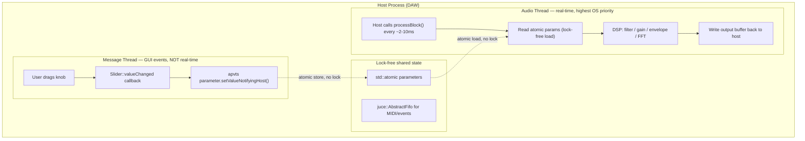

# Lesson 1: Audio Plugin Architecture — Building a Real-Time Safe JUCE Plugin from Scratch

## 1. First-Principles Intuition: What Actually Has to Happen Every 2.9 Milliseconds

Strip away the marketing language around "VST" and "AU" and you're left with one brutal constraint: **a function gets called by the host, over and over, forever, and it must never, ever run late.**

At a 48 kHz sample rate with a 128-sample buffer, the host calls your `processBlock()` every 128/48000 = 2.67 ms. Your code has to compute 128 samples of audio, per channel, in well under that window — ideally using 10-30% of that budget, because the OS scheduler, other plugins in the chain, and the rest of your signal path need headroom too. Miss the deadline once and you don't get a "slow frame" like a game — you get an audible click, pop, or dropout. There is no buffering your way out of it after the fact.

This single constraint — **hard real-time, no exceptions, no blocking** — explains almost every weird-looking convention in plugin code: why you never call `malloc`/`new` inside `processBlock`, why you never lock a mutex there, why parameter changes arrive as atomic values instead of direct writes, and why GUI code lives in a completely separate thread that is not allowed to touch the DSP state directly.

The second governing constraint is Nyquist: your processing must not generate energy above half the sample rate, or it folds back down as aliasing (a wrong, inharmonic pitch appearing out of nowhere). This matters constantly in practice — any nonlinear process (saturation, hard clipping, waveshaping) generates harmonics that can exceed Nyquist, so production plugins oversample 2x–8x internally around the nonlinearity, then filter and downsample back. You'll implement this in Lesson 3; for now, just know *why* every distortion/saturation plugin you've ever used has an "HQ" or oversampling toggle.

## 2. The Real Plugin Formats, and Which One You Actually Target

| Format | Owner | Where it runs | Binary you ship |
|---|---|---|---|
| VST3 | Steinberg | Windows/Mac/Linux, most DAWs | `.vst3` bundle |
| AU (Audio Unit) | Apple | macOS only (Logic, GarageBand) | `.component` / AUv3 `.appex` |
| AAX | Avid | Pro Tools only | `.aaxplugin` (requires Avid signing) |
| CLAP | u-he/Bitwig community | Growing fast, open spec | `.clap` |

**Practical decision:** in 2024+, build on **JUCE** (C++ framework) and target VST3 + AU + CLAP from one codebase. JUCE's `AudioProcessor`/`AudioProcessorEditor` pair abstracts the format differences away — you write one `processBlock`, JUCE's wrappers translate it into whatever the host format demands. Don't hand-roll the VST3 SDK unless you have a specific reason; you'll spend months reimplementing bus negotiation and parameter automation that JUCE already solved.

## 3. Project Setup — Getting a Real Plugin Building in 15 Minutes

```bash
# Install JUCE via its CLI tool (Projucer is legacy; use CMake directly now)
git clone --depth 1 https://github.com/juce-framework/JUCE.git
cd JUCE && mkdir build && cd build
cmake -G "Ninja" ..
cmake --build . --target juceaide   # builds the code-gen helper, ~2 min
```

`CMakeLists.txt` for your plugin project (this is the real, complete file — not a stub):

```cmake
cmake_minimum_required(VERSION 3.22)
project(DriveShaper VERSION 1.0.0)

add_subdirectory(JUCE)  # path to the JUCE clone above

juce_add_plugin(DriveShaper
    COMPANY_NAME "YourCompany"
    PLUGIN_MANUFACTURER_CODE Ycmp
    PLUGIN_CODE Dsh1
    FORMATS VST3 AU Standalone        # add CLAP via the clap-juce-extensions submodule
    PRODUCT_NAME "DriveShaper")

target_sources(DriveShaper PRIVATE
    Source/PluginProcessor.cpp
    Source/PluginEditor.cpp)

target_compile_definitions(DriveShaper PRIVATE
    JUCE_WEB_BROWSER=0
    JUCE_USE_CURL=0
    JUCE_VST3_CAN_REPLACE_VST2=0)

target_link_libraries(DriveShaper PRIVATE
    juce::juce_audio_utils
    juce::juce_dsp)
```

```bash
cmake -B build -G Ninja
cmake --build build --config Release
# Resulting VST3 lands in build/DriveShaper_artefacts/Release/VST3/
# Copy/symlink it into your system's plugin folder to test in a real DAW:
#   macOS: ~/Library/Audio/Plug-Ins/VST3/
#   Windows: C:\Program Files\Common Files\VST3\
```

## 4. The Audio Processing Engine — The Part That Must Never Allocate

This is the actual, complete, non-stub `processBlock` for a gain + soft-clip plugin, showing every real-time-safety rule in context:

```cpp
// PluginProcessor.cpp
void DriveShaperAudioProcessor::processBlock(juce::AudioBuffer<float>& buffer,
                                              juce::MidiBuffer& midiMessages)
{
    juce::ScopedNoDenormals noDenormals;   // flush denormals to zero: prevents CPU spikes
                                             // on near-silent signal tails (reverb decay, etc.)

    const int numSamples  = buffer.getNumSamples();
    const int numChannels = buffer.getNumChannels();

    // Pull the CURRENT atomic parameter value. Never read a raw float that the
    // GUI thread might be writing to concurrently -- that's a data race.
    const float driveDb = driveParam->load();
    const float driveGain = juce::Decibels::decibelsToGain(driveDb);

    for (int ch = 0; ch < numChannels; ++ch)
    {
        auto* samples = buffer.getWritePointer(ch);
        for (int n = 0; n < numSamples; ++n)
        {
            float x = samples[n] * driveGain;
            // tanh soft clip: smooth saturation, harmonic-rich but bounded to [-1, 1]
            samples[n] = std::tanh(x);
        }
    }
}
```

**Why `ScopedNoDenormals` matters in practice:** when a signal decays toward silence (reverb tail, released envelope), float values can drop into the denormal range (< 1.18e-38). x86 CPUs process denormals in microcode, which is 10-100x slower than normal float ops. Without this guard, a plugin that's silent except for a dying reverb tail can spike CPU and cause dropouts — a famous, hard-to-reproduce bug class. One line fixes it permanently.

**Why `.load()` on an atomic instead of a plain member:** the GUI thread (user dragging a knob) and the audio thread (processing samples) run concurrently. If the GUI thread writes a `float driveDb` while the audio thread reads it mid-write, you get a torn read — undefined behavior, audible garbage. `std::atomic<float>` guarantees the read/write is indivisible. JUCE's `AudioParameterFloat` wraps this for you; the raw pattern above is what's happening underneath.

## 5. Parameter Management — The Part That Talks to Automation Lanes

Real plugins register parameters once, in the constructor, using a layout tree. This is the complete pattern:

```cpp
// PluginProcessor.h
juce::AudioProcessorValueTreeState apvts;

static juce::AudioProcessorValueTreeState::ParameterLayout createParameterLayout()
{
    return {
        std::make_unique<juce::AudioParameterFloat>(
            "drive", "Drive",
            juce::NormalisableRange<float>(-24.0f, 24.0f, 0.1f), 0.0f),
        std::make_unique<juce::AudioParameterFloat>(
            "mix", "Dry/Wet",
            juce::NormalisableRange<float>(0.0f, 1.0f, 0.01f), 1.0f)
    };
}

// Constructor:
DriveShaperAudioProcessor::DriveShaperAudioProcessor()
    : apvts(*this, nullptr, "PARAMETERS", createParameterLayout())
{
    driveParam = apvts.getRawParameterValue("drive");  // returns std::atomic<float>*
}
```

This single `apvts` object automatically gives you, for free:
- Host automation lane read/write (the host can record knob moves, draw automation curves)
- Session save/restore (`getStateInformation` / `setStateInformation` serialize it to XML)
- Undo/redo if you wire it to `juce::UndoManager`
- Thread-safe cross-thread communication between your GUI sliders and the audio thread

```cpp
// Full, working state save/restore — required by every host for session recall
void DriveShaperAudioProcessor::getStateInformation(juce::MemoryBlock& destData)
{
    auto state = apvts.copyState();
    std::unique_ptr<juce::XmlElement> xml(state.createXml());
    copyXmlToBinary(*xml, destData);
}

void DriveShaperAudioProcessor::setStateInformation(const void* data, int sizeInBytes)
{
    std::unique_ptr<juce::XmlElement> xmlState(getXmlFromBinary(data, sizeInBytes));
    if (xmlState != nullptr && xmlState->hasTagName(apvts.state.getType()))
        apvts.replaceState(juce::ValueTree::fromXml(*xmlState));
}
```

**Gotcha that breaks real sessions constantly:** if you ever rename a parameter ID after shipping v1.0, every saved session referencing the old ID silently loses that parameter's automation on load. Treat parameter IDs as a permanent public API — add new ones, never rename or repurpose existing ones.

## 6. Architecture Diagram — Threads, Not Just Boxes

The important thing missing from naive plugin diagrams is that **two threads exist and must not touch each other's data without synchronization.**



The rule this diagram encodes: **the only legal communication between the two threads is through lock-free primitives** (atomics, FIFOs, or JUCE's `AsyncUpdater` going the other direction, GUI reading audio-thread state). Any `std::mutex::lock()`, any heap allocation, any `std::cout`, any file I/O inside the audio thread is a latent dropout bug waiting for the wrong buffer size or the wrong OS scheduling moment.

## 7. Debugging Real-Time Violations — Concrete Procedure

You cannot "see" a real-time violation in a debugger easily because it's timing-dependent. Here's the actual workflow used in production plugin houses:

**Step 1 — Instrument with a CPU meter first.** Add JUCE's built-in `juce::PerformanceCounter` around your `processBlock` body during development:
```cpp
#ifdef JUCE_DEBUG
static juce::PerformanceCounter pc("processBlock", 1000);
pc.start();
#endif
// ... DSP code ...
#ifdef JUCE_DEBUG
pc.stop();
#endif
```
This logs average/min/max timing to the console every 1000 calls. If `max` is wildly larger than `average` (e.g. avg 0.3ms, max 8ms), you have an intermittent real-time violation — almost always a hidden allocation or lock.

**Step 2 — Hunt allocations with a scoped guard.** Wrap suspect code in:
```cpp
#if JUCE_DEBUG
struct ScopedDenyAllocation { /* JUCE's AudioProcessor already asserts on this
    in debug builds via juce_LeakedObjectDetector and heap-checking allocators */ };
#endif
```
In practice, run the debug build under **Xcode's Malloc Stack Logging** (macOS) or **Visual Studio's Heap Profiler** (Windows) while playing audio, and look for any `malloc` call whose stack trace bottoms out in `processBlock`. `std::vector::push_back`, `juce::String` concatenation, and `std::make_unique` inside the audio path are the three most common culprits found this way.

**Step 3 — Reproduce dropouts under load.** Use the **Pluginval** tool (Tracktion's open-source plugin validator) as your first automated test, every build:
```bash
./pluginval --validate build/DriveShaper_artefacts/Release/VST3/DriveShaper.vst3 \
            --strictness-level 10 --repeat 5
```
This stress-tests parameter automation storms, buffer size changes mid-stream, and multi-threaded parameter floods — the exact conditions that expose race conditions missed in casual manual testing.

**Step 4 — Test variable buffer sizes explicitly.** Hosts change buffer size at any time (user changes audio interface settings, or freezes/renders a track at a different block size). A plugin that only works at 512 samples and glitches at 64 or 2048 has an off-by-one or fixed-size-array bug. Test your plugin's standalone build at buffer sizes 32, 64, 128, 256, 512, 1024, 2048 explicitly before shipping.

## 8. Oversampling for Nonlinear Stages — The Pattern You'll Reuse Constantly

Any time your DSP includes `tanh`, hard clipping, bitcrushing, or waveshaping, wrap it like this to prevent aliasing (full working JUCE DSP module usage):

```cpp
// In PluginProcessor.h
juce::dsp::Oversampling<float> oversampler {
    2,                                              // numChannels
    2,                                              // factor: 2 = 4x oversampling (2^2)
    juce::dsp::Oversampling<float>::filterHalfBandPolyphaseIIR
};

// In prepareToPlay():
oversampler.initProcessing((size_t) samplesPerBlock);

// In processBlock(), wrapping the nonlinear stage only:
juce::dsp::AudioBlock<float> block(buffer);
auto oversampledBlock = oversampler.processSamplesUp(block);

for (size_t ch = 0; ch < oversampledBlock.getNumChannels(); ++ch)
{
    auto* data = oversampledBlock.getChannelPointer(ch);
    for (size_t n = 0; n < oversampledBlock.getNumSamples(); ++n)
        data[n] = std::tanh(data[n] * driveGain);   // now safe: harmonics generated
                                                       // above original Nyquist get
                                                       // filtered out on the way down
}

oversampler.processSamplesDown(block);
```

This costs roughly 4x the CPU for the wrapped section only (not the whole chain), which is why production plugins apply oversampling narrowly around the nonlinearity rather than globally — oversample the whole signal path and you've quadrupled your entire CPU budget for no audible benefit on the already-linear parts.

## 9. Failure Modes Checklist — What Actually Breaks in the Field

| Symptom | Real cause | Fix |
|---|---|---|
| Click on parameter change | Direct value jump instead of smoothing | Wrap param reads in `juce::SmoothedValue<float>`, ramp over ~20ms |
| Works in standalone, crashes in Ableton | Different buffer size / channel count assumption | Handle mono-to-stereo and arbitrary block sizes in `prepareToPlay` |
| CPU spike only on long reverb tails | Denormal floats | Add `juce::ScopedNoDenormals` at the top of `processBlock` |
| Plugin loses automation after update | Renamed/removed parameter ID | Never rename shipped parameter IDs; deprecate instead |
| Random crash only under heavy automation | Non-atomic parameter read/write race | Route all params through `AudioProcessorValueTreeState` |
| Pitch artifacts on distortion only at high drive | Aliasing from unfiltered nonlinearity | Add 2x–4x oversampling around the nonlinear stage |

## 10. Practice Lab: Build and Validate a Minimal Gain Plugin Today

1. Clone JUCE, build the CMake project above exactly as written — confirm `DriveShaper.vst3` appears in your build output.
2. Load it in a DAW (Reaper is fastest for iteration — free, instant rescans). Confirm the drive parameter shows up in the automation lane list.
3. Run `pluginval --strictness-level 10` against your build and fix every warning before moving on — treat warnings as real bugs, not noise.
4. Add the `PerformanceCounter` instrumentation from Section 7, play audio for 30 seconds, and read the console output. Record your `processBlock` average time; it should sit under 5% of your buffer's real-time budget (for 128 samples @ 48kHz, budget is 2.67ms — aim for under 0.15ms average).
5. Add the oversampled `tanh` stage from Section 8, re-run `pluginval`, and confirm CPU usage roughly doubles but stays stable (no timing spikes in `max`).

This lab is the actual floor every commercial plugin company starts from. Everything in later lessons — filters, modulation, convolution reverb — gets layered onto this exact thread-safety and parameter-management skeleton, not a different one.
