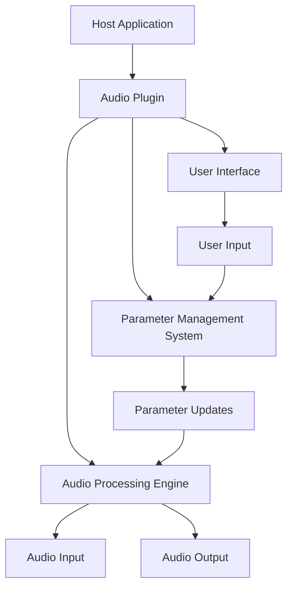

# Lesson 1: Audio Plugin Architecture Overview

## 1. First-Principles Intuition & Invariants

In the realm of digital audio processing, audio plugins serve as the foundational building blocks that enable musicians, producers, and sound engineers to manipulate and enhance audio signals in real-time. These plugins encapsulate a wide array of functionalities, from basic equalization and reverb to complex synthesizers and effect processors. Understanding the architecture of audio plugins requires delving into the underlying principles that govern their operation and the mathematical invariants that ensure their reliability and performance.

At the heart of audio plugin architecture lies digital signal processing (DSP). DSP involves the manipulation of audio signals in the digital domain, leveraging algorithms to perform operations such as filtering, modulation, and synthesis. The digital audio signal is typically represented as a sequence of discrete samples, each corresponding to a specific amplitude at a given point in time. The sampling rate, measured in samples per second (Hz), determines the fidelity of the digital representation and must adhere to the Nyquist-Shannon sampling theorem to avoid aliasing, where high-frequency components are incorrectly represented as lower frequencies.

Audio plugins operate within a host application, such as a digital audio workstation (DAW), which provides the necessary infrastructure for loading, managing, and interacting with the plugins. The host application is responsible for managing the audio signal flow, providing user interfaces, and handling the communication between the plugins and the underlying hardware. The plugin itself is a software module that implements specific audio processing algorithms and interfaces with the host through standardized plugin formats.

The most prevalent plugin formats in the music production industry are Virtual Studio Technology (VST), Audio Unit (AU), and Audio eXchange (AAX). Each of these formats defines a set of conventions and APIs that dictate how plugins are structured, how they communicate with the host, and how they process audio data. Despite their differences, these formats share common architectural principles that facilitate their integration into the broader ecosystem of digital audio processing.

A key invariant in audio plugin architecture is the concept of the audio processing loop. This loop is responsible for continuously processing audio data in real-time, ensuring that the plugin can respond to user inputs and produce output in synchronization with the host application. The audio processing loop typically consists of several stages, including parameter updates, audio input processing, and audio output generation. Each stage is designed to be highly efficient, minimizing latency and maximizing performance.

Another critical invariant is the use of control signals to modulate the behavior of the plugin. Control signals can take many forms, including MIDI messages, automation curves, and user interface interactions. These signals are used to adjust plugin parameters, such as gain, frequency, and modulation depth, in real-time. The ability to respond to control signals is essential for creating dynamic and expressive audio effects.

## 2. Core Architecture & Mechanics

The architecture of an audio plugin is designed to facilitate efficient and reliable audio processing while providing a flexible interface for user interaction. At a high level, an audio plugin consists of several key components, including the audio processing engine, parameter management system, and user interface.

The audio processing engine is the core component of the plugin, responsible for performing the actual audio processing operations. This engine is typically implemented using a combination of DSP algorithms and optimized code to ensure low latency and high performance. The audio processing engine receives audio input from the host, processes it according to the current plugin parameters, and generates audio output that is sent back to the host.

The parameter management system is responsible for handling the plugin's parameters, including their initialization, storage, and updating. Parameters can be of various types, such as floating-point numbers, integers, and booleans, and are used to control the behavior of the audio processing engine. The parameter management system ensures that parameter updates are applied in a thread-safe manner, preventing race conditions and ensuring consistent behavior.

The user interface is the component of the plugin that allows users to interact with the plugin's parameters and control its behavior. The user interface can take many forms, ranging from simple sliders and knobs to complex graphical representations of the plugin's functionality. The user interface is typically implemented using a combination of graphical libraries and custom code, and must be designed to be intuitive and responsive.

To illustrate the architecture of an audio plugin, we can use a simplified diagram that highlights the key components and their interactions. The following Mermaid diagram provides an overview of the audio plugin architecture:

In this diagram, the host application is responsible for loading and managing the audio plugin. The audio plugin consists of three main components: the audio processing engine, the parameter management system, and the user interface. The audio processing engine receives audio input from the host, processes it according to the current plugin parameters, and generates audio output that is sent back to the host. The parameter management system handles the plugin's parameters, including their initialization, storage, and updating. The user interface allows users to interact with the plugin's parameters and control its behavior.

## 3. High-Performance Optimization & Failure Modes

To ensure that audio plugins perform efficiently and reliably, it is essential to optimize their architecture and implementation. High-performance optimization involves a combination of algorithmic improvements, code optimizations, and resource management techniques.

One of the key challenges in audio plugin optimization is minimizing latency. Latency refers to the delay between the time an audio signal is received by the plugin and the time it is processed and sent back to the host. High latency can be problematic in real-time audio processing, as it can cause synchronization issues and degrade the overall user experience. To minimize latency, audio plugins must be designed to process audio data as efficiently as possible, using optimized algorithms and data structures.

Another critical aspect of optimization is efficient memory management. Audio plugins often handle large volumes of data, and improper memory management can lead to performance bottlenecks and crashes. Techniques such as memory pooling and data streaming can help reduce memory usage and improve performance.

Failure modes in audio plugins can arise from various sources, including software bugs, hardware limitations, and user errors. Common failure modes include crashes, audio glitches, and unexpected behavior. To mitigate these risks, it is essential to implement robust error handling and testing procedures. Techniques such as unit testing, integration testing, and stress testing can help identify and resolve potential issues before the plugin is released.

In summary, the architecture of audio plugins is a complex and multifaceted system that requires a deep understanding of digital signal processing, software engineering, and user interface design. By adhering to the principles and invariants outlined in this chapter, developers can create audio plugins that are efficient, reliable, and user-friendly.
