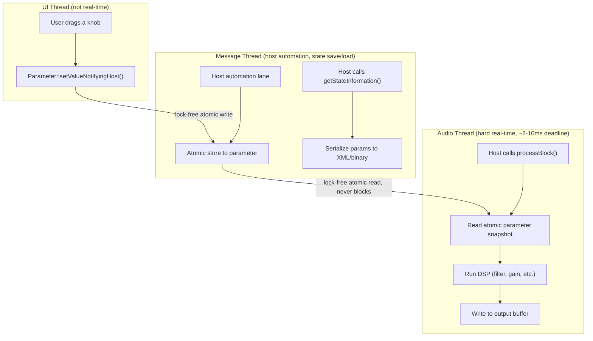

# Lesson 2: Building a Production Audio Plugin — VST3/AU Host Interaction in Practice

## 1. Why This Matters: The Real-Time Contract

A plugin is a guest in someone else's house. The host (Ableton, Logic, Reaper, Pro Tools) owns the audio thread, the clock, and the UI event loop. Your plugin's `processBlock()` function gets called tens of thousands of times per second, and if it ever runs too slow, blocks, or allocates memory at the wrong moment, the result isn't a crash — it's a click, a dropout, or a glitch the user hears immediately. This lesson treats plugin-host interaction as what it actually is: **a hard real-time contract**, and shows you how to write C++ (using the JUCE framework, the industry-standard way to target VST3/AU/AAX from one codebase) that honors it.

**The one invariant that matters more than any other:** the audio callback thread must never wait. No locks, no allocations, no file I/O, no logging to disk, no `std::cout`. Everything else in this lesson — lock-free queues, atomic parameters, double-buffering — exists purely to serve that one rule.

A short grounding in the physics: digital audio moves through the host in fixed-size blocks (e.g. 64, 128, 512 samples) at a fixed sample rate (44.1kHz, 48kHz, 96kHz). At 48kHz with a 128-sample buffer, your `processBlock()` has **2.67 milliseconds** to run before the host needs the next block. Miss that deadline once, and the OS audio driver inserts silence — that's the "click" you hear. Everything in plugin architecture is downstream of that deadline.

## 2. Core Architecture: Three Threads You Must Respect



The three threads never share a mutex. They communicate exclusively through **atomics** (for single values like a cutoff frequency) and **lock-free FIFOs** (for streams like MIDI events or UI meter data). This is the mechanical heart of every professional plugin.

## 3. Setting Up a Real Plugin Project (JUCE)

```bash
# Install JUCE (macOS/Linux/Windows — Projucer or CMake)
git clone --depth 1 https://github.com/juce-framework/JUCE.git
cd JUCE

# Scaffold a new audio effect plugin with CMake (no Projucer GUI needed)
mkdir -p ~/plugins/GainPlug && cd ~/plugins/GainPlug
```

`CMakeLists.txt` — this is the actual build contract that tells CMake which plugin formats to compile (VST3 for Windows/Linux/Mac, AU for Mac-only hosts like Logic):

```cmake
cmake_minimum_required(VERSION 3.22)
project(GainPlug VERSION 1.0.0)

add_subdirectory(JUCE)  # path to the cloned JUCE repo

juce_add_plugin(GainPlug
    COMPANY_NAME "YourStudio"
    PLUGIN_MANUFACTURER_CODE Ysdo
    PLUGIN_CODE Gpl1
    FORMATS VST3 AU Standalone      # build all three targets from one source
    PRODUCT_NAME "GainPlug")

target_sources(GainPlug PRIVATE
    Source/PluginProcessor.cpp
    Source/PluginEditor.cpp)

target_link_libraries(GainPlug PRIVATE
    juce::juce_audio_utils
    juce::juce_dsp)

target_compile_definitions(GainPlug PRIVATE
    JUCE_WEB_BROWSER=0
    JUCE_USE_CURL=0)
```

Build it:

```bash
cmake -B build -DCMAKE_BUILD_TYPE=Release
cmake --build build --config Release -j8

# On macOS, the AU/VST3 bundles land here — symlink or copy to system plugin folders:
cp -r build/GainPlug_artefacts/Release/VST3/GainPlug.vst3 ~/Library/Audio/Plug-Ins/VST3/
cp -r build/GainPlug_artefacts/Release/AU/GainPlug.component ~/Library/Audio/Plug-Ins/Components/
```

## 4. Parameter Management: The AudioProcessorValueTreeState Pattern

This is the single most important class to master. It gives you **one source of truth** for every knob — automation-safe, undo-safe, and thread-safe — instead of hand-rolling atomics for every parameter.

`PluginProcessor.h`:

```cpp
#pragma once
#include <juce_audio_processors/juce_audio_processors.h>
#include <juce_dsp/juce_dsp.h>

class GainPlugProcessor : public juce::AudioProcessor
{
public:
    GainPlugProcessor();
    ~GainPlugProcessor() override = default;

    void prepareToPlay(double sampleRate, int samplesPerBlock) override;
    void releaseResources() override {}
    void processBlock(juce::AudioBuffer<float>&, juce::MidiBuffer&) override;

    juce::AudioProcessorEditor* createEditor() override;
    bool hasEditor() const override { return true; }

    const juce::String getName() const override { return "GainPlug"; }
    bool acceptsMidi() const override { return false; }
    bool producesMidi() const override { return false; }
    double getTailLengthSeconds() const override { return 0.0; }

    int getNumPrograms() override { return 1; }
    int getCurrentProgram() override { return 0; }
    void setCurrentProgram(int) override {}
    const juce::String getProgramName(int) override { return {}; }
    void changeProgramName(int, const juce::String&) override {}

    void getStateInformation(juce::MemoryBlock& destData) override;
    void setStateInformation(const void* data, int sizeInBytes) override;

    // The single source of truth for all parameters.
    juce::AudioProcessorValueTreeState apvts;

private:
    juce::AudioProcessorValueTreeState::ParameterLayout createParameterLayout();

    // Atomic pointers resolved once; audio-thread reads are lock-free and O(1).
    std::atomic<float>* gainParam  = nullptr;
    std::atomic<float>* muteParam  = nullptr;

    juce::dsp::Gain<float> gainProcessor; // ramped gain, click-free
};
```

`PluginProcessor.cpp` — the parts that matter for host interaction:

```cpp
#include "PluginProcessor.h"
#include "PluginEditor.h"

GainPlugProcessor::GainPlugProcessor()
    : AudioProcessor(BusesProperties()
          .withInput("Input", juce::AudioChannelSet::stereo())
          .withOutput("Output", juce::AudioChannelSet::stereo())),
      apvts(*this, nullptr, "PARAMS", createParameterLayout())
{
    // Resolve raw atomic pointers ONCE at construction — never look up by
    // string ID inside processBlock(), that does a map lookup every sample.
    gainParam = apvts.getRawParameterValue("gain");
    muteParam = apvts.getRawParameterValue("mute");
}

juce::AudioProcessorValueTreeState::ParameterLayout GainPlugProcessor::createParameterLayout()
{
    std::vector<std::unique_ptr<juce::RangedAudioParameter>> params;

    // NormalisableRange with a skew factor gives you a musically useful taper:
    // 0.3 skew biases resolution toward the lower/quieter end of the range,
    // matching how human hearing perceives loudness (roughly logarithmic).
    params.push_back(std::make_unique<juce::AudioParameterFloat>(
        "gain", "Gain",
        juce::NormalisableRange<float>(-60.0f, 12.0f, 0.1f, 0.3f),
        0.0f, "dB"));

    params.push_back(std::make_unique<juce::AudioParameterBool>(
        "mute", "Mute", false));

    return { params.begin(), params.end() };
}

void GainPlugProcessor::prepareToPlay(double sampleRate, int samplesPerBlock)
{
    juce::dsp::ProcessSpec spec { sampleRate,
                                   (juce::uint32)samplesPerBlock,
                                   (juce::uint32)getTotalNumOutputChannels() };
    gainProcessor.prepare(spec);
    gainProcessor.setRampDurationSeconds(0.02); // 20ms ramp kills parameter "zipper" clicks
}

void GainPlugProcessor::processBlock(juce::AudioBuffer<float>& buffer, juce::MidiBuffer&)
{
    juce::ScopedNoDenormals noDenormals; // flushes denormal floats to zero — see §6

    // Clear unused output channels if the host gave us more outs than ins.
    for (auto i = getTotalNumInputChannels(); i < getTotalNumOutputChannels(); ++i)
        buffer.clear(i, 0, buffer.getNumSamples());

    const bool isMuted = muteParam->load() > 0.5f;
    const float gainDb = isMuted ? -100.0f : gainParam->load();

    gainProcessor.setGainDecibels(gainDb);
    juce::dsp::AudioBlock<float> block(buffer);
    gainProcessor.process(juce::dsp::ProcessContextReplacing<float>(block));
}

void GainPlugProcessor::getStateInformation(juce::MemoryBlock& destData)
{
    // Called by the host when saving a project — must be fast and deterministic.
    if (auto state = apvts.copyState(); state.isValid())
        if (auto xml = state.createXml())
            copyXmlToBinary(*xml, destData);
}

void GainPlugProcessor::setStateInformation(const void* data, int sizeInBytes)
{
    if (auto xml = getXmlFromBinary(data, sizeInBytes))
        apvts.replaceState(juce::ValueTree::fromXml(*xml));
}
```

**Why `std::atomic<float>*` and not a mutex:** `getRawParameterValue()` returns a pointer into an internal atomic float. Reading it in `processBlock()` is a single lock-free load — a handful of CPU cycles. A mutex lock, by contrast, can block for microseconds if the UI thread is mid-write, and on a 128-sample buffer at 48kHz you only have 2.67ms total. One blocked lock can blow your entire deadline.

## 5. MIDI and Event Handling: The Lock-Free FIFO Pattern

When you need to pass data from the audio thread to the UI thread (e.g. driving a VU meter or a MIDI activity light), never use a mutex — use `juce::AbstractFifo`, a ring buffer built exactly for this single-producer/single-consumer relationship.

```cpp
// In PluginProcessor.h — a lock-free ring buffer for MIDI note activity,
// written by the audio thread, read by the editor's 30Hz UI timer.
juce::AbstractFifo midiFifo { 512 };
std::array<juce::MidiMessage, 512> midiStorage;

// In processBlock(), for each incoming MIDI message:
void GainPlugProcessor::processBlock(juce::AudioBuffer<float>& buffer, juce::MidiBuffer& midi)
{
    for (const auto metadata : midi)
    {
        auto msg = metadata.getMessage();
        int start1, size1, start2, size2;
        midiFifo.prepareToWrite(1, start1, size1, start2, size2);
        if (size1 > 0) midiStorage[start1] = msg;
        midiFifo.finishedWrite(size1 + size2);
    }
    // ... DSP processing continues ...
}

// In PluginEditor.cpp, on a juce::Timer callback (runs on the message thread, 30-60Hz):
void GainPlugEditor::timerCallback()
{
    int start1, size1, start2, size2;
    processor.midiFifo.prepareToRead(processor.midiFifo.getNumReady(), start1, size1, start2, size2);
    for (int i = start1; i < start1 + size1; ++i)
        updateMidiLED(processor.midiStorage[i]);     // safe: UI thread only, no audio-thread contention
    processor.midiFifo.finishedRead(size1 + size2);
}
```

This is the mirror image of the architecture diagram in §2: the audio thread **never** waits on the UI, and the UI thread **never** waits on the audio thread. Both sides just poll the ring buffer's read/write cursors, which are atomics under the hood.

## 6. Host Interaction Failure Modes — and the Real Fixes

| Failure mode | Symptom the user hears/sees | Root cause | Production fix |
|---|---|---|---|
| **Denormal floats** | CPU spikes to 100%, audio stutters, no visible cause | Signal decays into the denormal float range (~1e-38); x86 FPUs process these 10-100x slower | Wrap `processBlock()` in `juce::ScopedNoDenormals` (flushes denormals to zero via the FTZ/DAZ CPU flags) |
| **Parameter zipper noise** | Audible "stepping" or clicking when automating a knob fast | Parameter value jumps instantly between blocks instead of ramping | Use `juce::dsp::Gain`, `SmoothedValue<float>`, or linear-ramp the parameter over 10-50ms inside each block |
| **Dropped MIDI at buffer boundary** | Notes get "eaten" when buffer size changes (e.g. host changes from 512→64 samples) | Plugin assumed a fixed buffer size and indexed a stack array out of bounds | Never assume `getNumSamples()` is constant; allocate scratch buffers in `prepareToPlay()` sized to the **maximum** block size the host reports |
| **Audio thread allocation stall** | Random, rare clicks under heavy automation or preset load | `processBlock()` calls `new`, `malloc`, or a `std::vector::push_back` that triggers reallocation | Pre-allocate all buffers in `prepareToPlay()`; audit with a tool like **JUCE's `AudioProcessor::isNonRealtime()` assertion** or a custom debug allocator that asserts on the audio thread |
| **State recall mismatch** | Preset loads with wrong parameter values, especially version-to-version | Plugin's `setStateInformation()` doesn't handle missing/renamed parameter IDs gracefully | Version-tag your saved XML state; on load, check for missing IDs and fall back to defaults instead of crashing |
| **Plugin validation failure in host scanner** | Host (Ableton, Pro Tools) silently refuses to load the plugin, or crashes during scan | Plugin throws/crashes during static initialization, or reports inconsistent channel counts between `isBusesLayoutSupported()` and actual processing | Run `pluginval` (open-source JUCE validator) before every release — catches 90% of host-scan crashes before a user ever sees them |

```bash
# Validate your build against real-world host scanning behavior before shipping:
git clone https://github.com/Tracktion/pluginval.git
# or download prebuilt binary from the releases page
./pluginval --validate-in-process --strictness-level 10 \
    ~/Library/Audio/Plug-Ins/VST3/GainPlug.vst3
```

`pluginval` runs the exact category of checks hosts perform at scan time: thread-safety stress tests, bus layout queries, state save/reload round-trips, and automation flooding. A clean pass here catches the overwhelming majority of "works on my machine, crashes in Pro Tools" bugs.

## 7. Practice Drill: Build, Automate, Break, Fix

This is a hands-on lab, not a thought experiment. Budget 90 minutes.

1. **Build** the `GainPlug` project above and load it in a real host (Reaper is free to trial and has the most forgiving plugin scanner, good for a first pass).
2. **Automate** the gain parameter with a fast automation ramp (0 to -40dB over 50ms) and listen for zipper noise. Temporarily comment out `gainProcessor.setRampDurationSeconds(0.02)` to hear the raw, un-smoothed stepping — this makes the failure mode audible and concrete before you fix it.
3. **Stress-test MIDI timing:** route a fast 16th-note hi-hat MIDI pattern at 180 BPM into the plugin's MIDI FIFO logging, and verify in the debugger that `midiFifo.getNumReady()` never exceeds capacity (512). If it does, your UI timer isn't draining fast enough — drop the timer interval from 30Hz to 60Hz.
4. **Resize the host buffer** live (most hosts expose this in audio device settings — try 512, then 64, then 2048 samples) while audio is playing, and confirm no crash, no stuck notes, no pops. This directly exercises the "dropped MIDI at buffer boundary" failure mode from §6.
5. **Run `pluginval --strictness-level 10`** against your build and fix every reported warning before considering the plugin "done." Strictness 10 includes randomized audio data injection and denormal-flood tests — treat every red line as a real bug, not noise.

## 8. Core Mental Model to Keep

Every decision in plugin architecture traces back to one question: **"Which thread does this code run on, and what is its deadline?"** The audio thread has a hard deadline measured in milliseconds and must never block. The message/UI thread has no hard deadline and can safely do anything — allocate, lock, log, serialize XML. Your entire job as a plugin engineer is building a clean, lock-free bridge between those two worlds, and the APVTS + AbstractFifo patterns above are that bridge in its most battle-tested, production-proven form.
