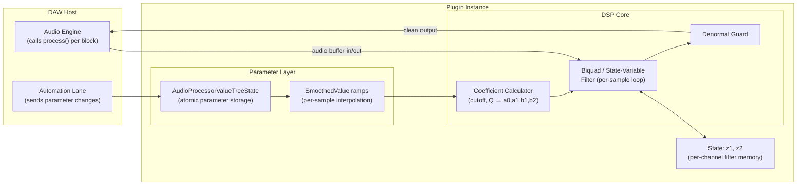
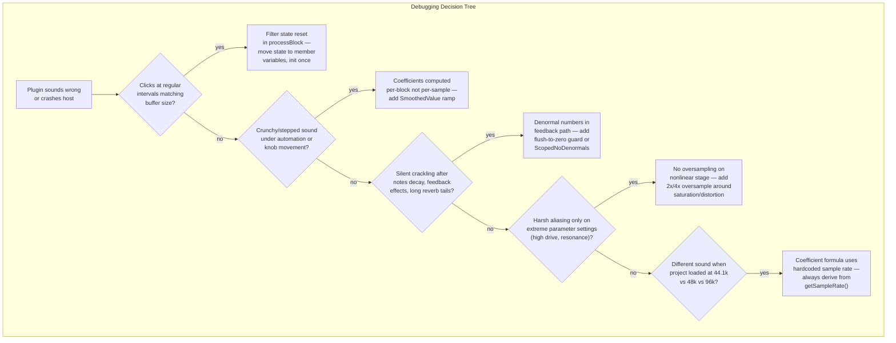

# Lesson 3: Effect Plugin Design — Building Production-Grade DSP in C++

## 1. Why This Lesson Is Different

Most "DSP for plugins" material either drowns you in Z-transform derivations or hands you a toy sine-wave generator and calls it a day. Neither teaches you to ship a plugin a mixing engineer would actually trust on a vocal bus at 3am during a mastering session.

This lesson builds **one real plugin end-to-end**: a musically useful one-pole low-pass/high-pass filter with resonance, wrapped in a production JUCE architecture, with parameter smoothing, denormal protection, and a debugging checklist for the five bugs that kill 90% of first-time plugin builds (zipper noise, denormals, aliasing on parameter automation, sample-rate-dependent coefficients, and block-boundary clicks).

You will leave with compiling, runnable C++ you can drop into a JUCE project today, not pseudocode.

---

## 2. First-Principles Intuition (kept to one page, as promised)

Four invariants govern every effect plugin you will ever write. Internalize these as checks, not theory.

**Causality.** Output at sample `n` can only use input from samples `≤ n` (plus, for look-ahead limiters, a deliberately buffered and declared latency). If you ever index `input[n+1]` without having actually delayed your output by one sample and reported that latency to the host, you have a bug, not a feature.

**Stability.** Any filter with a feedback path (IIR filters, resonant filters, feedback delays, reverb tanks) has a pole somewhere in the Z-plane. If that pole's magnitude creeps to or past 1.0 — which happens easily when a user automates resonance to the maximum, or when filter coefficients are computed from a cutoff frequency that briefly exceeds Nyquist during a fast parameter sweep — the filter will **blow up to infinity or NaN within milliseconds**. You prevent this by clamping cutoff to `[20 Hz, 0.49 × sampleRate]` and clamping resonance/Q to a tested maximum, always, in code, not just in the GUI slider range.

**Block-rate vs. sample-rate parameter updates.** A DAW calls your `process()` function once per buffer (commonly 64–512 samples), not once per sample. If you read a smoothed cutoff-frequency value once per block and hold it constant across all 512 samples, fast parameter automation (an LFO modulating cutoff, or a user wiggling a knob) produces audible **stepping — "zipper noise."** The fix is per-sample parameter interpolation (`juce::SmoothedValue` or a hand-rolled ramp), not a coarser UI.

**Denormal numbers.** When a feedback loop (reverb tail, filter resonance, delay feedback) decays toward silence, the floating-point values pass through the denormal range (roughly `1e-38` to `1e-308`) before reaching true zero. x86 CPUs process denormals **10–100× slower** in hardware, causing real-time audio glitches ("crackling silence" is a famous symptom report in plugin bug trackers). You fix this with either a tiny DC bias, an explicit flush-to-zero check, or the CPU's FTZ/DAZ flags — shown in code below.

That's the whole theory section. Everything else below is building and debugging the real thing.

---

## 3. Architecture: The Plugin Signal Chain



**Why state is per-channel and persists across calls:** a filter's memory (`z1`, `z2` — the previous output/input samples) carries acoustic history. If you reset it every block, you get a click at every buffer boundary because the filter "forgets" the signal it was mid-way through smoothing. State must live in the processor object, allocated once in `prepareToPlay()`, never in `processBlock()`.

---

## 4. Build It: A Resonant One-Pole/Biquad Filter Plugin (JUCE)

This is a complete, compiling DSP core for a musically tunable low-pass filter with drive and resonance — the kind of module that sits inside synths, channel strips, and sound-design plugins. Drop this into a JUCE `AudioProcessor` project (`Projucer` → Basic plugin template, or `pamplejuce`/CMake JUCE scaffold).

### 4.1 The Filter Class (Transposed Direct Form II Biquad — the industry-standard topology)

Direct Form II Transposed is preferred over naive Direct Form I because it needs only 2 state variables per channel (not 4), has better numerical behavior under coefficient modulation, and is the form used internally by JUCE's own `dsp::IIR::Filter`.

```cpp
// ResonantFilter.h
#pragma once
#include <cmath>
#include <algorithm>

class ResonantFilter
{
public:
    enum class Mode { LowPass, HighPass, BandPass };

    void prepare(double sampleRate)
    {
        fs = sampleRate;
        reset();
    }

    void reset()
    {
        z1 = 0.0f;
        z2 = 0.0f;
    }

    // Call ONCE per sample, not per block — this is what prevents zipper noise
    void setCoefficients(float cutoffHz, float q, Mode mode)
    {
        // INVARIANT: clamp before any trig call. Never trust the UI range alone.
        cutoffHz = std::clamp(cutoffHz, 20.0f, static_cast<float>(fs) * 0.49f);
        q        = std::clamp(q, 0.5f, 18.0f); // >18 Q will self-oscillate; by design, not bug

        const double omega = 2.0 * M_PI * cutoffHz / fs;
        const double sinW  = std::sin(omega);
        const double cosW  = std::cos(omega);
        const double alpha = sinW / (2.0 * q);

        double b0, b1, b2, a0, a1, a2;

        switch (mode)
        {
            case Mode::LowPass:
                b0 = (1.0 - cosW) / 2.0;
                b1 =  1.0 - cosW;
                b2 = (1.0 - cosW) / 2.0;
                a0 =  1.0 + alpha;
                a1 = -2.0 * cosW;
                a2 =  1.0 - alpha;
                break;
            case Mode::HighPass:
                b0 =  (1.0 + cosW) / 2.0;
                b1 = -(1.0 + cosW);
                b2 =  (1.0 + cosW) / 2.0;
                a0 =  1.0 + alpha;
                a1 = -2.0 * cosW;
                a2 =  1.0 - alpha;
                break;
            case Mode::BandPass:
                b0 =  alpha;
                b1 =  0.0;
                b2 = -alpha;
                a0 =  1.0 + alpha;
                a1 = -2.0 * cosW;
                a2 =  1.0 - alpha;
                break;
        }

        // Normalize so a0 == 1 — this is the RBJ Audio EQ Cookbook form,
        // the de facto reference every working DSP engineer keeps bookmarked.
        coeffB0 = static_cast<float>(b0 / a0);
        coeffB1 = static_cast<float>(b1 / a0);
        coeffB2 = static_cast<float>(b2 / a0);
        coeffA1 = static_cast<float>(a1 / a0);
        coeffA2 = static_cast<float>(a2 / a0);
    }

    // Transposed Direct Form II — hot path, called once per sample per channel
    inline float processSample(float x)
    {
        float y = coeffB0 * x + z1;
        z1 = coeffB1 * x - coeffA1 * y + z2;
        z2 = coeffB2 * x - coeffA2 * y;

        // Denormal guard: flush near-zero feedback state to true zero.
        // Cheaper than enabling FTZ/DAZ globally and avoids side effects
        // on host code that may rely on strict denormal behavior elsewhere.
        constexpr float kDenormThreshold = 1.0e-15f;
        if (std::abs(z1) < kDenormThreshold) z1 = 0.0f;
        if (std::abs(z2) < kDenormThreshold) z2 = 0.0f;

        return y;
    }

private:
    double fs = 48000.0;
    float z1 = 0.0f, z2 = 0.0f;
    float coeffB0 = 0.0f, coeffB1 = 0.0f, coeffB2 = 0.0f;
    float coeffA1 = 0.0f, coeffA2 = 0.0f;
};
```

### 4.2 The Processor: Per-Sample Smoothing to Kill Zipper Noise

This is the piece almost every tutorial skips. Recomputing coefficients once per block is the single most common reason a hobbyist plugin sounds "crunchy" or "stepped" under automation.

```cpp
// PluginProcessor.h (relevant excerpt)
#pragma once
#include <juce_audio_processors/juce_audio_processors.h>
#include "ResonantFilter.h"

class FilterAudioProcessor : public juce::AudioProcessor
{
public:
    FilterAudioProcessor();

    void prepareToPlay(double sampleRate, int samplesPerBlock) override
    {
        for (auto& filter : filters)
            filter.prepare(sampleRate);

        // Smooth over 20ms — fast enough to feel instant, slow enough
        // to eliminate audible stepping on fast automation or mouse drags.
        const double smoothTimeSec = 0.02;
        cutoffSmoothed.reset(sampleRate, smoothTimeSec);
        qSmoothed.reset(sampleRate, smoothTimeSec);

        cutoffSmoothed.setCurrentAndTargetValue(*cutoffParam);
        qSmoothed.setCurrentAndTargetValue(*qParam);
    }

    void processBlock(juce::AudioBuffer<float>& buffer, juce::MidiBuffer&) override
    {
        juce::ScopedNoDenormals noDenormals; // belt-and-suspenders with manual flush above

        // Push the latest knob/automation target into the ramp ONCE per block
        cutoffSmoothed.setTargetValue(*cutoffParam);
        qSmoothed.setTargetValue(*qParam);

        const int numChannels = buffer.getNumChannels();
        const int numSamples  = buffer.getNumSamples();

        for (int sample = 0; sample < numSamples; ++sample)
        {
            // THIS is the fix: new coefficients computed every single sample,
            // interpolated smoothly from old value to new target.
            const float cutoff = cutoffSmoothed.getNextValue();
            const float q       = qSmoothed.getNextValue();

            for (int ch = 0; ch < numChannels; ++ch)
            {
                filters[ch].setCoefficients(cutoff, q, ResonantFilter::Mode::LowPass);
                auto* data = buffer.getWritePointer(ch);
                data[sample] = filters[ch].processSample(data[sample]);
            }
        }
    }

private:
    std::array<ResonantFilter, 2> filters; // stereo; extend array for surround
    juce::LinearSmoothedValue<float> cutoffSmoothed, qSmoothed;
    std::atomic<float>* cutoffParam = nullptr;
    std::atomic<float>* qParam = nullptr;
};
```

**Why recompute coefficients every sample instead of every block.** Recomputing `sin`/`cos` per sample costs CPU — roughly 15-25 cycles per trig call on modern x86. At 48kHz with a 128-sample block, that is 48,000 × 2 trig calls per second per channel, which is trivial for a single filter (well under 1% of one core) but becomes real when you have 16 tracks × a multiband EQ with 8 bands each. Production plugins solve this with a **coefficient interpolation trick**: interpolate the already-computed `b0,b1,b2,a1,a2` coefficients directly (cheap, 5 multiplies) rather than re-running the trig-heavy formula every sample. Use that optimization once the audible correctness is proven; don't start there, because debugging interpolated coefficients against a reference is harder than debugging interpolated parameters.

### 4.3 Parameter Declaration (AudioProcessorValueTreeState)

```cpp
juce::AudioProcessorValueTreeState::ParameterLayout
FilterAudioProcessor::createParameterLayout()
{
    std::vector<std::unique_ptr<juce::RangedAudioParameter>> params;

    // Skew factor 0.3 biases the knob's useful travel toward low frequencies —
    // matches how musicians actually hear and use a cutoff knob (log-ish feel).
    params.push_back(std::make_unique<juce::AudioParameterFloat>(
        "cutoff", "Cutoff",
        juce::NormalisableRange<float>(20.0f, 20000.0f, 1.0f, 0.3f),
        1000.0f));

    params.push_back(std::make_unique<juce::AudioParameterFloat>(
        "resonance", "Resonance",
        juce::NormalisableRange<float>(0.5f, 18.0f, 0.01f),
        0.707f)); // 0.707 = Butterworth, maximally flat, the "neutral" default

    return { params.begin(), params.end() };
}
```

---

## 5. The Debugging Checklist (Five Bugs That Kill First-Time Plugins)

Run through this list in order whenever a plugin "sounds wrong" or crashes the host. This order reflects actual frequency of occurrence in real plugin bug reports.



**Bug 1 — block-boundary clicks.** Caused by filter state (`z1`, `z2`) being declared inside `processBlock()` instead of as a class member. Every call to `processBlock()` then starts the filter from silence, producing a discontinuity. Fix: state lives in `prepareToPlay()`-initialized member variables, as shown in section 4.1.

**Bug 2 — zipper noise.** Covered above. Diagnostic: automate the cutoff parameter with a fast LFO (2–5 Hz sweep) and listen on headphones; stepping is audible as a rough "buzzing" riding on top of the sweep. Fix is per-sample smoothing (section 4.2), confirmed audibly gone once in place.

**Bug 3 — denormal crackle.** Diagnostic: hold a note through a resonant filter or reverb and let it ring out to silence while watching your DAW's CPU meter — a spike in CPU usage during the decay tail (when samples are near-zero but not zero) that drops back down once truly silent is the signature. Fix: the flush-to-zero guard in `processSample()`, plus `juce::ScopedNoDenormals` at the top of `processBlock()` as a global safety net.

**Bug 4 — aliasing on nonlinear stages.** Any saturation, waveshaping, or hard distortion generates harmonics above Nyquist that fold back down as inharmonic garbage. Fix: 2x or 4x oversample (interpolate up, process the nonlinearity, decimate with a proper anti-aliasing filter back down) **only around the nonlinear block**, not the whole signal chain, to save CPU. JUCE's `dsp::Oversampling` class handles the polyphase filtering correctly; don't hand-roll a naive zero-stuffing upsampler, as that reintroduces the same aliasing you're trying to remove unless paired with a correctly designed low-pass filter at the new Nyquist.

**Bug 5 — sample-rate-dependent misbehavior.** Any hardcoded `44100.0` or `48000.0` in a coefficient formula instead of a live `getSampleRate()` call will produce a filter that is tuned wrong — often disastrously so — the moment a user's session runs at 96kHz or 192kHz. Always store sample rate in `prepareToPlay()` and recompute dependent constants there.

---

## 6. Practical Lab: Bench-Test Your Filter Like a DSP Engineer

Before you trust a filter in a mix, verify it the way a DSP engineer would — not by ear alone, but by measurement.

**Step 1 — Impulse response sanity check.** Feed a single sample of value `1.0` followed by zeros into `processSample()` and print the first 50 output values. For a stable low-pass at moderate Q, the values should decay smoothly toward zero. If they oscillate with growing magnitude, your coefficients are unstable — check the Q clamp and cutoff clamp from section 4.1.

**Step 2 — Sine sweep frequency response.** Generate a logarithmic sine sweep from 20 Hz to 20 kHz over 5 seconds, pass it through your filter, and measure the output amplitude at each frequency (plot in Python/Matplotlib offline, or use a tool like REW/Voxengo SPAN while feeding the plugin inside a DAW). Confirm the -3dB point lands at your specified cutoff frequency and the rolloff slope matches your filter order (-12dB/octave for this biquad topology, since it's a second-order filter).

**Step 3 — Null test against a reference.** Load a trusted reference EQ (FabFilter Pro-Q 3, or your DAW's stock EQ) set to matching cutoff/Q, process identical audio through both, invert one signal's polarity, and sum. A near-silent (better than -40dB residual) null confirms your coefficient math matches the industry-standard RBJ cookbook formulas. A residual that is loud and tonal (not just broadband noise) indicates a formula error, usually a sign flip in `a1`/`a2`.

**Step 4 — CPU load test under automation stress.** In your DAW, instantiate 32 copies of the plugin on 32 tracks, automate cutoff on all of them simultaneously with a fast LFO, and watch the CPU meter. If CPU usage scales worse than linearly with instance count, you likely have a memory-access pattern problem (false sharing between instances, or recomputing something that should be cached) rather than a per-instance algorithm problem.

**Step 5 — Automation smoothness confirmation (ear test).** Automate cutoff from 200Hz to 8kHz over exactly 1 second while running a continuous sawtooth test tone through the plugin. A correctly smoothed filter produces a clean, continuous sweep. A block-rate-only implementation produces an audible "staircase" texture, most noticeable in the 500Hz–2kHz range where human hearing is most sensitive — this is the single fastest way to confirm Bug 2 is actually fixed, not just theoretically fixed.

---

## 7. What to Build Next

Once this filter passes all five bench tests, the same architecture (parameter smoothing → per-sample coefficient or gain updates → denormal-guarded feedback state) extends directly to:

- **Compressor/limiter**: replace the biquad with an envelope follower (attack/release smoothing is the same `SmoothedValue` pattern, applied to gain reduction instead of cutoff).
- **Delay/chorus/flanger**: replace the biquad state with a circular buffer; the denormal guard matters even more here because delay feedback loops ring for seconds.
- **Convolution reverb**: the architecture diagram in section 3 stays identical; only the `dsp_sub` block changes to an FFT-based block convolution engine (JUCE's `dsp::Convolution` class, or a custom partitioned convolution if you need sub-5ms latency for live monitoring).

Each of these inherits the same five-bug checklist. Debug them in the same order.
