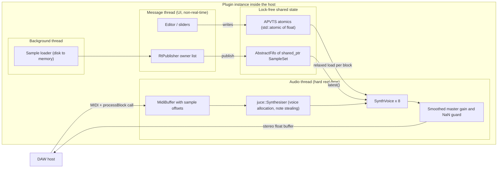
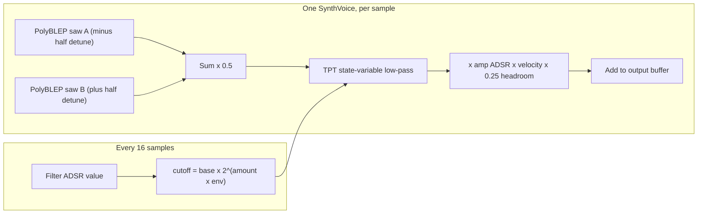

# Lesson 4: Instrument Plugin Development (JUCE 8, CMake, VST3 and AU)

You will build **MiniPoly**, an 8-voice polyphonic subtractive synthesizer plugin, then validate it, profile it, and break it on purpose. Everything compiles as written: a CMake project, a band-limited oscillator, a per-voice filter and envelope, host-safe parameters and state, and a lock-free hand-off for loading samples while the instrument plays.

**You need:** a C++20 compiler (Xcode 15+, MSVC 2022, GCC 12+ or Clang), CMake 3.22+, Git, and a MIDI keyboard or a virtual MIDI port.

---

## 1. First-Principles Intuition & Invariants

**The physics that matters (one paragraph).** A naive sawtooth has harmonics at k·f0 with amplitude 1/k. At 48 kHz the Nyquist limit is 24 kHz, so for a C7 note (2093 Hz) harmonic 12 (25,116 Hz) is above Nyquist and folds back to 48,000 − 25,116 = 22,884 Hz at −21.6 dB relative to the fundamental. That is clearly audible, and it moves *down* as you play *up*, which is how you recognize aliasing by ear. The fix is to band-limit the oscillator (PolyBLEP below) instead of filtering afterward, because aliased energy cannot be separated from real harmonics once it exists.

**The deadline.** The host calls your `processBlock` once per buffer. At 128 samples and 48 kHz you have 128 / 48000 = 2.67 ms to render every voice. Missing it produces a dropout (an "xrun"). Every rule below exists to make the worst-case block, not the average block, fit in that budget.

**Invariants (never violate these):**

1. **The audio thread never allocates, locks, waits, does file or network I/O, or logs.** No `new`, `std::vector::push_back`, `std::mutex`, `DBG` in release paths, or `juce::String` construction.
2. **Parameters cross threads as atomics.** The UI writes. The audio thread reads once per block with a relaxed load. Anything audible (gain, cutoff) is smoothed or applied at control rate to avoid zipper noise.
3. **MIDI is sample-accurate.** `juce::Synthesiser` splits the block at each event offset. Never apply all events at the start of the block.
4. **Oscillators are band-limited at the source.** Filters come after, not instead.
5. **Plugin state is the parameter tree and nothing else.** Parameter IDs are permanent. Renaming one silently breaks every saved project.
6. **A voice that is silent must stop costing CPU.** Free voices return immediately from `renderNextBlock`.

---

## 2. Core Architecture & Mechanics

Three threads touch a plugin. Knowing which code runs on which thread is most of the engineering.



| Component | JUCE class | Thread | Rule |
|---|---|---|---|
| Parameters | `AudioProcessorValueTreeState` (APVTS) | UI writes, audio reads | Read via `getRawParameterValue()` atomics only |
| MIDI in | `MidiBuffer` | Audio | Events carry sample offsets within the block |
| Voice allocator | `Synthesiser` | Audio | Add or remove voices only in the constructor or `prepareToPlay` |
| Voice | `SynthesiserVoice` | Audio | Add into the buffer (`+=`), never overwrite |
| Sample library | `shared_ptr<const SampleSet>` | Built off-thread, read on audio | Immutable once published |
| UI | `AudioProcessorEditor` | Message | Talks to the processor through APVTS attachments only |

**Per-voice signal path.** Two detuned PolyBLEP saws feed a TPT state-variable low-pass, whose cutoff is modulated by a filter envelope. The amp envelope, velocity and a headroom factor set the level. The filter coefficient is updated every 16 samples rather than every sample, because the tangent inside the coefficient calculation is the most expensive part of the filter.



---

## 3. Build the Instrument: MiniPoly

### 3.1 Project layout

```
MiniPoly/
├── CMakeLists.txt
└── Source/
    ├── Parameters.h
    ├── SynthVoice.h
    ├── PluginProcessor.h
    └── PluginProcessor.cpp
```

**Linux build dependencies:**

```bash
sudo apt install build-essential cmake ninja-build libasound2-dev libjack-jackd2-dev \
  libfreetype-dev libfontconfig1-dev libx11-dev libxcomposite-dev libxcursor-dev \
  libxext-dev libxinerama-dev libxrandr-dev libxrender-dev libglu1-mesa-dev mesa-common-dev
```

### 3.2 `CMakeLists.txt`

```cmake
cmake_minimum_required(VERSION 3.22)
project(MiniPoly VERSION 0.1.0)

set(CMAKE_CXX_STANDARD 20)
set(CMAKE_CXX_STANDARD_REQUIRED ON)

include(FetchContent)
# Pinned. Move to a newer 8.x tag only after re-running pluginval.
FetchContent_Declare(JUCE
    GIT_REPOSITORY https://github.com/juce-framework/JUCE.git
    GIT_TAG        8.0.4
    GIT_SHALLOW    TRUE)
FetchContent_MakeAvailable(JUCE)

set(MINIPOLY_FORMATS VST3 Standalone)
if(APPLE)
    list(APPEND MINIPOLY_FORMATS AU)
endif()

juce_add_plugin(MiniPoly
    COMPANY_NAME               "Example"
    PRODUCT_NAME               "MiniPoly"
    IS_SYNTH                   TRUE
    NEEDS_MIDI_INPUT           TRUE
    NEEDS_MIDI_OUTPUT          FALSE
    PLUGIN_MANUFACTURER_CODE   Exmp   # needs at least one uppercase letter for AU
    PLUGIN_CODE                Mpol   # unique per product; never change after release
    FORMATS                    ${MINIPOLY_FORMATS}
    COPY_PLUGIN_AFTER_BUILD    FALSE)

target_sources(MiniPoly PRIVATE
    Source/PluginProcessor.cpp
    Source/PluginProcessor.h
    Source/SynthVoice.h
    Source/Parameters.h)

target_compile_definitions(MiniPoly PUBLIC
    JUCE_WEB_BROWSER=0
    JUCE_USE_CURL=0
    JUCE_VST3_CAN_REPLACE_VST2=0)

target_link_libraries(MiniPoly
    PRIVATE
        juce::juce_audio_utils
        juce::juce_dsp
    PUBLIC
        juce::juce_recommended_config_flags
        juce::juce_recommended_lto_flags
        juce::juce_recommended_warning_flags)
```

### 3.3 `Source/Parameters.h`

```cpp
#pragma once
#include <atomic>
#include <juce_audio_processors/juce_audio_processors.h>

// Parameter IDs are permanent. Changing one breaks every saved project and preset.
namespace ids
{
    inline constexpr const char* attack    = "attack";
    inline constexpr const char* decay     = "decay";
    inline constexpr const char* sustain   = "sustain";
    inline constexpr const char* release   = "release";
    inline constexpr const char* detune    = "detune";
    inline constexpr const char* cutoff    = "cutoff";
    inline constexpr const char* resonance = "resonance";
    inline constexpr const char* fltEnvAmt = "fltEnvAmt";
    inline constexpr const char* fltDecay  = "fltDecay";
    inline constexpr const char* gainDb    = "gainDb";
}

// Raw atomic handles, resolved once at construction and read on the audio thread.
struct ParamPtrs
{
    std::atomic<float>* attack    = nullptr;
    std::atomic<float>* decay     = nullptr;
    std::atomic<float>* sustain   = nullptr;
    std::atomic<float>* release   = nullptr;
    std::atomic<float>* detune    = nullptr;
    std::atomic<float>* cutoff    = nullptr;
    std::atomic<float>* resonance = nullptr;
    std::atomic<float>* fltEnvAmt = nullptr;
    std::atomic<float>* fltDecay  = nullptr;
    std::atomic<float>* gainDb    = nullptr;
};

inline juce::AudioProcessorValueTreeState::ParameterLayout createLayout()
{
    using Range = juce::NormalisableRange<float>;
    constexpr int version = 1;   // bump per-parameter only when you change its meaning

    juce::AudioProcessorValueTreeState::ParameterLayout layout;

    auto add = [&] (const char* id, const char* name, Range range, float def, const char* unit)
    {
        layout.add (std::make_unique<juce::AudioParameterFloat> (
            juce::ParameterID { id, version }, name, range, def,
            juce::AudioParameterFloatAttributes().withLabel (unit)));
    };

    //                                     min     max      step  skew
    add (ids::attack,    "Attack",         Range (0.001f, 5.0f,   0.0f, 0.3f),  0.005f, " s");
    add (ids::decay,     "Decay",          Range (0.001f, 5.0f,   0.0f, 0.3f),  0.30f,  " s");
    add (ids::sustain,   "Sustain",        Range (0.0f,   1.0f,   0.0f, 1.0f),  0.80f,  "");
    add (ids::release,   "Release",        Range (0.005f, 5.0f,   0.0f, 0.3f),  0.20f,  " s");
    add (ids::detune,    "Detune",         Range (0.0f,   50.0f,  0.1f, 1.0f),  12.0f,  " ct");
    add (ids::cutoff,    "Cutoff",         Range (20.0f,  20000.0f, 0.0f, 0.25f), 3000.0f, " Hz");
    add (ids::resonance, "Resonance",      Range (0.5f,   8.0f,   0.0f, 0.5f),  0.9f,   " Q");
    add (ids::fltEnvAmt, "Filter Env Amt", Range (0.0f,   6.0f,   0.0f, 1.0f),  2.0f,   " oct");
    add (ids::fltDecay,  "Filter Decay",   Range (0.02f,  3.0f,   0.0f, 0.4f),  0.4f,   " s");
    add (ids::gainDb,    "Master",         Range (-36.0f, 6.0f,   0.1f, 1.0f),  -6.0f,  " dB");

    return layout;
}
```

### 3.4 `Source/SynthVoice.h`

```cpp
#pragma once
#include <cmath>
#include <juce_audio_basics/juce_audio_basics.h>
#include <juce_dsp/juce_dsp.h>
#include "Parameters.h"

class SynthSound final : public juce::SynthesiserSound
{
public:
    bool appliesToNote (int) override    { return true; }
    bool appliesToChannel (int) override { return true; }
};

class SynthVoice final : public juce::SynthesiserVoice
{
public:
    explicit SynthVoice (const ParamPtrs& p) : params (p) {}

    // Called from prepareToPlay (never from the audio callback).
    void prepare (double sampleRate, int maxBlockSize)
    {
        sr = sampleRate;
        maxCutoff = (float) juce::jmin (20000.0, sampleRate * 0.45);

        ampEnv.setSampleRate (sr);
        fltEnv.setSampleRate (sr);

        filter.prepare ({ sr, (juce::uint32) maxBlockSize, 1 });
        filter.setType (juce::dsp::StateVariableTPTFilterType::lowpass);
        filter.reset();
    }

    bool canPlaySound (juce::SynthesiserSound* s) override
    {
        return dynamic_cast<SynthSound*> (s) != nullptr;
    }

    void startNote (int midiNote, float velocity, juce::SynthesiserSound*, int pitchWheel) override
    {
        noteHz       = (float) juce::MidiMessage::getMidiNoteInHertz (midiNote);
        level        = velocity;
        phaseA       = 0.0f;
        phaseB       = 0.0f;
        lastFltEnv   = 0.0f;
        heardSound   = false;
        pitchWheelMoved (pitchWheel);

        filter.reset();
        updateEnvelopes();
        ampEnv.noteOn();
        fltEnv.noteOn();
    }

    void stopNote (float, bool allowTailOff) override
    {
        if (allowTailOff)
        {
            updateEnvelopes();   // the Release knob takes effect at key-up
            ampEnv.noteOff();
            fltEnv.noteOff();
        }
        else
        {
            ampEnv.reset();
            fltEnv.reset();
            clearCurrentNote();
        }
    }

    // 0..16383, centre 8192. Range fixed at +/-2 semitones.
    void pitchWheelMoved (int newValue) override
    {
        bendSemitones = ((float) newValue - 8192.0f) / 8192.0f * 2.0f;
    }

    void controllerMoved (int, int) override {}

    using juce::SynthesiserVoice::renderNextBlock;   // keep the double overload visible

    void renderNextBlock (juce::AudioBuffer<float>& out, int startSample, int numSamples) override
    {
        if (! isVoiceActive())
            return;

        // Block-rate reads of everything the user can move.
        const float bendRatio  = std::exp2 (bendSemitones / 12.0f);
        const float halfDetune = params.detune->load (std::memory_order_relaxed) * 0.5f / 1200.0f; // octaves
        const float dtA = juce::jmin (0.45f, noteHz * bendRatio * std::exp2 (-halfDetune) / (float) sr);
        const float dtB = juce::jmin (0.45f, noteHz * bendRatio * std::exp2 ( halfDetune) / (float) sr);
        const float baseCutoff = params.cutoff->load (std::memory_order_relaxed);
        const float envOctaves = params.fltEnvAmt->load (std::memory_order_relaxed);
        filter.setResonance (params.resonance->load (std::memory_order_relaxed));

        auto* left  = out.getWritePointer (0, startSample);
        auto* right = out.getNumChannels() > 1 ? out.getWritePointer (1, startSample) : nullptr;

        for (int i = 0; i < numSamples; ++i)
        {
            // Control rate: recompute the filter coefficient every 16 samples.
            if ((i & (controlInterval - 1)) == 0)
            {
                const float fc = baseCutoff * std::exp2 (envOctaves * lastFltEnv);
                filter.setCutoffFrequency (juce::jlimit (20.0f, maxCutoff, fc));
            }

            const float amp = ampEnv.getNextSample();
            lastFltEnv      = fltEnv.getNextSample();

            float x = 0.5f * (sawBlep (phaseA, dtA) + sawBlep (phaseB, dtB));
            advance (phaseA, dtA);
            advance (phaseB, dtB);

            x = filter.processSample (0, x) * amp * level * voiceHeadroom;

            left[i] += x;
            if (right != nullptr) right[i] += x;

            // Free the voice when the release ends, or when a sustain-0 pluck has decayed to silence.
            if (amp > 1.0e-3f) heardSound = true;
            if (! ampEnv.isActive() || (heardSound && amp < 1.0e-5f))
            {
                ampEnv.reset();
                fltEnv.reset();
                clearCurrentNote();
                break;
            }
        }
    }

private:
    static constexpr int   controlInterval = 16;     // must be a power of two
    static constexpr float voiceHeadroom   = 0.25f;  // 8 voices at full level stay near 0 dBFS

    // PolyBLEP correction: removes the aliasing a naive saw creates at its reset edge.
    static float polyBlep (float t, float dt) noexcept
    {
        if (t < dt)         { t /= dt;               return t + t - t * t - 1.0f; }
        if (t > 1.0f - dt)  { t = (t - 1.0f) / dt;   return t * t + t + t + 1.0f; }
        return 0.0f;
    }

    static float sawBlep (float phase, float dt) noexcept
    {
        return 2.0f * phase - 1.0f - polyBlep (phase, dt);
    }

    static void advance (float& phase, float dt) noexcept
    {
        phase += dt;
        if (phase >= 1.0f) phase -= 1.0f;
    }

    void updateEnvelopes()
    {
        ampEnv.setParameters ({ params.attack->load(), params.decay->load(),
                                params.sustain->load(), params.release->load() });
        fltEnv.setParameters ({ 0.001f, params.fltDecay->load(), 0.0f, 0.1f });
    }

    const ParamPtrs& params;

    juce::ADSR ampEnv, fltEnv;
    juce::dsp::StateVariableTPTFilter<float> filter;

    double sr         = 44100.0;
    float  maxCutoff  = 19000.0f;
    float  noteHz     = 440.0f;
    float  level      = 0.0f;
    float  phaseA     = 0.0f, phaseB = 0.0f;
    float  bendSemitones = 0.0f;
    float  lastFltEnv = 0.0f;
    bool   heardSound = false;
};
```

### 3.5 `Source/PluginProcessor.h`

```cpp
#pragma once
#include <juce_audio_processors/juce_audio_processors.h>
#include "Parameters.h"
#include "SynthVoice.h"

class MiniPolyProcessor final : public juce::AudioProcessor
{
public:
    static constexpr int numVoices = 8;

    MiniPolyProcessor();

    void prepareToPlay (double sampleRate, int samplesPerBlock) override;
    void releaseResources() override {}
    void reset() override;
    bool isBusesLayoutSupported (const BusesLayout&) const override;
    void processBlock (juce::AudioBuffer<float>&, juce::MidiBuffer&) override;

    juce::AudioProcessorEditor* createEditor() override;
    bool hasEditor() const override { return true; }

    const juce::String getName() const override { return JucePlugin_Name; }
    bool acceptsMidi() const override  { return true; }
    bool producesMidi() const override { return false; }
    bool isMidiEffect() const override { return false; }
    double getTailLengthSeconds() const override { return 5.0; }   // equals the maximum Release

    int getNumPrograms() override { return 1; }
    int getCurrentProgram() override { return 0; }
    void setCurrentProgram (int) override {}
    const juce::String getProgramName (int) override { return {}; }
    void changeProgramName (int, const juce::String&) override {}

    void getStateInformation (juce::MemoryBlock&) override;
    void setStateInformation (const void*, int) override;

private:
    // Declaration order matters: voices reference ptrs, so ptrs is destroyed after synth.
    juce::AudioProcessorValueTreeState apvts;
    ParamPtrs ptrs;
    juce::Synthesiser synth;
    juce::SmoothedValue<float> gainSmooth;

    JUCE_DECLARE_NON_COPYABLE_WITH_LEAK_DETECTOR (MiniPolyProcessor)
};
```

### 3.6 `Source/PluginProcessor.cpp`

```cpp
#include "PluginProcessor.h"
#include <cmath>

MiniPolyProcessor::MiniPolyProcessor()
    : AudioProcessor (BusesProperties().withOutput ("Output", juce::AudioChannelSet::stereo(), true)),
      apvts (*this, nullptr, "STATE", createLayout())
{
    auto raw = [this] (const char* id) { return apvts.getRawParameterValue (id); };
    ptrs.attack    = raw (ids::attack);
    ptrs.decay     = raw (ids::decay);
    ptrs.sustain   = raw (ids::sustain);
    ptrs.release   = raw (ids::release);
    ptrs.detune    = raw (ids::detune);
    ptrs.cutoff    = raw (ids::cutoff);
    ptrs.resonance = raw (ids::resonance);
    ptrs.fltEnvAmt = raw (ids::fltEnvAmt);
    ptrs.fltDecay  = raw (ids::fltDecay);
    ptrs.gainDb    = raw (ids::gainDb);

    synth.addSound (new SynthSound());
    for (int i = 0; i < numVoices; ++i)
        synth.addVoice (new SynthVoice (ptrs));
}

void MiniPolyProcessor::prepareToPlay (double sampleRate, int samplesPerBlock)
{
    synth.setCurrentPlaybackSampleRate (sampleRate);
    for (int i = 0; i < synth.getNumVoices(); ++i)
        if (auto* v = dynamic_cast<SynthVoice*> (synth.getVoice (i)))
            v->prepare (sampleRate, samplesPerBlock);

    gainSmooth.reset (sampleRate, 0.02);   // 20 ms linear ramp
    gainSmooth.setCurrentAndTargetValue (juce::Decibels::decibelsToGain (ptrs.gainDb->load()));
}

void MiniPolyProcessor::reset()
{
    synth.allNotesOff (0, false);   // transport stop or host reset must not leave stuck notes
}

bool MiniPolyProcessor::isBusesLayoutSupported (const BusesLayout& layouts) const
{
    return layouts.getMainOutputChannelSet() == juce::AudioChannelSet::stereo();
}

void MiniPolyProcessor::processBlock (juce::AudioBuffer<float>& buffer, juce::MidiBuffer& midi)
{
    juce::ScopedNoDenormals noDenormals;

    const int numSamples = buffer.getNumSamples();
    buffer.clear();   // instrument: ignore whatever the host put in the buffer

    gainSmooth.setTargetValue (juce::Decibels::decibelsToGain (ptrs.gainDb->load (std::memory_order_relaxed)));

    synth.renderNextBlock (buffer, midi, 0, numSamples);
    gainSmooth.applyGain (buffer, numSamples);

    // Safety net: a NaN or inf sent downstream can destroy hosts' filters and speakers.
    bool bad = false;
    for (int ch = 0; ch < buffer.getNumChannels(); ++ch)
    {
        const float* p = buffer.getReadPointer (ch);
        for (int i = 0; i < numSamples; ++i)
            bad |= ! std::isfinite (p[i]);
    }
    if (bad)
    {
        buffer.clear();
        synth.allNotesOff (0, false);
        jassertfalse;   // debug builds stop here so you can find the source
    }
}

juce::AudioProcessorEditor* MiniPolyProcessor::createEditor()
{
    return new juce::GenericAudioProcessorEditor (*this);
}

void MiniPolyProcessor::getStateInformation (juce::MemoryBlock& dest)
{
    if (auto xml = apvts.copyState().createXml())
        copyXmlToBinary (*xml, dest);
}

void MiniPolyProcessor::setStateInformation (const void* data, int size)
{
    if (auto xml = getXmlFromBinary (data, size))
        if (xml->hasTagName (apvts.state.getType()))
            apvts.replaceState (juce::ValueTree::fromXml (*xml));
}

juce::AudioProcessor* JUCE_CALLTYPE createPluginFilter()
{
    return new MiniPolyProcessor();
}
```

The generic editor is enough for development. When you write a custom editor, bind every control with `juce::AudioProcessorValueTreeState::SliderAttachment`. The editor must never hold a pointer to a voice.

### 3.7 Build, run, validate

```bash
# Configure and build (single-config generators)
cmake -B build -G Ninja -DCMAKE_BUILD_TYPE=Release
cmake --build build -j

# Multi-config generators (Xcode, Visual Studio)
cmake -B build
cmake --build build --config Release -j
```

Artefacts land in `build/MiniPoly_artefacts/Release/{VST3,AU,Standalone}/`.

```bash
# Standalone (Linux). On macOS: open build/MiniPoly_artefacts/Release/Standalone/MiniPoly.app
./build/MiniPoly_artefacts/Release/Standalone/MiniPoly

# Host-independent validation (Tracktion pluginval): opens the plugin, fuzzes parameters,
# changes sample rates and block sizes, saves and restores state.
pluginval --strictness-level 10 --skip-gui-tests \
  --validate build/MiniPoly_artefacts/Release/VST3/MiniPoly.vst3

# Same check, in-process, so a debugger or sanitizer can attach
pluginval --strictness-level 10 --validate-in-process --skip-gui-tests \
  --validate build/MiniPoly_artefacts/Release/VST3/MiniPoly.vst3

# macOS Audio Unit: install, flush the registrar cache, validate.
# aumu = instrument, then PLUGIN_CODE, then PLUGIN_MANUFACTURER_CODE
cp -R build/MiniPoly_artefacts/Release/AU/MiniPoly.component ~/Library/Audio/Plug-Ins/Components/
killall -9 AudioComponentRegistrar 2>/dev/null
auval -v aumu Mpol Exmp
```

**Sending notes without a keyboard** (SendMIDI, installable from its GitHub releases or Homebrew; on macOS enable the IAC Driver in Audio MIDI Setup first):

```bash
sendmidi list
sendmidi dev "IAC Driver Bus 1" on 36 100     # C2 down
sendmidi dev "IAC Driver Bus 1" off 36 0
```

### 3.8 Play test: two patches and what to listen for

Set the parameters, then play the drill.

| Parameter | Sub pluck | Pad |
|---|---|---|
| Attack / Decay / Sustain / Release | 0.002 s / 0.25 s / 0.0 / 0.15 s | 0.8 s / 1.0 s / 0.8 / 2.0 s |
| Detune | 8 ct | 20 ct |
| Cutoff / Resonance | 400 Hz / 1.5 | 1800 Hz / 0.8 |
| Filter Env Amt / Filter Decay | 3.0 oct / 0.2 s | 1.0 oct / 1.5 s |

- **Sub pluck drill.** Play E1 (MIDI 28) and A1 (MIDI 33) as straight eighth notes at velocity 90, at 80 BPM, then 110, then 140. Every note should have the same attack. A tick at the start of a note means the envelope or the filter state is being reset badly. A note that never frees its voice (watch CPU after releasing the key) means the sustain-0 voice-free logic is broken.
- **Pad drill.** Hold Cm9 as C2, G3, Bb3, D4, Eb4 (MIDI 36, 55, 58, 62, 63). Release and replay it once per second. The Release of 2 s plus five new notes needs 10 voices, so with `numVoices = 8` the allocator steals tails. The hard cut on a stolen voice is audible as a click. This is expected, and Section 4.3 gives the fix.
- **Pitch bend.** Push the wheel up, hold, and release. Pitch must return exactly to the note. If it stays sharp, `pitchWheelMoved` is not being called on the voice.

---

## 4. High-Performance Optimization & Failure Modes

### 4.1 Concurrency

**Rules per thread:**

| Thread | May do | Must not do |
|---|---|---|
| Audio | Atomic loads, arithmetic, copying a `shared_ptr` (one atomic increment), reading immutable data | Allocate, free, lock, wait, read files, construct a `juce::String`, call `DBG` in release |
| Message (UI) | Write parameters (via APVTS), build and publish new immutable data | Touch voices or the `Synthesiser` while audio runs |
| Background | Load files, decode, build `SampleSet` objects | Block the message thread |

**Parameters** are already handled: the APVTS stores each value in a `std::atomic<float>`, and voices read it relaxed once per block. A relaxed load is correct here because each parameter is independent and no other memory depends on the ordering.

**Large data (samples, wavetables, tunings)** needs a hand-off. Locking is forbidden, and freeing the old object on the audio thread is forbidden too. The pattern below publishes immutable objects through a wait-free single-producer, single-consumer FIFO. The producer keeps its own `shared_ptr` to every published object, so the audio thread can never drop the last reference. The producer frees an object only once its reference count falls back to 1.

`Source/RtPublisher.h`:

```cpp
#pragma once
#include <algorithm>
#include <array>
#include <memory>
#include <vector>
#include <juce_audio_basics/juce_audio_basics.h>

// One non-audio producer thread, one audio consumer thread.
// Invariant: the audio thread is never the last owner of any published object.
template <typename T, int Capacity = 8>
class RtPublisher
{
public:
    RtPublisher() : fifo (Capacity) {}

    // Producer thread. Returns false if the FIFO is full (try again later).
    bool publish (std::shared_ptr<const T> item)
    {
        collectGarbage();
        if (fifo.getFreeSpace() < 1)
            return false;

        int start1, size1, start2, size2;
        fifo.prepareToWrite (1, start1, size1, start2, size2);
        owned.push_back (item);                       // producer's own reference
        slots[(size_t) start1] = std::move (item);
        fifo.finishedWrite (1);
        return true;
    }

    // Producer thread. Frees objects the audio thread no longer references.
    void collectGarbage()
    {
        owned.erase (std::remove_if (owned.begin(), owned.end(),
                                     [] (const auto& p) { return p.use_count() == 1; }),
                     owned.end());
    }

    // Audio thread. Returns the newest published object, or an empty pointer before the first publish.
    const std::shared_ptr<const T>& latest() noexcept
    {
        while (fifo.getNumReady() > 0)
        {
            int start1, size1, start2, size2;
            fifo.prepareToRead (1, start1, size1, start2, size2);
            current = std::move (slots[(size_t) start1]);   // old 'current' loses a ref, never the last
            fifo.finishedRead (1);
        }
        return current;
    }

private:
    juce::AbstractFifo fifo;
    std::array<std::shared_ptr<const T>, (size_t) Capacity> slots;
    std::vector<std::shared_ptr<const T>> owned;   // producer-only
    std::shared_ptr<const T> current;              // consumer-only
};
```

`Source/SamplePlayer.h` holds the immutable data, the off-thread loader, and the audio-thread playback with linear interpolation. Link `juce::juce_audio_formats`, which `juce_audio_utils` already pulls in.

```cpp
#pragma once
#include <cmath>
#include <memory>
#include <juce_audio_formats/juce_audio_formats.h>

struct SampleSet
{
    juce::AudioBuffer<float> data;
    double sourceRate = 44100.0;
    int    rootNote   = 60;
};

// Background thread only (allocates and reads from disk).
inline std::shared_ptr<const SampleSet> loadSampleSet (const juce::File& file, int rootNote)
{
    juce::AudioFormatManager formats;
    formats.registerBasicFormats();

    std::unique_ptr<juce::AudioFormatReader> reader (formats.createReaderFor (file));
    if (reader == nullptr || reader->lengthInSamples <= 1)
        return nullptr;

    auto set = std::make_shared<SampleSet>();
    set->data.setSize ((int) reader->numChannels, (int) reader->lengthInSamples);
    reader->read (&set->data, 0, (int) reader->lengthInSamples, 0, true, true);
    set->sourceRate = reader->sampleRate;
    set->rootNote   = rootNote;
    return set;
}

// Audio thread. Pitch-shifts by resampling: ratio = 2^((note - root)/12) x (fileRate / hostRate).
struct SamplePlayer
{
    std::shared_ptr<const SampleSet> set;
    double pos = 0.0, step = 0.0;

    void start (std::shared_ptr<const SampleSet> s, int midiNote, double hostRate)
    {
        set  = std::move (s);
        pos  = 0.0;
        step = set ? std::pow (2.0, (midiNote - set->rootNote) / 12.0) * set->sourceRate / hostRate : 0.0;
    }

    // Adds the channel-averaged sample into dest. Returns false once the sample has ended.
    bool render (float* dest, int n, float gain) noexcept
    {
        if (! set) return false;

        const auto& d = set->data;
        const int len   = d.getNumSamples();
        const int chans = d.getNumChannels();

        for (int i = 0; i < n; ++i)
        {
            const int i0 = (int) pos;
            if (i0 + 1 >= len) { set.reset(); return false; }   // not the last owner, so no free here

            const float frac = (float) (pos - i0);
            float s = 0.0f;
            for (int ch = 0; ch < chans; ++ch)
            {
                const float* p = d.getReadPointer (ch);
                s += p[i0] + frac * (p[i0 + 1] - p[i0]);
            }
            dest[i] += gain * s / (float) chans;
            pos += step;
        }
        return true;
    }
};
```

**Wiring it into MiniPoly** (four edits):

1. In `PluginProcessor.h`, add `RtPublisher<SampleSet> sampleSets;` as a member declared *before* `synth`, and `juce::ThreadPool loaderPool { 1 };` declared *last*. One worker keeps the producer single-threaded. Declaring it last destroys it first, which joins the worker before anything it touches goes away.
2. Add a public method:
   ```cpp
   void loadSample (const juce::File& f, int rootNote)
   {
       loaderPool.addJob ([this, f, rootNote]
       {
           if (auto s = loadSampleSet (f, rootNote))
               sampleSets.publish (std::move (s));
       });
   }
   ```
3. Give `SynthVoice` a `RtPublisher<SampleSet>&` constructor argument and a `SamplePlayer player;` member.
4. In `SynthVoice::startNote` call `player.start (sampleSets.latest(), midiNote, sr);`. In `renderNextBlock`, call `player.render (left + i, 1, level * 0.5f)` per sample, or restructure into a block call before the oscillator loop.

### 4.2 CPU budget and measurement

Budget: at 128 samples and 48 kHz, 2.67 ms per block. Targets for your slowest supported machine:

- Average load with all 8 voices sounding: under 25% of the deadline.
- Worst-case block: under 50% of the deadline.

**Procedure:**

1. Build `Release` (never judge performance on a Debug build).
2. Set the host or Standalone to 48 kHz and 64 samples, which is the harshest realistic setting.
3. Hold an 8-note chord with the longest Release and full filter modulation.
4. Read the host's CPU meter, then profile:

```bash
# Linux
perf record -g -- ./build/MiniPoly_artefacts/Release/Standalone/MiniPoly
perf report --no-children

# macOS
xcrun xctrace record --template "Time Profiler" --launch -- \
  build/MiniPoly_artefacts/Release/Standalone/MiniPoly.app
```

**Optimization order, by payoff:**

1. Skip idle voices (done).
2. Move modulation to control rate (done, every 16 samples).
3. Use block-based inner loops and SIMD (`juce::dsp::SIMDRegister` or xsimd), but only after the profile points at the oscillator or filter loop.
4. Do not use `-ffast-math` globally. It lets the compiler assume values are never NaN or inf, which silently defeats the guard in `processBlock`.

### 4.3 Failure modes

| Symptom | Cause | Confirm | Fix |
|---|---|---|---|
| Crackle or dropouts at 64 or 128 samples, fine at 1024 | Allocation, lock or I/O on the audio thread | RealtimeSanitizer (4.4); `perf` showing `malloc` or `pthread_mutex_lock` under `processBlock` | Preallocate in `prepareToPlay`; use `RtPublisher` for large data |
| CPU climbs as notes fade out | Denormals in feedback paths (delay, reverb, IIR tails) | CPU drops when you remove `ScopedNoDenormals`'s opposite: comment it out and watch it spike | Keep `ScopedNoDenormals` as the first line of `processBlock`; add a tiny DC offset or flush in your own feedback loops. MiniPoly's voices stop rendering when silent, so you will meet this problem when you add a delay or reverb |
| Click on repeated notes | Envelope restarts from a nonzero level with a very short attack; or a stolen voice is cut hard | Record the output and zoom to the note start; check whether the waveform jumps | Minimum attack 1 ms and release 5 ms (already enforced by the ranges); more voices; for production, crossfade a stolen voice by keeping it alive as a fading "ghost" |
| Zipper noise sweeping the cutoff or master | Per-block parameter steps | Automate the parameter in the host and listen for stepping | `SmoothedValue` for gain (done); control-rate coefficient updates for the filter (done) |
| Harsh inharmonic lines when playing high | Aliasing from a naive oscillator | Spectrum analyzer after the plugin; play a slow glissando upward and look for lines that move *down* | PolyBLEP or wavetables with per-octave band-limited tables |
| Stuck notes after stopping transport | Missing `noteOff` | Hit stop while holding a chord | `reset()` calls `allNotesOff` (done); also handle MIDI all-notes-off (CC 123), which `Synthesiser` does |
| Presets or projects load with default values | A parameter ID changed or was removed | Load a project saved by the previous build | Never rename IDs; bump `ParameterID` version only when a parameter's meaning changes |
| AU fails `auval` but VST3 passes | Mismatched type or codes, or wrong bus layout | `auval -v aumu Mpol Exmp` output | Confirm `IS_SYNTH TRUE`, the 4-char codes, and `isBusesLayoutSupported` |
| Plugin silent in one host only | Host sends `processBlock` with a block larger than the `samplesPerBlock` given to `prepareToPlay` | Run pluginval level 10 | Never size buffers from `prepareToPlay` alone; derive loop counts from `buffer.getNumSamples()` |
| Output goes to full-scale noise, then silence | NaN or inf from an unstable filter coefficient | The guard in `processBlock` trips `jassertfalse` in Debug | Clamp cutoff below Nyquist (done) and keep Q in a safe range |

### 4.4 Finding real-time violations with RealtimeSanitizer

Clang 20 and newer include RealtimeSanitizer (RTSan), which aborts or reports when code inside a marked realtime scope calls `malloc`, takes a lock, or makes a blocking system call.

Add to `CMakeLists.txt`:

```cmake
option(MINIPOLY_RTSAN "Build with RealtimeSanitizer (Clang 20+)" OFF)
if(MINIPOLY_RTSAN)
    target_compile_definitions(MiniPoly PUBLIC MINIPOLY_RTSAN)
    target_compile_options(MiniPoly PUBLIC -fsanitize=realtime -g)
    target_link_options(MiniPoly PUBLIC -fsanitize=realtime)
endif()
```

Create `Source/RtScope.h`:

```cpp
#pragma once
#if defined (MINIPOLY_RTSAN)
 #include <sanitizer/rtsan_interface.h>
 struct RtScope
 {
     RtScope()  { __rtsan_realtime_enter(); }
     ~RtScope() { __rtsan_realtime_exit(); }
 };
#else
 struct RtScope {};
#endif
```

Add `#include "RtScope.h"` and, as the first line of `SynthVoice::renderNextBlock`, `[[maybe_unused]] RtScope rtScope;`. The scope goes in the voice, not in `processBlock`, because `juce::Synthesiser` takes a `CriticalSection` once per block. RTSan reports even an uncontended mutex as a blocking call, and that lock is JUCE's, not yours.

```bash
cmake -B build-rtsan -G Ninja -DCMAKE_BUILD_TYPE=RelWithDebInfo \
  -DCMAKE_C_COMPILER=clang -DCMAKE_CXX_COMPILER=clang++ -DMINIPOLY_RTSAN=ON
cmake --build build-rtsan -j
RTSAN_OPTIONS=halt_on_error=false ./build-rtsan/MiniPoly_artefacts/RelWithDebInfo/Standalone/MiniPoly
```

Play notes. Each violation prints the offending function and its stack.

---

## 5. Labs & Acceptance Criteria

**Lab 1: Build and validate.** Build Release, run pluginval at strictness level 10, and on macOS run `auval`.
*Pass:* both report zero failures, and state saved from one instance restores identical parameter values in a second instance.

**Lab 2: Sound-design drills.** Program both patches from 3.8. Play the Sub pluck drill at 80, 110, and 140 BPM, then the Pad drill for 16 bars.
*Pass:* no clicks at any tempo, identical attack on each repeated note, pitch returns exactly after bend, and releasing all keys returns CPU to idle within the release time.

**Lab 3: Break it on purpose.**
(a) Inside `SynthVoice::renderNextBlock`, add `std::vector<float> scratch ((size_t) numSamples);`. Build with RTSan and record the reported function and stack. Remove it.
(b) Raise `numVoices` from 8 to 16 and replay the Pad drill.
*Pass:* RTSan names `operator new` (or `malloc`) in `renderNextBlock`, and with 16 voices the pad no longer clicks on repeated chords.

**Lab 4: Add a sample layer.** Wire in `RtPublisher` and `SamplePlayer` as described in 4.1, then call `loadSample` with a 30-second WAV while an 8-note chord is held at a 64-sample buffer.
*Pass:* no xruns during the load, RTSan reports nothing from your code, and an ASan build (`-fsanitize=address`) completes a load-swap-load cycle without a use-after-free.

**Lab 5: Measure.** Profile with `perf` or `xctrace` at 48 kHz and 64 samples with 8 voices sounding.
*Pass:* average load under 25% of the block deadline and worst block under 50%. If you miss, record which function dominates before changing anything.
