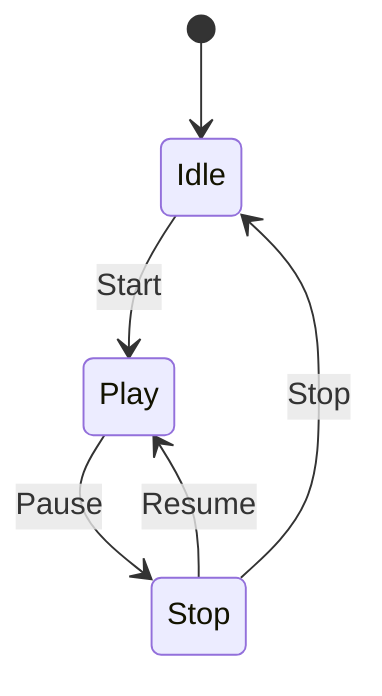

# Advanced Foundation: Beatmaking

## 1. Theoretical Invariants & Formal Frameworks

Beatmaking, at its core, is an intricate amalgamation of rhythm, timing, and digital signal processing (DSP). To delve into the advanced foundation of beatmaking, we must first establish a formal framework that underpins the creation and manipulation of rhythmic patterns and audio signals.

### 1.1 Temporal Invariants

Temporal invariants in beatmaking refer to the consistent and predictable patterns that form the backbone of rhythmic structures. A fundamental invariant is the **isochrony** of beats, which ensures that each beat occurs at a regular interval. Mathematically, this can be expressed as:

\[ t_n = t_0 + n \cdot T \]

where \( t_n \) is the time of the \( n \)-th beat, \( t_0 \) is the initial time, and \( T \) is the beat period.

### 1.2 Harmonic Invariants

Harmonic invariants in beatmaking involve the consistent use of harmonic structures that maintain tonal stability. The **equal temperament** system is a key invariant, where the frequency ratio between any two adjacent notes is the twelfth root of two:

\[ f_n = f_0 \cdot 2^{n/12} \]

This ensures that the interval between any two adjacent notes is consistent across the entire scale.

### 1.3 Formal Proofs in Beatmaking

Formal proofs in beatmaking can be constructed using mathematical logic to verify the consistency and correctness of rhythmic patterns and harmonic structures. For example, proving that a given rhythmic pattern adheres to a specific time signature can be formalized using modular arithmetic:

\[ \sum_{i=1}^{N} r_i \equiv 0 \pmod{M} \]

where \( r_i \) represents the rhythmic value of the \( i \)-th note, \( N \) is the total number of notes, and \( M \) is the number of beats in the measure.

## 2. Low-Level Invariant Taxonomy

Understanding the low-level invariants in beatmaking is crucial for optimizing performance and ensuring consistency across different hardware and software platforms.

### 2.1 Deep Registers & Memory Models

In digital audio workstations (DAWs) and beatmaking software, deep registers and memory models play a critical role in managing audio data. The **Nyquist-Shannon sampling theorem** is a fundamental invariant that dictates the minimum sampling rate required to accurately represent an audio signal:

\[ f_s > 2 \cdot f_{max} \]

where \( f_s \) is the sampling rate and \( f_{max} \) is the maximum frequency component of the audio signal.

### 2.2 Hardware Constraints

Hardware constraints, such as CPU and memory limitations, impose invariants on the performance of beatmaking software. For instance, the **cache coherence** invariant ensures that data stored in CPU caches is consistent with main memory, preventing race conditions and data corruption.

### 2.3 Axiomatic Definitions

Axiomatic definitions provide a formal basis for understanding the fundamental concepts in beatmaking. For example, the **axiom of rhythm** can be defined as the consistent and periodic repetition of sound events:

\[ \forall t \in \mathbb{R}, \exists n \in \mathbb{Z} \text{ such that } t = t_0 + n \cdot T \]

## 3. Micro-Architecture & Concurrency Dynamics

Exploring the micro-architecture and concurrency dynamics of beatmaking software reveals the intricate mechanisms that enable real-time audio processing and pattern generation.

### 3.1 State Machines & Cache Diagrams

State machines are used to model the behavior of beatmaking software, capturing the transitions between different states (e.g., play, stop, record). A simple state machine for a beatmaker might be represented using Mermaid syntax:



Cache diagrams illustrate the flow of data between different levels of memory, optimizing performance by reducing latency. A cache diagram for a beatmaker might be represented using ASCII art:

```
+-------------------+
|       CPU         |
+-------------------+
|  L1 Cache         |
+-------------------+
|  L2 Cache         |
+-------------------+
|  Main Memory      |
+-------------------+
```

### 3.2 Concurrency & Race Conditions

Concurrency dynamics in beatmaking software involve the simultaneous execution of multiple threads or processes. Race conditions can occur when multiple threads access shared resources, leading to inconsistent or unpredictable behavior. To prevent race conditions, synchronization mechanisms such as locks and semaphores are used.

## 4. Subtle Failure Modes & Boundary Conditions

Identifying subtle failure modes and boundary conditions is essential for ensuring the robustness and reliability of beatmaking software.

### 4.1 Quantization Errors

Quantization errors occur when analog audio signals are converted to digital form, leading to loss of precision. The **quantization noise** can be minimized by using higher bit depths and oversampling techniques.

### 4.2 Buffer Overflows

Buffer overflows can occur when audio data exceeds the allocated memory buffer, leading to data corruption or system crashes. To prevent buffer overflows, proper memory management techniques such as dynamic memory allocation and buffer size validation are used.

### 4.3 Edge Cases

Edge cases in beatmaking software involve extreme or unusual scenarios that can challenge the system's performance and reliability. For example, generating extremely high or low frequencies, or processing audio signals with extreme dynamic ranges, can reveal subtle failure modes and boundary conditions.

## 5. Master Socratic Inquiries

Master Socratic inquiries are research-grade discussion questions that encourage deep reflection and critical thinking about the theoretical and practical aspects of beatmaking.

### 5.1 Theoretical Invariants

- How can formal proofs be used to verify the consistency and correctness of rhythmic patterns and harmonic structures in beatmaking?
- What are the implications of the Nyquist-Shannon sampling theorem for the design and implementation of digital audio workstations?

### 5.2 Low-Level Invariants

- How do hardware constraints, such as CPU and memory limitations, impact the performance and reliability of beatmaking software?
- What are the implications of cache coherence invariants for optimizing real-time audio processing and pattern generation?

### 5.3 Micro-Architecture & Concurrency Dynamics

- How can state machines and cache diagrams be used to model and optimize the behavior of beatmaking software?
- What are the implications of concurrency dynamics and race conditions for ensuring the robustness and reliability of beatmaking software?

### 5.4 Subtle Failure Modes & Boundary Conditions

- How can quantization errors be minimized in digital audio workstations?
- What are the implications of buffer overflows and edge cases for the design and implementation of beatmaking software?

By exploring these advanced foundational concepts, staff engineers, security researchers, and theoretical specialists can gain a deeper understanding of the intricate mechanisms that underpin beatmaking, enabling them to design and implement robust, reliable, and high-performance beatmaking software.
