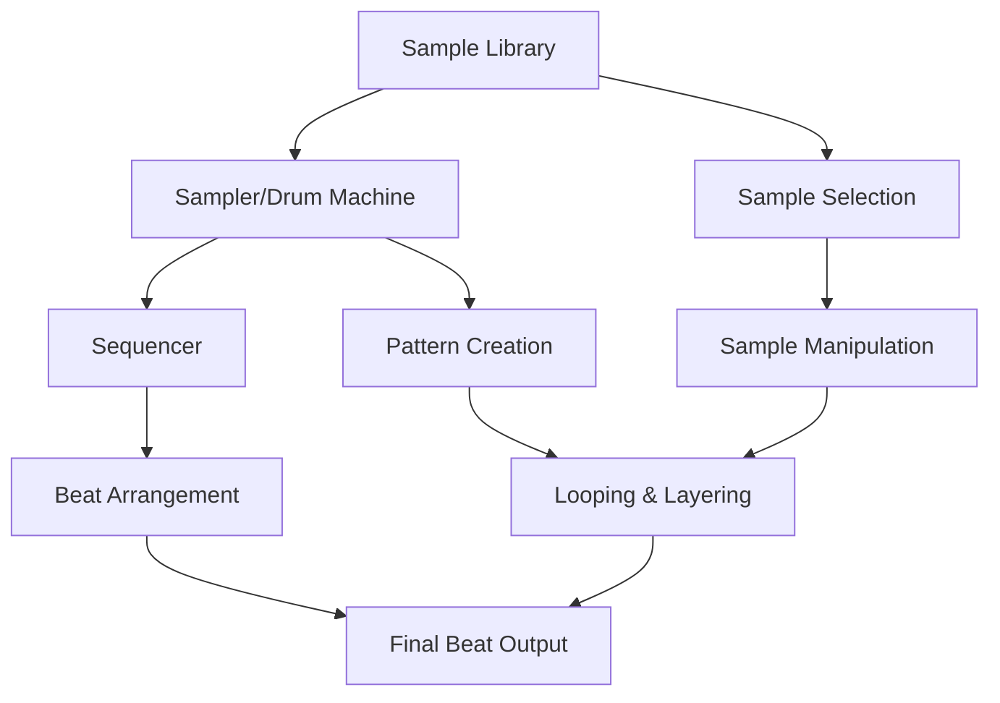

# Beginner Foundation: Beatmaking

## 1. Everyday Intuition & First Principles

Beatmaking is the art of creating rhythmic patterns and grooves that form the backbone of much of modern music, from hip-hop to electronic dance music. Imagine you're a chef in a kitchen, and instead of ingredients, you have sounds. Just as a chef combines different ingredients to create a dish, a beatmaker combines different sounds to create a beat. This beat serves as the foundation upon which melodies and lyrics are built, much like how a strong base is essential for a skyscraper.

## 2. Foundational Vocabulary & Glossary

### 1. **Beat**: A rhythmic pattern or groove that forms the foundation of a song. Think of it as the heartbeat of the music.
   - **Example**: The classic "four-on-the-floor" kick drum pattern in house music.

### 2. **Sample**: A short audio clip that can be manipulated and used in a beat. Samples can be from any source, such as drum hits, vocal snippets, or even environmental sounds.
   - **Example**: A snare drum hit from a classic funk record.

### 3. **Drum Machine**: An electronic instrument that produces drum sounds and can be programmed to play rhythmic patterns. Drum machines are the backbone of beatmaking.
   - **Example**: The Roland TR-808, known for its deep, punchy bass drum sound.

### 4. **Sampler**: An electronic instrument that can record and play back audio samples. Samplers allow for the creation of unique sounds by manipulating existing recordings.
   - **Example**: The Akai MPC, which is widely used in hip-hop and electronic music.

### 5. **Sequencer**: A device or software that allows you to program and control the timing and order of musical events, such as drum hits or sample playback.
   - **Example**: The step sequencer on a drum machine or a software sequencer like Ableton Live.

### 6. **Loop**: A section of audio that repeats continuously. Loops are the building blocks of beats and can be created from samples or generated by drum machines.
   - **Example**: A 16-bar loop of a bassline that repeats throughout a song.

### 7. **MIDI**: Musical Instrument Digital Interface, a protocol that allows electronic musical instruments to communicate with each other. MIDI can be used to control drum machines, samplers, and other electronic instruments.
   - **Example**: Using a MIDI controller to trigger drum sounds on a sampler.

### 8. **DAW (Digital Audio Workstation)**: Software used for recording, editing, and producing audio. DAWs provide a comprehensive environment for beatmaking, allowing you to manipulate samples, program sequences, and mix tracks.
   - **Example**: Ableton Live, FL Studio, and Logic Pro are popular DAWs used for beatmaking.

## 3. Visual System Flow

### ASCII Diagram

```
+-------------------+       +-------------------+       +-------------------+
|   Sample Library  |  ---> |     Sampler/      |  ---> |     Sequencer     |
|                   |       |   Drum Machine    |       |                   |
+-------------------+       +-------------------+       +-------------------+
          |                                   |                                   |
          v                                   v                                   v
+-------------------+       +-------------------+       +-------------------+
|  Sample Selection |  ---> |  Pattern Creation |  ---> |  Beat Arrangement |
|                   |       |                   |       |                   |
+-------------------+       +-------------------+       +-------------------+
          |                                   |                                   |
          v                                   v                                   v
+-------------------+       +-------------------+       +-------------------+
|  Sample Manipulation|  ---> |  Looping & Layering|  ---> |  Final Beat Output|
|                   |       |                   |       |                   |
+-------------------+       +-------------------+       +-------------------+
```

### Mermaid Flowchart



## 4. Common Beginner Misconceptions & Mental Traps

### 1. **Misconception**: Beatmaking is only about using drum machines.
   - **Reality**: While drum machines are a crucial tool, beatmaking can also involve samplers, synthesizers, and even acoustic instruments. The key is creating rhythmic patterns that drive the music.

### 2. **Misconception**: You need expensive equipment to make beats.
   - **Reality**: Many beatmakers start with affordable equipment or even free software. The focus should be on developing your skills and creativity rather than spending a lot of money.

### 3. **Misconception**: Beatmaking is all about copying other people's beats.
   - **Reality**: While it's important to learn from others, true beatmaking involves developing your own unique style. Experiment with different sounds and patterns to create something original.

### 4. **Misconception**: You need to be a great drummer to make beats.
   - **Reality**: While understanding rhythm and timing is important, beatmaking is more about programming and arranging sounds than being a drummer. Many beatmakers are not traditional drummers.

## 5. Socratic Discussion Starters

### 1. **What is the difference between a sample and a loop in beatmaking?**
   - **Explore**: How do you choose which samples to use and how to loop them effectively?

### 2. **How does a drum machine differ from a sampler?**
   - **Explore**: What are the advantages and disadvantages of each?

### 3. **What role does the sequencer play in beatmaking?**
   - **Explore**: How do you use a sequencer to create complex rhythmic patterns?

### 4. **How can you manipulate samples to create unique sounds?**
   - **Explore**: What techniques do you use to alter samples and add character to your beats?

### 5. **What is the importance of timing and rhythm in beatmaking?**
   - **Explore**: How do you ensure that your beats have a strong, consistent rhythm?

### 6. **How do you balance different elements in a beat, such as bass, snare, and hi-hat?**
   - **Explore**: What techniques do you use to create a well-rounded and dynamic beat?

By understanding these foundational concepts and exploring these questions, you'll build a strong intuitive understanding of beatmaking and be well on your way to creating your own unique beats.
