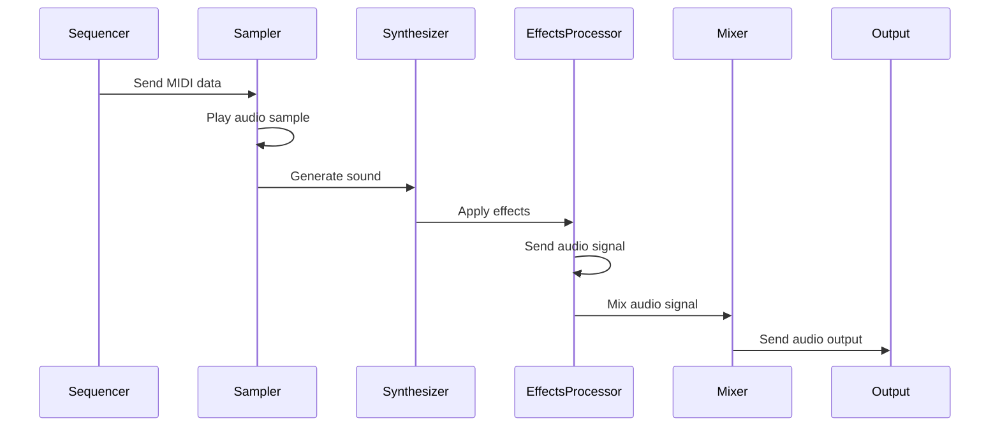

# Intermediate Foundation: Beatmaking

## 1. Architectural Mental Model

Beatmaking, at its core, is the art of constructing rhythmic patterns and musical compositions using digital audio workstations (DAWs) and various software and hardware tools. To build a robust beatmaking system, it is essential to understand the underlying architectural principles that govern the interaction between different components. This section assumes a foundational understanding of basic beatmaking concepts and delves into the more intricate aspects of production architecture.

### 1.1. Modular Design Philosophy

A modular design philosophy is fundamental to effective beatmaking. This approach involves breaking down the production process into distinct, manageable components that can be independently developed, tested, and integrated. The primary modules in a beatmaking system typically include:

- **Sequencer:** Responsible for generating and controlling rhythmic patterns and MIDI data.
- **Sampler:** Handles the playback of audio samples and loops.
- **Synthesizer:** Generates electronic sounds using various synthesis techniques.
- **Effects Processor:** Applies audio effects to enhance the sound.
- **Mixer:** Manages the routing and mixing of audio signals.
- **Controller:** Provides a physical interface for controlling various parameters in real-time.

### 1.2. Data Flow and Signal Processing

Understanding the data flow and signal processing pipeline is crucial for designing an efficient beatmaking system. The typical data flow in a beatmaking system can be described as follows:

1. **Input:** MIDI data from a controller or sequencer, audio samples, and synthesizer parameters.
2. **Processing:** Sequencer generates rhythmic patterns, sampler plays back audio samples, synthesizer generates electronic sounds, and effects processor applies audio effects.
3. **Output:** Mixed audio signal sent to the speakers or headphones.

### 1.3. Real-Time Performance and Latency

Real-time performance is a critical aspect of beatmaking, especially when working with live performances or collaborative sessions. Latency, the delay between an input and its corresponding output, can significantly impact the overall user experience. To minimize latency, it is essential to optimize the signal processing pipeline and use efficient algorithms.

## 2. Systems Taxonomy & Component Protocols

A well-designed beatmaking system relies on standard interfaces, protocols, and data models to ensure interoperability between different components. This section explores the key protocols and data models used in beatmaking systems.

### 2.1. MIDI Protocol

MIDI (Musical Instrument Digital Interface) is a widely used protocol for controlling electronic musical instruments and software synthesizers. It allows for the transmission of control signals, such as note on/off messages, velocity, and controller data, between different devices. MIDI is essential for sequencing and controlling synthesizers and samplers in a beatmaking system.

### 2.2. Audio Formats

Audio formats are used to store and transmit audio data in a beatmaking system. Common audio formats include:

- **WAV:** A lossless audio format that supports high-quality audio with minimal compression.
- **AIFF:** Another lossless audio format, similar to WAV, used primarily on Apple platforms.
- **FLAC:** A lossless audio format that provides high-quality audio with better compression than WAV and AIFF.
- **MP3:** A lossy audio format that provides compressed audio with reduced file sizes at the cost of some audio quality.
- **AAC:** A lossy audio format used in Apple devices and streaming services, offering better compression than MP3 with similar audio quality.

### 2.3. Digital Audio Workstations (DAWs)

DAWs are software applications used for recording, editing, and producing audio. Some popular DAWs used in beatmaking include:

- **Ableton Live:** A popular DAW known for its live performance capabilities and intuitive interface.
- **FL Studio:** A DAW specifically designed for beatmaking and electronic music production.
- **Logic Pro:** A DAW used by professional musicians and producers, offering a wide range of features and plugins.
- **Avid Pro Tools:** A DAW used in professional audio production, known for its stability and reliability.

### 2.4. Plugin Standards

Plugins are software modules that extend the functionality of a DAW. Common plugin standards used in beatmaking include:

- **VST (Virtual Studio Technology):** A plugin standard developed by Steinberg, widely used in Windows and Mac platforms.
- **AU (Audio Units):** A plugin standard developed by Apple, used primarily on Mac platforms.
- **RTAS (Real-Time Audio Suite):** A plugin standard developed by Digidesign, used in Pro Tools.
- **LV2:** A plugin standard designed for Linux, offering a flexible and extensible architecture.

## 3. Multi-Component Interaction Flow

Understanding the interaction flow between different components in a beatmaking system is essential for designing an efficient and effective production pipeline. This section provides detailed ASCII and Mermaid sequence diagrams to illustrate the interaction flow.

### 3.1. ASCII Sequence Diagram

```
+----------------+          +----------------+          +----------------+          +----------------+
|    Sequencer   |          |     Sampler    |          |   Synthesizer  |          | Effects Processor|
+----------------+          +----------------+          +----------------+          +----------------+
          |                           |                           |                           |
          |  Send MIDI data           |                           |                           |
          |-------------------------->|                           |                           |
          |                           |  Play audio sample        |                           |
          |                           |<--------------------------|                           |
          |                           |                           |  Generate sound           |
          |                           |                           |-------------------------->|
          |                           |                           |                           |  Apply effects
          |                           |                           |                           |-------------------------->|
          |                           |                           |                           |  Send audio signal
          |                           |                           |                           |-------------------------->|
          |                           |                           |                           |  Mix audio signal
          |                           |                           |                           |-------------------------->|
          |                           |                           |                           |  Send audio output
          |                           |                           |                           |-------------------------->|
```

### 3.2. Mermaid Sequence Diagram



## 4. Architectural Trade-offs & Production Pitfalls

Designing an efficient and effective beatmaking system involves making architectural trade-offs and avoiding common production pitfalls. This section explores some of the key trade-offs and pitfalls to consider.

### 4.1. Trade-offs

- **Performance vs. Quality:** Balancing real-time performance and audio quality is a critical trade-off in beatmaking. Higher audio quality may require more processing power and memory, which can impact real-time performance.
- **Modularity vs. Integration:** A modular design philosophy allows for greater flexibility and customization but may require more effort to integrate different components. A more integrated design may offer better performance and ease of use but may be less flexible.
- **Scalability vs. Complexity:** Designing a scalable system that can handle a large number of components and users may require more complex architecture and increased development effort. A simpler architecture may be easier to develop and maintain but may not be scalable.

### 4.2. Production Pitfalls

- **Latency:** High latency can significantly impact the user experience in real-time performance scenarios. To minimize latency, it is essential to optimize the signal processing pipeline and use efficient algorithms.
- **Compatibility:** Ensuring compatibility between different components and platforms is crucial for a robust beatmaking system. Using standard interfaces, protocols, and data models can help ensure compatibility.
- **Performance:** Designing an efficient and effective beatmaking system requires careful consideration of performance. Balancing real-time performance and audio quality is a critical trade-off in beatmaking.

## 5. Socratic Discussion Starters

Socratic discussion starters are questions that bridge architecture to low-level implementation, encouraging critical thinking and exploration. This section provides some discussion starters to facilitate deeper understanding and exploration of beatmaking architecture.

### 5.1. Sequencer Design

- How can a sequencer be designed to support complex rhythmic patterns and polyrhythms?
- What are the trade-offs between a step-based sequencer and a pattern-based sequencer?
- How can a sequencer be designed to support real-time performance and collaboration?

### 5.2. Sampler Design

- What are the key considerations for designing a sampler that supports a wide range of audio formats and sample rates?
- How can a sampler be designed to support real-time sample manipulation and effects processing?
- What are the trade-offs between a hardware sampler and a software sampler?

### 5.3. Synthesizer Design

- What are the key considerations for designing a synthesizer that supports a wide range of synthesis techniques, such as subtractive, additive, and FM synthesis?
- How can a synthesizer be designed to support real-time parameter modulation and effects processing?
- What are the trade-offs between a hardware synthesizer and a software synthesizer?

### 5.4. Effects Processor Design

- What are the key considerations for designing an effects processor that supports a wide range of audio effects, such as reverb, delay, and distortion?
- How can an effects processor be designed to support real-time parameter modulation and automation?
- What are the trade-offs between a hardware effects processor and a software effects processor?

### 5.5. Mixer Design

- What are the key considerations for designing a mixer that supports a wide range of audio channels and buses?
- How can a mixer be designed to support real-time automation and parameter modulation?
- What are the trade-offs between a hardware mixer and a software mixer?

### 5.6. Controller Design

- What are the key considerations for designing a controller that supports a wide range of input devices, such as MIDI controllers, drum pads, and touchscreens?
- How can a controller be designed to support real-time parameter modulation and automation?
- What are the trade-offs between a hardware controller and a software controller?

By exploring these discussion starters, engineers and practitioners can gain a deeper understanding of the architectural principles and design considerations involved in beatmaking. This knowledge can help them design more efficient, effective, and scalable beatmaking systems.
