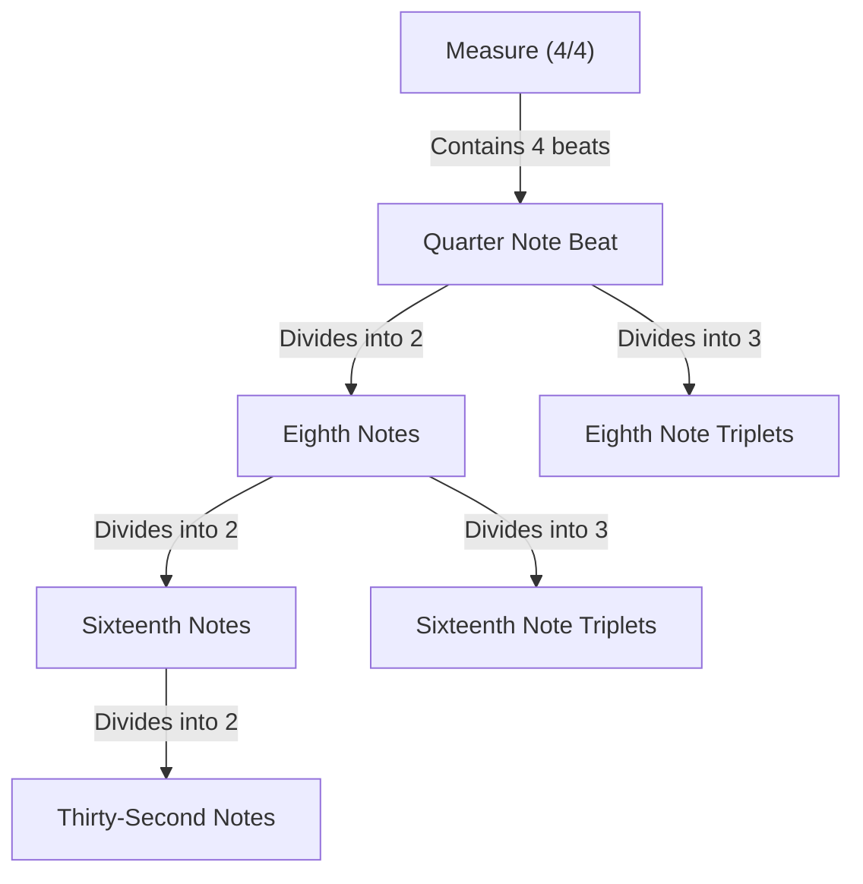
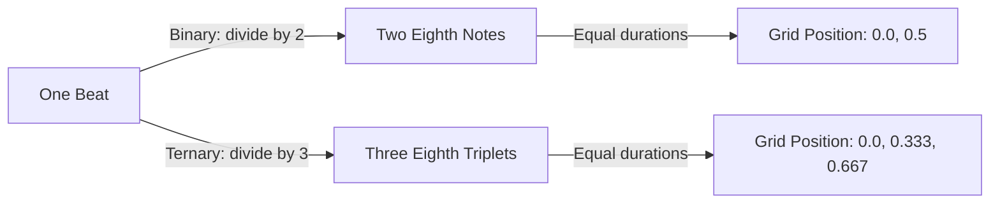
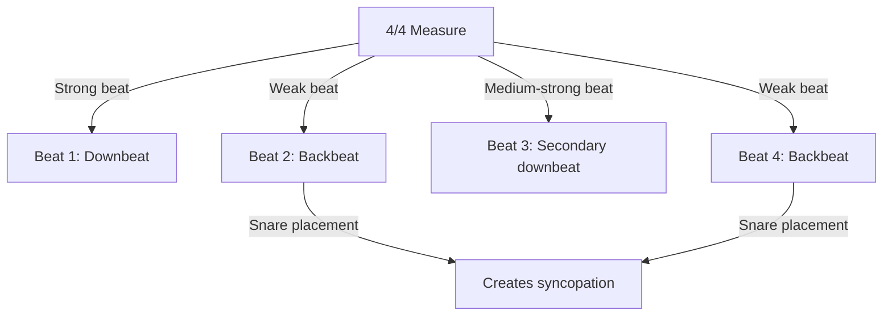
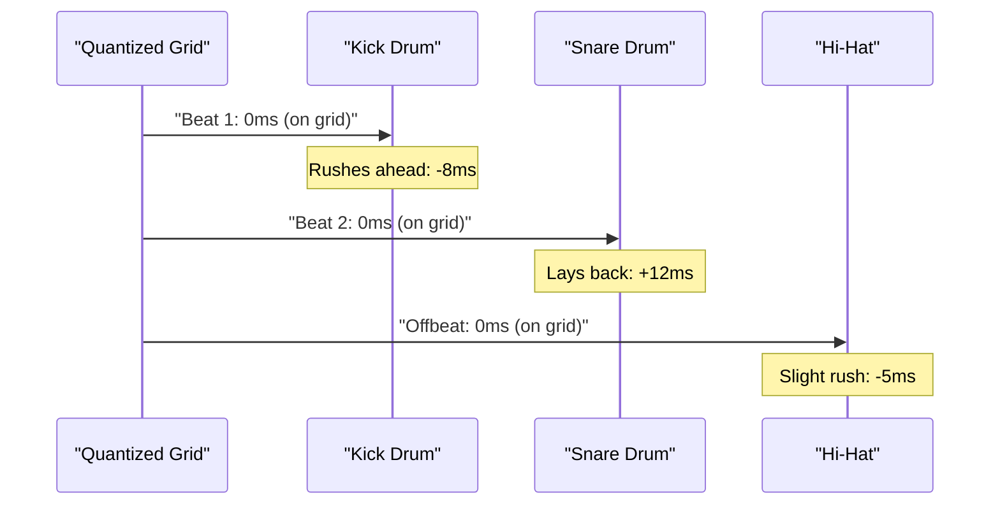
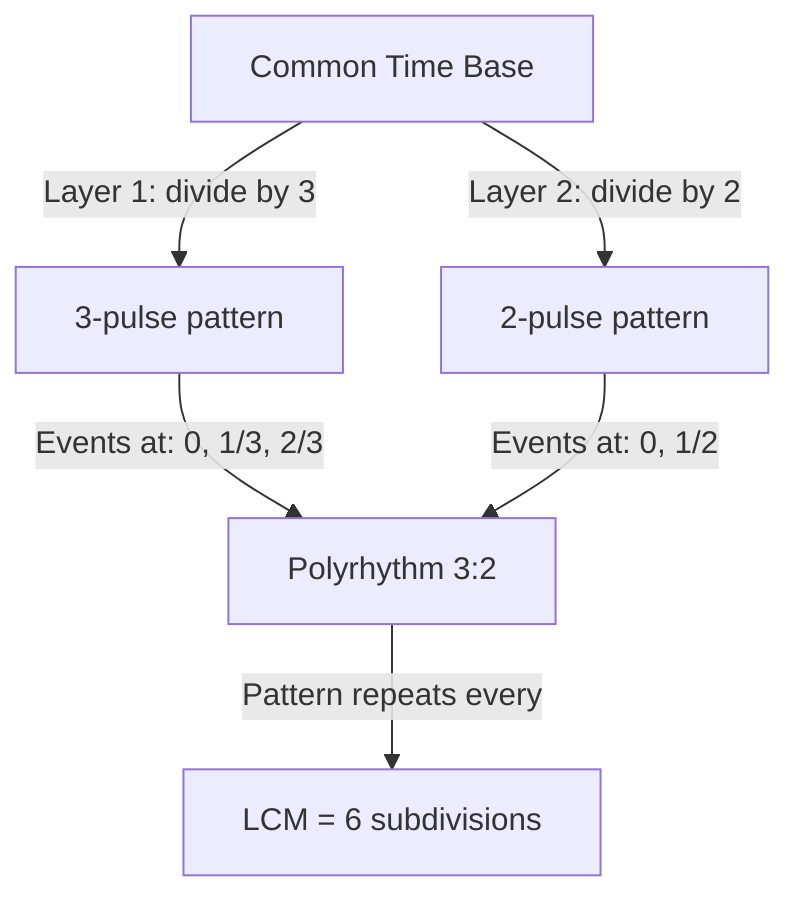

# Lesson 1: Rhythm Structure, Timing Fundamentals, Groove Mechanics

## First-Principles Intuition & Invariants

Rhythm is the skeletal architecture upon which all musical meaning is constructed. Where melody and harmony provide emotional color and tonal direction, rhythm alone determines whether a listener's body will move, whether a groove will lock into physical entrainment, and whether a beat will feel alive or sterile. The craft of beatmaking demands intimate mastery of temporal organization at multiple hierarchical scales simultaneously: from the macro-level placement of downbeats and phrase boundaries, through mid-level syncopation and polyrhythmic interplay, down to the micro-level variations in note onset timing that separate a quantized grid from a living, breathing performance.

At its foundation, rhythm emerges from the human perception of periodic recurrence. Our neurological systems are extraordinarily sensitive to patterns that repeat with predictable periodicity, and we derive profound satisfaction from both the confirmation of expected events and the strategic violation of those expectations. This dual nature—the interplay between predictability and surprise—forms the bedrock of groove construction. A beat that adheres too rigidly to perfect mathematical periodicity feels mechanical and lifeless, devoid of the subtle temporal fluctuations that characterize human performance. Conversely, a beat with excessive temporal chaos loses its anchor, failing to establish the predictable framework against which syncopation and microtiming variations derive their expressive power.

## Temporal Hierarchies and Metrical Organization

The Western music notation system encodes rhythm through a hierarchical tree of nested subdivisions, beginning with the measure as the fundamental container. Each measure is governed by a time signature, expressed as a fraction where the numerator indicates the count of beats per measure and the denominator specifies the note value receiving one beat. The ubiquitous 4/4 time signature—four quarter-note beats per measure—dominates contemporary popular music production because it aligns naturally with human walking gait and breathing cycles, establishing a stable framework for both creators and listeners. However, time signatures exist across a vast continuum: 3/4 provides the waltz's lilting character through its asymmetric grouping, 6/8 creates compound duple meter through two groups of three eighth-notes, and more exotic signatures like 5/4 or 7/8 generate rhythmic tension through their resistance to even subdivision.

Subdivision hierarchy extends downward from the beat level through increasingly fine temporal grids. A quarter note divides into two eighth notes, which further subdivide into four sixteenth notes, then eight thirty-second notes, and theoretically onward into thirty-second note triplets, sixty-fourth notes, and beyond, though practical musical application rarely extends past thirty-second note resolution. Each subdivision level introduces new rhythmic vocabulary: eighth notes enable basic offbeat syncopation, sixteenth notes unlock the rapid-fire hi-hat patterns characteristic of trap and drill production, and thirty-second notes facilitate the intricate rolls and ghost notes that give a drum pattern texture and depth.

The mathematical relationship between subdivision levels follows a strict binary or ternary branching structure. In binary subdivision, each level represents a doubling of temporal resolution: if one quarter note equals $T$ milliseconds at a given tempo, then eighth notes occupy $T/2$ milliseconds, sixteenth notes occupy $T/4$ milliseconds, and thirty-second notes occupy $T/8$ milliseconds. At 120 BPM, a quarter note spans 500ms, yielding eighth notes at 250ms intervals, sixteenth notes at 125ms intervals, and thirty-second notes at 62.5ms intervals. This exponential relationship means that as subdivision density increases arithmetically, the absolute timing precision required increases geometrically, placing severe demands on both human performers and digital sequencing systems.

## Binary and Ternary Subdivision Systems

Triplet subdivisions overlay an alternative mathematical framework atop the binary subdivision grid, dividing each beat into three equal parts rather than two. This ternary division creates fundamentally different rhythmic feels: while straight sixteenth notes generate a mechanical, driving quality perfect for techno and industrial styles, sixteenth-note triplets introduce a rolling, tumbling quality often heard in contemporary R&B and neo-soul production. The interplay between binary and ternary grids within a single composition generates polyrhythmic complexity, a technique exploited extensively in Afro-Cuban music traditions where 3-against-2 and 3-against-4 cross-rhythms create hypnotic, interlocking patterns.

The ratio between binary and ternary subdivision establishes a fundamental mathematical constant in groove construction. A quarter note triplet occupies $2/3$ of a quarter note's duration, meaning three triplet eighth notes span the same time as two straight eighth notes. This 3:2 ratio appears throughout African diasporic music as a foundational polyrhythmic cell, manifesting in son clave patterns, Brazilian samba rhythms, and the swing eighth notes of jazz and blues. When binary and ternary grids coexist in a single arrangement—a straight kick and snare pattern layered with triplet hi-hats, for instance—the resulting cross-rhythm generates perceptual ambiguity that propels groove forward through metric tension and resolution.

## Swing Quantization and Groove Templates

Swing quantization represents a controlled deviation from perfect binary subdivision, systematically delaying every second subdivision event to create a loping, laid-back feel. Rather than placing eighth notes at mathematically precise 50-50 divisions of each quarter note, swing pushes the offbeat eighth note later in time, typically somewhere between 54% and 67% of the beat duration depending on swing intensity. This transformation converts straight eighth notes into unequal eighth-note pairs that approach but never quite reach triplet proportions. The swing percentage parameter provides continuous control over this timing shift: 50% produces perfectly straight quantization, 66.67% creates full triplet swing approaching shuffle feel, and intermediate values like 58-62% deliver the subtle lift characteristic of jazz, hip-hop, and lo-fi production.

The mathematical formulation of swing timing proceeds as follows: given a beat duration $T$ and swing percentage $S$ expressed as a decimal between 0.5 and 1.0, the first eighth note of each pair occurs at time $t_1 = 0$ and the second at time $t_2 = S \cdot T$. At 50% swing ($S = 0.5$), we recover straight quantization with $t_2 = 0.5T$. At 66.67% swing ($S = 0.667$), the second eighth note aligns with the third position of an eighth-note triplet grid, producing $t_2 = 0.667T$. Intermediate swing values interpolate smoothly between these extremes, with 58-60% representing the "medium swing" setting found in most digital audio workstations and 62-64% delivering the pronounced lope of classic boom-bap hip-hop production.

Modern production workflows extend swing quantization through groove templates that encode complex microtiming patterns derived from sampled performances. Rather than applying a single percentage shift to all offbeat events uniformly, groove templates specify individual timing offsets for each subdivision position across multiple beats, capturing the idiosyncratic rhythm fingerprint of specific drummers or drum machines. The Akai MPC swing algorithm, for instance, applies asymmetric timing shifts that vary with subdivision density: sixteenth-note offbeats receive more aggressive delays than eighth-note offbeats, creating a cascading ripple of syncopation that distinguishes J Dilla's production aesthetic from earlier jazz and funk swing conventions.

## Syncopation and Metrical Displacement

Syncopation emerges when note onsets occupy positions that conflict with the prevailing metrical hierarchy, emphasizing weak beats and subdivision positions while leaving strong beats silent or understated. In 4/4 time, beats one and three carry primary metrical weight, with beat three holding secondary emphasis. Syncopation inverts this hierarchy by placing accents on beats two and four—the backbeat that defines rock, funk, and most contemporary popular music—or on offbeat eighth-note and sixteenth-note positions. The strategic deployment of syncopation creates rhythmic momentum and surprise, preventing the predictable thud of four-on-the-floor kick drums from becoming soporific.

The degree of syncopation intensity correlates with the magnitude of metrical displacement. Placing accents on beat two and four produces mild syncopation, as these positions still align with quarter-note grid points despite their metrical weakness. Shifting accents to the "and" of each beat—the offbeat eighth-note positions—generates moderate syncopation by occupying half-beat subdivisions. Emphasizing sixteenth-note positions between the primary and offbeat eighth notes creates aggressive syncopation, especially when these accents occur immediately before strong beats, generating anticipatory rhythmic figures that pull the listener's attention forward in time. This principle of metric anticipation underlies the characteristic rhythmic vocabulary of reggaeton, dembow, and UK garage, where kick and snare hits consistently precede expected downbeat positions by a sixteenth note, creating propulsive forward drive.

Syncopation also manifests through silence and rhythmic omission. A rest placed on a strong beat position carries equal rhythmic weight to an articulated note on a weak position, as the violation of metrical expectation occurs through absence rather than presence. James Brown's funk grooves exploit this principle extensively: the legendary "Funky Drummer" break features a one-beat kick pattern that lands exclusively on beat one of alternating measures, leaving beats three conspicuously empty and forcing the snare backbeat and hi-hat syncopation to shoulder the rhythmic momentum. This technique of strategic omission generates a sense of space and tension that dense, continuously articulated patterns cannot achieve.

## Microtiming and Humanization

Microtiming refers to the systematic or expressive deviation of note onsets from their quantized grid positions by small time intervals, typically in the range of 5 to 50 milliseconds. Human instrumentalists never perform with machine-perfect timing; their note placements fluctuate naturally around the intended beat positions, and these minute variations contribute enormously to the perceived humanness and groove quality of a performance. Drummers consistently rush or drag certain elements relative to others: kick drums often sit slightly ahead of the beat to drive momentum forward, snares may lay fractionally behind to create weight and pocket, and hi-hats can occupy any position in this continuum depending on the intended feel.

Research in music perception has established that microtiming variations within the 10-30ms range enhance groove perception without disrupting temporal coherence. Deviations smaller than 10ms fall below the perceptual threshold for most listeners in typical musical contexts, producing no discernible effect on groove character. Deviations exceeding 50ms begin to register as timing errors rather than expressive variations, disrupting the sense of ensemble cohesion and making the performance sound sloppy rather than human. The optimal range for humanization processing thus centers on 15-25ms variations, with the magnitude and direction of deviation varying systematically with instrument role and rhythmic function.

Contemporary digital audio workstations provide groove templates that systematically apply these microtiming offsets, encoding the timing fingerprint of legendary drummers like J Dilla, whose signature MPC swing became synonymous with neo-soul and underground hip-hop production. These templates capture not only the swing percentage but also the instrument-specific timing relationships: Dilla's grooves characteristically feature kick drums rushing by 15-20ms, snares dragging by 10-15ms, and hi-hats exhibiting high temporal variance with standard deviations of 20-30ms. This combination of swing quantization and microtiming offset creates the liquid, slightly intoxicated feel that distinguishes organic groove from mechanical quantization.

The implementation of microtiming in production workflows proceeds through several technical approaches. Manual nudging allows producers to select individual MIDI notes or audio regions and shift their timeline positions by precise millisecond values, providing complete control at the cost of tedious note-by-note editing. Groove templates offer a more efficient workflow, applying predefined microtiming patterns across entire MIDI performances with a single command. Randomization algorithms introduce controlled timing variance by adding random offsets drawn from specified probability distributions, with Gaussian distributions centered at zero and standard deviations of 10-20ms producing natural-sounding humanization. Advanced implementations combine these approaches, applying groove templates as a foundation while layering instrument-specific randomization to prevent the mechanical repetition that occurs when identical groove patterns repeat across multiple measures.

## Perceptual Thresholds and Temporal Resolution

The perceptual threshold for rhythmic discrimination varies with context and musical density. In sparse arrangements with minimal concurrent elements, listeners detect timing deviations as small as 10-15 milliseconds, well within the temporal resolution of professional audio interfaces operating at 48kHz sample rate, which provides approximately 0.021ms precision per sample. However, in dense productions with multiple overlapping percussive elements, masking effects raise the discrimination threshold to 20-30ms, as simultaneous transients blur temporal perception and reduce the ear's ability to pinpoint individual onset times. This context-dependent sensitivity has profound implications for production practice: subtle microtiming variations that enhance groove in minimal deep house arrangements may disappear entirely in maximalist trap productions with dense hi-hat rolls and layered percussion.

The Nyquist-Shannon sampling theorem establishes that a digital audio system sampling at frequency $f_s$ can accurately represent timing events with resolution $\Delta t = 1/f_s$. At 48kHz sampling rate, this yields $\Delta t \approx 0.021$ ms, which far exceeds human temporal acuity for rhythm perception. However, sample rate affects not only timing precision but also the accuracy of time-stretching, pitch-shifting, and other digital signal processing operations that manipulate temporal relationships. Low sample rates introduce quantization errors when applying fractional timing shifts, manifesting as subtle artifacts in groove template processing and swing quantization. Professional production standards have thus converged on 48kHz as the minimum acceptable sample rate, with 96kHz and 192kHz rates reserved for archival applications and specialized processing chains where multiple cascaded DSP operations accumulate timing errors.

The just-noticeable difference (JND) for tempo perception sits at approximately 4-6% of the reference tempo for rates between 80-140 BPM, the range encompassing most contemporary popular music. At 120 BPM, this translates to a JND of roughly 5-7 BPM, meaning listeners can reliably distinguish 120 BPM from 127 BPM but may perceive 120 BPM and 123 BPM as equivalent. This perceptual granularity constrains tempo automation and rubato effects: gradual tempo ramps must span at least 5-7 BPM to register as intentional musical gestures rather than phase drift or playback instability. Conversely, the JND for single-event timing within an established tempo context drops to 2-3% of the inter-onset interval, enabling listeners to perceive the subtle pushes and pulls that characterize expressive microtiming.

## Tempo, Pulse, and Temporal Context

Tempo, measured in beats per minute (BPM), establishes the fundamental rate of pulse recurrence and determines the absolute duration of all rhythmic subdivisions. The relationship between tempo and subdivision duration follows inverse proportion: doubling the tempo halves the duration of each subdivision level. At 60 BPM, a quarter note spans exactly one second (1000ms), eighth notes span 500ms, and sixteenth notes span 250ms. At 120 BPM, these durations halve to 500ms, 250ms, and 125ms respectively. At 240 BPM, they halve again to 250ms, 125ms, and 62.5ms. This inverse relationship means that as tempo increases, the producer's ability to manually place notes with precision decreases, as the temporal spacing between adjacent grid positions shrinks below the motor control threshold for precise timing adjustments.

The tempo range from 60-80 BPM characterizes downtempo genres including trip-hop, chillwave, and lo-fi hip-hop, providing ample temporal space between beats for complex microtiming variations and extended decay tails on reverb and delay effects. The 80-100 BPM range encompasses boom-bap hip-hop, reggae, and dub, offering a relaxed but forward-moving pulse. The 100-120 BPM zone serves as the harmonic mean of popular music, hosting house, funk, disco, and pop production, while 120-140 BPM accelerates into techno, trance, and uptempo EDM territory. Above 140 BPM, genres fragment into specialized high-energy categories: drum and bass operates at 160-180 BPM with half-time drum patterns that create perceived tempos of 80-90 BPM, jungle pushes to 170-180 BPM with breakbeat complexity, and gabber and hardcore techno exceed 180 BPM, approaching the upper limits of human rhythmic perception.

Tempo also interacts with harmonic rhythm—the rate at which chord changes occur—to establish phrase-level temporal structure. In most popular music, harmonic changes align with measure boundaries, creating four-bar and eight-bar hypermeter that organizes musical form into verses, choruses, and bridges. At 120 BPM with chord changes every four beats, harmonic rhythm proceeds at a rate of 30 changes per minute, providing sufficient stability for melodic development while maintaining forward momentum. Doubling the rate of harmonic change to every two beats accelerates the sense of progression, while halving it to every eight beats creates expansive, meditative harmonic space characteristic of ambient and drone music.

## Polyrhythm and Cross-Rhythm

Polyrhythm arises when multiple rhythmic layers with different subdivision densities or metrical alignments operate simultaneously, creating complex interference patterns that generate emergent rhythmic structures exceeding the complexity of any individual layer. The simplest polyrhythms involve integer ratios like 3:2, where three equally spaced events in one layer coincide with two equally spaced events in another layer across the same time span. This 3:2 polyrhythm forms the basis of the son clave, a foundational rhythmic cell in Afro-Cuban music that organizes multiple percussion instruments into a coherent ensemble texture. More complex ratios like 5:4, 7:4, and 11:8 generate increasingly intricate interference patterns, though practical musical application rarely extends beyond 5:4 due to the cognitive load imposed on both performers and listeners.

The mathematical analysis of polyrhythm proceeds through least common multiple (LCM) calculations. A 3:2 polyrhythm repeats its full pattern every LCM(3,2) = 6 subdivision units, meaning six is the smallest number of subdivisions that accommodates both a three-event pattern and a two-event pattern without requiring fractional subdivision positions. A 5:4 polyrhythm repeats every LCM(5,4) = 20 subdivisions, creating a much longer pattern cycle before recurrence. This expansion of pattern length with increasing ratio complexity explains why simple polyrhythms like 3:2 feel stable and grounded while complex polyrhythms like 7:5 feel disorienting and unpredictable.

Cross-rhythm refers to a specific subset of polyrhythmic technique where a rhythmic pattern implies a meter or pulse that conflicts with the prevailing time signature. The archetypal cross-rhythm in Western popular music positions three-beat groupings within a 4/4 measure, creating hemiola—a temporary shift from duple to triple subdivision that reverses after one or more measures. Latin music traditions extend this principle through extensive use of 3-2 and 2-3 clave patterns that establish a five-beat rhythmic cycle overlaid atop four-beat measures, generating a two-measure pattern before metric alignment recurs. Electronic music producers exploit cross-rhythm by programming synth arpeggios or melodic sequences with three-note, five-note, or seven-note patterns that drift in and out of phase with the underlying four-beat drum pattern, creating evolving polyrhythmic textures that sustain listener interest across extended mix durations.

## Quantization and Grid Alignment

Quantization is the process of snapping performed or programmed note onsets to the nearest position on a predefined temporal grid, correcting timing imprecision and enforcing metric regularity. In digital audio workstations, quantization operates on MIDI note data by calculating the temporal distance between each note's recorded onset time and the nearest grid position, then shifting the note to align exactly with that position. The quantization grid resolution determines the coarseness of this correction: quarter-note quantization shifts all notes to beat positions, eighth-note quantization permits offbeat placement, and sixteenth-note quantization allows rapid subdivisions. Stronger quantization (coarser grids) produces more aggressive timing correction but destroys expressive microtiming, while weaker quantization (finer grids) preserves more performance nuance but may fail to correct significant timing errors.

Most contemporary DAWs implement adaptive or percentage-based quantization that moves notes only partway toward the quantization grid rather than snapping them completely. A 50% quantize strength moves each note halfway from its original position to the nearest grid point, a 75% strength moves it three-quarters of the distance, and 100% strength performs full hard quantization. This partial quantization preserves a controllable fraction of the original timing variance, allowing producers to tighten loose performances while retaining expressive microtiming. The optimal quantization strength varies with musical style: electronic dance music typically demands 90-100% quantization to achieve the mechanical precision characteristic of the genre, while jazz and neo-soul productions favor 30-50% quantization to maintain organic timing feel.

Iterative quantization represents an alternative approach that repeatedly applies weak quantization across multiple passes rather than executing a single strong quantization operation. Each iteration moves notes a small fraction of the distance toward the grid, gradually tightening timing while avoiding the abrupt snap that characterizes full-strength quantization. This technique proves particularly effective for humanized programming workflows, where the producer intentionally performs with loose timing, then iteratively quantizes across 10-20 passes at 10-20% strength to achieve a final timing that balances precision and humanity. The gradual convergence mimics the way skilled drummers internalize groove through repeated practice, progressively tightening their timing while retaining the fundamental character of their original performance.

## Rhythm and Genre Identity

Rhythm serves as the primary carrier of genre identity in contemporary music production, exceeding the importance of harmonic vocabulary, timbral palette, or melodic structure. The 808 kick and snare pattern of trap music, the shuffled breakbeat of jungle and drum and bass, the four-on-the-floor kick of house and techno, the boom-bap of golden-era hip-hop—each of these rhythmic signatures immediately signals genre affiliation to experienced listeners, often within the first measure of playback. This primacy of rhythm in genre recognition reflects evolutionary neurological priorities: humans evolved acute sensitivity to temporal patterns for survival-critical tasks like coordinating group movement and detecting predator approach, while sensitivity to pitch and timbre developed later and serves less urgent functions.

The construction of genre-appropriate rhythm requires intimate familiarity with the characteristic templates that define each style. House music demands unwavering four-on-the-floor kick placement on every quarter note, with open hi-hats on offbeat eighth notes and closed hi-hats filling sixteenth-note subdivisions, creating the steady, driving pulse optimized for continuous dancing. Trap production centers on rapid hi-hat rolls built from thirty-second-note and sixty-fourth-note triplet subdivisions, punctuated by massive 808 kick drums tuned to the key of the track and extended snare rolls triggered by the half-time snare pattern landing on beat three. Reggaeton relies on the dembow rhythm, a two-measure pattern derived from Shabba Ranks' "Dem Bow" track that establishes a specific sequence of kick and snare hits with characteristic anticipatory sixteenth-note syncopation.

The evolution of rhythmic templates across music history reflects technological innovation and cultural exchange. The quantized perfection of early drum machines like the Roland TR-808 and TR-909 enabled the rigid, machine-like precision of Chicago house and Detroit techno in the 1980s, establishing a rhythmic aesthetic that rejected human timing imprecision in favor of robotic regularity. The Akai MPC sampling workstations of the 1990s introduced the swing and microtiming capabilities that defined boom-bap hip-hop and neo-soul, allowing producers to program beats that retained human groove characteristics despite their electronic origin. Contemporary DAWs synthesize these historical approaches, providing both perfect quantization and sophisticated humanization tools that enable producers to position their work anywhere along the continuum from machine precision to organic looseness.
